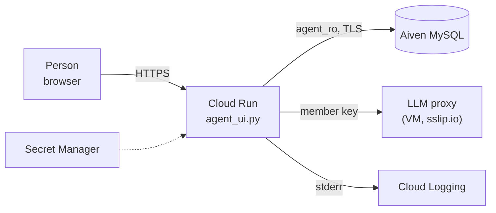

# Deploying the demo page on Google Cloud Run

Runs `scripts/agent_ui.py` (the Streamlit chat page) as a container on Cloud Run, next to
the [LiteLLM budget proxy](README-setup-gcp.md). The database stays on Aiven; the page
talks to it as the read-only `agent_ro` user and to the LLM through the proxy.



Not tested end to end yet: the Dockerfile and the commands below were written, not run.
Build and open it once before relying on it.

## Files

| File | What it is |
|---|---|
| `Dockerfile` | Python 3.12 slim, installs `requirements-app.txt`, copies `scripts/`, starts Streamlit on `$PORT` |
| `requirements-app.txt` | Only what the page needs. **Pin the versions** from your working environment before the demo |
| `.dockerignore` | Keeps `.env`, `data/`, `docs/`, `tests/` and `logs/` out of the image |

The image holds no secrets and no data: settings come from the environment, data from Aiven.

## 0. Get the files into Cloud Shell

`gcloud run deploy --source .` builds whatever is in the current folder, so the files must be
in Cloud Shell first. You need exactly these four things (the `Dockerfile` copies the whole of
`scripts/`; nothing else is needed, and `.dockerignore` keeps the rest out):

```
Dockerfile
.dockerignore            # a hidden file: make sure it is included
requirements-app.txt
scripts/
```

**Option A: the zip, like the proxy kit.** On your computer, from the repo root:

```bash
zip -r jme-agent.zip Dockerfile .dockerignore requirements-app.txt scripts -x "scripts/__pycache__/*"
```

(Windows without `zip`: select those four items in Explorer, Send to, Compressed folder.
Check that `.dockerignore` is in it; hidden files are easy to miss.) Then in Cloud Shell: the
⋮ menu, **Upload**, pick `jme-agent.zip`, and

```bash
mkdir -p jme-agent && unzip -o jme-agent.zip -d jme-agent && cd jme-agent
ls -la Dockerfile .dockerignore requirements-app.txt scripts/agent_ui.py   # all four must exist
```

**Option B: git.** If the team repo is on GitHub and holds the Dockerfile and
`requirements-app.txt` (commit them first): `git clone <repo-url> && cd <repo>`.

**Option C: deploy from your own computer.** If `gcloud` is installed and logged in there, run
section 2 from the repo root on your computer and skip the upload.

Stay in that folder for section 2; the deploy command ends with `--source .`, the current folder.

## 1. One-off setup (Cloud Shell)

```bash
PROJECT=your-project-id
REGION=asia-southeast1                  # same region as the proxy
gcloud config set project $PROJECT
gcloud services enable run.googleapis.com cloudbuild.googleapis.com \
    artifactregistry.googleapis.com secretmanager.googleapis.com

# secrets (printf, so no trailing newline is stored)
printf '%s' 'THE_AGENT_RO_PASSWORD' | gcloud secrets create agent-db-password --data-file=-
printf '%s' 'YOUR_PROXY_MEMBER_KEY'  | gcloud secrets create openai-api-key    --data-file=-
printf '%s' 'A_PAGE_PASSWORD'        | gcloud secrets create app-password      --data-file=-

# let the service read them (default Compute Engine service account)
SA=$(gcloud projects describe $PROJECT --format='value(projectNumber)')-compute@developer.gserviceaccount.com
for s in agent-db-password openai-api-key app-password; do
  gcloud secrets add-iam-policy-binding $s --member=serviceAccount:$SA \
      --role=roles/secretmanager.secretAccessor
done
```

Use the **agent_ro** password, never the owner's (`DB_USERNAME`/`DB_PASSWORD` are not set
on Cloud Run, and `connect()` refuses the owner account anyway).

## 2. Deploy (from the folder with the `Dockerfile`, section 0)

```bash
gcloud run deploy jme-agent --source . --region $REGION \
  --allow-unauthenticated --session-affinity \
  --min-instances 0 --max-instances 1 --memory 1Gi --timeout 600 \
  --set-env-vars "DB_HOST=YOUR-SERVICE.aivencloud.com,DB_PORT=12345,DB_NAME=defaultdb,AGENT_DB_USERNAME=agent_ro,OPENAI_BASE_URL=https://35-240-177-226.sslip.io" \
  --set-secrets "AGENT_DB_PASSWORD=agent-db-password:latest,OPENAI_API_KEY=openai-api-key:latest,APP_PASSWORD=app-password:latest"
```

Fill in the Aiven host, port and database name. `--allow-unauthenticated` makes the URL
public, so **`APP_PASSWORD` is what protects it**: the page shows a password box first and
nothing connects until it's right. To make it private to Google accounts instead, deploy with
`--no-allow-unauthenticated`, grant `roles/run.invoker` to each person, and open it with
`gcloud run services proxy jme-agent --region $REGION` (each viewer needs `gcloud`).

`--max-instances 1 --session-affinity` keeps one container and one conversation per browser
(Streamlit uses a websocket and keeps each session's state in memory).

## 3. Before the demo

- Open the URL a few minutes early: with `--min-instances 0` the first load after idle is slow.
  For demo day, `gcloud run services update jme-agent --region $REGION --min-instances 1`, and
  set it back to 0 afterwards (it costs while idle).
- Ask the kill-shot questions once through the hosted page; the "What happened" table is the
  same as on your laptop.
- Logs: **Cloud Run, jme-agent, Logs** (each line is the JSON event: model calls, tool calls with
  arguments, `scale_guess_blocked`). They are not written to a file here (`AGENT_LOG_FILE=off`).
- Update: change the code, run the same `gcloud run deploy` command again.

## Troubleshooting

| Symptom | Likely cause |
|---|---|
| Page shows "Couldn't connect as the agent user" | Wrong `DB_HOST`/`DB_PORT`, Aiven's allow-list blocks Cloud Run (it has no fixed IP: allow all, or add a static egress IP), or Aiven is powered off |
| The connection error mentions secure transport / SSL | Aiven requires TLS and `db_config.py` has no SSL option yet: add a `DB_SSL_CA` setting (a small change, with a test) |
| `cryptography` error at login | `cryptography` missing from `requirements-app.txt` |
| "Set OPENAI_API_KEY" | The secret isn't attached, or the service account can't read it |
| Page loads then keeps reconnecting | Missing `--session-affinity`, or more than one instance |
| Build fails in a step named `universal_builder` (exit status 51) | Cloud Run found no `Dockerfile` and tried to guess the language. The files are not in the folder you deployed from: run the `ls -la` check in section 0 |
| Deploy fails building | Run `docker build -t jme-agent .` locally to see the error, or `gcloud builds list --limit=1` then `gcloud builds log <ID> \| tail -40` |