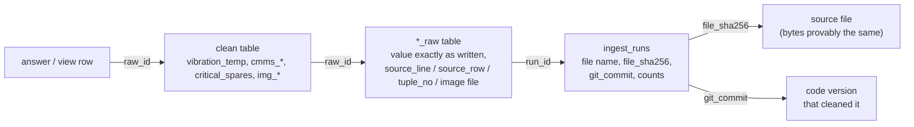

# Ingest scripts

One style for every data source: settings from one shared `.env`, small cleaning
steps chained with `.pipe()`, each load in a single transaction, `--dry-run` to
check parsing without a database, lineage back to the source file, and a summary
you can paste into the data quality report.

| Script | Source | Details |
|---|---|---|
| `scripts/ingest_logs.py` | Sensor log CSV (`vibration_temp_*.csv`) | [`ingest_logs.md`](docs/ingest_logs.md) |
| `scripts/ingest_spares.py` | Critical spares sheet (`critical_spares.xlsx`) | [`ingest_spares.md`](docs/ingest_spares.md) |
| `scripts/ingest_cmms.py` | CMMS SQL dump (`jurongmarine_cmms.sql`) | [`ingest_cmms.md`](docs/ingest_cmms.md) |
| `scripts/ingest_images.py` | Scanned nameplates and incident report forms (`data/images/`): read by Tesseract, the class vision model, or both; photos stored for the app (forms redacted) | [`ingest_images.md`](docs/ingest_images.md) |
| `scripts/ingest_sops.py` | SOP documents (`data/sops/`): steps with line numbers, machine links, keyword search | [`ingest_sops.md`](docs/ingest_sops.md) |
| `scripts/relationships.py` | The loaded tables: links the sources (CMMS, sensors, spares, scans, SOPs) | [`relationships.md`](docs/relationships.md), [ER diagram](docs/er_diagram.md) |
| `scripts/agent_user.py` | Creates the app's read-only database user (PDPA) | [`agent_user.md`](docs/agent_user.md) |
| `scripts/pipeline.py` | Runs all of the above in order (the SOPs after the CMMS), writes a Markdown report | [`pipeline.md`](docs/pipeline.md) |
| `scripts/agent_tools.py` | Not a load: the fixed tools the app's LLM calls, as the read-only user, with citations | [`agent_tools.md`](docs/agent_tools.md) |
| `scripts/agent_app.py`, `scripts/agent_ui.py` | The chat agent (function-calling loop) and its Streamlit page, with sources, photos and caveats under each answer | [`agent_app.md`](docs/agent_app.md), [`agent_ui.md`](docs/agent_ui.md) |
| `scripts/run_evals.py` | The eval suite (`evals/cases.yaml`): the real model, loop and database, each answer checked for the tools that ran, key facts, sources and grounding; prints the spend | [`evals.md`](docs/evals.md) |
| `scripts/audit_sensor_csv.py` | Profiles a sensor CSV without loading it: formats, units, ids, gaps, duplicates, outliers, with line numbers. Run it alone, or first in the pipeline with `pipeline.py --audit` | [`trap_list.md`](docs/trap_list.md#sensor-log-vibration_temp_2026h1csv) |

Every data-quality problem found so far, with evidence, is in
[`trap_list.md`](docs/trap_list.md).

```bash
python -m venv .venv
source .venv/bin/activate                 # Windows: .venv\Scripts\activate
pip install -r requirements-dev.txt       # pandas, sqlalchemy, pymysql, ... + pytest
cp .env.example .env                      # set the passwords
pytest                                    # tests, no DB needed (see "Testing with pytest")

docker compose up -d                      # MySQL 8.4 on localhost:3307
docker compose ps                         # wait for "healthy"

python scripts/ingest_logs.py   data/logs/vibration_temp_2026H1.csv --dry-run
python scripts/ingest_logs.py   data/logs/vibration_temp_2026H1.csv --recreate   # first load
python scripts/ingest_spares.py data/tabular/critical_spares.xlsx --dry-run
python scripts/ingest_spares.py data/tabular/critical_spares.xlsx --recreate     # first load
python scripts/ingest_cmms.py   data/sql/jurongmarine_cmms.sql --dry-run
python scripts/ingest_cmms.py   data/sql/jurongmarine_cmms.sql --recreate        # first load
python scripts/ingest_images.py data/images --dry-run                            # needs Tesseract, see below
python scripts/ingest_images.py data/images --dry-run --photos-preview .cache/ingest_images/preview   # look at the redacted forms
python scripts/ingest_images.py data/images --recreate                           # first load (engine: see below)
python scripts/ingest_sops.py   data/sops --dry-run
python scripts/ingest_sops.py   data/sops --recreate                             # first load (after the CMMS)

python scripts/relationships.py --mermaid docs/er_diagram.md   # link the sources (after the loads)
python scripts/agent_user.py                                   # the app's read-only user, then a check
```

**The images need Tesseract** (free, offline OCR), installed once: Windows from
[UB Mannheim](https://github.com/UB-Mannheim/tesseract/wiki) (default folder), WSL/Ubuntu
`sudo apt install tesseract-ocr`, macOS `brew install tesseract`. The Python side is
`pytesseract` and `opencv-python-headless`; the vision model needs `openai`, and `.env` is
read with `python-dotenv` (all four belong in `requirements.txt`)
([setup](docs/ingest_images.md#setup-tesseract)).

**Which engine reads the scans** (`--engine`, else `IMAGE_ENGINE` in `.env`, else `tesseract`):

| Engine | What it does | When |
|---|---|---|
| `tesseract` | Three preprocessings of each scan, fields voted; on the new forms the severity also read from its blue ink alone ([voting](docs/ingest_images.md#four-pass-voting), [colour separation](docs/ingest_images.md#colour-separation-severity-from-the-blue-value-ink)) | No network; the default |
| `llm` | The class LLM endpoint's vision model (`OPENAI_BASE_URL` / `OPENAI_API_KEY`), nothing else | For comparison only |
| `both` | Both read every scan; per field, a [decision tree](docs/ingest_images.md#decision-tree-2-per-field-which-value-is-kept) keeps one value and flags `engines_disagree_*` where they differ | **What we load** (`IMAGE_ENGINE=both` in `.env`): it fixed every misread checked by eye on the plates (I15, I18) |

Values neither engine can read can be read off the scan by a person and recorded in the
script ([Values read by a person](docs/ingest_images.md#values-read-by-a-person); flagged
`checked_by_eye_*`). The load also stores the photos the chat page shows: nameplates as
they are, incident forms **only redacted** (person and signature covered; a form whose labels
can't be found isn't stored). Look at the redacted forms with `--photos-preview` before the
first load ([Photos for the app](docs/ingest_images.md#photos-for-the-app)).

Or run the loads and `relationships.py` in one go, with a report of the results in
`reports/` ([`pipeline.md`](docs/pipeline.md)):

```bash
python scripts/pipeline.py --dry-run     # check everything first
python scripts/pipeline.py --recreate    # first load; later loads without --recreate
python scripts/pipeline.py --image-engine both   # engine for the scans (default: IMAGE_ENGINE in .env)
```

Use `--recreate` on the first load and after any schema change; afterwards run
without it. Run `relationships.py` again after every load: it re-checks the links
and refreshes the views and the ER diagram.

With uv (personal repo): `uv sync`, then put `uv run` in front of each command,
e.g. `uv run python scripts/ingest_cmms.py data/sql/jurongmarine_cmms.sql --dry-run`.

## Why MySQL

Every source is loaded into one MySQL database (8.4 in Docker locally; the same scripts
run against hosted MySQL such as Aiven). The reasons come from what the client sent and
what the app must guarantee:

| Need | Why MySQL fits |
|---|---|
| **The client's system of record is already MySQL** | The CMMS arrived as a MySQL dump (`jurongmarine_cmms.sql`). Staying on the same engine keeps its types, dates and collation as the client has them, and the cleaned `cmms_*` tables can sit next to the dump's own tables in one database (see [The client's CMMS dump](#the-clients-cmms-dump)). The dump is still parsed, never executed |
| **The sources link by shared keys** | `machine_id` ties the CMMS, sensor log, spares sheet, nameplates, incident forms and SOPs together; `emp_code` and `incident_id` link others. Cross-source questions ("CNC-02's work orders with the readings before each") are joins, and `relationships.py` checks every link and can enforce it with foreign keys. A relational database does this natively |
| **PDPA has to be enforced by the database, not the prompt** | MySQL users, `GRANT SELECT` per view, and views that run with their creator's rights (`SQL SECURITY DEFINER`) let the app's user read `work_order_detail` but never `cmms_employees.emp_name` or any `*_raw` table. `agent_user.py --check` proves it live. A file store or a vector store has no access control at this level |
| **Loads must be all-or-nothing and traceable** | Each load runs in one transaction, so a failure changes nothing, and is recorded in `ingest_runs` with the file's SHA-256 and the git commit (see [Lineage](#lineage-traceability-and-reproducibility)). Raw tables keep every row as written, with the `run_id` of the load that brought it in |
| **The SOPs need text search, not a second database** | InnoDB `FULLTEXT` indexes find the right SOP by keyword in the same database, under the same grants and lineage. For three short SOPs, a separate vector store would add a second copy to keep in step and make "no SOP covers this" harder to say reliably (decision and details in [`ingest_sops.md`](docs/ingest_sops.md#search-keyword-not-a-vector-database)) |
| **The data is small** | About 106k sensor readings, 1,603 work orders, 85 incidents, 42 scans and 3 SOPs. One MySQL instance holds and queries this in milliseconds; a data warehouse or distributed store would add cost and moving parts for nothing |
| **It runs wherever the team does** | Free, one `docker compose up` locally, and offered by hosted providers for the demo. Its SQL dialect is widely known, which helps when the app's SQL tool writes queries |

**What MySQL doesn't give us, and how each gap is handled:**

- **Search beyond keywords:** no stemming, synonyms or vector search out of the box.
  `ingest_sops.py` adds a stop-word table, synonyms and a normalised `search_text` column
  ([`ingest_sops.md`](docs/ingest_sops.md#mysql-fulltext-what-it-does-for-the-search)).
  Embeddings would be a column in the same database if the SOP collection grows.
- **Server settings differ between hosts.** Hosted MySQL can require a primary key on
  every table (`sql_require_primary_key`, MySQL error 3750) and keeps even the admin out
  of system databases. The scripts are written to work under both
  ([`agent_user.md`](docs/agent_user.md#hosted-mysql-aiven)).
- **Time-series analysis** (the CNC-02 trend) is done with SQL grouping and in pandas, not a
  dedicated time-series database. At 106k rows that's fast enough.

**Alternatives, briefly.** PostgreSQL would also work (and has richer text search and
`pgvector`), but the client's dump is MySQL and would have to be converted. SQLite has no
users or grants, so the PDPA guardrail would move into application code. A vector
database alone can't do the joins, the grants or the lineage.

## Database (Docker)

`docker-compose.yml` runs MySQL in a container, configured from the same `.env`
as the scripts: on first start it creates `DB_NAME` and the user
`DB_USERNAME`/`DB_PASSWORD`. Data lives in the `mysql-data` volume, so it
survives `docker compose down`; `docker compose down -v` wipes it.

Changing `DB_NAME`, `DB_USERNAME` or a password in `.env` after the first start
has no effect on the existing database. Either change it in MySQL, or wipe and
recreate with `docker compose down -v && docker compose up -d`.

```bash
# MySQL shell inside the container
docker compose exec mysql sh -c 'mysql -u"$MYSQL_USER" -p"$MYSQL_PASSWORD" "$MYSQL_DATABASE"'
```

GUI clients (MySQL Workbench, DBeaver) connect to `localhost:3307` from Windows.

### The client's CMMS dump

Load it with **`ingest_cmms.py`** (see the quick start and
[`ingest_cmms.md`](docs/ingest_cmms.md)). The script parses the dump
without executing it, cleans it, and writes `cmms_*` tables with lineage, like the
other sources. This is the path to use for the app and the audit.

Running the dump directly in MySQL is only for browsing the client's tables as they
are. It runs as root and executes whatever the dump contains, including any
`DROP TABLE` or `CREATE DATABASE`, so look at the dump first:

```bash
grep -nE '^(DROP|CREATE) (TABLE|DATABASE)|^USE ' data/sql/jurongmarine_cmms.sql   # what it will do
docker compose exec -T mysql sh -c 'mysql -uroot -p"$MYSQL_ROOT_PASSWORD"' < data/sql/jurongmarine_cmms.sql
```

If the dump creates its own database (e.g. `jurongmarine_cmms`), grant the ingest
user access to it:

```bash
docker compose exec mysql sh -c 'mysql -uroot -p"$MYSQL_ROOT_PASSWORD" -e "GRANT ALL ON jurongmarine_cmms.* TO \"$MYSQL_USER\"@\"%\""'
```

The `cmms_` prefix keeps `ingest_cmms.py`'s tables apart from the dump's own
`machines`, `work_orders`, ... tables, so both can live in the same database.

## Tables

The [ER diagram](docs/er_diagram.md) shows the cleaned tables and how they link;
`relationships.py --mermaid docs/er_diagram.md` regenerates it.

| Table | What it holds | Made by |
|---|---|---|
| `ingest_runs` | One row per run: script, file name, file SHA-256, git commit, time, row counts, `success`/`failed` + error. `relationships.py` runs appear as source `(database)`; image loads as the folder, with one hash over all its images | every script |
| `vibration_temp_raw` | Every CSV row exactly as in the file (text), with `source_line`, `status` (`loaded`/`rejected`), `reject_reason`, `duplicate_of_raw_id`, `warnings` | [`ingest_logs`](docs/ingest_logs.md) |
| `vibration_temp` | Cleaned readings only; `raw_id` links each to its raw row | [`ingest_logs`](docs/ingest_logs.md) |
| `vibration_temp_audit` (view) | Clean + raw + run joined: use this for citations | [`ingest_logs`](docs/ingest_logs.md) |
| `critical_spares_raw` | Every sheet row exactly as written (text), with `source_row`, `source_rev`, `status`, `reject_reason`, `duplicate_of_raw_id`, `warnings` | [`ingest_spares`](docs/ingest_spares.md) |
| `critical_spares` | Cleaned parts only; `raw_id` links each to its raw row | [`ingest_spares`](docs/ingest_spares.md) |
| `critical_spare_machines` | Part to machine links (`CNC-01/02/03` split into three rows) | [`ingest_spares`](docs/ingest_spares.md) |
| `critical_spares_audit` (view) | Clean + raw + run joined: use this for citations | [`ingest_spares`](docs/ingest_spares.md) |
| `cmms_<table>_raw` | For `machines`, `employees`, `work_orders`, `safety_incidents`: every INSERT tuple exactly as in the dump (text), with `source_line`, `tuple_no`, `raw_tuple`, `status`, `reject_reason`, `duplicate_of_raw_id`, `warnings`. The dump's `work_orders.status` is stored as `status_src` | [`ingest_cmms`](docs/ingest_cmms.md) |
| `cmms_<table>` | Cleaned rows only; `raw_id` links each to its raw row. Incidents carry `severity_as_logged`, `severity_scale` and `severity_5_worst` | [`ingest_cmms`](docs/ingest_cmms.md) |
| `cmms_<table>_audit` (view) | Clean + raw + run joined: use this for citations | [`ingest_cmms`](docs/ingest_cmms.md) |
| `img_documents_raw` | One row per image: file name, its SHA-256, document type, OCR engine(s), each field as read (JSON), where the readings or the two engines disagreed and which value was kept, the OCR text, `status`, `reject_reason`, `warnings` | [`ingest_images`](docs/ingest_images.md) |
| `img_nameplates` | One per machine (`asset_tag` = `machine_id`): serial, power, weight, **lubricant**, **grease interval**, ... | [`ingest_images`](docs/ingest_images.md) |
| `img_incident_reports` | One per incident (`IR-2024-900` -> `incident_id` 900): immediate action, root cause, signature, severity on the **scale printed on the form** | [`ingest_images`](docs/ingest_images.md) |
| `img_files` | The photos for the app, in the database (the hosted page has no data folder): nameplates as they are, incident forms only redacted; `bytes_sha256` to check them | [`ingest_images`](docs/ingest_images.md#photos-for-the-app) |
| `img_files_public` (view) | The photos the app may show: nameplates' originals and forms' redacted copies, of loaded scans only | [`ingest_images`](docs/ingest_images.md#photos-for-the-app) |
| `img_nameplates_audit`, `img_incident_reports_audit` (views) | Clean + image file + its SHA-256 + run: use these for citations | [`ingest_images`](docs/ingest_images.md) |
| `sop_documents_raw` | One row per file in the SOP folder: file name, SHA-256, text as read, `status`, `reject_reason`, `warnings` | [`ingest_sops`](docs/ingest_sops.md) |
| `sops`, `sop_steps`, `sop_machines` | One row per SOP revision (`is_current`; `search_text` is what the app searches), per step with its line number, per machine it names | [`ingest_sops`](docs/ingest_sops.md) |
| `sop_ft_stopwords` | The words the SOP `FULLTEXT` indexes ignore (MySQL's defaults + the script's own) | [`ingest_sops`](docs/ingest_sops.md#stop-words-how-they-help-retrieval) |
| `sops_audit`, `sop_steps_audit` (views) | Clean + file + its SHA-256 + run: use these for citations | [`ingest_sops`](docs/ingest_sops.md) |
| `table_relationships` | One row per link between sources (see below): child and parent column, `fk`/`soft`, rows checked, matched, orphans and which keys, `run_id` of the run that checked it | [`relationships`](docs/relationships.md) |
| `machine_overview` (view) | One row per machine: work orders, breakdowns, open WOs, incidents, lost days, spares, spares below min, sensor readings and their date range | [`relationships`](docs/relationships.md#views) |
| `machine_spares` (view) | Spares per machine, with `ALL` expanded to every machine | [`relationships`](docs/relationships.md#views) |
| `work_order_detail` (view) | Work orders + machine + employee trade/shift (no names) | [`relationships`](docs/relationships.md#views) |
| `incident_detail` (view) | Incidents + machine + employee trade/shift; severity as `severity_5_worst` only | [`relationships`](docs/relationships.md#views) |
| `work_order_sensor_window` (view) | Each work order with the sensor readings in the 7 days up to it (`--window-days`) | [`relationships`](docs/relationships.md#views) |
| `machine_nameplate` (view) | Every machine with its nameplate's values; `has_nameplate = 0` if there is no photo | [`relationships`](docs/relationships.md#views) |
| `machine_sops` (view) | Every machine with the current SOPs that name it; `has_sop = 0` if none does | [`relationships`](docs/relationships.md#views) |
| `incident_report_vs_cmms` (view) | Scanned form vs CMMS, one row per field: `form_value`, `logged_value`, `agrees` | [`relationships`](docs/relationships.md#views) |

Re-loading a sensor file or a CMMS dump replaces that file's rows (other files are
kept). The spares sheet is a complete list, so each spares load replaces all spares
rows with the new sheet; the images folder likewise replaces every row from that folder.
`ingest_runs` keeps the history of what was loaded when.
Spares `raw_id` = `run_id * 100000 + sheet row`, so `300008` is run 3, row 8.

## Linking the sources

The ingest scripts load each source on its own. `relationships.py` ties them together
through their shared keys and is safe to run after every load:

| Link (child -> parent) | Kind |
|---|---|
| `cmms_work_orders.machine_id` -> `cmms_machines.machine_id` | FK with `--foreign-keys`, if no orphans |
| `cmms_safety_incidents.machine_id` -> `cmms_machines.machine_id` | FK with `--foreign-keys`, if no orphans |
| `vibration_temp.machine_id` -> `cmms_machines.machine_id` | FK with `--foreign-keys`, if no orphans |
| `critical_spare_machines.machine_code` -> `cmms_machines.machine_id` | soft: `ALL` means every machine |
| `critical_spare_machines.part_no` -> `critical_spares.part_no` | FK, made by `ingest_spares.py` |
| `cmms_work_orders.emp_code` -> `cmms_employees.emp_code` | soft: `emp_code` is not unique by design |
| `cmms_safety_incidents.emp_code` -> `cmms_employees.emp_code` | soft: `emp_code` is not unique by design |
| `img_nameplates.asset_tag` -> `cmms_machines.machine_id` | FK with `--foreign-keys`, if no orphans |
| `img_incident_reports.incident_id` -> `cmms_safety_incidents.incident_id` | FK with `--foreign-keys`, if no orphans |
| `img_incident_reports.machine_id` -> `cmms_machines.machine_id` | FK with `--foreign-keys`, if no orphans |
| `sop_machines.machine_id` -> `cmms_machines.machine_id` | FK with `--foreign-keys`, if no orphans |
| `sop_machines.doc_no` -> `sops.doc_no` | FK on `(doc_no, revision)`, made by `ingest_sops.py` |

Each run checks every link (rows, matched, NULL, **orphans**: child keys with no
parent), prints the result, writes it to `table_relationships`, creates the views
above, and records itself in `ingest_runs`. Orphans are flagged in the views
(`machine_known`, `employee_known`), never dropped.

On the client's data we expect no orphans on the sensor link: the five machine ids in
`vibration_temp_2026H1.csv` (CMP-01, CNC-01, CNC-02, CNC-03, PMP-T01) are spelled exactly
as in the CMMS. The other seven CMMS machines have no sensor readings, so
`machine_overview` shows them with zero readings; that's missing coverage, not an
orphan. If a later sensor file gives orphans, lookalike ids (`CNC2` for `CNC-02`) would
need a `machine_aliases` table. On the image links, an orphan asset tag or incident id
means OCR misread it or the scan isn't in the CMMS; check `img_documents_raw.ocr_notes`.
All 30 incident forms link with 0 orphans (one misread machine id, `CRN-002`, was fixed
by a stricter machine-id check: trap list I10). The 7 machines the SOPs name (by id, CMMS
name or alias) all match the CMMS.

```bash
python scripts/relationships.py --dry-run --mermaid docs/er_diagram.md   # no database needed
python scripts/relationships.py                                          # check + catalog + views
python scripts/relationships.py --foreign-keys                           # also enforce where clean
python scripts/relationships.py --drop-foreign-keys                      # before reloading a source
```

Foreign keys are opt-in: a reload deletes rows they would protect, so while they
exist a reload fails. Order of work: `--drop-foreign-keys`, reload, `--foreign-keys`
(see [Foreign keys](docs/relationships.md#foreign-keys)). Every run is logged too
(see [Run log](docs/relationships.md#run-log)).
The ER diagram of the cleaned schema is in [`er_diagram.md`](docs/er_diagram.md); solid
lines are foreign keys, dotted lines are soft links. Details in
[`relationships.md`](docs/relationships.md).

## Database access for the app (PDPA)

The app, and through its tools the LLM, must **never** connect as `DB_USERNAME`: that
user owns every table, including `cmms_employees.emp_name`. Telling the model "use the
views" is not protection; the database has to refuse. `agent_user.py` creates a separate
user that can only `SELECT` from an allow-list:

| The app user can read | It can't |
|---|---|
| the linking views (`machine_overview`, `machine_spares`, `work_order_detail`, `incident_detail`, `work_order_sensor_window`, `machine_nameplate`, `machine_sops`, `incident_report_vs_cmms`), `table_relationships`, the `*_audit` views for citations (machines, work orders, incidents, sensor readings, spares, nameplates, incident forms, SOPs and their steps), for the SOPs also `sops` (its `FULLTEXT` index is on the table) and `sop_machines`, and `img_files_public` (the photos: incident forms redacted) | `cmms_employees`, `cmms_employees_raw`, `cmms_employees_audit`, any `*_raw` table (including `img_documents_raw`, which keeps OCR text as read, and `sop_documents_raw`, which keeps the GM's email), `img_files` (the photo table itself), any write, any schema change |

Views run with their creator's rights (MySQL's default), so the app user reads
`work_order_detail` without any access to the tables underneath. Before granting, the
script refuses any object that has an `emp_name` column, so a view changed later can't
leak names. Add to `.env`:

```bash
AGENT_DB_USERNAME=agent_ro
AGENT_DB_PASSWORD=...              # the app connects with these two
DB_ADMIN_USERNAME=root             # creating users needs an admin account
DB_ADMIN_PASSWORD=...              # falls back to MYSQL_ROOT_PASSWORD
```

```bash
python scripts/agent_user.py --dry-run   # the plan and SQL, password hidden; no database needed
python scripts/agent_user.py             # create/update the user, then check it
python scripts/agent_user.py --check     # only the check (exit 1 if anything is wrong)
```

The check connects **as the app user** and must show every allowed view working and
every probe refused: employee names, the employees table and its audit view, raw rows
(employees, the raw OCR of the scans and the SOP folder), the photo table itself, a write,
a `CREATE TABLE`. Run it after the first full
load: objects that don't exist yet are skipped, not granted. Run it again after adding a
view to the allow-list (`allowed_objects` in the script). A refused object is reported as
"not created yet" or "exists but not granted", using the admin account to tell which.
It's also the evidence for the PDPA question on demo day; run `--check` live. Details,
errors and hosted MySQL in [`agent_user.md`](docs/agent_user.md).

## The agent's tools

Ingestion and linking give you a clean, grant-controlled database; `scripts/agent_tools.py`
is the layer on top that the LLM agent actually calls. It's not an ingest script and
loads nothing — it's a fixed set of tools (list machines, check a nameplate, count and
list incidents on one severity scale, compare a machine's sensor trend, find and quote
an SOP, and a last-resort checked `query_sql`) that the model picks from and fills in
arguments for, never writing free SQL itself. Every tool runs as the read-only
`agent_ro` user from `agent_user.py` above, and returns its answer with citations back to
the audit views (`*_audit`) and lineage (`ingest_runs`) described in this file.

```bash
python scripts/agent_tools.py schemas                                     # the tool definitions
python scripts/agent_tools.py call find_sop '{"question": "entering the blasting chamber"}'
```

Full tool list, error codes, and how each trap-list item is handled in code:
[`agent_tools.md`](docs/agent_tools.md). The agent's tools are tested the same way as the
ingest scripts (`tests/test_agent_tools.py`, no MySQL needed) and have been checked
against the real database too
([verification pass](docs/agent_tools.md#checked-against-the-real-database-5-nov-2026)).

**`scripts/agent_app.py`** is what a person actually talks to: a plain function-calling
loop (no framework) that wires an LLM to the tools above, shows the sources a tool
cited under every answer, and degrades honestly rather than inventing a value when a
tool or the LLM call fails. Every note a tool returns (an OCR value the engines disagreed on,
a severity read by eye, a description that doesn't fit the machine) is a caveat the answer
must carry. Details, what it deliberately doesn't do yet (guardrails,
cross-restart state), and its tests: [`agent_app.md`](docs/agent_app.md).

```bash
python scripts/agent_app.py "is CNC-02 running differently now?"
streamlit run scripts/agent_ui.py          # the same, as a chat page for the demo
```

The page ([`agent_ui.md`](docs/agent_ui.md)) shows under each answer the sources, the
photos behind it (nameplates, redacted incident forms, from `img_files_public`) and the
tools' caveats in a closed expander. To host it (Google Cloud Run, Aiven for the data):
[Deploying on Google Cloud Run](docs/agent_ui.md#deploying-on-google-cloud-run). After a
redeploy, hard-refresh the page (Ctrl+Shift+R) before testing.

**The eval suite** (`evals/cases.yaml`, run by `scripts/run_evals.py`) asks the real model
23 questions (the severity kill-shot in five phrasings, the SOPs, CNC-02, oil, trap-list
items, six refusals) through the same loop over the real database, and checks each answer
for the tools that ran, its key facts, its sources, and that it states nothing no tool
returned. It prints the spend; run it after every significant change and commit
`evals/results/latest.txt` ([`evals.md`](docs/evals.md)).

```bash
pip install pyyaml                         # team repo; with uv (personal repo): uv add --dev pyyaml
python scripts/run_evals.py --check        # validate the cases: free
python scripts/run_evals.py                # the real run: about 40 model calls
python scripts/run_evals.py --tag killshot # one group
```

## Lineage: traceability and reproducibility

Every cleaned value can be followed back to the exact line of the exact file it came
from, and to the exact code that cleaned it. That is what lets the app cite its sources
and what an auditor will test.



| Link | Where it is | What it proves |
|---|---|---|
| clean row -> raw row | `raw_id` on every clean table, joined in the `*_audit` views | which input row produced this value |
| raw row -> place in the file | `source_line` (CSV, header is line 1), `source_line` + `tuple_no` (SQL dump), `source_row` + `source_rev` (spreadsheet), `source_file` + `image_sha256` (scans) | where to look in the original |
| raw row -> load | `run_id` on every raw row | which load brought it in, and when |
| load -> file | `ingest_runs.file_sha256` (for the images: one hash over the folder, `lineage.folder_sha256`) | the file you hold is byte-for-byte the one that was loaded |
| load -> code | `ingest_runs.git_commit` | which version of the cleaning rules ran |
| rejected rows | `*_raw` with `status = 'rejected'`, `reject_reason`, `duplicate_of_raw_id` | nothing was dropped silently |
| links between sources | `table_relationships.run_id`; `relationships.py` runs in `ingest_runs` with a fingerprint of the check | how well the sources linked up at that moment |

The views made by `relationships.py` keep `raw_id`, so a row from `work_order_detail` or
`incident_detail` traces through `cmms_work_orders_audit` / `cmms_safety_incidents_audit`,
and a row from `machine_nameplate` or `incident_report_vs_cmms` through the `img_*_audit`
views to the image file.

### Demonstrating traceability

Take a value the app gave as an answer and walk it back to the source. Run the SQL in
the MySQL shell (or DBeaver), the shell commands from the repo root.

**A sensor reading:**

```sql
-- 1. The value, as stored and as written in the file
SELECT temp_c, temp_raw, temp_unit_raw, timestamp_raw, source_file, source_line, run_id, file_sha256
FROM vibration_temp_audit
WHERE machine_id = 'CNC-02' AND sampled_at = '2026-03-14 02:00:00';

-- 2. The load that brought it in
SELECT run_id, script, source_file, file_sha256, git_commit, started_at, status
FROM ingest_runs WHERE run_id = <run_id>;
```

```bash
sed -n '<source_line>p' data/logs/vibration_temp_2026H1.csv   # 3. the line exactly as in the file
sha256sum data/logs/vibration_temp_2026H1.csv                 # 4. must equal file_sha256
git show --stat <git_commit>                                  # 5. the code that cleaned it
```

On Windows: `Get-FileHash -Algorithm SHA256 data\logs\vibration_temp_2026H1.csv`.

That reading is line 42343 of the 2026H1 file. Point out what changed on the way. The
file's first CNC-03 reading (line 4) was logged as `141.4` with unit `F` and is stored
as `temp_c = 60.78`; the rule is `clean_temperatures` in `ingest_logs.py` at that commit.

**A safety incident** (the severity flip the auditor will test):

```sql
SELECT incident_id, incident_date, severity_as_logged, severity_scale, severity_5_worst,
       source_file, source_line, raw_tuple, file_sha256
FROM cmms_safety_incidents_audit WHERE incident_id = 902;
```

```bash
sed -n '<source_line>p' data/sql/jurongmarine_cmms.sql   # the INSERT line holding raw_tuple
```

Incident 902 (16 Apr 2024) was logged as `5` on the old scale (1 = worst), so it appears
as `severity_5_worst = 1`: same incident, translated, with the original kept beside it.

**A scanned form** (and the printed scale behind the conversion):

```sql
SELECT incident_id, severity_as_logged, severity_scale, severity_5_worst, source_file, image_sha256
FROM img_incident_reports_audit WHERE incident_id = 900;
SELECT field, form_value, logged_value, agrees FROM incident_report_vs_cmms WHERE incident_id = 900;
```

```bash
sha256sum data/images/IR-2024-900.jpg   # must equal image_sha256; then open the image
```

The form says `Severity (1 = MOST SEVERE): 4`, so it is `severity_5_worst = 2`, the same
value the CMMS date rule gives.

**A spare part:** `critical_spares_audit` gives `source_row` and `source_rev`; open
`critical_spares.xlsx` at that row and check the title says the same revision.

**Nothing lost:** every row read is either loaded or rejected with a reason.

```sql
-- Counts add up for every load
SELECT run_id, script, source_file, rows_read, rows_loaded, rows_rejected,
       rows_read = rows_loaded + rows_rejected AS adds_up
FROM ingest_runs WHERE script LIKE 'ingest_%' AND status = 'success' ORDER BY run_id DESC;

-- The rows behind a run's counts (latest run of each file; older runs' rows were replaced)
SELECT status, reject_reason, COUNT(*) FROM vibration_temp_raw
WHERE run_id = <run_id> GROUP BY status, reject_reason;
```

### Demonstrating reproducibility

Same file + same code = same result. `ingest_runs` records both halves, so a load can be
repeated and compared.

1. **Before a load that matters, commit.** `git_commit` records only `HEAD`; changes
   that aren't committed are not recorded. Check `git status` is clean, then load.
2. **Re-run the load at the recorded commit, without touching the database:**

   ```bash
   git switch --detach <git_commit>                     # the code as it was
   sha256sum data/logs/vibration_temp_2026H1.csv        # same file as file_sha256?
   python scripts/ingest_logs.py data/logs/vibration_temp_2026H1.csv --dry-run
   git switch -                                         # back to where you were
   ```

   `Rows read / loaded / rejected` and the reject reasons must match that run's row in
   `ingest_runs` and the `GROUP BY` above. For the client's 2026H1 file that's
   106,384 read, 106,384 loaded, 0 rejected ([Run summary](docs/ingest_logs.md#run-summary)).
3. **Linking reproduces too.** Run `relationships.py` twice with no load in between: both
   runs get the same `file_sha256` (the fingerprint of the check results).

   ```sql
   SELECT run_id, started_at, file_sha256, rows_read, rows_loaded, rows_rejected
   FROM ingest_runs WHERE script = 'relationships.py' ORDER BY run_id DESC LIMIT 2;
   ```

**Compare content, not ids.** `run_id` and `raw_id` are assigned by the database, so they
differ between runs and between databases (spares `raw_id` even contains the `run_id`).
Compare by `source_file` + `source_line` / `source_row` and by the counts.

**Dry run vs real load:** a real load also rejects rows that duplicate rows already
loaded from *other* files, which a dry run can't see. The counts match exactly for the
first file of a source; for later files, the difference is the `duplicate_*` rejects.

**OCR is the exception:** another Tesseract version can read a bad photo differently, and
the vision model's answers vary from run to run even at `temperature = 0` (trap list I24).
Each image's reading is cached by its SHA-256 and the engine tag
(`.cache/ingest_images/<hash>_tesseract-v3.json`, `<hash>_llm-v3-gpt-4o-mini.json`), and
`img_documents_raw` keeps what was read, so a re-run on the same machine with the cache gives
the same result; across machines, compare `fields_raw` and `ocr_notes`. Changing the image
preparation or the model's prompt means a new tag, so old cached reads are ignored.
`ingest_runs` and the run summary record the engine (`both:tesseract-v3+llm-v3:gpt-4o-mini`).

## Data concerns and open questions

What we know is uncertain in the client's data, what the scripts do about it now, and
what we need from someone else to settle it. Keep this list current: it feeds the data
quality report, and the client will be asked these questions. The evidence for every
problem, by source, is in [`trap_list.md`](docs/trap_list.md); the `C`, `S`, `L`, `I` and `D`
numbers below refer to it.

### Needs the client's input

| # | Question | Evidence and why it matters | What we do now | Once answered |
|---|---|---|---|---|
| 1 | **On which day did incident severity switch to 5 = worst?** (safety officer) | The dump's header note says 1 Jul 2025, but forms in use may have lagged. In this dump only two incidents fall in July 2025: **906** (11 Jul, logged 3) and **907** (4 Jul, logged 2). A 3 means the same on both scales, so **907 is the only incident whose meaning changes**: severity 2 on the new scale, or 4 converted from the old. The auditor will test this. Form 906 (11 Jul) already prints the new scale, so the switch was between 1 and 11 Jul 2025; there is no scanned form for 907. (C1, C2, I5) | Before 1 Jul 2025 converted (`6 − s`); all of July left `ambiguous`, `severity_5_worst = NULL` | `ingest_cmms.py --severity-cutover <date> --severity-ambiguous-until none`, then `relationships.py` |
| 2 | **Do old-scale severities agree with lost days?** (safety officer) | Several pre-July-2025 incidents logged `5` (least severe on the old scale) have 5 lost days, e.g. 901, 919, 920, 937; incident 982 logged `4` (minor) has 14. **Not a scale mix-up:** the forms for 919, 937 and 982 print the old scale and agree with the CMMS, so the mismatch is on the original paper. Either lost days aren't tied to severity, or the severity was misjudged when the form was filled in. (C3, I5) | Rule applied as stated. All 30 forms checked: none contradicts the date rule | Explain how severity and lost days relate |
| 3 | **Are work order and incident descriptions reliable for the machine they're on?** (maintenance) | Many don't fit the machine type: 10018 `crane limit switch fault` on the test pump rig, 10045 `weld porosity complaints` on the overhead crane, 10005 `spindle vibration high` on a welding bay; incident 923 `finger caught in chuck` on a crane. Either the machine id or the description is wrong. The paper form for incident 900 has the same mismatch (`weld flash burn` on the manual lathe), so it isn't just a CMMS typing error. (C6, I6) | Loaded as written | Decide which field to trust; until then the app should cite descriptions, not reason from them |
| 4 | **What vibration and temperature levels count as "off" for CNC-02?** (maintenance / OEM) | The night shift's question needs a threshold or a baseline, and the data has none. It's now urgent: CNC-02's monthly mean vibration rises from 2.31 mm/s (Jan–Mar 2026) to 2.71 (Apr), 3.56 (May) and 4.41 (Jun), and its temperature from 52.0 to 56.0 °C, while the other four sensored machines stay flat. Day and night shifts read the same. | Readings stored; no alarm levels. The trend can be shown, but not judged against a limit | Add the limits to the analysis and the chart |
| 5 | **Is "Nurul Aisyah binte Hassan" one person or two?** (HR) | Same name on EMP015 (QA, night) and EMP026 (QA, night). Affects any per-person count. (C8) | Treated as two employees (two codes) | Merge or keep; the app never shows names either way |
| 6 | **What's the difference between `corrective` and `breakdown` work orders?** (maintenance) | Both are unplanned repairs; `coolant leak` appears as both. "Breakdowns per machine" depends on the definition. (C12) | Kept as logged | Document the definition, or map one to the other |
| 7 | **What does `cost_sgd` on an open work order mean?** (finance / maintenance) | All 34 open and `awaiting parts` WOs (June 2026) already have costs and hours, e.g. 11550 (open, S$941.13). Estimate or spend so far? (C10) | Summed like closed WOs | Exclude open WOs from cost totals, or label them estimates |
| 8 | **Which currency are spares costs in?** (storeman) | The sheet only shows `$`; the bearing from Germany may be priced differently. (S2) | Stored without a currency | Add the currency per part |
| 9 | **Which part is an `awaiting parts` work order waiting for?** (maintenance) | Work orders don't record parts, so spares can't be linked to WOs; the app can't answer "what's holding up WO 11552". The likeliest case: WO 11570 (CRN-01 crane limit switch, awaiting parts) and spare LS-CXT-11 at 0 in stock. (C11) | Not linked | A part field in the CMMS export, or a separate list |
| 10 | **What do the `lost_days` values mean?** (safety officer) | Across all 85 incidents `lost_days` is only ever 0, 1, 2, 5 or 14, never 3, 4 or 6–13. That looks like a coded band, not a count. (C4) | Loaded as a number | If it's a code, map it to a band and stop summing it |
| 11 | **Why do QA inspectors and crane operators log repairs?** (maintenance / HR) | 11 of 32 staff are QA Inspectors, and they do repairs (10001: EMP002, QA, on a crane gearbox). Crane operators work on CNCs (10029, 10042: EMP005 on CNC-02). Either `emp_code` records who raised the WO rather than who did it, or trades are out of date. (C7) | Loaded as written | Say which it is; "who fixed it" answers depend on it |
| 12 | **Are same-day PM pairs double entries?** (maintenance) | Same machine, day and type twice, e.g. 10727 + 10728 (CNC-02 PM, 2025-02-01, both EMP009). They have different `wo_id`s, so the duplicate check keeps both. (C9) | Both loaded | Give a rule (e.g. same machine, day, type and technician = one job), or confirm they're separate |
| 13 | **Is WO 11512's 24.1 hours real?** (maintenance) | MILL-01 PM, 2026-05-05; the next longest WO is 18.9 h. Could be a long job or a typo for 2.41. (C13) | Loaded as written | Correct it, or leave it |
| 14 | **Where are the 5-Why root-cause sheets?** (safety officer) | Incident forms say `Root cause (5-Why attached?): see attached`; no attachment is in the scans or the data package. "Why did incident 900 happen" can't be answered. (I7) | `root_cause_attached = 1`, flagged `root_cause_in_attachment`; the app says the root cause isn't in the data | Scan and load them, or confirm they don't exist |
| 15 | **Is BLAST-01's nameplate on the right machine, and which oil does it take? Are other plates' lines copied from other machines?** (maintenance) | The plate rates the blasting chamber `450 A @ 60%` (how welding power sources are rated) and names `Shell Tonna S3 M68` (a slideway oil); the spares sheet lists only the `ALL` hydraulic oil for it. The same `450 A @ 60%` is on the crane CRN-01 and the pump PMP-T01, and welder WELD-02's plate carries a compressor's rating (`30 kW FAD 88 cfm`) and a 3.5 t weight. (I2, I3, I19) | Loaded as read, flagged `duty_cycle_rating_on_non_welder`; the app cites both sources for "what oil" | Correct the plate record or the asset tag |
| 16 | **Which lubricant and interval do the welders and the compressor really take?** (maintenance) | The plates list `ISO VG68` every 2000 h for WELD-01 and `Shell Tonna S3 M68` (a slideway oil) every 2000 h for WELD-02; inverter welding sets usually have no lubrication points. The screw compressor CMP-01 also lists Tonna S3 M68, where the maker's compressor fluid would be expected. (I20) | Loaded as printed; the app cites the plate photo | Correct the plates, or confirm and we note it |
| 17 | **Are there SOPs for welding, grinding, machine guarding, portable electrical equipment and housekeeping?** (safety officer) | Only three SOPs were provided (LOTO, crane lifting, confined space). 58 of the 85 incidents are of a kind none of them covers: finger caught in chuck 15, weld flash burn 14, electric shock from a faulty extension 10, eye injury from grinding 7, slip on hydraulic oil 6, deburring laceration 6. (D3) | The app says "no SOP in the data" for those topics | Send them and we load them; or confirm they don't exist (an audit finding in itself) |
| 18 | **Which incident is the "Aug 2025 near-miss (sling snapped)" in the crane SOP?** (safety officer) | The CMMS has five sling near-misses (917, 957, 941, 973, 944) and none in August 2025. Incident 944 (CRN-01, 28 Apr 2026, 5 lost days) happened after rev 6 (Mar 2026) said all old slings were scrapped. (D4) | Both sources cited as they are | Add the missing incident or correct the SOP's date; say whether 944's sling was a new one |
| 19 | **Who is certified to operate the cranes, and does `emp_code` on an incident mean the operator?** (HR / safety officer) | The crane SOP allows only certified operators ("list with HR"). The CMMS has two Crane Ops (EMP005, EMP024); none of the five sling near-misses names either. (D5, C7) | The app doesn't say who operated a crane | The certification list, and what `emp_code` means on incidents |
| 20 | **Can we have the earlier SOP revisions and their effective dates?** (safety officer) | Only the current revision of each SOP is in the package, dated to the month (LOTO rev 4 Jan 2026, crane rev 6 Mar 2026, confined space rev 2 Sep 2025). Which procedure applied at an older incident can't be shown. (D9) | Answers say "current revision as of <month>" | Load the earlier revisions with their dates |

```sql
-- Evidence for question 2: lost days by scale and logged severity
SELECT severity_scale, severity_as_logged, COUNT(*) AS incidents, ROUND(AVG(lost_days), 1) AS avg_lost_days
FROM cmms_safety_incidents GROUP BY severity_scale, severity_as_logged ORDER BY 1, 2;

-- Questions 1 and 2: the scale each scanned form printed, vs the CMMS date rule
SELECT incident_id, form_value AS printed_scale, logged_value AS date_rule_scale, agrees
FROM incident_report_vs_cmms WHERE field = 'severity_scale' ORDER BY incident_id;

-- Evidence for question 12: candidate double entries
SELECT machine_id, wo_date, wo_type, COUNT(*) AS n, GROUP_CONCAT(wo_id) AS wo_ids
FROM cmms_work_orders GROUP BY 1, 2, 3 HAVING n > 1 ORDER BY wo_date;
```

### Assumptions we made (state them in the data quality report)

| Assumption | Where | Check |
|---|---|---|
| Sensor timestamps without an offset are Singapore time | [`ingest_logs.md`](docs/ingest_logs.md) | The 2026H1 file has none (`iso_naive` = 0), so this doesn't affect the client's data; every ISO time carries `+08:00` |
| Slash dates are day first (`05/02/2026` = 5 Feb) | [`ingest_cmms.md`](docs/ingest_cmms.md), [`ingest_images.md`](docs/ingest_images.md) | The client's dump has none; every date is `YYYY-MM-DD`. The scanned forms do use them, and form IR-2024-900's `01/07/2024` matches the CMMS's `2024-07-01` (I8) |
| A form's printed severity scale is right for that form, even where it contradicts the date rule (flagged, not overruled; the CMMS value is not changed) | [`ingest_images.md`](docs/ingest_images.md#severity-the-scale-printed-on-the-form) | `form_scale_contradicts_date_rule` warnings (none on the 30 forms) |
| When OCR readings of a field disagree, the majority reading that passes the field's format check is right; ties go to the plain grey reading, and a field where no two readings agree is flagged `ocr_no_majority_*` | [`ingest_images.md`](docs/ingest_images.md#four-pass-voting) | `ocr_disagreed_*` warnings; each reading in `ocr_notes` |
| With `--engine both`, where the engines disagree: the only value passing the field's check wins, then a severity from the blue ink, then the model on free text, then a Tesseract majority, else the model | [`ingest_images.md`](docs/ingest_images.md#decision-tree-2-per-field-which-value-is-kept) | `engines_disagree_*` warnings; the rule used (`chose`) in `ocr_notes` |
| A value read off the scan by a person is right; it is stored as read, the OCR reading kept beside it | [`ingest_images.md`](docs/ingest_images.md#values-read-by-a-person) | `checked_by_eye_*` warnings (the severities of forms 911, 922, 955) |
| A severity read only from the blue value ink is right when at least 3 of 10 colour masks agree and no other digit comes close; otherwise it's left unread | [`ingest_images.md`](docs/ingest_images.md#colour-separation-severity-from-the-blue-value-ink) | `read_from_value_ink_severity` warnings; 6 of 9 new forms read, the other 3 read by eye; all match the CMMS where it has a value (I12) |
| Lead-time months are 30 days; `local` has no lead time in days | [`ingest_spares.md`](docs/ingest_spares.md) | `lead_time_unparsed` warnings (none in rev 11; no lead time uses months) |
| Only sizes written with a unit are converted; bearing numbers (`6205`) aren't decoded | [`ingest_spares.md`](docs/ingest_spares.md) | `no_explicit_size` count (5 in rev 11) |
| Part numbers aren't read for size (`BELT-5V-850` is 85.0 in, not 850 mm) | [`ingest_spares.md`](docs/ingest_spares.md) | agent instructions |
| Duplicates keep the first row seen, even if later ones differ | all four ingest docs | `duplicate_*` rejects (none in the client's files) |
| Category values aren't merged, only case and spacing normalised. This dump has none to merge: statuses are only `CLOSED`, `OPEN`, `AWAITING PARTS`; types only `CORRECTIVE`, `PREVENTIVE`, `BREAKDOWN` | [`ingest_cmms.md`](docs/ingest_cmms.md) | distinct `status` / `wo_type` values in the run summary of a new dump |
| No plausibility checks: a 900 °C reading or negative quantity loads as written. The client's sensor file stays within 28.1–79.8 °C and 0.2–5.81 mm/s, so nothing is affected today | [`ingest_logs.md`](docs/ingest_logs.md), [`ingest_spares.md`](docs/ingest_spares.md) | add a rule if a later file needs one |
| Time gaps in the sensor log aren't detected at ingest. In 2026H1, 2,216 of 108,600 expected readings are missing, none more than two 12-minute slots in a row | [`ingest_logs.md`](docs/ingest_logs.md) | `audit_sensor_csv.py`; analysis groups by time, not by row |
| An SOP is found by keyword; a question that shares no word with any SOP (after stop words and synonyms) has no SOP | [`ingest_sops.md`](docs/ingest_sops.md#search-keyword-not-a-vector-database) | the search tests; add a `SYNONYMS` entry and a test when a real question misses |

### Still to check ourselves

| Item | How |
|---|---|
| All 30 incident forms and all 12 nameplates are loaded with `--engine both` and compared with the CMMS. Every new-scale severity is now known (6 from the blue ink, 911/922/955 by eye: I12); all 4 forms Tesseract thought unsigned are signed (I23); the plate misreads found by eye (CRN-02 and CNC-03 grease intervals and weights, WELD-02's oil, the CNC-01 power line) are read right by the model (I15, I18, I25). Left: 13 warnings on the plates and 32 on the forms, mostly `engines_disagree_*` the app reports as caveats; plate lines that look copied between machines (I19, client Q15–Q16) | `SELECT * FROM machine_nameplate`, then the audit queries in [`ingest_images.md`](docs/ingest_images.md#audit-queries); add findings to [`trap_list.md`](docs/trap_list.md#images-images-incident-forms-and-nameplates); a value read by eye goes into `REVIEWED` |
| Whether `emp_code` with trade and shift identifies a person in a 32-person shop (PDPA) | team decision: if so, drop `emp_code` from `incident_detail` / `work_order_detail` |
| Names also appear in the spares sheet title (`storeman: Halim`) | stored only in `critical_spares_raw.source_title`, which the app user can't read; keep it that way |
| Views, grants and run logging have only been tested without a database | run `relationships.py` and `agent_user.py --check` on the real database |

## Run summary

Every run, dry or real, ends with counts you can paste into the data quality report.
Each breakdown line ends with its total, for example:

```
Timestamp formats: epoch_ms=4, iso_naive=1, iso_offset=2, unknown=2 (total 9)
Rejected rows: bad_timestamp=2, duplicate_reading=1, missing_machine_id=1 (total 4)
```

Category totals (timestamp formats, temperature units, `trade`, `severity_scale`, document
types, ...) add up to the rows read or loaded, which is a quick check that no row was missed.
`Rejected rows` totals equal the rejected count. Warning totals (`Loaded with gaps`,
`Loaded with warnings`) count **warnings**, not rows: one row can carry several.
Each script's doc shows a full example: [`ingest_logs.md`](docs/ingest_logs.md),
[`ingest_spares.md`](docs/ingest_spares.md), [`ingest_cmms.md`](docs/ingest_cmms.md),
[`ingest_images.md`](docs/ingest_images.md#run-summary).
`relationships.py` prints a per-link check instead
(see [`relationships.md`](docs/relationships.md#relationships)).

## Audit queries

```sql
-- Where did this reading come from?
SELECT source_file, source_line, timestamp_raw, temp_raw, temp_unit_raw, temp_c, file_sha256
FROM vibration_temp_audit WHERE machine_id = 'CNC-02' AND sampled_at = '2026-03-14 02:00:00';

-- What was rejected, and why?
SELECT reject_reason, COUNT(*) FROM vibration_temp_raw WHERE status = 'rejected' GROUP BY 1;

-- Duplicates side by side with the row that was kept
SELECT d.source_line, d.`timestamp`, d.temp, d.temp_unit,
       k.source_line AS kept_line, k.`timestamp` AS kept_ts, k.temp AS kept_temp, k.temp_unit AS kept_unit
FROM vibration_temp_raw d JOIN vibration_temp_raw k ON k.raw_id = d.duplicate_of_raw_id;

-- Where did this spare's lead time come from?
SELECT part_no, lead_time_raw, lead_time_min_days, lead_time_max_days, source_file, source_row, source_rev
FROM critical_spares_audit WHERE part_no = 'SEAL-KIT-KSB';

-- Spares rows that were rejected or loaded with warnings
SELECT source_row, part_no, status, reject_reason, warnings FROM critical_spares_raw
WHERE status = 'rejected' OR warnings IS NOT NULL;

-- Incidents on one severity scale, with their source line in the dump
SELECT incident_id, incident_date, severity_as_logged, severity_scale, severity_5_worst,
       source_line, raw_tuple
FROM cmms_safety_incidents_audit ORDER BY incident_date;

-- Incidents the severity rule could not place (resolve before the audit)
SELECT incident_id, incident_date, severity_as_logged, severity_scale
FROM cmms_safety_incidents WHERE severity_5_worst IS NULL;

-- Work orders pointing at unknown machines or employees (fix before adding foreign keys)
SELECT source_line, wo_id, machine_id, emp_code, warnings FROM cmms_work_orders_raw
WHERE warnings LIKE '%unknown_%';

-- What oil and grease interval does each machine's nameplate give?
SELECT machine_id, has_nameplate, lubricant, grease_interval_h FROM machine_nameplate;

-- Where scanned forms and the CMMS disagree
SELECT incident_id, field, form_value, logged_value FROM incident_report_vs_cmms WHERE agrees = 0;

-- Which SOPs apply to a machine (has_sop = 0: no SOP in the data covers it)
SELECT machine_id, has_sop, doc_no, rev_label, linked_by FROM machine_sops WHERE machine_id = 'CNC-02';

-- The SOP for a question (terms from ingest_sops.search_terms), then quote it whole
SELECT doc_no, revision, MATCH (search_text) AGAINST ('blasting chamber entry') AS score
FROM sops WHERE is_current = 1 AND MATCH (search_text) AGAINST ('blasting chamber entry');
SELECT step_no, line_no, marker, step_text, refers_to FROM sop_steps_audit
WHERE doc_no = 'SOP-CONFINED-03' AND is_current = 1 ORDER BY step_no;

-- How well do the sources link up? (paste into the data quality report)
SELECT name, child_table, child_column, enforced, child_rows, matched_rows, orphan_rows, orphan_values
FROM table_relationships;

-- One machine across all sources
SELECT * FROM machine_overview WHERE machine_id = 'CNC-02';

-- Sensor readings before each CNC-02 work order (is the night shift right?)
SELECT wo_id, wo_date, wo_type, description, readings, vib_avg, vib_max, temp_c_max
FROM work_order_sensor_window WHERE machine_id = 'CNC-02' AND readings > 0 ORDER BY wo_date;

-- Load history
SELECT run_id, script, source_file, status, rows_read, rows_loaded, rows_rejected, started_at
FROM ingest_runs ORDER BY run_id DESC;
```

## Testing with pytest

The tests check the reading and cleaning logic of every script, plus the shared
modules. They run in a few seconds and **need no database, Docker or `.env`**:
each test builds a small messy CSV, spreadsheet, SQL dump or OCR text (in a temporary
folder or as a string), runs the script's cleaning steps on it, and checks the result.
Settings exported in your shell or in the repo's `.env` don't leak into the tests.

### Setup

pytest is in `requirements-dev.txt` (not `requirements.txt`, which is only what
the scripts need to run):

```bash
source .venv/bin/activate                 # Windows: .venv\Scripts\activate
pip install -r requirements-dev.txt
```

`pytest.ini` tells pytest where things are, so no other setup is needed:

```ini
[pytest]
pythonpath = scripts    # lets tests "import ingest_logs", "import db_config", ...
testpaths = tests       # where to look for test files
```

### Running

Run from the **repo root** (the folder with `pytest.ini`):

```bash
pytest                                              # all tests
pytest tests/test_logs.py                           # one file
pytest tests/test_spares.py -v                      # one line per test, with names
pytest -k lead_time                                 # only tests whose name contains "lead_time"
pytest -k "spares and not size"                     # combine name filters
pytest -k severity                                  # the CMMS severity-scale tests
pytest -k crlf                                       # the Windows line-ending tests
pytest -k ink                                       # the blue-ink severity reader
pytest tests/test_images.py                         # the scans (OCR text given; no Tesseract needed)
pytest tests/test_relationships.py                  # the linking script (SOP links included)
pytest tests/test_sops.py                           # the SOPs (no database)
pytest -k "mysql or plural or synonym or entry"     # the SOP search: MySQL vs search_sops, the entry rule
pytest tests/test_agent_tools.py                    # the agent's tools (SQLite stand-in, no MySQL)
pytest -k "severity and (incident or count)"        # the severity kill-shot, on the tools layer
pytest tests/test_agent_app.py                      # the agent's loop (chat call + tools both stubbed)
pytest tests/test_agent_ui.py                       # the chat page's helpers: trace, photos, caveats
pytest tests/test_evals.py                          # the eval runner's checks and cases.yaml (no model, no DB)
pytest tests/test_pipeline.py                       # the pipeline and its report
pytest -k "both or engine"                          # the two-engine decision tree
pytest -k "redact or photo"                         # the photos: redaction, fail closed, the public view
pytest tests/test_logs.py::test_temperature_units   # one specific test
pytest -x                                           # stop at the first failure
pytest --lf                                         # re-run only the tests that failed last time
pytest -q                                           # quieter output
```

With uv (personal repo): put `uv run` in front, e.g. `uv run pytest -v`.

### What's tested

| File | Covers | Tests |
|---|---|---|
| `tests/test_agent_tools.py` | [`agent_tools.py`](docs/agent_tools.md): every tool's schema; machine names written six ways, ambiguous and unknown machines; **the severity kill-shot**: four phrasings without a scale asked about on both incident tools, the same question on either scale giving the same incidents, the naive logged-value count never produced, July 2025 reported apart; listings by date with no employee data; form vs CMMS disagreements; OCR confidence per field, known plate problems, no photo; oil from two sources that disagree (shop-wide vs the machine's own), and an unreadable one; spares in both units, shop-wide only, below minimum once each; open costs apart and double entries; no sensors on a crane; weekly coverage; CNC-02 `machine_specific` against flat machines; the blasting chamber SOP quoted whole, nothing for welding; `query_sql` refusing writes, two statements, employees, `SELECT *`, the logged severity, `SLEEP` and `UNION`, and capping rows; a dead database giving `tool_failed`; bad, extra and JSON-string arguments; the app refusing the owner account; OCR confidence ranked (unreadable, engines disagreed, uncertain, majority, one engine, clear) with power warnings applying to kW, phases and voltage, values checked by eye; the photo behind a nameplate or form fetched and hash-checked, `query_sql` never returning `image_bytes`; descriptions that don't fit the machine (C6); found by the eval suite (8 Nov 2026): the July 2025 incidents named in the count's note, a crane's max load looked up in SOP-CRANE-02 with its line, the part an awaiting-parts work order waits for marked as not recorded; the sensor verdict spelled out in the first note | 125 |
| `tests/test_agent_app.py` | [`agent_app.py`](docs/agent_app.md): the loop's own logic, with `agent_tools.run_tool` and the chat call stubbed — a plain answer needing no tool, a tool call round-tripping into the next model call, several tool calls in one round all running and all cited, a tool's clarification question returned to the user with no further model call (the severity-scale guess), a severity scale the user never named stripped so the tool asks (the model's guess), a failed chat call degrading to a plain message instead of raising, too many tool-call rounds stopping with an honest message instead of looping forever, the assistant-message shape matching the API with and without tool calls, source-label deduplication, a new conversation starting with only the system prompt, and `ask()` appending the question, returning formatted sources and logging one turn summary; raw sources and tool notes passed out of the turn, notes formatted once, the system prompt telling the model to carry every note as a caveat | 21 |
| `tests/test_agent_ui.py` | [`agent_ui.py`](docs/agent_ui.md): the trace table behind the demo page: one row per model call and tool call in order, with the arguments the model sent, a refusal and a failed chat call shown (Streamlit not needed), the page password check, logging to stderr with no file; the photos under an answer (one per image, from the tools' sources, as data URLs so a redeploy can't break them) and the caveats listed once in a closed expander | 10 |
| `tests/test_evals.py` | [`run_evals.py`](docs/evals.md) and `evals/cases.yaml`, with the model and tools stubbed: the suite meets the checklist (20+ cases, 2+ refusals, the kill-shot in 5 phrasings, each asking and never counting); a malformed `cases.yaml` refused before any call; selection by id and tag; grounding (an invented number fails, a rounded one warns, ids, dates in four formats, thousands separators, digits inside dates and ids not counting); paths into a tool result; the severity case end to end through the real loop and guard: passing when the guard strips the guess, **failing on the 5 Nov behaviour**, failing on an invented count; a failed model call as ERROR, not FAIL; a changed pinned value reported; the proxy's cost header read per call, list price as the fallback | 19 |
| `tests/test_logs.py` | [`ingest_logs.py`](docs/ingest_logs.md): ISO/epoch timestamps (incl. the 8-hour bug), timezones, °C/°F, unknown units, every CSV line kept in raw with its line number, clean rows linked to raw, reject reasons, duplicates within the file and against rows already loaded, Windows (CRLF) line endings read exactly like LF | 10 |
| `tests/test_spares.py` | [`ingest_spares.py`](docs/ingest_spares.md): costs (`$38/spool`), lead times (`2-3 weeks (Germany)`, `local`), metric/imperial sizes, machine lists; on a messy sheet: raw rows and row numbers, `raw_id`, duplicate/missing part numbers, warnings for unreadable values | 18 |
| `tests/test_cmms.py` | [`ingest_cmms.py`](docs/ingest_cmms.md): dump parsing (`;` and quotes inside strings, comments, multi-row INSERTs with line and tuple numbers, column lists, malformed tuples); ids, numbers (`S$1,050`), day-first dates; the severity flip (old scale inverted, July 2025 left unconverted, a confirmed cutover, out-of-range values never guessed); on a messy dump: duplicates and conflicting duplicates, orphan machines/employees flagged not dropped, raw text kept, `work_orders.status` not clashing with the load status; employee names masked to their last 4 characters in everything printed | 27 |
| `tests/test_images.py` | [`ingest_images.py`](docs/ingest_images.md): the sample scans' real OCR text (mistakes included); label parsing, the printed severity scale, [four-pass voting](docs/ingest_images.md#four-pass-voting) (majority, format checks, ties, the only reading shaped like a machine id, a misread digit not accepted as a letter), asset-tag and location parsing, id fixes (`BLAST` stays `BLAST`); the 12-plate audit (oil-name misreadings undone before the vote, `ocr_no_majority_*` when no two readings agree, impossible manufacture dates rejected, a label line never taken as the maker), forms that contradict the date rule or settle July 2025, an unreadable scale never guessed, a name never stored as `emp_code`, welding ratings, lb -> kg, every reject reason, the LLM engine, the cache, the folder hash, audit views without OCR text; the [blue-ink severity reader](docs/ingest_images.md#colour-separation-severity-from-the-blue-value-ink) (recovers a lost severity and flags it, never outvotes page readings that agree, abstains on weak or split votes, never returns a wrong digit on a mock of the overlapping line); reads the real scans, incl. forms 904 and 906, if Tesseract is installed; **two engines**: both decision trees (one engine failing, agreement on the cleaned value, the scale-digit guard, blue ink beating the model, free text to the model, a model reading cut short, the Tesseract majority, power compared on kW/phases/volts), `IMAGE_ENGINE` read after `.env`; values read by a person (`REVIEWED`, `fields_raw` untouched); serials (`KO04778956` → `KO4778956`), signatures from the blue ink below the label; **photos**: redaction boxes, failing closed, JPEG encoding, the public view, and on every real form no signature ink left outside the box | 237 |
| `tests/test_sops.py` | [`ingest_sops.py`](docs/ingest_sops.md): the client's SOPs as delivered; header, UTF-8 where cp1252 garbles the title, BOM/CRLF, the GM's email rejected and never printed, duplicate files and revisions, only the highest revision current, steps with line numbers, references to missing documents, personal data flagged, machine links by id, CMMS name and alias; search for real questions and paraphrases (`SYNONYMS`, the `ENTRY_VERBS`/`SPACE_WORDS` entry rule), nothing for welding, "enter a work order" never found as confined-space entry; MySQL's side kept in step: the `FULLTEXT` stop words, the index rebuild order, a primary key on the stopword table, `search_text` and plurals, MySQL-style matching never missing an SOP `search_sops` finds, an old `sops` table stopping the load; the whole SOP quoted with its citation | 63 |
| `tests/test_relationships.py` | [`relationships.py`](docs/relationships.md): orphan/NULL/`ALL` counting, keys compared like MySQL (case, spaces), when a foreign key is added or skipped, table prefixes, no view exposes `emp_name`, incidents (and the form comparison) only offer `severity_5_worst`, the form comparison on one collation with July left open, machines without a nameplate kept, the ER diagram, the run fingerprint, successful and failed runs recorded in `ingest_runs`; the SOP links (the client's 7 all matching the CMMS, an unknown machine kept as an orphan with the FK off, `sop_doc` enforced by `ingest_sops.py`'s composite key and never given a second FK, earlier revisions ambiguous but never orphans) and `machine_sops` (machines without an SOP kept, current revisions only) | 58 |
| `tests/test_pipeline.py` | [`pipeline.py`](docs/pipeline.md): step order and flags (images after the CMMS), foreign keys dropped first and re-added last (never in a dry run), sample rows with names kept out of the report, counts from every script's summary, the images folder hashed like the load, a failure stopping the rest, `--keep-going`, Ctrl+C, the report's tables, `--save-log`, `--audit`; the SOP step (after the CMMS and before the linking, its folder hashed like the load, one summary line per SOP with the step table and the rejected email's name kept out); the image engine (`--image-engine`, else `IMAGE_ENGINE` from `.env`) passed on and shown in the report header, the photo lines in the summary | 44 |
| `tests/test_agent_user.py` | [`agent_user.py`](docs/agent_user.md): the allow-list never includes employees or raw tables (nor the raw OCR, nor the raw SOP files), the scans' and SOPs' objects granted, objects with `emp_name` refused, missing objects skipped, a refused object told apart as "not created yet" or "exists but not granted", `SELECT`-only grants after a full reset, password never written into SQL or output, bad user/host/database names rejected, MySQL error codes read correctly, errors never include the password, failed steps named with MySQL's message, no statement needing rights over every database, the access check reads no rows; settings with Windows line endings (from the shell or a CRLF `.env`) read without the trailing `\r`, and no settings leak in from your shell or `.env`; the public photo view granted, the photo table itself probed and refused | 29 |
| `tests/test_shared.py` | `db_config.py`, `lineage.py`: password never printed, passwords with special characters, values of a failed query kept out of error messages, table-name check, file SHA-256, a run recorded without a file, values passed to MySQL are plain Python types, `getenv` and `load_db_config` strip a trailing `\r` (CRLF `.env`) | 9 |
| **Total** | | **670** |

**Not covered:** anything that needs MySQL, i.e. creating tables, views and users,
the inserts, the one-transaction rollback and the `ingest_runs` record. After
changing DDL or load code, check with a real load (`--recreate`) and the audit
queries above; after changing a view in `relationships.py`, run it and query the view;
for the app user's grants, `agent_user.py --check` is the real test; for the agent's
tools, the real-database verification pass in
[`agent_tools.md`](docs/agent_tools.md#checked-against-the-real-database-5-nov-2026);
for the agent's answers on the real model and data, the eval suite
(`python scripts/run_evals.py`, [`evals.md`](docs/evals.md)).

### Reading the output

One line per test file, a dot per test, then the total (shortened here):

```
tests/test_agent_app.py .....................                                    [  3%]
tests/test_agent_tools.py ...................................................... [ 11%]
...
tests/test_spares.py ..................                                          [100%]
========== 670 passed in 25.1s ==========
```

| Mark | Meaning |
|---|---|
| `.` | passed |
| `F` | failed: an `assert` was false. pytest prints the values on both sides |
| `E` | error: the test couldn't run (e.g. an import failed) |
| `s` | skipped: the tests that build a SQLAlchemy engine or URL skip if SQLAlchemy isn't installed; installing `requirements-dev.txt` fixes it. the tests on the real scans (`test_the_real_scans_read_correctly`, the blue-ink severities, the redaction and signature checks on every form) skip without Tesseract or `data/images/`, `test_the_real_sop_folder` without `data/sops/` |

### When it doesn't work

| Message | Cause | Fix |
|---|---|---|
| `collected 0 items` | pytest isn't running from the repo root, or `tests/` is missing | `cd` to the folder with `pytest.ini`; check `ls tests` |
| `ModuleNotFoundError: No module named 'ingest_logs'` (or `db_config`, `relationships`, `agent_tools`) | `pytest.ini` not found, or the scripts aren't in `scripts/` | Run from the repo root; check `pythonpath = scripts` matches the folder name |
| `ModuleNotFoundError: No module named 'pandas'` (or `openpyxl`, `cv2`, `openai`, `dotenv`, `pydantic`, `sqlglot`, `yaml`, ...) | Virtual environment not active, or requirements not installed | Activate `.venv`, then `pip install -r requirements-dev.txt` (`yaml` is the `pyyaml` package) |
| `pytest: command not found` | pytest not installed in the active environment | `pip install -r requirements-dev.txt`, or use `python -m pytest` |
| `Invalid user name: 'agent_ro\r'` (or another value ending in `\r`) | `.env` has Windows line endings and was loaded with `source .env`, so every value in your shell ends in `\r` | Update to the current scripts (they strip it), and fix the file: `sed -i 's/\r$//' .env`, then open a new shell |

### Adding a test

- Put it in the file for the script it tests (`test_logs.py`, `test_spares.py`, `test_cmms.py`, `test_images.py`, `test_sops.py`, `test_relationships.py`, `test_agent_tools.py`, `test_agent_app.py`, `test_agent_ui.py`, `test_evals.py`, `test_agent_user.py`, `test_pipeline.py`), or `test_shared.py` for `db_config.py` / `lineage.py`.
- Name the function `test_...`, otherwise pytest won't find it.
- Test the cleaning functions directly with a small `DataFrame` (see `test_temperature_units`), or a whole file through `process()` / `prepare()` using the `tmp_path` fixture (see the `lineage_run` and `messy_sheet` fixtures). For the CMMS script, pass a dump as a string to `parse_dump()` and then `process()` (see `test_pipeline_end_to_end`). For the scans, pass OCR text as an `Extraction` to `process()` (see `test_incident_form_end_to_end`); copy the text from `img_documents_raw.ocr_text` when a real scan misreads; for a two-engine case, give both readings to `interpret_both` (the model's from `fields_raw` / `ocr_notes`). For `relationships.py`, pass key counts to `check_relationship()` (see `test_check_counts_matched_null_and_orphans`). For an SOP question that finds the wrong SOP or none, add it to the search tests in `test_sops.py`, with a `SYNONYMS` entry (or an `ENTRY_VERBS`/`SPACE_WORDS` case) if it's a paraphrase. For a tool that answers wrong on a real call, add that exact question and arguments to `test_agent_tools.py` using the SQLite fixture, with a comment pointing at the real-data check that found it. For a loop bug (a tool call not round-tripping right, a bad degrade-on-failure path), add it to `test_agent_app.py` with the chat call and `agent_tools.run_tool` both stubbed — no database or real LLM call needed. For a wrong answer on the real model, add the question to `evals/cases.yaml` ([Adding a case](docs/evals.md#adding-a-case)); a bug in the runner's own checks goes in `test_evals.py`.
- When you find a new problem in the client's data, add a test with that exact value **before** fixing the code. It fails first, then passes with the fix, and it keeps the problem from coming back. The harness checklist asks for this pattern in your git history.

## Rules worth knowing

**Timezone rule:** `epoch_ms` is UTC; `sampled_at` is Singapore time (UTC+8).
ISO timestamps without an offset are assumed to be Singapore time (`--source-tz`).
See [`ingest_logs.md`](docs/ingest_logs.md).

**Temperatures:** stored in Celsius only (`temp_c`); the reading and unit as
logged stay in `vibration_temp_raw`. Unknown units give `temp_c = NULL`.
See [`ingest_logs.md`](docs/ingest_logs.md).

**Spares sizes and lead times:** sizes in inches and mm both end up in `size_mm`;
lead times like `2-3 weeks (Germany)` become day ranges. See
[`ingest_spares.md`](docs/ingest_spares.md).

**Severity:** the CMMS scale flipped from 1 = worst to 5 = worst in July 2025.
`severity_5_worst` puts every incident on the new scale; always query it, never
`severity_as_logged`. Incidents from July 2025 are left unconverted until the client
confirms the switch-over day; then re-run `ingest_cmms.py` with
`--severity-cutover <date> --severity-ambiguous-until none`. See
[`ingest_cmms.md`](docs/ingest_cmms.md). Scanned forms print their own scale;
`img_incident_reports.severity_5_worst` uses it, and `incident_report_vs_cmms` shows
where form and CMMS disagree ([`ingest_images.md`](docs/ingest_images.md)). The agent's
`count_incidents` / `list_incidents` tools enforce the same rule in code: a severity
number must come with the scale it's on, or the tool asks rather than assumes
([`agent_tools.md`](docs/agent_tools.md)).

**Scans:** cite the image file (`img_*_audit.source_file`) and show the photo
(`img_files_public`: incident forms only redacted). Treat a value flagged
`engines_disagree_*`, `ocr_disagreed_*` or `ocr_no_majority_*` as read from a poor photo and
say so. A severity flagged `read_from_value_ink_severity` was read from the blue ink alone,
because the printed label covered it; one flagged `checked_by_eye_*` was read by a person.
A machine with `has_nameplate = 0` has no nameplate photo: say so rather than answer from
model memory.

**SOPs:** find the SOP with `MATCH (search_text) AGAINST (search_terms(question))`, decide
with `search_sops` (no match = "no SOP in the data covers this"), and quote the whole SOP
from `sop_steps_audit` with its revision and line numbers, never one step on its own. See
[`ingest_sops.md`](docs/ingest_sops.md#answering-from-the-sops). The agent's `find_sop` tool
is the one path the app uses to answer this; see [The agent's tools](#the-agents-tools).

**Employee names (PDPA):** `emp_name` stays in `cmms_employees`. None of the linking
views select it; they give `emp_code`, trade and shift only. The app connects as the
read-only user from `agent_user.py`, which the database stops from reading names, so
this holds whatever the model is asked. Scanned forms keep only `EMP` codes and whether
the form was signed, and their photos are stored only redacted. See
[Database access for the app](#database-access-for-the-app-pdpa) and
[`relationships.md`](docs/relationships.md#views).

**Foreign keys before reloading:** if you ran `relationships.py --foreign-keys`, run
`relationships.py --drop-foreign-keys` before reloading any source or using
`--recreate`, then add them back afterwards. See
[`relationships.md`](docs/relationships.md#foreign-keys).

**Adding a new ingest script:** import `load_db_config`, `add_common_args` from
`db_config` and `start_run`, `finish_run` from `lineage`; write each cleaning rule
as a `df -> df` function and add a test for it. If its tables share a key with
another source, add the link to `RELATIONSHIPS` in `relationships.py`
(see [`relationships.md`](docs/relationships.md#relationships)).