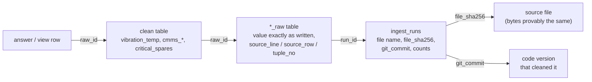

# Ingest scripts

One style for every data source: settings from one shared `.env`, small cleaning
steps chained with `.pipe()`, each load in a single transaction, `--dry-run` to
check parsing without a database, lineage back to the source file, and a summary
you can paste into the data quality report.

How the cleaned tables connect: **[ER diagram](docs/er_diagram.md)**.

| Script | Source | Details |
|---|---|---|
| `scripts/ingest_logs.py` | Sensor log CSV (`vibration_temp_*.csv`) | [`ingest_logs.md`](docs/ingest_logs.md) |
| `scripts/ingest_spares.py` | Critical spares sheet (`critical_spares.xlsx`) | [`ingest_spares.md`](docs/ingest_spares.md) |
| `scripts/ingest_cmms.py` | CMMS SQL dump (`jurongmarine_cmms.sql`) | [`ingest_cmms.md`](docs/ingest_cmms.md) |
| `scripts/relationships.py` | The loaded tables: links the three sources | [`relationships.md`](docs/relationships.md), [ER diagram](docs/er_diagram.md) |
| `scripts/agent_user.py` | Creates the app's read-only database user (PDPA) | [below](#database-access-for-the-app-pdpa) |

```bash
python -m venv .venv
source .venv/bin/activate                 # Windows: .venv\Scripts\activate
pip install -r requirements-dev.txt       # pandas, sqlalchemy, pymysql, ... + pytest
cp .env.example .env                      # set the passwords
pytest                                    # tests, no DB needed (see "Testing with pytest")

docker compose up -d                      # MySQL 8.4 on localhost:3307
docker compose ps                         # wait for "healthy"

python scripts/ingest_logs.py   data/logs/vibration_temp_2026H1.csv --dry-run
python scripts/ingest_logs.py   data/logs/vibration_temp_2026H1.csv --recreate   # first load
python scripts/ingest_spares.py data/tabular/critical_spares.xlsx --dry-run
python scripts/ingest_spares.py data/tabular/critical_spares.xlsx --recreate     # first load
python scripts/ingest_cmms.py   data/sql/jurongmarine_cmms.sql --dry-run
python scripts/ingest_cmms.py   data/sql/jurongmarine_cmms.sql --recreate        # first load

python scripts/relationships.py --mermaid docs/er_diagram.md   # link the sources (after the loads)
python scripts/agent_user.py                                   # the app's read-only user, then a check
```

Use `--recreate` on the first load and after any schema change; afterwards run
without it. Run `relationships.py` again after every load: it re-checks the links
and refreshes the views and the ER diagram.

With uv (personal repo): `uv sync`, then put `uv run` in front of each command,
e.g. `uv run python scripts/ingest_cmms.py data/sql/jurongmarine_cmms.sql --dry-run`.

## Database (Docker)

`docker-compose.yml` runs MySQL in a container, configured from the same `.env`
as the scripts: on first start it creates `DB_NAME` and the user
`DB_USERNAME`/`DB_PASSWORD`. Data lives in the `mysql-data` volume, so it
survives `docker compose down`; `docker compose down -v` wipes it.

Changing `DB_NAME`, `DB_USERNAME` or a password in `.env` after the first start
has no effect on the existing database. Either change it in MySQL, or wipe and
recreate with `docker compose down -v && docker compose up -d`.

```bash
# MySQL shell inside the container
docker compose exec mysql sh -c 'mysql -u"$MYSQL_USER" -p"$MYSQL_PASSWORD" "$MYSQL_DATABASE"'
```

GUI clients (MySQL Workbench, DBeaver) connect to `localhost:3307` from Windows.

### The client's CMMS dump

Load it with **`ingest_cmms.py`** (see the quick start and
[`ingest_cmms.md`](docs/ingest_cmms.md)). The script parses the dump
without executing it, cleans it, and writes `cmms_*` tables with lineage, like the
other sources. This is the path to use for the app and the audit.

Running the dump directly in MySQL is only for browsing the client's tables as they
are. It runs as root and executes whatever the dump contains, including any
`DROP TABLE` or `CREATE DATABASE`, so look at the dump first:

```bash
grep -nE '^(DROP|CREATE) (TABLE|DATABASE)|^USE ' data/sql/jurongmarine_cmms.sql   # what it will do
docker compose exec -T mysql sh -c 'mysql -uroot -p"$MYSQL_ROOT_PASSWORD"' < data/sql/jurongmarine_cmms.sql
```

If the dump creates its own database (e.g. `jurongmarine_cmms`), grant the ingest
user access to it:

```bash
docker compose exec mysql sh -c 'mysql -uroot -p"$MYSQL_ROOT_PASSWORD" -e "GRANT ALL ON jurongmarine_cmms.* TO \"$MYSQL_USER\"@\"%\""'
```

The `cmms_` prefix keeps `ingest_cmms.py`'s tables apart from the dump's own
`machines`, `work_orders`, ... tables, so both can live in the same database.

## Tables

The [ER diagram](docs/er_diagram.md) shows the cleaned tables and how they link;
`relationships.py --mermaid docs/er_diagram.md` regenerates it.

| Table | What it holds | Made by |
|---|---|---|
| `ingest_runs` | One row per run: script, file name, file SHA-256, git commit, time, row counts, `success`/`failed` + error. `relationships.py` runs appear as source `(database)` | every script |
| `vibration_temp_raw` | Every CSV row exactly as in the file (text), with `source_line`, `status` (`loaded`/`rejected`), `reject_reason`, `duplicate_of_raw_id`, `warnings` | [`ingest_logs`](docs/ingest_logs.md) |
| `vibration_temp` | Cleaned readings only; `raw_id` links each to its raw row | [`ingest_logs`](docs/ingest_logs.md) |
| `vibration_temp_audit` (view) | Clean + raw + run joined: use this for citations | [`ingest_logs`](docs/ingest_logs.md) |
| `critical_spares_raw` | Every sheet row exactly as written (text), with `source_row`, `source_rev`, `status`, `reject_reason`, `duplicate_of_raw_id`, `warnings` | [`ingest_spares`](docs/ingest_spares.md) |
| `critical_spares` | Cleaned parts only; `raw_id` links each to its raw row | [`ingest_spares`](docs/ingest_spares.md) |
| `critical_spare_machines` | Part to machine links (`CNC-01/02/03` split into three rows) | [`ingest_spares`](docs/ingest_spares.md) |
| `critical_spares_audit` (view) | Clean + raw + run joined: use this for citations | [`ingest_spares`](docs/ingest_spares.md) |
| `cmms_<table>_raw` | For `machines`, `employees`, `work_orders`, `safety_incidents`: every INSERT tuple exactly as in the dump (text), with `source_line`, `tuple_no`, `raw_tuple`, `status`, `reject_reason`, `duplicate_of_raw_id`, `warnings`. The dump's `work_orders.status` is stored as `status_src` | [`ingest_cmms`](docs/ingest_cmms.md) |
| `cmms_<table>` | Cleaned rows only; `raw_id` links each to its raw row. Incidents carry `severity_as_logged`, `severity_scale` and `severity_5_worst` | [`ingest_cmms`](docs/ingest_cmms.md) |
| `cmms_<table>_audit` (view) | Clean + raw + run joined: use this for citations | [`ingest_cmms`](docs/ingest_cmms.md) |
| `table_relationships` | One row per link between sources (see below): child and parent column, `fk`/`soft`, rows checked, matched, orphans and which keys, `run_id` of the run that checked it | [`relationships`](docs/relationships.md) |
| `machine_overview` (view) | One row per machine: work orders, breakdowns, open WOs, incidents, lost days, spares, spares below min, sensor readings and their date range | [`relationships`](docs/relationships.md#views) |
| `machine_spares` (view) | Spares per machine, with `ALL` expanded to every machine | [`relationships`](docs/relationships.md#views) |
| `work_order_detail` (view) | Work orders + machine + employee trade/shift (no names) | [`relationships`](docs/relationships.md#views) |
| `incident_detail` (view) | Incidents + machine + employee trade/shift; severity as `severity_5_worst` only | [`relationships`](docs/relationships.md#views) |
| `work_order_sensor_window` (view) | Each work order with the sensor readings in the 7 days up to it (`--window-days`) | [`relationships`](docs/relationships.md#views) |

Re-loading a sensor file or a CMMS dump replaces that file's rows (other files are
kept). The spares sheet is a complete list, so each spares load replaces all spares
rows with the new sheet; `ingest_runs` keeps the history of what was loaded when.
Spares `raw_id` = `run_id * 100000 + sheet row`, so `300008` is run 3, row 8.

## Linking the sources

The ingest scripts load each source on its own. `relationships.py` ties them together
through their shared keys and is safe to run after every load:

| Link (child -> parent) | Kind |
|---|---|
| `cmms_work_orders.machine_id` -> `cmms_machines.machine_id` | FK with `--foreign-keys`, if no orphans |
| `cmms_safety_incidents.machine_id` -> `cmms_machines.machine_id` | FK with `--foreign-keys`, if no orphans |
| `vibration_temp.machine_id` -> `cmms_machines.machine_id` | FK with `--foreign-keys`, if no orphans |
| `critical_spare_machines.machine_code` -> `cmms_machines.machine_id` | soft: `ALL` means every machine |
| `critical_spare_machines.part_no` -> `critical_spares.part_no` | FK, made by `ingest_spares.py` |
| `cmms_work_orders.emp_code` -> `cmms_employees.emp_code` | soft: `emp_code` is not unique by design |
| `cmms_safety_incidents.emp_code` -> `cmms_employees.emp_code` | soft: `emp_code` is not unique by design |

Each run checks every link (rows, matched, NULL, **orphans**: child keys with no
parent), prints the result, writes it to `table_relationships`, creates the views
above, and records itself in `ingest_runs`. Orphans are flagged in the views
(`machine_known`, `employee_known`), never dropped. Look at the orphan keys after
loading the full sensor CSV: lookalikes of real machine ids (`CNC2` for `CNC-02`)
mean the sources spell machines differently.

```bash
python scripts/relationships.py --dry-run --mermaid docs/er_diagram.md   # no database needed
python scripts/relationships.py                                          # check + catalog + views
python scripts/relationships.py --foreign-keys                           # also enforce where clean
python scripts/relationships.py --drop-foreign-keys                      # before reloading a source
```

Foreign keys are opt-in: a reload deletes rows they would protect, so while they
exist a reload fails. Order of work: `--drop-foreign-keys`, reload, `--foreign-keys`
(see [Foreign keys](docs/relationships.md#foreign-keys)). Every run is logged too
(see [Run log](docs/relationships.md#run-log)).
The ER diagram of the cleaned schema is in [`er_diagram.md`](docs/er_diagram.md); solid
lines are foreign keys, dotted lines are soft links. Details in
[`relationships.md`](docs/relationships.md).

## Database access for the app (PDPA)

The app, and through its tools the LLM, must **never** connect as `DB_USERNAME`: that
user owns every table, including `cmms_employees.emp_name`. Telling the model "use the
views" is not protection; the database has to refuse. `agent_user.py` creates a separate
user that can only `SELECT` from an allow-list:

| The app user can read | It can't |
|---|---|
| the linking views (`machine_overview`, `machine_spares`, `work_order_detail`, `incident_detail`, `work_order_sensor_window`), `table_relationships`, and the `*_audit` views for citations (machines, work orders, incidents, sensor readings, spares) | `cmms_employees`, `cmms_employees_raw`, `cmms_employees_audit`, any `*_raw` table, any write, any schema change |

Views run with their creator's rights (MySQL's default), so the app user reads
`work_order_detail` without any access to the tables underneath. Before granting, the
script refuses any object that has an `emp_name` column, so a view changed later can't
leak names. Add to `.env`:

```bash
AGENT_DB_USERNAME=agent_ro
AGENT_DB_PASSWORD=...              # the app connects with these two
DB_ADMIN_USERNAME=root             # creating users needs an admin account
DB_ADMIN_PASSWORD=...              # falls back to MYSQL_ROOT_PASSWORD
```

```bash
python scripts/agent_user.py --dry-run   # the plan and SQL, password hidden; no database needed
python scripts/agent_user.py             # create/update the user, then check it
python scripts/agent_user.py --check     # only the check (exit 1 if anything is wrong)
```

The check connects **as the app user** and must show every allowed view working and
every probe refused: employee names, the employees table and its audit view, raw rows,
a write, a `CREATE TABLE`. Run it after the first full load: objects that don't exist
yet are skipped, not granted. Run it again after adding a view to the allow-list
(`allowed_objects` in the script). It's also the evidence for the PDPA question on
demo day; run `--check` live.

## Lineage: traceability and reproducibility

Every cleaned value can be followed back to the exact line of the exact file it came
from, and to the exact code that cleaned it. That is what lets the app cite its sources
and what an auditor will test.



| Link | Where it is | What it proves |
|---|---|---|
| clean row -> raw row | `raw_id` on every clean table, joined in the `*_audit` views | which input row produced this value |
| raw row -> place in the file | `source_line` (CSV, header is line 1), `source_line` + `tuple_no` (SQL dump), `source_row` + `source_rev` (spreadsheet) | where to look in the original |
| raw row -> load | `run_id` on every raw row | which load brought it in, and when |
| load -> file | `ingest_runs.file_sha256` | the file you hold is byte-for-byte the one that was loaded |
| load -> code | `ingest_runs.git_commit` | which version of the cleaning rules ran |
| rejected rows | `*_raw` with `status = 'rejected'`, `reject_reason`, `duplicate_of_raw_id` | nothing was dropped silently |
| links between sources | `table_relationships.run_id`; `relationships.py` runs in `ingest_runs` with a fingerprint of the check | how well the sources linked up at that moment |

The views made by `relationships.py` keep `raw_id`, so a row from `work_order_detail` or
`incident_detail` traces through `cmms_work_orders_audit` / `cmms_safety_incidents_audit`.

### Demonstrating traceability

Take a value the app gave as an answer and walk it back to the source. Run the SQL in
the MySQL shell (or DBeaver), the shell commands from the repo root.

**A sensor reading:**

```sql
-- 1. The value, as stored and as written in the file
SELECT temp_c, temp_raw, temp_unit_raw, timestamp_raw, source_file, source_line, run_id, file_sha256
FROM vibration_temp_audit
WHERE machine_id = 'CNC-02' AND sampled_at = '2026-03-14 02:00:00';

-- 2. The load that brought it in
SELECT run_id, script, source_file, file_sha256, git_commit, started_at, status
FROM ingest_runs WHERE run_id = <run_id>;
```

```bash
sed -n '<source_line>p' data/logs/vibration_temp_2026H1.csv   # 3. the line exactly as in the file
sha256sum data/logs/vibration_temp_2026H1.csv                 # 4. must equal file_sha256
git show --stat <git_commit>                                  # 5. the code that cleaned it
```

On Windows: `Get-FileHash -Algorithm SHA256 data\logs\vibration_temp_2026H1.csv`.

Point out what changed on the way. In the sample file, CNC-03's first reading was logged
as `141.4` with unit `F` and is stored as `temp_c = 60.78`; the rule is
`clean_temperatures` in `ingest_logs.py` at that commit.

**A safety incident** (the severity flip the auditor will test):

```sql
SELECT incident_id, incident_date, severity_as_logged, severity_scale, severity_5_worst,
       source_file, source_line, raw_tuple, file_sha256
FROM cmms_safety_incidents_audit WHERE incident_id = 902;
```

```bash
sed -n '<source_line>p' data/sql/jurongmarine_cmms.sql   # the INSERT line holding raw_tuple
```

Incident 902 (16 Apr 2024) was logged as `5` on the old scale (1 = worst), so it appears
as `severity_5_worst = 1`: same incident, translated, with the original kept beside it.

**A spare part:** `critical_spares_audit` gives `source_row` and `source_rev`; open
`critical_spares.xlsx` at that row and check the title says the same revision.

**Nothing lost:** every row read is either loaded or rejected with a reason.

```sql
-- Counts add up for every load
SELECT run_id, script, source_file, rows_read, rows_loaded, rows_rejected,
       rows_read = rows_loaded + rows_rejected AS adds_up
FROM ingest_runs WHERE script LIKE 'ingest_%' AND status = 'success' ORDER BY run_id DESC;

-- The rows behind a run's counts (latest run of each file; older runs' rows were replaced)
SELECT status, reject_reason, COUNT(*) FROM vibration_temp_raw
WHERE run_id = <run_id> GROUP BY status, reject_reason;
```

### Demonstrating reproducibility

Same file + same code = same result. `ingest_runs` records both halves, so a load can be
repeated and compared.

1. **Before a load that matters, commit.** `git_commit` records only `HEAD`; changes
   that aren't committed are not recorded. Check `git status` is clean, then load.
2. **Re-run the load at the recorded commit, without touching the database:**

   ```bash
   git switch --detach <git_commit>                     # the code as it was
   sha256sum data/logs/vibration_temp_2026H1.csv        # same file as file_sha256?
   python scripts/ingest_logs.py data/logs/vibration_temp_2026H1.csv --dry-run
   git switch -                                         # back to where you were
   ```

   `Rows read / loaded / rejected` and the reject reasons must match that run's row in
   `ingest_runs` and the `GROUP BY` above.
3. **Linking reproduces too.** Run `relationships.py` twice with no load in between: both
   runs get the same `file_sha256` (the fingerprint of the check results).

   ```sql
   SELECT run_id, started_at, file_sha256, rows_read, rows_loaded, rows_rejected
   FROM ingest_runs WHERE script = 'relationships.py' ORDER BY run_id DESC LIMIT 2;
   ```

**Compare content, not ids.** `run_id` and `raw_id` are assigned by the database, so they
differ between runs and between databases (spares `raw_id` even contains the `run_id`).
Compare by `source_file` + `source_line` / `source_row` and by the counts.

**Dry run vs real load:** a real load also rejects rows that duplicate rows already
loaded from *other* files, which a dry run can't see. The counts match exactly for the
first file of a source; for later files, the difference is the `duplicate_*` rejects.

## Run summary

Every run, dry or real, ends with counts you can paste into the data quality report.
Each breakdown line ends with its total, for example:

```
Timestamp formats: epoch_ms=4, iso_naive=1, iso_offset=2, unknown=2 (total 9)
Rejected rows: bad_timestamp=2, duplicate_reading=1, missing_machine_id=1 (total 4)
```

Category totals (timestamp formats, temperature units, `trade`, `severity_scale`, ...)
add up to the rows read or loaded, which is a quick check that no row was missed.
`Rejected rows` totals equal the rejected count. Warning totals (`Loaded with gaps`,
`Loaded with warnings`) count **warnings**, not rows: one row can carry several.
Each script's doc shows a full example: [`ingest_logs.md`](docs/ingest_logs.md),
[`ingest_spares.md`](docs/ingest_spares.md), [`ingest_cmms.md`](docs/ingest_cmms.md).
`relationships.py` prints a per-link check instead
(see [`relationships.md`](docs/relationships.md#relationships)).

## Audit queries

```sql
-- Where did this reading come from?
SELECT source_file, source_line, timestamp_raw, temp_raw, temp_unit_raw, temp_c, file_sha256
FROM vibration_temp_audit WHERE machine_id = 'CNC-02' AND sampled_at = '2026-03-14 02:00:00';

-- What was rejected, and why?
SELECT reject_reason, COUNT(*) FROM vibration_temp_raw WHERE status = 'rejected' GROUP BY 1;

-- Duplicates side by side with the row that was kept
SELECT d.source_line, d.`timestamp`, d.temp, d.temp_unit,
       k.source_line AS kept_line, k.`timestamp` AS kept_ts, k.temp AS kept_temp, k.temp_unit AS kept_unit
FROM vibration_temp_raw d JOIN vibration_temp_raw k ON k.raw_id = d.duplicate_of_raw_id;

-- Where did this spare's lead time come from?
SELECT part_no, lead_time_raw, lead_time_min_days, lead_time_max_days, source_file, source_row, source_rev
FROM critical_spares_audit WHERE part_no = 'SEAL-KIT-KSB';

-- Spares rows that were rejected or loaded with warnings
SELECT source_row, part_no, status, reject_reason, warnings FROM critical_spares_raw
WHERE status = 'rejected' OR warnings IS NOT NULL;

-- Incidents on one severity scale, with their source line in the dump
SELECT incident_id, incident_date, severity_as_logged, severity_scale, severity_5_worst,
       source_line, raw_tuple
FROM cmms_safety_incidents_audit ORDER BY incident_date;

-- Incidents the severity rule could not place (resolve before the audit)
SELECT incident_id, incident_date, severity_as_logged, severity_scale
FROM cmms_safety_incidents WHERE severity_5_worst IS NULL;

-- Work orders pointing at unknown machines or employees (fix before adding foreign keys)
SELECT source_line, wo_id, machine_id, emp_code, warnings FROM cmms_work_orders_raw
WHERE warnings LIKE '%unknown_%';

-- How well do the sources link up? (paste into the data quality report)
SELECT name, child_table, child_column, enforced, child_rows, matched_rows, orphan_rows, orphan_values
FROM table_relationships;

-- One machine across all sources
SELECT * FROM machine_overview WHERE machine_id = 'CNC-02';

-- Sensor readings before each CNC-02 work order (is the night shift right?)
SELECT wo_id, wo_date, wo_type, description, readings, vib_avg, vib_max, temp_c_max
FROM work_order_sensor_window WHERE machine_id = 'CNC-02' AND readings > 0 ORDER BY wo_date;

-- Load history
SELECT run_id, script, source_file, status, rows_read, rows_loaded, rows_rejected, started_at
FROM ingest_runs ORDER BY run_id DESC;
```

## Testing with pytest

The tests check the reading and cleaning logic of every script, plus the shared
modules. They run in a few seconds and **need no database, Docker or `.env`**:
each test builds a small messy CSV, spreadsheet or SQL dump (in a temporary folder
or as a string), runs the script's cleaning steps on it, and checks the result.

### Setup

pytest is in `requirements-dev.txt` (not `requirements.txt`, which is only what
the scripts need to run):

```bash
source .venv/bin/activate                 # Windows: .venv\Scripts\activate
pip install -r requirements-dev.txt
```

`pytest.ini` tells pytest where things are, so no other setup is needed:

```ini
[pytest]
pythonpath = scripts    # lets tests "import ingest_logs", "import db_config", ...
testpaths = tests       # where to look for test files
```

### Running

Run from the **repo root** (the folder with `pytest.ini`):

```bash
pytest                                              # all tests
pytest tests/test_logs.py                           # one file
pytest tests/test_spares.py -v                      # one line per test, with names
pytest -k lead_time                                 # only tests whose name contains "lead_time"
pytest -k "spares and not size"                     # combine name filters
pytest -k severity                                  # the CMMS severity-scale tests
pytest tests/test_relationships.py                  # the linking script
pytest tests/test_logs.py::test_temperature_units   # one specific test
pytest -x                                           # stop at the first failure
pytest --lf                                         # re-run only the tests that failed last time
pytest -q                                           # quieter output
```

With uv (personal repo): put `uv run` in front, e.g. `uv run pytest -v`.

### What's tested

| File | Covers | Tests |
|---|---|---|
| `tests/test_logs.py` | [`ingest_logs.py`](docs/ingest_logs.md): ISO/epoch timestamps (incl. the 8-hour bug), timezones, °C/°F, unknown units, every CSV line kept in raw with its line number, clean rows linked to raw, reject reasons, duplicates within the file and against rows already loaded | 8 |
| `tests/test_spares.py` | [`ingest_spares.py`](docs/ingest_spares.md): costs (`$38/spool`), lead times (`2-3 weeks (Germany)`, `local`), metric/imperial sizes, machine lists; on a messy sheet: raw rows and row numbers, `raw_id`, duplicate/missing part numbers, warnings for unreadable values | 18 |
| `tests/test_cmms.py` | [`ingest_cmms.py`](docs/ingest_cmms.md): dump parsing (`;` and quotes inside strings, comments, multi-row INSERTs with line and tuple numbers, column lists, malformed tuples); ids, numbers (`S$1,050`), day-first dates; the severity flip (old scale inverted, July 2025 left unconverted, a confirmed cutover, out-of-range values never guessed); on a messy dump: duplicates and conflicting duplicates, orphan machines/employees flagged not dropped, raw text kept, `work_orders.status` not clashing with the load status | 21 |
| `tests/test_relationships.py` | [`relationships.py`](docs/relationships.md): orphan/NULL/`ALL` counting, keys compared like MySQL (case, spaces), when a foreign key is added or skipped, table prefixes, no view exposes `emp_name`, incidents only offer `severity_5_worst`, the ER diagram, the run fingerprint, successful and failed runs recorded in `ingest_runs` | 33 |
| `tests/test_agent_user.py` | `agent_user.py`: the allow-list never includes employees or raw tables, objects with `emp_name` refused, missing objects skipped, `SELECT`-only grants after a full reset, password never written into SQL or output, bad user/host/database names rejected, MySQL error codes read correctly, errors never include the password | 15 |
| `tests/test_shared.py` | `db_config.py`, `lineage.py`: password never printed, passwords with special characters, values of a failed query kept out of error messages, table-name check, file SHA-256, a run recorded without a file, values passed to MySQL are plain Python types | 7 |

**Not covered:** anything that needs MySQL, i.e. creating tables, views and users,
the inserts, the one-transaction rollback and the `ingest_runs` record. After
changing DDL or load code, check with a real load (`--recreate`) and the audit
queries above; after changing a view in `relationships.py`, run it and query the view;
for the app user's grants, `agent_user.py --check` is the real test.

### Reading the output

```
tests/test_agent_user.py ...............                            [ 15%]
tests/test_cmms.py .....................                            [ 35%]
tests/test_logs.py ........                                         [ 44%]
tests/test_relationships.py .................................       [ 78%]
tests/test_shared.py .......                                        [ 85%]
tests/test_spares.py ..................                             [100%]
========== 102 passed in 0.85s ==========
```

| Mark | Meaning |
|---|---|
| `.` | passed |
| `F` | failed: an `assert` was false. pytest prints the values on both sides |
| `E` | error: the test couldn't run (e.g. an import failed) |
| `s` | skipped: the tests that build a SQLAlchemy engine or URL skip if SQLAlchemy isn't installed; installing `requirements-dev.txt` fixes it |

### When it doesn't work

| Message | Cause | Fix |
|---|---|---|
| `collected 0 items` | pytest isn't running from the repo root, or `tests/` is missing | `cd` to the folder with `pytest.ini`; check `ls tests` |
| `ModuleNotFoundError: No module named 'ingest_logs'` (or `db_config`, `relationships`) | `pytest.ini` not found, or the scripts aren't in `scripts/` | Run from the repo root; check `pythonpath = scripts` matches the folder name |
| `ModuleNotFoundError: No module named 'pandas'` (or `openpyxl`, ...) | Virtual environment not active, or requirements not installed | Activate `.venv`, then `pip install -r requirements-dev.txt` |
| `pytest: command not found` | pytest not installed in the active environment | `pip install -r requirements-dev.txt`, or use `python -m pytest` |

### Adding a test

- Put it in the file for the script it tests (`test_logs.py`, `test_spares.py`, `test_cmms.py`, `test_relationships.py`), or `test_shared.py` for `db_config.py` / `lineage.py`.
- Name the function `test_...`, otherwise pytest won't find it.
- Test the cleaning functions directly with a small `DataFrame` (see `test_temperature_units`), or a whole file through `process()` / `prepare()` using the `tmp_path` fixture (see the `lineage_run` and `messy_sheet` fixtures). For the CMMS script, pass a dump as a string to `parse_dump()` and then `process()` (see `test_pipeline_end_to_end`). For `relationships.py`, pass key counts to `check_relationship()` (see `test_check_counts_matched_null_and_orphans`).
- When you find a new problem in the client's data, add a test with that exact value **before** fixing the code. It fails first, then passes with the fix, and it keeps the problem from coming back. The harness checklist asks for this pattern in your git history.

## Rules worth knowing

**Timezone rule:** `epoch_ms` is UTC; `sampled_at` is Singapore time (UTC+8).
ISO timestamps without an offset are assumed to be Singapore time (`--source-tz`).
See [`ingest_logs.md`](docs/ingest_logs.md).

**Temperatures:** stored in Celsius only (`temp_c`); the reading and unit as
logged stay in `vibration_temp_raw`. Unknown units give `temp_c = NULL`.
See [`ingest_logs.md`](docs/ingest_logs.md).

**Spares sizes and lead times:** sizes in inches and mm both end up in `size_mm`;
lead times like `2-3 weeks (Germany)` become day ranges. See
[`ingest_spares.md`](docs/ingest_spares.md).

**Severity:** the CMMS scale flipped from 1 = worst to 5 = worst in July 2025.
`severity_5_worst` puts every incident on the new scale; always query it, never
`severity_as_logged`. Incidents from July 2025 are left unconverted until the client
confirms the switch-over day; then re-run `ingest_cmms.py` with
`--severity-cutover <date> --severity-ambiguous-until none`. See
[`ingest_cmms.md`](docs/ingest_cmms.md).

**Employee names (PDPA):** `emp_name` stays in `cmms_employees`. None of the linking
views select it; they give `emp_code`, trade and shift only. The app connects as the
read-only user from `agent_user.py`, which the database stops from reading names, so
this holds whatever the model is asked. See
[Database access for the app](#database-access-for-the-app-pdpa) and
[`relationships.md`](docs/relationships.md#views).

**Foreign keys before reloading:** if you ran `relationships.py --foreign-keys`, run
`relationships.py --drop-foreign-keys` before reloading any source or using
`--recreate`, then add them back afterwards. See
[`relationships.md`](docs/relationships.md#foreign-keys).

**Adding a new ingest script:** import `load_db_config`, `add_common_args` from
`db_config` and `start_run`, `finish_run` from `lineage`; write each cleaning rule
as a `df -> df` function and add a test for it. If its tables share a key with
another source, add the link to `RELATIONSHIPS` in `relationships.py`
(see [`relationships.md`](docs/relationships.md#relationships)).