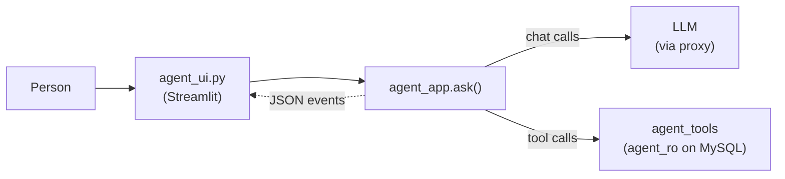
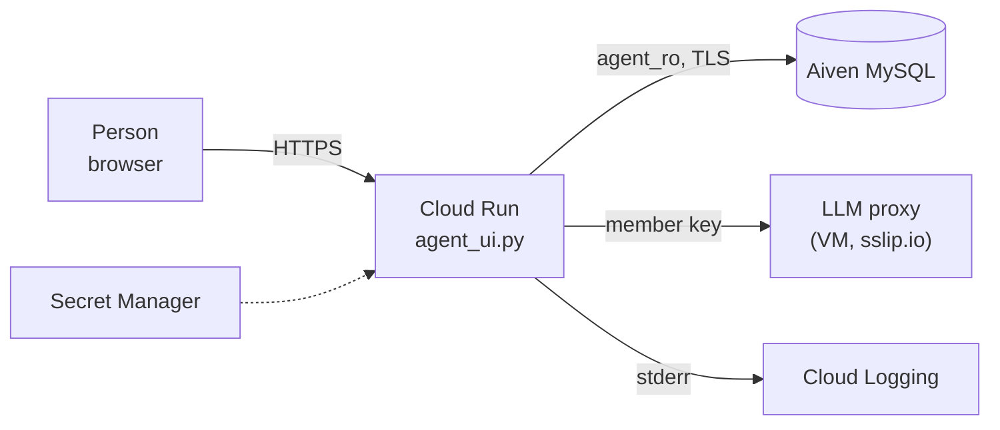

# Agent UI: the demo chat page

`scripts/agent_ui.py` is a Streamlit chat page for the agent, built for the demo. It shows the
path a question takes, from the person to the app, the LLM and the tools, and back.

It is a thin page over `agent_app.py` and adds no agent logic of its own. Every answer comes
with the sources the tools cited. It also has a **What happened** table listing each model call
and each tool call in order, so viewers can watch the path live.



You can run it on your laptop (below) or host it on Google Cloud Run
([Deploying on Cloud Run](#deploying-on-google-cloud-run)).

## What the page shows

- **Title and caption.** The title is "JME maintenance assistant". The caption says that answers
  come only from the shop's own data, through fixed tools, with sources shown.
- **Password box.** This appears only if `APP_PASSWORD` is set. Nothing connects until the
  password is right. The check is constant-time, using `hmac.compare_digest`.
- **Sidebar.**
  - Five example questions you can click: CNC-02 behaviour, CNC-03 oil, blasting-chamber
    entry, welding SOP, and the count of 2025 incidents at severity 4 or worse.
  - A **New conversation** button.
  - The model in use (`agent_app.MODEL`).
- **Chat.** Each answer has a **Sources** list. It also has a **What happened** expander, which
  is open for the latest answer and closed for earlier ones. The expander's table has one row
  per step:

| Step | Detail shown |
|---|---|
| `model, round N` | Which tools the model asked for, or `(answered)`, plus the seconds taken |
| `tool, round N` | Tool name, the arguments the model sent, `ok` or `refused: <error_code>`, plus the seconds taken |
| `model, round N` (failed) | The model call's error |
| `app` | A tool asked a clarifying question that was passed to the user, or the app stopped after too many tool calls |

## Run it locally

This lives in the team repo, so it uses pip. Work from the repo root:

```bash
python -m venv .venv
source .venv/bin/activate            # Windows: .venv\Scripts\activate
pip install -r requirements-app.txt  # includes streamlit
streamlit run scripts/agent_ui.py
```

Streamlit opens the page at <http://localhost:8501>.

The page needs the same `.env` as `agent_app.py`. Set at least the agent database settings,
`OPENAI_API_KEY` and `OPENAI_BASE_URL` (see [Configuration](#configuration)). Leave
`APP_PASSWORD` unset if you don't want a password box on your own machine.

## Configuration

All settings come from environment variables, or from `.env` when you run locally.

| Variable | Used for |
|---|---|
| `DB_HOST`, `DB_PORT`, `DB_NAME` | The MySQL database (Aiven) |
| `AGENT_DB_USERNAME`, `AGENT_DB_PASSWORD` | The read-only `agent_ro` user. `agent_tools.connect()` refuses the owner account (`DB_USERNAME`/`DB_PASSWORD`) |
| `OPENAI_API_KEY` | Your LiteLLM proxy member key |
| `OPENAI_BASE_URL` | The proxy URL |
| `APP_PASSWORD` | Optional page password. If it is unset, there is no password box |
| `AGENT_LOG_FILE` | Path of the JSON log file. Defaults to `logs/agent_app.jsonl`, the same file `agent_app.py` writes. Set it to `off` to turn the file off |

## Logs

Every question's events are written as one JSON line per event. The events are `chat_call`,
`tool_call`, `chat_error`, `clarification_returned` and `max_rounds_exceeded`, plus anything
else `agent_app` logs, such as `scale_guess_blocked`. They go to two places:

- **stderr, always.** On Cloud Run this is what ends up in Cloud Logging.
- **`AGENT_LOG_FILE`**, unless it is set to `off`. The page appends to this file through a
  single shared handler for the whole process.

The **What happened** table is built from these same events.

## How the code is laid out

| Piece | What it does |
|---|---|
| `EXAMPLES` | The sidebar questions |
| `TraceHandler` | A logging handler that collects the JSON events of one question for the on-page table |
| `trace_logger()` | Makes a fresh logger for each question (no propagation). It attaches the trace handler, the shared stderr handler and, if enabled, the shared file handler |
| `trace_rows()` | Turns the events into the table rows |
| `password_ok()` | Constant-time password check |
| `main()` | The Streamlit page: password gate, the cached `connect()` (one DB connection and LLM client per process, through `st.cache_resource`), sidebar, chat history and one question per run |

Conversation state lives in `st.session_state`, in memory and per browser session:

- `messages` holds the model's conversation, from `agent_app.new_conversation()`.
- `shown` holds what is drawn on screen.

Because the state is in memory, the hosted version needs a single instance with session
affinity.

---

# Deploying on Google Cloud Run

This runs `scripts/agent_ui.py` as a container on Cloud Run, next to the
[LiteLLM budget proxy](README-setup-gcp.md). The database stays on Aiven. The page connects to
it as the read-only `agent_ro` user, and reaches the LLM through the proxy.



**Not tested end to end yet.** The Dockerfile and the commands below were written but never
run. Build the service and open it once before you rely on it.

## Files

| File | What it is |
|---|---|
| `Dockerfile` | Python 3.12 slim. Installs `requirements-app.txt`, copies `scripts/` and starts Streamlit on `$PORT` |
| `requirements-app.txt` | Only what the page needs. **Pin the versions** from your working environment before the demo |
| `.dockerignore` | Keeps `.env`, `data/`, `docs/`, `tests/` and `logs/` out of the image |

The image holds no secrets and no data. Settings come from the environment and data comes from
Aiven.

## 0. Get the files into Cloud Shell

`gcloud run deploy --source .` builds whatever is in the current folder, so the files must be in
Cloud Shell first. You need exactly these four items:

```
Dockerfile
.dockerignore            # a hidden file: make sure it is included
requirements-app.txt
scripts/
```

Nothing else is needed. The `Dockerfile` copies the whole of `scripts/`, and `.dockerignore`
keeps everything else out.

**Option A: the zip, like the proxy kit.** On your computer, from the repo root:

```bash
zip -r jme-agent.zip Dockerfile .dockerignore requirements-app.txt scripts -x "scripts/__pycache__/*"
```

On Windows without `zip`, select those four items in Explorer, then choose **Send to** and
**Compressed folder**. Check that `.dockerignore` made it into the zip, because hidden files are
easy to miss.

Then, in Cloud Shell, open the ⋮ menu, choose **Upload** and pick `jme-agent.zip`. Unzip it and
check the files:

```bash
mkdir -p jme-agent && unzip -o jme-agent.zip -d jme-agent && cd jme-agent
ls -la Dockerfile .dockerignore requirements-app.txt scripts/agent_ui.py   # all four must exist
```

**Option B: git.** This works if the team repo on GitHub holds the `Dockerfile` and
`requirements-app.txt` (commit them first):

```bash
git clone <repo-url> && cd <repo>
```

**Option C: deploy from your own computer.** If `gcloud` is installed and logged in there, run
section 2 from the repo root on your computer and skip the upload.

Whichever option you use, stay in that folder for section 2. The deploy command ends with
`--source .`, which means the current folder.

## 1. One-off setup (Cloud Shell)

```bash
PROJECT=your-project-id
REGION=asia-southeast1                  # same region as the proxy
gcloud config set project $PROJECT
gcloud services enable run.googleapis.com cloudbuild.googleapis.com \
    artifactregistry.googleapis.com secretmanager.googleapis.com

# secrets (printf, so no trailing newline is stored)
printf '%s' 'THE_AGENT_RO_PASSWORD' | gcloud secrets create agent-db-password --data-file=-
printf '%s' 'YOUR_PROXY_MEMBER_KEY'  | gcloud secrets create openai-api-key    --data-file=-
printf '%s' 'A_PAGE_PASSWORD'        | gcloud secrets create app-password      --data-file=-

# let the service read them (default Compute Engine service account)
SA=$(gcloud projects describe $PROJECT --format='value(projectNumber)')-compute@developer.gserviceaccount.com
for s in agent-db-password openai-api-key app-password; do
  gcloud secrets add-iam-policy-binding $s --member=serviceAccount:$SA \
      --role=roles/secretmanager.secretAccessor
done
```

Use the **agent_ro** password, never the owner's. `DB_USERNAME` and `DB_PASSWORD` are not set
on Cloud Run, and `connect()` refuses the owner account anyway.

## 2. Deploy (from the folder with the `Dockerfile`, section 0)

```bash
gcloud run deploy jme-agent --source . --region $REGION \
  --allow-unauthenticated --session-affinity \
  --min-instances 0 --max-instances 1 --memory 1Gi --timeout 600 \
  --set-env-vars "DB_HOST=YOUR-SERVICE.aivencloud.com,DB_PORT=12345,DB_NAME=defaultdb,AGENT_DB_USERNAME=agent_ro,OPENAI_BASE_URL=https://35-240-177-226.sslip.io,AGENT_LOG_FILE=off" \
  --set-secrets "AGENT_DB_PASSWORD=agent-db-password:latest,OPENAI_API_KEY=openai-api-key:latest,APP_PASSWORD=app-password:latest"
```

Fill in the Aiven host, port and database name.

`--allow-unauthenticated` makes the URL public, so **`APP_PASSWORD` is what protects the page**.
The page shows a password box first, and nothing connects until the password is right. If the
`app-password` secret is missing, the page is open to anyone with the URL.

To make the page private to Google accounts instead:

1. Deploy with `--no-allow-unauthenticated`.
2. Grant `roles/run.invoker` to each person who should see it.
3. Each person opens it with `gcloud run services proxy jme-agent --region $REGION`. This means
   every viewer needs `gcloud` installed.

`--max-instances 1 --session-affinity` keeps a single container and one conversation per
browser. This matters because Streamlit uses a websocket and keeps each session's state in
memory (see [How the code is laid out](#how-the-code-is-laid-out)).

`AGENT_LOG_FILE=off` stops the page writing the log file. The container's disk is temporary, so
the file would be lost anyway, and the same lines already go to Cloud Logging through stderr.

## 3. Before the demo

- **Open the URL a few minutes early.** With `--min-instances 0`, the first load after the
  service has been idle is slow. For demo day, run
  `gcloud run services update jme-agent --region $REGION --min-instances 1`. Set it back to 0
  afterwards, because an idle instance still costs money.
- **Run the kill-shot questions once on the hosted page.** The What happened table should match
  what you see on your laptop.
- **Check the logs** under **Cloud Run → jme-agent → Logs**. Each line is one JSON event: model
  calls, tool calls with their arguments, and `scale_guess_blocked`.
- **To update the service**, change the code and run the same `gcloud run deploy` command again.

## Troubleshooting

| Symptom | Where | Likely cause |
|---|---|---|
| `ModuleNotFoundError: streamlit` | Local | Run `pip install -r requirements-app.txt` in the active venv |
| No password box | Both | `APP_PASSWORD` is not set (or, on Cloud Run, the secret isn't attached) |
| "Wrong password." when the password is right | Cloud Run | The secret was stored with a trailing newline. Recreate it with `printf '%s'` |
| Page shows "Couldn't connect as the agent user" | Both | One of these: wrong `DB_HOST`/`DB_PORT`; Aiven's allow-list blocks Cloud Run (Cloud Run has no fixed IP, so allow all addresses or add a static egress IP); or Aiven is powered off |
| The connection error mentions secure transport / SSL | Both | Aiven requires TLS, and `db_config.py` has no SSL option yet. Add a `DB_SSL_CA` setting (a small change, with a test) |
| `cryptography` error at login | Both | `cryptography` is missing from `requirements-app.txt` |
| "Set OPENAI_API_KEY" | Both | The key isn't set. On Cloud Run, either the secret isn't attached or the service account can't read it |
| What happened table is empty | Both | `agent_app.ask()` didn't log JSON events to the logger it was given |
| Page loads, then keeps reconnecting | Cloud Run | `--session-affinity` is missing, or more than one instance is running |
| Build fails in a step named `universal_builder` (exit status 51) | Cloud Run | Cloud Run found no `Dockerfile` and tried to guess the language, which means the files aren't in the folder you deployed from. Run the `ls -la` check in section 0 |
| Deploy fails while building | Cloud Run | To see the error, run `docker build -t jme-agent .` locally. Or run `gcloud builds list --limit=1`, then `gcloud builds log <ID> \| tail -40` |