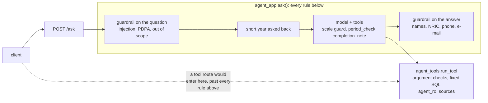

# agent_api.py: an HTTP API over the agent

`scripts/agent_api.py` (11 Nov 2026) puts a JSON API in front of the agent, the same
[LangGraph graph](agent_graph.md) the eval suite tests. Since phase 3 (15 Nov 2026) it is
**the only way in**: the Streamlit page calls it for everything (questions, saved
conversations, photos, spend) through `scripts/api_client.py`, and any other client (a
backend service, a script, a test harness) uses the same routes. It adds no agent logic. Grounding,
citations, the guardrail on both sides of the model, honest degradation and the date rules
all happen inside the graph, the same for every client.

```bash
# personal repo
uv add fastapi uvicorn langgraph langgraph-checkpoint-postgres "psycopg[binary]" psycopg-pool
uv add --dev httpx                                  # only for the route tests
uv run uvicorn agent_api:create_app --factory --app-dir scripts --port 8000

# team repo
pip install -r requirements-api.txt httpx
uvicorn agent_api:create_app --factory --app-dir scripts --port 8000
```

Needs `CMMS_DB_*` (the agent's read-only login), `OPENAI_API_KEY`, `OPENAI_BASE_URL`, `CONV_DB_URL` for
saved conversations ([`conversations.md`](conversations.md): Postgres, set up once with
`conversations.py setup` and `check`), **plus `AGENT_API_KEY`**, 16 characters or
more. Without it the API refuses to start (fail closed, like the guardrail's name list):

```bash
python -c "import secrets; print(secrets.token_urlsafe(32))"     # paste into .env as AGENT_API_KEY
```

FastAPI serves interactive docs for every route at `http://localhost:8000/docs`.

## Routes

Every route except `/health` needs the key in the `X-API-Key` header (compared in constant
time). Errors are JSON, `{"error": {"code": ..., "message": ...}}`, never a stack trace.

| Route | Body / query | Returns |
|---|---|---|
| `GET /health` | (no key) | `status`, `guard_ready`, `sessions` (on / off and why), `store` (`postgres`, or null when off), `model`, `agent` (`langgraph`), `version`. 503 when the guard's name list isn't loaded |
| `POST /ask` | `{"question": "...", "session_id": optional}` | `answer`, `sources`, `notes` (the tools' caveats), `images` (the scans it cites: `sha256`, `what`, `file`), `refused` (the guardrail's rule, or null), `answer_replaced` (rule, or null), `usage` (model calls, tokens, cost from the proxy), `cost_line`, `trace` (the page's What happened rows), `session_id`, `turns`, `saved`, `save_error` |
| `POST /ask/stream` | the same body | `text/event-stream`: `session` (`{"session_id"}`, as soon as the conversation is known, before the model is asked; not sent when conversations are off), a `step` event per step of the turn as it happens, then one `answer` (the `/ask` body) or `error` (`{"status", "error"}`) |
| `GET /sessions?limit=8` | | the newest saved conversations: `session_id`, `title`, `turns`, `updated_at` |
| `GET /sessions/{session_id}` | | one conversation as the page draws it (`messages`, each answer with its `images`), with its `spend` |
| `DELETE /sessions/{session_id}` | | deletes it: its checkpoints, then its row. `{"session_id", "deleted": true}`; one that isn't there counts as deleted |
| `GET /photos/{sha256}` | | the photo an answer cites, as image bytes (`Content-Type` its type; `X-Photo-Variant` `as_is` or `redacted`). From `img_files_public`, so an incident form is only ever the redacted copy, and only if its bytes still match the hash recorded at ingest |
| `GET /usage` | | this deployment's LLM spend against its budget, from the LiteLLM proxy with the API's own key ([`spend.py`](README.md)): `ok`, `spend`, `max_budget`, `used`, `warn`, `budget_reset_at`, `line`, `model`. Always 200; `ok` false says why |

```bash
KEY=...                                                   # your AGENT_API_KEY
curl -s localhost:8000/health
curl -s localhost:8000/ask -H "X-API-Key: $KEY" -H 'Content-Type: application/json' \
     -d '{"question": "what oil does CNC-03 take?"}'
curl -sN localhost:8000/ask/stream -H "X-API-Key: $KEY" -H 'Content-Type: application/json' \
     -d '{"question": "is CNC-02 running differently now?"}'
curl -s localhost:8000/usage -H "X-API-Key: $KEY"
curl -s -X DELETE localhost:8000/sessions/<session_id> -H "X-API-Key: $KEY"
```

**Conversations: LangGraph's checkpointer in Postgres** (13 Nov 2026,
[`conversations.md`](conversations.md)). `session_id` is the conversation's LangGraph thread:
the agent runs from the thread's saved state and saves it when the turn finishes, so no
history is sent back and forth. A threads table keeps each conversation's title, question
count and display copy (the page's format) for `/sessions`, and gives the 7-day retention. A
refused question is never saved as typed, and an answer with personal data never reaches a
checkpoint. Without `CONV_DB_URL` the API still answers; `session_id` is then null and `saved`
false. **One store for every client** (phase 3, 15 Nov 2026): the page reads, lists and deletes
conversations only through these routes, so a conversation started from the page can be
continued from a script and the other way round. `sessions.py` (the page's own MySQL store,
and its `agent_sessions` login) is retired.

**One question at a time per conversation.** A lock per session id makes load, ask and save
one step in this process, so two requests on the same conversation can't both append and lose
one on save. (Two API processes would need the lock in the database; one is enough here.)

**Streaming.** The first event is `session`, sent as soon as the conversation's row is
written (a new one) or loaded (a follow-up), before the model is asked. A client that loses
the stream (the page clicked mid-answer, a network blip) still knows which conversation to
reopen, and the answer is there once the API finishes it. Each `step` is what the [graph](agent_graph.md#what-each-step-reports)
reports per node (`guard_in`, `model`, `tools`, `guard_out`: which tools ran, which round,
whether the answer was replaced), never the question or answer text. A refused question is
one step (`guard_in`, not passed) and then the answer. The question runs in its own thread, so it finishes and
is saved even if the client disconnects; if nothing happens for 300 s (`STREAM_TIMEOUT`) the
stream ends with a 504 `timeout` error, and the question may still finish and be saved.

```text
event: session
data: {"session_id": "3f9c…"}

event: step
data: {"node": "guard_in", "passed": true}

event: step
data: {"node": "model", "round": 1, "tool_calls": ["compare_sensor_trend"]}

event: step
data: {"node": "tools", "round": 1, "tools": ["compare_sensor_trend"]}

event: step
data: {"node": "model", "round": 2, "tool_calls": []}

event: step
data: {"node": "guard_out", "answer_replaced": false, "sources": 2, "model_calls": 2}

event: answer
data: {"session_id": "…", "answer": "…", "sources": […], …}
```

| Status | `code` | When |
|---|---|---|
| 401 | `unauthorised` | no key or a wrong key |
| 422 | `bad_question`, `question_too_long`, `bad_session_id`, `bad_limit`, `bad_sha256` | checked before anything runs; nothing is asked or queried |
| 404 | `unknown_session`, `no_photo` | no conversation with that id (or older than the 7-day retention); no stored photo with that hash, or its bytes no longer match it |
| 503 | `sessions_off`, `store_down`, `db_down` | conversations aren't saved here, the store can't be read or written, or the photo can't be read |
| 504 | `timeout` | `/ask/stream` only: no progress for `STREAM_TIMEOUT` seconds |
| 500 | `internal` | a bug: logged as `api_error` (route and error type only), no trace returned |

## Design

The routes are a thin shell over `AgentService`, whose methods take and return plain Python
(a `Reply`: status and JSON body; a `Photo` for `/photos`) and never raise. So nearly all the tests need neither
FastAPI nor a server, the same way the page keeps its logic in plain functions. Routes are
plain `def`, so FastAPI runs each in its thread pool and a question blocking on the model
for seconds doesn't hold up other requests.

The module must **not** use `from __future__ import annotations`: FastAPI reads the routes'
type hints to know which argument is the JSON body, and with postponed annotations it can't
resolve `AskIn`, which is defined inside `create_app()`. The first draft had the import, and
`/ask` would have failed on a real server (found on review, 11 Nov 2026).

How an answer is shown and kept (the trace rows, the cost line, the display copy saved with
the conversation, the `images` it cites) is built by `scripts/answer_view.py`. Until 15 Nov
2026 those helpers lived in the page and the API imported the page; now the API builds every
answer and the page only draws it, so the dependency runs one way.

Logging: one `api_ask` JSON line per question (refused / replaced rule, saved, model calls),
with only the first 8 characters of the session id, since the full id opens the
conversation (`api_delete` the same way). The question's own events go to
`logs/agent_app.jsonl` and stderr.

Not done yet: hosting it (phase 4). The Cloud Run service runs the page; the API becomes a
second service with the database and LLM secrets plus `AGENT_API_KEY`, and the page then
needs only `AGENT_API_URL` and `AGENT_API_KEY`.

## Why there's no endpoint per tool

The API exposes the **agent**, not the tools it calls. There is no `/tools/list_incidents` or
`/tools/find_sop`: every request goes through `agent_app.ask()`, the same door the page and
the eval suite use. This is on purpose (decided 12 Nov 2026), because of where the app's
safeguards live:



`agent_tools.run_tool()` enforces a lot by itself: it checks the arguments, runs fixed SQL as
the read-only `agent_ro` user (which the database stops from reading names), and returns
sources. But several of the rules the client and the auditor care about are in `ask()`, not in
the tools:

| Rule | Where it lives | What a tool route would skip |
|---|---|---|
| Guardrail on the question (prompt injection, PDPA, out of scope) | `ask()` → `guardrail.check_input` | Every refusal |
| Guardrail on the answer (staff names, NRIC, phone, e-mail) | `ask()` → `guardrail.check_output` | The last check before anything is shown |
| A severity scale the user never named is removed, so the tool asks (trap C1, the kill-shot) | `agent_app.tool_round` → `scale_guessed` | The guard on the scale |
| A period after the data ends is run again for the latest full month, with a note | `agent_app.period_check` | The June fallback and its note |
| "Completed" read as CLOSED, and said | `agent_app.completion_note` | The note that makes the answer say so |
| A year written short is asked back | `agent_app.before_model` | The question back |
| The eval suite, the trace table, the `turn` log line, the spend | the path through `ask()` | All the evidence; a second way in that no eval covers |

So one door means every client, whatever it is, gets the protections the brief asks for
(sources cited, "say so instead of guessing", PDPA), and the 52 eval cases test exactly what
it serves. The brief's client is non-technical and asks in plain English; nothing in the
brief or the checklist asks for raw data over HTTP.

### When tool routes would make sense, and how to add them

Structured data without a model call is worth having for a dashboard or a scripted report
(the same number every time, no cost), for testing a tool on its own, or for another backend
that wants data rather than prose. If that need comes up, the plan is:

- **One generic route**, `POST /tools/{name}` with the tool's arguments as the body, and
  `GET /tools` for the definitions (`agent_tools.tool_schemas()`). Not one hand-written route
  per tool, so a tool changed in `agent_tools.py` can't drift from its endpoint.
- **The same `X-API-Key`**, straight through `agent_tools.run_tool()`: still `agent_ro`, the
  same argument checks, the result with its `sources`, `notes` and `error` as the tool gives them.
- **`query_sql` left out.** The model's SQL is checked and capped; a client sending free SQL is
  a different risk and nothing in the brief needs it.
- **A severity number only with its scale**, so the kill-shot can't be bypassed: the tool's own
  `needs_clarification` comes back as a 422, never a guessed count.
- **Tests** that no tool route ever returns a name, that a refusal stays a refusal, and that
  `query_sql` is refused; and a line in this file saying these answers are data, not checked by
  the eval suite.

About an hour with its tests. Not built, because nothing needs it yet.

## Tests

`tests/test_agent_api.py` (38 tests; no database, no real LLM call; the service tested with
the real agent graph, a scripted model, stubbed tools and real conversations: the threads
table on sqlite3 and LangGraph's in-memory checkpointer). **Access**:
the key compared exactly, no key no service. **Health**: whether it can answer (the guard's name
list), the agent, sessions on/off. **Ask**: empty, non-text and
over-long questions and bad session ids refused with nothing asked; a question starting a
saved conversation (answer, sources, usage, trace, display copy, the checkpointer's copy); a
follow-up reaching the model with the earlier question from the checkpointer; **a restart** (a
new service over the same database and checkpointer) carrying the conversation on, with the
system prompt from the code; a refused question in neither the checkpoint nor the row; **an
answer with personal data reported as replaced and in no key of the saved state**; a new
conversation's row written before its first answer; unknown, unreadable and unsaved conversations (404,
503); answered but not saved without a store; a failed save reported, not hidden; a bug as a
500 with no internals; two questions at once on one conversation both kept. **Conversations**:
one read back with its spend, the recent list newest first, its limit clamped and checked;
**deleting** one removes its row and its checkpoints, twice is fine, a bad id, no store and a
down store each answered. **Photos** (15 Nov 2026): an answer lists each scan it cites once,
and still does after a reload; a photo served by its hash only (a bad hash never reaches the
database); one that can't be read is a 503 with no connection details. **Usage**: the key's
spend and the 80% warning, a proxy that can't be reached, and a bug all answered with 200.
**Streaming**: the `session` event, then five steps, then the answer, saved, with no question
text in the steps; the `session` event out before the model is asked (the model waits for
it); a follow-up streaming its own id, none without saving, and an unknown id one error; a refused
question as one step then the answer; a bad request as one error event; a stalled question
ending the stream with a 504 while it still finishes and is saved; the SSE format. **HTTP**
(only with FastAPI and httpx installed): every route but `/health` refusing a missing key,
`/ask` and `/sessions/{id}` end to end, `/ask/stream` as `text/event-stream` with the
session event, five steps and the answer; `DELETE /sessions/{id}`, `/photos/{sha256}` (bytes,
type and variant header, 404) and `/usage`.

**Written in a sandbox without FastAPI**: the four HTTP tests skip until `fastapi` and
`httpx` are installed (both are in your environment).

`tests/test_api_client.py` (16 tests) covers the page's client: server-sent events read back
as sent (comments, CRLF, split data, a cut-off last event); the key in its header; an API
error keeping its code; an unreachable API as status 0 without the key in the message; a
reply that isn't JSON; a stream read line by line and closed; a refused stream raising before
any event; a missing photo as None; both settings required. End to end through
`ServiceTransport` (the real service and graph): a conversation from first question to
delete, the wrong key getting nothing but `/health`, photos by hash, a bad question as one
error event.