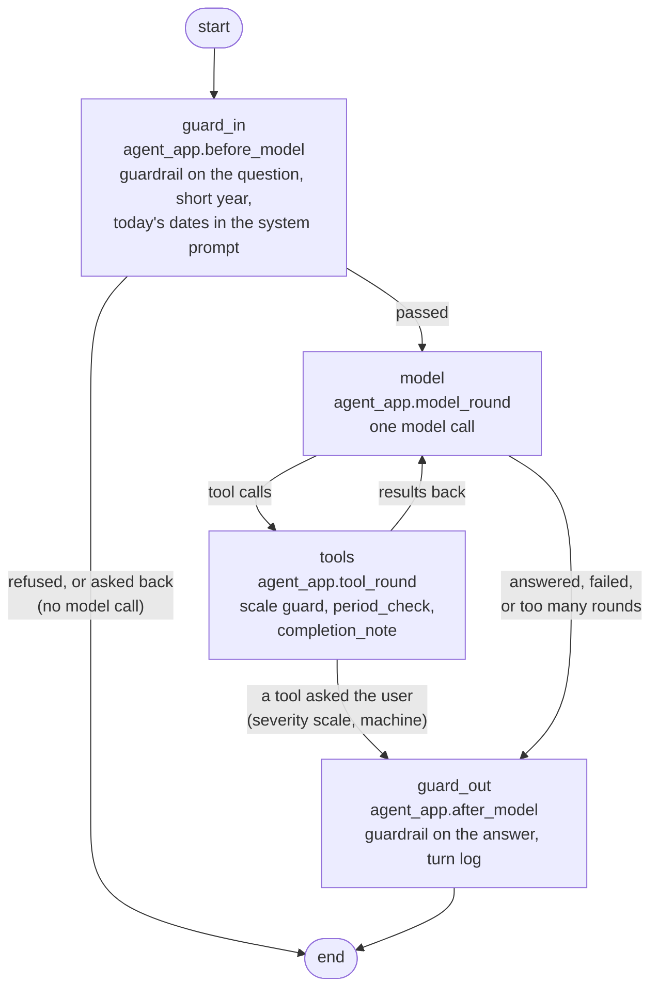

# agent_graph.py: the agent's turn as a LangGraph graph

`scripts/agent_graph.py` (11 Nov 2026) runs a question through the same steps as
[`agent_app.py`'s loop](agent_app.md), as a [LangGraph](https://langchain-ai.github.io/langgraph/)
graph. It adds no agent logic: each node calls one function in `agent_app.py`, and the loop
calls the same four. So everything the [harness checklist](HARNESS_CHECKLIST.md) asks for in
code (grounding, citations, the guardrail on both sides of the model, honest degradation,
relative dates, the short-year and "completed" rules) holds on either engine, and the tests
check that the two give the same turn.



`python scripts/agent_graph.py mermaid` prints the same graph as LangGraph draws it from the
compiled code.

## Running it

```bash
uv add langgraph                                   # personal repo
pip install langgraph                              # team repo

AGENT_ENGINE=graph uv run python scripts/agent_app.py "what oil does CNC-03 take?"
AGENT_ENGINE=graph uv run streamlit run scripts/agent_ui.py
AGENT_ENGINE=graph uv run python scripts/run_evals.py          # the eval suite on the graph
AGENT_ENGINE=graph uv run uvicorn agent_api:create_app --factory --app-dir scripts
```

(Team repo: the same without `uv run`.) `AGENT_ENGINE` is read inside `agent_app.ask()`
on every question, so the CLI, the page, the eval suite and the [API](agent_api.md) all
follow it with no change of their own. Anything other than `graph` runs the loop, which
stays the default. `graph` without langgraph installed also runs the loop and logs
`engine_unavailable` (the API's `/health` reports `engine_in_use: loop`), so a missing
package can't take the demo down.

## How it's built

| Piece | What it is |
|---|---|
| `TurnState` | What LangGraph carries between nodes: `route` (the next node), `round` (model calls so far), `step` (what the node did). Nothing else |
| `Turn` | One question's working set, shared by the nodes: the conversation (ask()'s working copy), the database, the model client, the logger, the usage tally, the sources, tool names and notes collected so far |
| `build(turn)` | The `StateGraph`: four nodes, conditional edges on `route`, compiled per question |
| `run(...)` | `graph.stream(..., stream_mode="updates")`; after each node, a `graph_step` log line and `on_step(step)` if given; returns `(answer, source labels)`, as the loop's `_ask()` does |

**Why the conversation isn't in the graph state.** LangGraph state is meant to be copied,
merged and checkpointed. The conversation already has one owner: `ask()` works on a copy and
puts it back only when the turn finishes (the all-or-nothing rule of 11 Nov 2026), and
`sessions.py` saves it. Keeping it in `Turn` means LangGraph never holds a second copy that
could disagree, and a turn cut off in the middle of the graph leaves the conversation exactly
as it was (tested). A LangGraph checkpointer could replace `sessions.py` later; nothing needs
that today.

**The round limit.** The `model` node counts rounds and stops at `MAX_TOOL_ROUNDS` (6) with
the loop's message, so LangGraph's own `recursion_limit` (set to `4 × rounds + 10`) never cuts
in first.

**What changed in `agent_app.py`.** `run_turn` and `_ask` were split, unchanged, into
`before_model`, `model_round`, `tool_round` and `after_model`; `run_turn` and `_ask` now call
them. `ask()` picks the engine (`engine()`, `graph_ready()`) and takes `on_step`. Nothing else.

## What each step reports

`on_step` gets one dict per node, and the same goes to the log as `graph_step`. It never
contains the question or the answer:

| node | fields |
|---|---|
| `guard_in` | `passed`; `answered_without_model: true` when refused or asked back |
| `model` | `round`, `tool_calls` (names); `failed: true` if the call failed; `stopped: "max_rounds"` |
| `tools` | `round`, `tools` (names run this round); `asked_user: true` for a clarification |
| `guard_out` | `answer_replaced`, `sources` (how many), `model_calls` |

The page's trace table ignores `graph_step` lines (it reads `chat_call`, `tool_call`, ...,
which both engines log identically). Not yet checked: how `read_log.py` prints them.

## Tests

`tests/test_agent_graph.py` (20 tests, no database, no real LLM call). **Eleven scenarios run
through `ask()` on both engines** with the same scripted model and tools, and must agree on
the answer, the source labels, the conversation left in `messages`, the raw sources, the
notes, the usage tally, the number of model calls and every log event (apart from
`graph_step` and timings): a plain answer; a tool round trip with sources and notes; two
rounds with several calls in one; a clarification with no second model call; a failed model
call; too many rounds (the graph's recursion limit never firing first); a question refused by
the guardrail with no model call and nothing of it in the history; an answer with an e-mail
address replaced; a year written short asked back; "completed" read as CLOSED and a guessed
severity scale stripped, in one turn; a conversation saved broken mended the same way.
**What the graph adds**: each step reported in order with no question or answer text, and
logged; a refusal is one step; a callback that raises never breaks the turn; the loop never
calls it; a turn cut off inside the graph leaves the conversation as it was; the engine switch
(case, spaces, unknown values); `graph` without langgraph running the loop and saying so; the
diagram's nodes; the recursion limit's room.

The parity tests were checked by breaking the graph on purpose (raw sources not passed on;
one round too many): each break failed them.

The tests use the real langgraph where it is installed, else `tests/mini_langgraph.py`, a
stand-in for the calls `agent_graph.py` makes (strict about state keys, routes and the
recursion limit). **Written in a sandbox without langgraph, so they have only run against the
stand-in so far.** Install langgraph and run them once to see them pass on the real one.