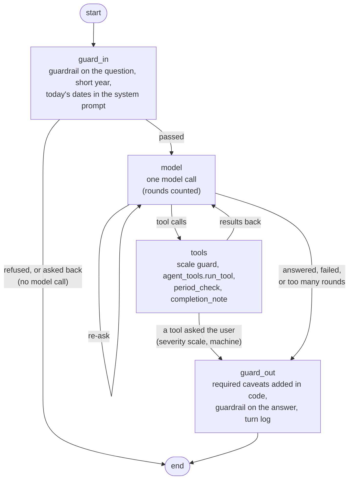
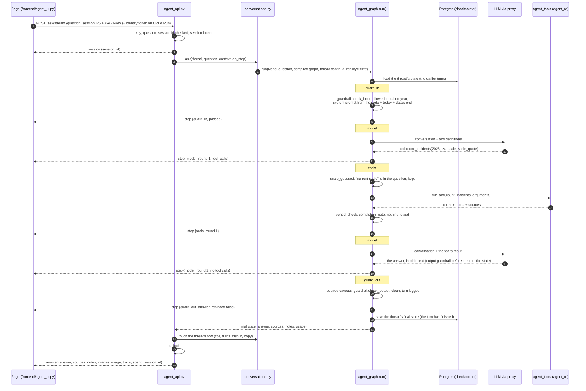

# agent_graph.py: the agent, as a LangGraph graph

`scripts/agent_graph.py` is the agent: one question's turn as a
[LangGraph](https://docs.langchain.com/oss/python/langgraph/overview) graph of four nodes. It
was added on 11 Nov 2026 beside the plain function-calling loop that came first, ran the same
steps, and was tested against it: the same answers, history and log on every test scenario,
and 52/52 on the eval suite (real model, langgraph 1.2.20, 12 Nov 2026). On 12 Nov 2026 it
became the only engine, set up the way production LangGraph apps are: the nodes hold the
turn's logic, the conversation lives in the graph's state, the database and model client
come in through LangGraph's runtime context, and the graph is compiled once per process.
Everything the [harness checklist](HARNESS_CHECKLIST.md) asks for in code (grounding,
citations, the guardrail on both sides of the model, honest degradation, relative dates, the
short-year and "completed" rules) happens in these nodes.



The `re-ask` loop: an answer with facts but no tool call this turn is dropped and the model
asked once more with a tool required (see [How it's built](#how-its-built)).
`python scripts/agent_graph.py mermaid` prints the same graph as LangGraph draws it from the
compiled code.

## Running it

langgraph is a requirement of the agent (`requirements-api.txt`; the page in `frontend/`
doesn't need it):

```bash
uv add langgraph                                   # personal repo
pip install -r requirements-api.txt                # team repo

uv run python scripts/agent_app.py "what oil does CNC-03 take?"
uv run python scripts/run_evals.py
uv run uvicorn agent_api:create_app --factory --app-dir scripts
uv run streamlit run frontend/agent_ui.py          # the page, through the API
```

(Team repo: the same without `uv run`.) All of them run the graph. The CLI and the eval suite
call `agent_app.ask()`, a thin wrapper that runs it once on a conversation. The
[API](agent_api.md) runs the same compiled graph with LangGraph's Postgres checkpointer, one
thread per conversation ([`conversations.md`](conversations.md)), and the page calls the API.
There is no engine switch any more (`AGENT_ENGINE` is gone).

## How it's built

| Piece | What it is |
|---|---|
| `AgentState` | What the graph carries, and what a checkpointer would save: `messages` (the conversation, in the chat API's own dict format), `question`, `round`, `pending` (the tool calls the model just made), `answer`, and this turn's `sources`, `tool_names`, `notes` and `usage`; `route` and `step` for routing and reporting. No reducers: a node returns the whole new value of each key it changes |
| `AgentContext` | What a run needs and the state must never hold: the database connection (`agent_ro`), the model client, the model name, the logger, `max_rounds`, and optionally a `complete_fn`. Passed per run with `context=` (LangGraph's runtime context API, since 0.6) and read in nodes as `runtime.context` |
| the nodes | `guard_in`, `model`, `tools`, `guard_out`: plain functions `(state, runtime) -> changes`. They use the pieces in `agent_app.py` (the prompt, `complete`, `scale_guessed`, `period_check`, `completion_note`, the date rules, the formatting) |
| `build(checkpointer=None)` | The `StateGraph(AgentState, context_schema=AgentContext)`, four nodes, conditional edges on `route`, compiled with an optional checkpointer |
| `graph()` | The graph without a checkpointer, compiled on first use and reused for the life of the process |
| `run(messages, question, context, ...)` | Streams the graph (`stream_mode=["updates", "values"]`); after each node a `graph_step` log line and `on_step(step)` if given; returns the final state |
| `agent_app.ask()` | Mends the conversation (`answered_only`), runs `run()` on a copy, and puts the finished conversation back all at once: a turn cut off half way changes nothing |

**Nodes never change the state they are given.** Each copies what it changes (the
conversation, the sources) and returns the new value. LangGraph doesn't copy state for you,
and a checkpointer saves what is in the state, so a node that appended to the list it was
given could change an earlier snapshot. Tested node by node.

**Nothing unsafe ever enters the state (13 Nov 2026, for the checkpointer).** The question as
typed travels in the context (`AgentContext.question`, set by `run()`), not the input: the
input becomes state, which a checkpointer saves. `guard_in` writes to the state only what may
be kept (the question, or a refused one's placeholder). The `model` node runs the output
guardrail on a plain answer before putting it in the state; `guard_out` checks again after
the caveats. `guard_in` also mends the history (`answered_only`) and puts the system prompt
from the code first, so a thread saved earlier never keeps an old prompt. With a checkpointer
(the API's, [`conversations.md`](conversations.md)), `run()` takes the compiled graph and the
thread in `config`, no `messages`, and `durability="exit"`.

**Each turn starts empty.** `guard_in` resets this turn's sources, notes, tool names, usage and
round. With a checkpointer the state persists between questions, and without the reset one
question's sources and cost would carry into the next.

**Every fact from a tool call made this turn (#1).** If the model answers with facts (any
digit: a count, a date, a cost, an id like CNC-02) and no tool has run this turn, the `model`
node drops that answer and asks once more with `tool_choice="required"`, so the facts are
fetched again and cited (`ungrounded_answer_retried`). Found on the eval run of 13 Nov 2026:
"Which of those are still open?" was answered from the previous turn's tool result in the
conversation, with no tool call and no sources. If the model still calls no tool, the answer
is kept and flagged `ungrounded_answer`. An answer with no digit (a greeting, "I couldn't
check that") is never asked again.

**What the answer must say is checked in code.** When "completed" was read as CLOSED this
turn (`read_as_closed` in the state), `guard_out` checks that the answer says both that and
that work orders are dated when raised, and adds a fixed sentence if not (`caveat_added`;
found on the eval run of 12 Nov 2026, when the model said the first and left out the second).
Likewise, when a question asks how things stand now ("still open", "currently", "now",
"today") and the data ends before today, an answer that doesn't give the data's last day gets
"(The shop's data runs to 30 Jun 2026, so this is how things stood on that date; it may have
changed since.)" (`caveat_added`, `data_end`). Neither is added to a question the tool asks
back, or to the "couldn't reach the model" and "too many tool calls" messages. Both run before
the output guardrail, so the added sentences are guarded too.

**The round limit.** The `model` node counts rounds and stops at `MAX_TOOL_ROUNDS` (6, or
`max_rounds` in the context) with an honest message, so LangGraph's own `recursion_limit` (set
to `4 × rounds + 10`) never cuts in first.

**The conversation is in the chat API's format, not LangChain's.** The app calls the OpenAI
SDK directly (through the LiteLLM proxy) rather than through a LangChain chat model, so the
messages stay plain dicts and `messages` has no `add_messages` reducer. Moving to LangChain's
message classes would change every node and test for no gain here.

**What went.** `run_turn`, `_ask`, the split step functions, `engine()`, `graph_ready()` and
`AGENT_ENGINE` (12 Nov 2026). The constants `CHAT_FAILED` and `ROUNDS_EXHAUSTED` stay in
`agent_app.py`.

## What each step reports

`on_step` gets one dict per node, and the same goes to the log as `graph_step`. It never
contains the question or the answer:

| node | fields |
|---|---|
| `guard_in` | `passed`; `answered_without_model: true` when refused or asked back |
| `model` | `round`, `tool_calls` (names); `failed: true` if the call failed; `stopped: "max_rounds"`; `retry` when an answer with facts and no tool call was dropped; `forced: true` on the call that followed, made with `tool_choice="required"` |
| `tools` | `round`, `tools` (names run this round); `asked_user: true` for a clarification |
| `guard_out` | `answer_replaced`, `sources` (how many), `model_calls` |

The page's trace table ignores `graph_step` lines (it reads `chat_call`, `tool_call`, ...).
Not yet checked: how `read_log.py` prints them.

## Worked example: one question, from the front end to the database and back

The question: **"How many incidents in 2025 were severity 4 or worse on the current scale?"**,
asked on the page as a follow-up in a saved conversation. The page sends it to the API's
`POST /ask/stream`; the API runs the graph on the conversation's LangGraph thread, and each
node calls into `agent_app.py` for the work. (The CLI and the eval suite go through
`agent_app.ask()` instead, with no checkpointer; from the graph on, everything below is the
same.)



**1. Page → API.** The page sends the question and the conversation's id with the
`X-API-Key` header (on Cloud Run also a Google identity token: the API is private,
[`agent_api.md`](agent_api.md#hosting-a-private-cloud-run-service)). Before anything is asked:

- the key is compared in constant time (a wrong one gets a 401);
- the question and the id are checked (an empty or over-long question, or a malformed id,
  gets a 422 and nothing runs);
- a lock is taken on that conversation, so a second request on it waits;
- the conversation's id goes back as the stream's first event (`session`), so a page that
  loses the stream can still reopen it;
- the question runs in its own thread, and a queue carries each step back as a server-sent
  event.

**2. API → the graph.** `Conversations.ask()` runs the graph compiled once with the
checkpointer, on the thread whose id is the session id. No history is sent: the graph starts
from the thread's saved state. The question as typed and the database, model client and logger
come in as the run's context (`AgentContext`), which LangGraph never saves.

**3. The nodes.**

| Node | In code | In this example |
|---|---|---|
| `guard_in` | `guard_in()` | Mends the history (`answered_only`), puts the system prompt from the code first. `check_input` allows the question (no injection, no person, in scope). No short year. Today's date and where the data ends (30 Jun 2026) go into the system prompt; the question is appended. Had it been refused, only a placeholder would go into the state and the graph would end here, with no model call |
| `model` (round 1) | `model()` | One call through the LiteLLM proxy with the tool definitions. The model picks `count_incidents` with 2025's dates, `at_least_as_severe_as: 4`, a severity scale and `scale_quote: "current scale"`. Its reply is appended, its cost read from the proxy's header |
| `tools` (round 1) | `tools()` | `scale_guessed()` finds "current scale" in the question, so the scale stays (had the user not named one, it would be stripped and the tool would ask, trap C1). `agent_tools.run_tool()` checks the arguments and runs the fixed SQL as `agent_ro`, returning the count, its notes (incidents from July 2025 can't be placed on one scale) and its sources. `period_check` and `completion_note` have nothing to add. The result goes into the conversation |
| `model` (round 2) | `model()` | The model answers in plain text, carrying the tool's notes as caveats; the output guardrail checks it before it enters the state |
| `guard_out` | `guard_out()` | Adds any required caveat (data's end, "completed"), then `check_output` finds no staff name, NRIC, phone number or e-mail (if it did, the answer would be replaced, in the history too). The `turn` line is logged, the source labels collected |

After each node, `run()` logs a `graph_step` line and calls `on_step`, which the API sends to
the page as a `step` event.

**4. Back out.** With `durability="exit"`, the checkpointer saves the thread once, when the
turn has finished: a turn cut off half way leaves the saved conversation as it was. The API
builds the reply (the answer, its sources and caveats, the scans it cites, usage and cost, the
trace from the logged events, and the conversation's spend: `scripts/answer_view.py`), writes
the threads row with the display copy (so `?session=<id>` reopens it on the page), releases
the lock, and sends the last event.

What the page receives:

```text
event: session  {"session_id": "…"}
event: step     {"node": "guard_in", "passed": true}
event: step     {"node": "model", "round": 1, "tool_calls": ["count_incidents"]}
event: step     {"node": "tools", "round": 1, "tools": ["count_incidents"]}
event: step     {"node": "model", "round": 2, "tool_calls": []}
event: step     {"node": "guard_out", "answer_replaced": false, "sources": 1, "model_calls": 2}
event: answer   {"answer": "…", "sources": […], "notes": […], "session_id": "…", …}
```

**Other paths through the same graph:**

- **A PDPA question** ("What is the name of employee EMP015?"): one step,
  `{guard_in, passed: false, answered_without_model: true}`, then the answer. The model is
  never called.
- **No scale named** ("severity 4 or worse in 2025?"): `scale_guessed` strips the model's
  guess, the tool returns `needs_clarification`, and `tools` goes straight to `guard_out`
  with `asked_user: true`. The user gets the tool's question; the model isn't called again.
- **"Last month"**: the model asks for October 2026; `period_check` finds it's after the data
  ends, runs the same tool for June 2026, and hands the model both results with a note to say so.

## Tests

`tests/test_agent_graph.py` (31 tests, no database, no real LLM call). Until 12 Nov 2026 these
ran eleven scenarios through both the old loop and the graph and required the same result;
with the loop gone, the same scenarios check the graph's behaviour directly, through `ask()`:
a plain answer; a tool round trip with sources and notes; two rounds with several calls in
one; a clarification with no second model call; a failed model call; too many rounds (the
graph's recursion limit never firing first), and the limit taken from the context; a question
refused by the guardrail with no model call and nothing of it in the history; an answer with
an e-mail address replaced in the history too; a year written short asked back; "completed"
read as CLOSED and a guessed severity scale stripped, in one turn; a conversation saved broken
mended. **How it's put together**: one compiled graph per process; the state holding the
conversation and this turn's results and nothing from the context; the database, client and
model reaching the nodes through the context; a `complete_fn` in the context used; nodes never
changing the state they are given (each node run by hand on a deep-copied state); each turn
starting with empty results whatever the state held. **What it reports**: each step in order,
with no question or answer text, and logged; a refusal as one step; a callback that raises
never breaking the turn; a turn cut off inside the graph leaving the conversation as it was;
the loop and the engine switch gone; the diagram; the recursion limit. Found on the eval run of
13 Nov 2026: **every fact from a tool call made this turn** (an answer with facts and no tool
call asked again with `tool_choice="required"`, the dropped answer kept out of the history,
asked once only, then flagged `ungrounded_answer`).

The tests that drove the old loop directly (eight in `test_agent_app.py`, four in
`test_multiturn.py`, one in `test_clarify.py`) now go through `ask()` with the same checks.
Checked by breaking the graph on purpose (the leaked answer left in the history; a turn's
results not reset): each break failed the tests.

The tests use the real langgraph where it is installed, else `tests/mini_langgraph.py`, a
stand-in for the calls `agent_graph.py` makes (state keys, routes, runtime context, stream
modes, the recursion limit). `tests/conftest.py` puts it in place when langgraph is missing
and says which one ran in the report header. Run on the real langgraph (1.2.20) since
12 Nov 2026.