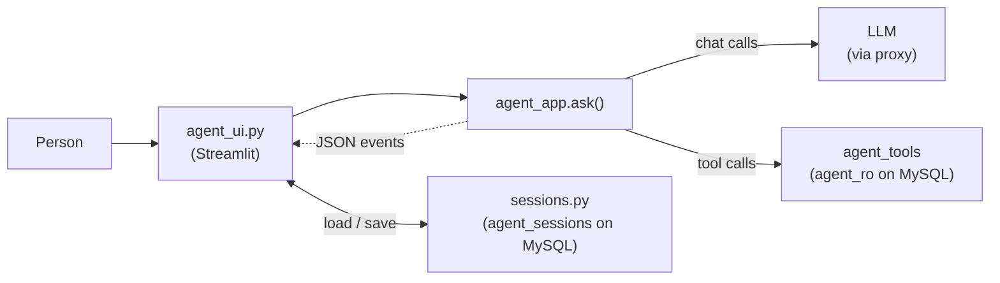
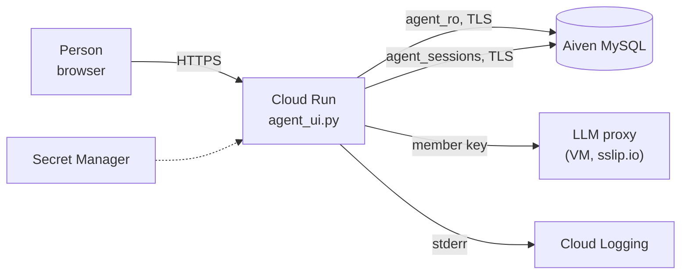

# Agent UI: the demo chat page

`scripts/agent_ui.py` is a Streamlit chat page for the agent, built for the demo. It shows the
path a question takes, from the person to the app, the LLM and the tools, and back.

It is a thin page over `agent_app.py` and adds no agent logic of its own. Every answer comes
with the sources the tools cited. It also has a **What happened** table listing each model call
and each tool call in order, so viewers can watch the path live.



You can run it on your laptop (below) or host it on Google Cloud Run
([Deploying on Cloud Run](#deploying-on-google-cloud-run)).

## What the page shows

Each part of the page has one place (layout reworked 10 Nov 2026; until then the sidebar
held the examples, the recent conversations and the spend together, and was congested). The
page uses Streamlit's wide layout.

- **Password box.** This appears only if `APP_PASSWORD` is set. Nothing connects until the
  password is right. The check is constant-time, using `hmac.compare_digest`.
- **Sidebar: conversations only.**
  - A **New conversation** button.
  - **Recent**: the eight saved conversations answered most recently, each titled by its
    first question, with how many questions and how long ago. Click one to open it here;
    the one on the page is greyed out ("open now").
  - **Fold earlier questions**, a toggle ([below](#what-the-page-shows)): on, only the latest
    exchange is open; off, the whole conversation is shown.
  - Whether this conversation is being saved
    ([below](#the-conversation-survives-a-restart)): a quiet line when it is, a warning when
    it isn't.
- **Top bar.**
  - The title, "JME maintenance assistant", and a caption saying that answers come only from
    the shop's own data, through fixed tools, with sources shown.
  - **Examples**, a lightbulb icon (`EXAMPLES_ICON`, tooltip "Example questions") opening a
    popover with the six example questions, once a conversation has started. An icon, not
    the word: the word was cut off in its narrow column.
  - The **usage** popover, a payments icon at the right (`USAGE_ICON`). Hovering it shows
    the model and this conversation's cost (`gpt-4o-mini · $0.0031`). Open it for the model,
    "This conversation: $X over N questions" (added up from the answers on the page, so it is
    the same after a reload or reopening a saved conversation), and the key's spend against
    its budget, from the proxy.
  - When the key is near or over its cap, or the proxy can't be reached, a warning also shows
    across the page, under the top bar, so it can't be missed inside a closed popover.
- **A new conversation** opens on the six example questions as a grid of buttons: CNC-02
  behaviour, CNC-03 oil, blasting-chamber entry, welding SOP, the count of 2025 incidents at
  severity 4 or worse, and an employee's name. The last one is refused by the guardrail on
  purpose, and its tooltip says so. The grid goes once a question is asked.
- **Only the latest exchange is open**, by default. Every earlier question and answer folds
  into one expander at the top, "Earlier in this conversation (N questions)", so the page
  stays short and still reads top to bottom (`split_latest()`, `earlier_label()`,
  `history_parts()`). Asking a new question folds the previous exchange straight away: the
  page reads the chat box before it draws the history. A reopened conversation folds the same
  way. The sidebar's **Fold earlier questions** toggle turns this off, to show the whole
  conversation as a normal chat; the choice lasts for the browser session. (Considered and not done: newest
  first. The chat box is pinned to the bottom, and follow-ups would read bottom to top.)
- **A new question is scrolled into view**, whether typed or picked from the examples. A
  picked one isn't typed into the chat box, so Streamlit didn't scroll to it, and it landed
  below the visible page unseen (10 Nov 2026). `scroll_script()` is an invisible component
  that scrolls the newest message to the top of the view.
- **Less space above the title**: `TOP_CSS` cuts Streamlit's default top padding (about
  6rem) to 2.5rem. It also gives the usage popover's panel a minimum width (24rem): it took
  the width of its narrow icon column and cut its lines off.
- **Each answer**: its text, one line with what it cost, then tabs for what it rests on, only
  for what it has, each with a count:
  - **Sources**: the sources the tools cited.
  - **Caveats**: the tools' notes ([below](#notes-from-the-data)).
  - **Photos**: the scans the tools cited ([below](#photos-under-the-answer)).
  - **What happened**: one row per step, as below. On the **newest** answer this is the
    first tab, so it is the one open (Streamlit always opens a tab group on its first tab);
    on earlier answers it is last.

| Step | Detail shown |
|---|---|
| `model, round N` | Which tools the model asked for, or `(answered)`, the call's cost when the proxy gave one, plus the seconds taken |
| `tool, round N` | Tool name, the arguments the model sent, `ok` or `refused: <error_code>`, plus the seconds taken |
| `model, round N` (failed) | The model call's error |
| `app` | A tool asked a clarifying question that was passed to the user, or the app stopped after too many tool calls |
| `guardrail` | The question was refused in code before the model was called, the staff name list wasn't loaded (fail closed), or the answer was replaced before it was shown |

## The conversation survives a restart

The page's link carries the conversation's id (`?session=...`). After every answer the page
saves the conversation through [`sessions.py`](sessions.md), to a table only the
`agent_sessions` user can touch. When the page starts (a refresh, a redeploy, Cloud Run
starting a new container, another device) it loads the conversation for the link's id, draws the
answers again and hands the model the earlier messages, so a follow-up keeps its context.

The sidebar's **Recent** list shows the eight newest saved conversations, so one can be
reopened without its link. Clicking one does what opening its link would. A title is the
first question as `messages` keeps it, so a question the guardrail refused shows only as its
placeholder. Everyone behind the page password sees the same list: the page has no user
accounts. Details in [`sessions.md`](sessions.md#recent-conversations-in-the-sidebar).

The conversation's spend in the usage popover is its own total, added up from its answers
(`conversation_spend`), not a counter in page memory. Until 10 Nov 2026 it was a counter,
which started at $0 on every load, so a reopened conversation showed "$0.0000 over 0
questions" ([`sessions.md`](sessions.md#the-conversations-spend-after-a-reload)).

A question the guardrail refuses is saved, and drawn again after a reload, only as its
placeholder (`kept_question()`), the same as in `messages`. Before 9 Nov 2026 the saved
display copy kept it as typed ([`sessions.md`](sessions.md#what-is-stored)).

If `CMMS_DB_SESSION_PASSWORD` isn't set, or MySQL is down, the sidebar says the conversation
isn't being saved, and the page carries on in memory as before. Details, setup and the check in
[`sessions.md`](sessions.md).

## Notes from the data

Every tool result carries `notes`: caveats the answer must keep (a value read off a scan by
a person, an OCR value not reliably read, a description that doesn't fit its machine, a
severity converted between scales). The system prompt tells the model to carry each one, but
on 7 Nov 2026 the live page answered incident 911 without its note that the form's severity
was read by a person. So the page also shows the tools' notes itself, once each, under every
answer (`agent_app.ask(..., notes=[...])`, `format_notes`, `show_notes`), in the answer's
**Caveats** tab. It is not the tab that opens by default, because with the prompt rule the
answer usually says them already in plainer words, and showing both repeated them; the tools'
wording is written for the model and names the trap-list item, which is what an auditor
wants. One click away whether or not the model said them. (Until 10 Nov 2026 this was a
closed expander, "Caveats from the data (N), as the tools gave them".)

## Photos under the answer

When a tool cites a scan (a nameplate photo or an incident form), the page shows the photo
in the answer's **Photos** tab, so "check the photo" in an answer is something the user can do
there and then. The model never handles images or links: `agent_app.ask(..., raw_sources=[...])`
hands back the tools' source records, and `photo_items()` fetches the photo behind each
image source.

- **From the database, not a folder.** The hosted page has no data folder; the photos are
  in `img_files_public` (made by `ingest_images.py`), which `agent_ro` may read.
- **Hash-checked.** `agent_tools.fetch_image` recomputes the SHA-256 of the bytes and shows
  nothing if it doesn't match the one recorded at ingest.
- **Incident forms only redacted.** The database holds no unredacted form: the "Person
  involved" value and the signature box are covered, and the caption says so.
- **No public link, not even an internal one.** The photo is drawn with its bytes inside the
  page (a `data:` URL, `img_html`), not with `st.image`. `st.image` keeps the bytes in the
  server's memory and has the browser fetch them from a `/media/...` link in a second
  request; on Cloud Run that request can miss (another or restarted container, media
  released after a rerun, a tab from before a redeploy) and the photo shows **broken**. That
  happened on the live page on 7 Nov 2026 (CNC-03's nameplate).
- A source whose photo isn't stored (a form that couldn't be redacted, a load with
  `--no-photos`) gets "photo not available here" instead.
- Photos are not saved with the conversation, so an answer reloaded after a restart shows its
  text, sources and caveats without the photo (and without its Photos tab).

## Run it locally

This lives in the team repo, so it uses pip. Work from the repo root:

```bash
python -m venv .venv
source .venv/bin/activate            # Windows: .venv\Scripts\activate
pip install -r requirements-app.txt  # includes streamlit (1.36 or later)
streamlit run scripts/agent_ui.py
```

With uv (personal repo): `uv pip install -r requirements-app.txt`, then
`uv run streamlit run scripts/agent_ui.py`.

Streamlit opens the page at <http://localhost:8501>.

The page needs Streamlit 1.36 or later (`st.popover`, and `st.columns` with
`vertical_alignment`); `requirements-app.txt` says so. An older one stops with a
`TypeError` or `AttributeError` naming one of those.

The page needs the same `.env` as `agent_app.py`. Set at least the agent database settings,
`OPENAI_API_KEY` and `OPENAI_BASE_URL` (see [Configuration](#configuration)). Leave
`APP_PASSWORD` unset if you don't want a password box on your own machine.

Settings are read once per Streamlit process (`st.cache_resource`). After changing `.env`,
stop Streamlit (Ctrl+C) and start it again; refreshing the browser is not enough.

## Configuration

All settings come from environment variables, or from `.env` when you run locally. The
database settings start with `CMMS_DB_` (since 14 Nov 2026; before that `DB_*`, `AGENT_DB_*`
and `AGENT_SESSION_DB_*`, which are no longer read: see
[Settings](README.md#settings-one-prefix-per-database)).

| Variable | Used for |
|---|---|
| `CMMS_DB_HOST`, `CMMS_DB_PORT`, `CMMS_DB_NAME` | The MySQL database (Aiven: `jme_cmms` since 15 Nov 2026) |
| `CMMS_DB_AGENT_USERNAME`, `CMMS_DB_AGENT_PASSWORD` | The read-only `agent_ro` user. `agent_tools.connect()` refuses the owner account (`CMMS_DB_USERNAME`/`CMMS_DB_PASSWORD`). Without the password the page stops with "Set CMMS_DB_AGENT_PASSWORD" |
| `CMMS_DB_SESSION_USERNAME`, `CMMS_DB_SESSION_PASSWORD` | The `agent_sessions` user, for saved conversations ([`sessions.md`](sessions.md)). Username defaults to `agent_sessions`. Without the password, conversations aren't saved and the sidebar says so |
| `AGENT_SESSION_DAYS` | How long a saved conversation is kept after its last answer (default 7) |
| `OPENAI_API_KEY` | Your LiteLLM proxy member key |
| `OPENAI_BASE_URL` | The proxy URL |
| `APP_PASSWORD` | Optional page password. If it is unset, there is no password box |
| `AGENT_LOG_FILE` | Path of the JSON log file. Defaults to `logs/agent_app.jsonl`, the same file `agent_app.py` writes. Set it to `off` to turn the file off |

## Logs

Every question's events are written as one JSON line per event. The events are `chat_call`,
`tool_call`, `chat_error`, `clarification_returned` and `max_rounds_exceeded`, plus anything
else `agent_app` logs, such as `scale_guess_blocked`. They go to two places:

- **stderr, always.** On Cloud Run this is what ends up in Cloud Logging.
- **`AGENT_LOG_FILE`**, unless it is set to `off`. The page appends to this file through a
  single shared handler for the whole process.

The **What happened** table is built from these same events.

## How the code is laid out

| Piece | What it does |
|---|---|
| `TITLE`, `CAPTION`, `EXAMPLES` | The top bar's text, and the example questions (the new conversation's grid and the Examples popover) |
| `example_help()` | The tooltip on an example button: only the one the guardrail refuses gets one |
| `TraceHandler` | A logging handler that collects the JSON events of one question for the on-page table |
| `trace_logger()` | Makes a fresh logger for each question (no propagation). It attaches the trace handler, the shared stderr handler and, if enabled, the shared file handler |
| `trace_rows()` | Turns the events into the table rows |
| `password_ok()` | Constant-time password check |
| `render_answer()`, `evidence_tabs()`, `last_answer()` | One answer: text, cost line, then its tabs. `evidence_tabs()` decides which tabs it gets and their labels, What happened first on the newest answer (`last_answer()`) |
| `show_notes()` | The tools' caveats, in the Caveats tab, from `agent_app.ask(..., notes=...)` |
| `photo_items()`, `show_photos()`, `img_html()` | The photos behind an answer's image sources, fetched and hash-checked, with captions; drawn in the Photos tab as `` tags with the bytes inside (caption HTML-escaped) |
| `cost_line()` | The cost under each answer |
| `conversation_spend()`, `conversation_line()`, `USAGE_ICON`, `usage_help()` | The conversation's spend: the sum of its answers' costs (`cost_usd`, or read back from the cost line of an answer saved before 10 Nov 2026), "at least" when one isn't known; the usage popover's icon and its tooltip, escaped for Markdown |
| `split_latest()`, `history_parts()`, `earlier_label()`, `draw_messages()`, `FOLD_KEY` | The latest exchange drawn open, everything before it folded into one expander, unless the sidebar toggle (`FOLD_KEY` in `st.session_state`) turns folding off |
| `TOP_MARKER`, `TOP_BAR` | The top bar's layout: a marker (an empty `<span id="jme-topbar">` in the caption) lets `TOP_CSS` shrink the two icon columns to their buttons, so the icons sit together at the right edge; the column weights are the fallback for a browser without CSS `:has()` |
| `TOP_CSS`, `scroll_script()` | Less padding above the title; the invisible component that scrolls a new question into view |
| `display_copy()`, `restored()`, `kept_question()`, `save_line()` | What is saved of the display (no photos, no trace, a refused question only as its placeholder, each answer's cost as a number), a loaded conversation turned back into `messages` and `shown` (questions checked again), and the sidebar's saved / not saved line |
| `RECENT`, `recent_label()`, `ago()`, `md_plain()` | The sidebar's list of saved conversations: how many (8), one line each (title, questions, how long ago or "open now"), Markdown escaped |
| `main()` | The Streamlit page: password gate, the cached `connect()` (one DB connection and LLM client per process, through `st.cache_resource`), the cached session store (purges old conversations once per process), the conversation loaded from `?session=`, the sidebar (with `open_saved()` behind the recent list), the top bar, the examples grid on a new conversation, the chat, one question per run, then the save |

Conversation state lives in `st.session_state` while the page is open, and in the
`agent_sessions` table between page loads:

- `messages` holds the model's conversation, from `agent_app.new_conversation()`.
- `shown` holds what is drawn on screen, each answer with its cost; the conversation's
  spend is added up from it.
- `sid` is the conversation's id, also in the link.

The hosted version still runs a single instance with session affinity, because Streamlit's
websocket needs it; a restart or a new container no longer loses the conversation.

---

# Deploying on Google Cloud Run

This runs `scripts/agent_ui.py` as a container on Cloud Run, next to the
[LiteLLM proxy](https://github.com/ensanguine2279/sctp-aie-m5-jurong-marine-llm-proxy). The database stays on Aiven. The page connects to
it as the read-only `agent_ro` user, keeps conversations as the `agent_sessions` user, and
reaches the LLM through the proxy.



**Deployed end to end on 9 Nov 2026**, with conversations saved to `agent_sessions` from the
hosted page. The problems hit on the way are in [Troubleshooting](#troubleshooting). For the
redeploy after the settings rename and the move to `jme_cmms` (15 Nov 2026), see
[Redeploying after the rename](#redeploying-after-the-rename-15-nov-2026).

## Files

| File | What it is |
|---|---|
| `Dockerfile` | Python 3.12 slim. Installs `requirements-app.txt`, copies `scripts/` and starts Streamlit on `$PORT` |
| `requirements-app.txt` | Only what the page needs. **Pin the versions** from your working environment before the demo |
| `.dockerignore` | Keeps `.env`, `data/`, `docs/`, `tests/` and `logs/` out of the image |
| `.gcloudignore` | Keeps `.env` and `.git` out of the **upload** (below) |

The image holds no secrets and no data. Settings come from the environment and data comes from
Aiven.

`.dockerignore` keeps `.env` out of the image, but `gcloud run deploy --source .` first uploads
the whole folder to a Cloud Build bucket. Keep no `.env` (or `.env.aiven`) in the deploy folder,
or add a `.gcloudignore` containing:

```
.env
.env.*
.git
__pycache__/
```

The hosted page never reads a `.env`: every setting comes from `--set-env-vars` and
`--set-secrets`.

## 0. Get the files into Cloud Shell

`gcloud run deploy --source .` builds whatever is in the current folder, so the files must be in
Cloud Shell first. You need exactly these four items:

```
Dockerfile
.dockerignore            # a hidden file: make sure it is included
requirements-app.txt
scripts/
```

Nothing else is needed. The `Dockerfile` copies the whole of `scripts/`, and `.dockerignore`
keeps everything else out.

**Option A: the zip, like the proxy kit.** On your computer, from the repo root:

```bash
zip -r jme-agent.zip Dockerfile .dockerignore requirements-app.txt scripts -x "scripts/__pycache__/*"
```

On Windows without `zip`, select those four items in Explorer, then choose **Send to** and
**Compressed folder**. Check that `.dockerignore` made it into the zip, because hidden files are
easy to miss.

Then, in Cloud Shell, open the ⋮ menu, choose **Upload** and pick `jme-agent.zip`. Unzip it and
check the files:

```bash
mkdir -p jme-agent && unzip -o jme-agent.zip -d jme-agent && cd jme-agent
ls -la Dockerfile .dockerignore requirements-app.txt scripts/agent_ui.py   # all four must exist
```

**Option B: git.** This works if the team repo on GitHub holds the `Dockerfile` and
`requirements-app.txt` at the repo root (commit them first):

```bash
git clone <repo-url> && cd <repo>
```

**Option C: deploy from your own computer.** If `gcloud` is installed and logged in there, run
section 2 from the repo root on your computer and skip the upload.

Whichever option you use, stay in that folder for section 2. The deploy command ends with
`--source .`, which means the current folder. **Cloud Shell opens in your home folder after a
reconnect**, so `cd ~/jme-agent` (or your clone) again before every deploy, and run the `ls -la`
check.

## 1. One-off setup (Cloud Shell)

```bash
PROJECT=your-project-id
REGION=asia-southeast1                  # same region as the proxy
gcloud config set project $PROJECT
gcloud services enable run.googleapis.com cloudbuild.googleapis.com \
    artifactregistry.googleapis.com secretmanager.googleapis.com

# secrets (printf, so no trailing newline is stored)
printf '%s' 'THE_AGENT_RO_PASSWORD'      | gcloud secrets create agent-db-password         --data-file=-
printf '%s' 'THE_SESSION_USER_PASSWORD'  | gcloud secrets create agent-session-db-password --data-file=-
printf '%s' 'YOUR_PROXY_MEMBER_KEY'      | gcloud secrets create openai-api-key            --data-file=-
printf '%s' 'A_PAGE_PASSWORD'            | gcloud secrets create app-password              --data-file=-

# let the service read them (default Compute Engine service account)
SA=$(gcloud projects describe $PROJECT --format='value(projectNumber)')-compute@developer.gserviceaccount.com
for s in agent-db-password agent-session-db-password openai-api-key app-password; do
  gcloud secrets add-iam-policy-binding $s --member=serviceAccount:$SA \
      --role=roles/secretmanager.secretAccessor
done
```

The secret names use **hyphens**, exactly as above, and the deploy command refers to them by
these names. Check with `gcloud secrets list --format='value(name)'`; a secret made with
underscores (`agent_session_db_password`) is a different secret, and the grant above doesn't
cover it. The secrets' names didn't change with the settings rename: only the environment
variable each one is attached to did (section 2).

Use the **agent_ro** password, never the owner's. `CMMS_DB_USERNAME` and `CMMS_DB_PASSWORD`
are not set on Cloud Run, and `connect()` refuses the owner account anyway. The agent_ro
password is the `CMMS_DB_AGENT_PASSWORD` that `agent_user.py` (or `pipeline.py --agent setup`)
used against Aiven; the session password is the `CMMS_DB_SESSION_PASSWORD` that
`sessions.py setup` used. Run both (and their checks) from your computer before the first
deploy, with `--env-file` pointing at your Aiven settings. To confirm a secret holds the same
password without printing either, compare
`gcloud secrets versions access latest --secret=agent-session-db-password | sha256sum` with the
SHA-256 of the value in your settings file.

## 2. Deploy (from the folder with the `Dockerfile`, section 0)

```bash
gcloud run deploy jme-agent --source . --region $REGION \
  --allow-unauthenticated --session-affinity \
  --min-instances 0 --max-instances 1 --memory 1Gi --timeout 600 \
  --set-env-vars "CMMS_DB_HOST=YOUR-SERVICE.aivencloud.com,CMMS_DB_PORT=12345,CMMS_DB_NAME=jme_cmms,CMMS_DB_AGENT_USERNAME=agent_ro,CMMS_DB_SESSION_USERNAME=agent_sessions,OPENAI_BASE_URL=https://35-240-177-226.sslip.io,AGENT_LOG_FILE=off" \
  --set-secrets "CMMS_DB_AGENT_PASSWORD=agent-db-password:latest,CMMS_DB_SESSION_PASSWORD=agent-session-db-password:latest,OPENAI_API_KEY=openai-api-key:latest,APP_PASSWORD=app-password:latest"
```

**Replace `YOUR-SERVICE.aivencloud.com` and `12345`** with the `CMMS_DB_HOST` and
`CMMS_DB_PORT` from your Aiven settings. The deploy succeeds with the placeholders, but the
page then can't reach MySQL. Keep the filled-in command in a script in Cloud Shell (it holds no
passwords) so every redeploy uses the same values. To fix only the settings on a running
service, without a rebuild:

```bash
gcloud run services update jme-agent --region $REGION \
  --update-env-vars "CMMS_DB_HOST=...,CMMS_DB_PORT=...,CMMS_DB_NAME=..."
```

`--set-env-vars` and `--set-secrets` **replace** the service's whole list, so a deploy with the
command above also removes any old variables (`DB_HOST`, `AGENT_DB_PASSWORD`, ...) left from an
earlier deploy. `--update-env-vars` only adds or changes the ones named.

`--allow-unauthenticated` makes the URL public, so **`APP_PASSWORD` is what protects the page**.
The page shows a password box first, and nothing connects until the password is right. If the
`app-password` secret is missing, the page is open to anyone with the URL.

To make the page private to Google accounts instead:

1. Deploy with `--no-allow-unauthenticated`.
2. Grant `roles/run.invoker` to each person who should see it.
3. Each person opens it with `gcloud run services proxy jme-agent --region $REGION`. This means
   every viewer needs `gcloud` installed.

`--max-instances 1 --session-affinity` keeps a single container and one websocket per
browser, which Streamlit needs. Conversations themselves no longer depend on it: they are
saved in MySQL after every answer.

`AGENT_LOG_FILE=off` stops the page writing the log file. The container's disk is temporary, so
the file would be lost anyway, and the same lines already go to Cloud Logging through stderr.

## Redeploying after the rename (15 Nov 2026)

The page deployed on 9 and 11 Nov reads the old setting names and the `defaultdb` database.
The current code reads only `CMMS_DB_*`, and the hosted data is now in `jme_cmms`, loaded by
the `ingest` owner. A redeploy with the old settings would not start ("Set
CMMS_DB_AGENT_PASSWORD"). In order:

1. **On your computer, against Aiven** (your Aiven settings file, e.g. `.env.aiven`):
   `pipeline.py --recreate --foreign-keys --agent setup` (creates `agent_ro` on `jme_cmms`),
   `agent_user.py --check`, `sessions.py setup` and `sessions.py check`, then
   `run_evals.py` (52/52). Done on 15 Nov 2026.
2. **Make the two secrets match the passwords those scripts used** (each adds a new version;
   `latest` is what the deploy reads):

   ```bash
   printf '%s' 'THE_CMMS_DB_AGENT_PASSWORD'   | gcloud secrets versions add agent-db-password --data-file=-
   printf '%s' 'THE_CMMS_DB_SESSION_PASSWORD' | gcloud secrets versions add agent-session-db-password --data-file=-
   ```

   Check without printing them: compare `gcloud secrets versions access latest
   --secret=agent-db-password | sha256sum` with the SHA-256 of `CMMS_DB_AGENT_PASSWORD` in your
   Aiven settings.
3. **Put the current files in the deploy folder** (section 0): `scripts/` from the repo (the
   whole folder: `db_config.py`, `agent_tools.py`, `sessions.py`, `agent_app.py`,
   `agent_graph.py`, `agent_ui.py` all changed), `requirements-app.txt` (it has `langgraph`),
   `Dockerfile`, `.dockerignore`.
4. **Deploy with the section 2 command**, with `CMMS_DB_NAME=jme_cmms` and your real host and
   port. It replaces every old variable.
5. **Check the page**: the sidebar says conversations are saved; ask one of the kill-shot
   questions and the CNC-02 question; open the What happened tab. In Cloud Run's logs, no
   `Missing setting(s)` or `Access denied` lines.
6. **Then clean up on Aiven**, as `avnadmin`, once the page answers from `jme_cmms`: the old
   tables and views in `defaultdb` are no longer used. Conversations saved in `defaultdb`'s
   `agent_sessions` stay behind there: the page's Recent list starts empty on `jme_cmms`.

## 3. Before the demo

- **Open the URL a few minutes early.** With `--min-instances 0`, the first load after the
  service has been idle is slow. For demo day, run
  `gcloud run services update jme-agent --region $REGION --min-instances 1`. Set it back to 0
  afterwards, because an idle instance still costs money.
- **Run the kill-shot questions once on the hosted page.** The What happened table should match
  what you see on your laptop.
- **Prove the restart.** Ask a question, copy the link, run
  `gcloud run services update jme-agent --region $REGION --update-env-vars RESTART=$(date +%s)`
  (a new revision: a new container with empty memory), open the link and ask a follow-up. The
  usage popover should show the conversation's total, not $0.
- **Check the logs** under **Cloud Run → jme-agent → Logs**. Each line is one JSON event: model
  calls, tool calls with their arguments, and `scale_guess_blocked`.
- **To update the service**, change the code and run the same `gcloud run deploy` command again.
- **Failed revisions** can be listed with
  `gcloud run revisions list --service jme-agent --region $REGION` and removed with
  `gcloud run revisions delete <name> --region $REGION`. The revision serving traffic can't be
  deleted. A failed build never creates a revision.

## Troubleshooting

The page shows only the error type (for example `OperationalError`), never the server's text.
For the MySQL error code, search Cloud Run → jme-agent → Logs for the error type.

| Symptom | Where | Likely cause |
|---|---|---|
| `ModuleNotFoundError: streamlit` | Local | Run `pip install -r requirements-app.txt` in the active venv |
| `TypeError` mentioning `vertical_alignment`, or `AttributeError: ... has no attribute 'popover'` | Local | Streamlit is older than 1.36. Run `pip install -U -r requirements-app.txt` |
| No password box | Both | `APP_PASSWORD` is not set (or, on Cloud Run, the secret isn't attached) |
| "Wrong password." when the password is right | Cloud Run | The secret was stored with a trailing newline. Recreate it with `printf '%s'` |
| Page shows "Couldn't connect as the agent user: Set CMMS_DB_AGENT_PASSWORD ..." | Both | The settings still have the old names (`AGENT_DB_PASSWORD`, `DB_HOST`, ...), which aren't read since 14 Nov 2026. Locally rename them in `.env`; on Cloud Run deploy with the section 2 command |
| Page shows "Couldn't connect as the agent user" | Both | One of these: wrong `CMMS_DB_HOST`/`CMMS_DB_PORT`; Aiven's allow-list blocks Cloud Run (Cloud Run has no fixed IP, so allow all addresses or add a static egress IP); or Aiven is powered off |
| Log: `(2003, "Can't connect to MySQL server on 'YOUR-SERVICE.aivencloud.com' ([Errno -2] Name or service not known)")` | Cloud Run | The deploy went out with the placeholder host. Set the real `CMMS_DB_HOST`/`CMMS_DB_PORT` with `gcloud run services update ... --update-env-vars` (section 2). Happened 9 Nov 2026 |
| Log: `(1045, "Access denied for user 'agent_ro'...")` or `'agent_sessions'` | Cloud Run | The secret differs from the password `agent_user.py` / `sessions.py setup` used (both recreate their user with the password in the settings file). Compare SHA-256s (section 1), add a corrected version, then start a new revision |
| Log: `(1044, "Access denied for user 'agent_ro'@'%' to database ...")` | Cloud Run | `CMMS_DB_NAME` isn't the database `agent_ro` was granted on (`jme_cmms` since 15 Nov 2026) |
| The connection error mentions secure transport / SSL | Both | Aiven requires TLS, and `db_config.py` has no SSL option yet. Add a `CMMS_DB_SSL_CA` setting (a small change, with a test) |
| `cryptography` error at login | Both | `cryptography` is missing from `requirements-app.txt` |
| `ModuleNotFoundError: langgraph` | Both | An old `requirements-app.txt`: the agent is a LangGraph graph since 12 Nov 2026. Use the current one |
| "Set OPENAI_API_KEY" | Both | The key isn't set. On Cloud Run, either the secret isn't attached or the service account can't read it |
| Sidebar: "Conversations aren't being saved (CMMS_DB_SESSION_PASSWORD isn't set)" | Both | Set it in `.env` and restart Streamlit (a browser refresh isn't enough), or attach the `agent-session-db-password` secret on Cloud Run as `CMMS_DB_SESSION_PASSWORD` |
| Sidebar: "This conversation isn't being saved right now" | Both | The session user can't reach or use its table: `setup` not run, a wrong password, a wrong `CMMS_DB_HOST`, or the table missing. Run `python scripts/sessions.py check`, and on Cloud Run read the MySQL error code in the logs |
| Spend says "This session: $0.0000 over 0 questions" on a reopened conversation | Both | The page is older than 10 Nov 2026: its spend was a counter in page memory. Deploy the current `agent_ui.py`; it shows "This conversation: ..." added up from the answers |
| The link opens an empty conversation | Both | The conversation is older than `AGENT_SESSION_DAYS`, was never saved (no answer yet), the link was cut short, or it was saved in `defaultdb` before the move to `jme_cmms` |
| Deploy: `Permission denied on secret: .../secrets/<name>/versions/latest for Revision service account ...` | Cloud Run | The service account can't read that secret, or the deploy names a secret that differs from the one granted (underscores vs hyphens). Check `gcloud secrets list`, then run the grant loop in section 1 for the names in `--set-secrets` |
| No What happened tab under an answer | Both | A reloaded answer: the trace isn't saved with the conversation. On a new answer, `agent_app.ask()` didn't log JSON events to the logger it was given |
| A **broken** image icon under an answer | Cloud Run | An older page that used `st.image`: the browser's second request for `/media/...` missed. Deploy the current `agent_ui.py`, then hard-refresh |
| "photo not available here" in the Photos tab | Both | The images were loaded with `--no-photos` or before photos were stored, the form couldn't be redacted (`form_image_not_stored`), or `agent_ro` lacks `img_files_public` (re-run `agent_user.py`) |
| Page loads, then keeps reconnecting | Cloud Run | `--session-affinity` is missing, or more than one instance is running |
| Build fails in a step named `universal_builder` (exit status 51), log ends with "provide a main.py or app.py" | Cloud Run | Cloud Run found no `Dockerfile` in the folder you deployed from and tried to guess the language. Usually the deploy ran from the home folder (Cloud Shell opens there after a reconnect), or the `Dockerfile` sits in a subfolder or has another name (`Dockerfile.txt`). `cd ~/jme-agent` and run the `ls -la` check in section 0 |
| Deploy fails while building | Cloud Run | To see the error, run `docker build -t jme-agent .` locally. Or run `gcloud builds list --limit=1`, then `gcloud builds log <ID> --region $REGION \| tail -40` |