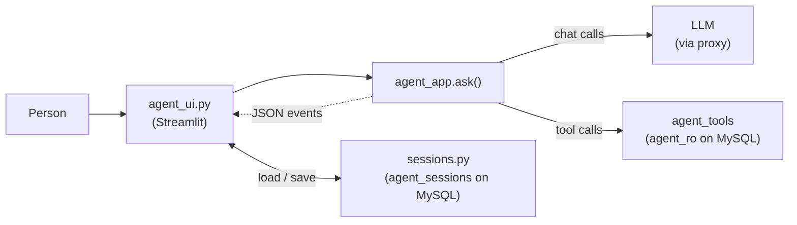
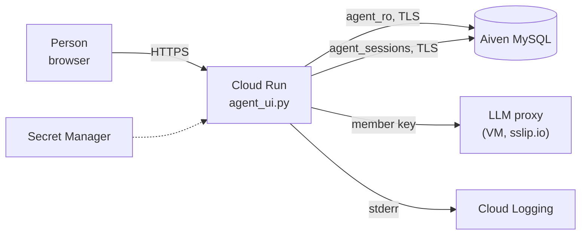

# Agent UI: the demo chat page

`scripts/agent_ui.py` is a Streamlit chat page for the agent, built for the demo. It shows the
path a question takes, from the person to the app, the LLM and the tools, and back.

It is a thin page over `agent_app.py` and adds no agent logic of its own. Every answer comes
with the sources the tools cited. It also has a **What happened** table listing each model call
and each tool call in order, so viewers can watch the path live.



You can run it on your laptop (below) or host it on Google Cloud Run
([Deploying on Cloud Run](#deploying-on-google-cloud-run)).

## What the page shows

- **Title and caption.** The title is "JME maintenance assistant". The caption says that answers
  come only from the shop's own data, through fixed tools, with sources shown.
- **Password box.** This appears only if `APP_PASSWORD` is set. Nothing connects until the
  password is right. The check is constant-time, using `hmac.compare_digest`.
- **Sidebar.**
  - Six example questions you can click: CNC-02 behaviour, CNC-03 oil, blasting-chamber
    entry, welding SOP, the count of 2025 incidents at severity 4 or worse, and an employee's
    name (refused by the guardrail).
  - A **New conversation** button.
  - The model in use (`agent_app.MODEL`), and whether this conversation is being saved
    ([below](#the-conversation-survives-a-restart)).
  - **Spend**: this session's cost and the key's spend against its budget.
- **Chat.** Each answer has a **Sources** list, a closed **Caveats from the data** expander
  (the tools' notes, below) and, when a tool cited a scan, a **Photo** expander showing it. It also has a **What happened** expander, which
  is open for the latest answer and closed for earlier ones. The expander's table has one row
  per step:

| Step | Detail shown |
|---|---|
| `model, round N` | Which tools the model asked for, or `(answered)`, plus the seconds taken |
| `tool, round N` | Tool name, the arguments the model sent, `ok` or `refused: <error_code>`, plus the seconds taken |
| `model, round N` (failed) | The model call's error |
| `app` | A tool asked a clarifying question that was passed to the user, or the app stopped after too many tool calls |

## The conversation survives a restart

The page's link carries the conversation's id (`?session=...`). After every answer the page
saves the conversation through [`sessions.py`](sessions.md), to a table only the
`agent_sessions` user can touch. When the page starts (a refresh, a redeploy, Cloud Run
starting a new container, another device) it loads the conversation for the link's id, draws the
answers again and hands the model the earlier messages, so a follow-up keeps its context.

If `AGENT_SESSION_DB_PASSWORD` isn't set, or MySQL is down, the sidebar says the conversation
isn't being saved, and the page carries on in memory as before. Details, setup and the check in
[`sessions.md`](sessions.md).

## Notes from the data

Every tool result carries `notes`: caveats the answer must keep (a value read off a scan by
a person, an OCR value not reliably read, a description that doesn't fit its machine, a
severity converted between scales). The system prompt tells the model to carry each one, but
on 7 Nov 2026 the live page answered incident 911 without its note that the form's severity
was read by a person. So the page also shows the tools' notes itself, once each, under every
answer (`agent_app.ask(..., notes=[...])`, `format_notes`, `show_notes`), in a **closed**
expander, "Caveats from the data (N), as the tools gave them". Closed, because with the
prompt rule the answer usually says them already in plainer words, and showing both
repeated them; the tools' wording is written for the model and names the trap-list item,
which is what an auditor wants. One click away whether or not the model said them.

## Photos under the answer

When a tool cites a scan (a nameplate photo or an incident form), the page shows the photo
under the answer, so "check the photo" in an answer is something the user can do there and
then. The model never handles images or links: `agent_app.ask(..., raw_sources=[...])`
hands back the tools' source records, and `photo_items()` fetches the photo behind each
image source.

- **From the database, not a folder.** The hosted page has no data folder; the photos are
  in `img_files_public` (made by `ingest_images.py`), which `agent_ro` may read.
- **Hash-checked.** `agent_tools.fetch_image` recomputes the SHA-256 of the bytes and shows
  nothing if it doesn't match the one recorded at ingest.
- **Incident forms only redacted.** The database holds no unredacted form: the "Person
  involved" value and the signature box are covered, and the caption says so.
- **No public link, not even an internal one.** The photo is drawn with its bytes inside the
  page (a `data:` URL, `img_html`), not with `st.image`. `st.image` keeps the bytes in the
  server's memory and has the browser fetch them from a `/media/...` link in a second
  request; on Cloud Run that request can miss (another or restarted container, media
  released after a rerun, a tab from before a redeploy) and the photo shows **broken**. That
  happened on the live page on 7 Nov 2026 (CNC-03's nameplate).
- A source whose photo isn't stored (a form that couldn't be redacted, a load with
  `--no-photos`) gets "photo not available here" instead.
- Photos are not saved with the conversation, so an answer reloaded after a restart shows its
  text, sources and caveats without the photo.

## Run it locally

This lives in the team repo, so it uses pip. Work from the repo root:

```bash
python -m venv .venv
source .venv/bin/activate            # Windows: .venv\Scripts\activate
pip install -r requirements-app.txt  # includes streamlit
streamlit run scripts/agent_ui.py
```

Streamlit opens the page at <http://localhost:8501>.

The page needs the same `.env` as `agent_app.py`. Set at least the agent database settings,
`OPENAI_API_KEY` and `OPENAI_BASE_URL` (see [Configuration](#configuration)). Leave
`APP_PASSWORD` unset if you don't want a password box on your own machine.

## Configuration

All settings come from environment variables, or from `.env` when you run locally.

| Variable | Used for |
|---|---|
| `DB_HOST`, `DB_PORT`, `DB_NAME` | The MySQL database (Aiven) |
| `AGENT_DB_USERNAME`, `AGENT_DB_PASSWORD` | The read-only `agent_ro` user. `agent_tools.connect()` refuses the owner account (`DB_USERNAME`/`DB_PASSWORD`) |
| `AGENT_SESSION_DB_USERNAME`, `AGENT_SESSION_DB_PASSWORD` | The `agent_sessions` user, for saved conversations ([`sessions.md`](sessions.md)). Username defaults to `agent_sessions`. Without the password, conversations aren't saved and the sidebar says so |
| `AGENT_SESSION_DAYS` | How long a saved conversation is kept after its last answer (default 7) |
| `OPENAI_API_KEY` | Your LiteLLM proxy member key |
| `OPENAI_BASE_URL` | The proxy URL |
| `APP_PASSWORD` | Optional page password. If it is unset, there is no password box |
| `AGENT_LOG_FILE` | Path of the JSON log file. Defaults to `logs/agent_app.jsonl`, the same file `agent_app.py` writes. Set it to `off` to turn the file off |

## Logs

Every question's events are written as one JSON line per event. The events are `chat_call`,
`tool_call`, `chat_error`, `clarification_returned` and `max_rounds_exceeded`, plus anything
else `agent_app` logs, such as `scale_guess_blocked`. They go to two places:

- **stderr, always.** On Cloud Run this is what ends up in Cloud Logging.
- **`AGENT_LOG_FILE`**, unless it is set to `off`. The page appends to this file through a
  single shared handler for the whole process.

The **What happened** table is built from these same events.

## How the code is laid out

| Piece | What it does |
|---|---|
| `EXAMPLES` | The sidebar questions |
| `TraceHandler` | A logging handler that collects the JSON events of one question for the on-page table |
| `trace_logger()` | Makes a fresh logger for each question (no propagation). It attaches the trace handler, the shared stderr handler and, if enabled, the shared file handler |
| `trace_rows()` | Turns the events into the table rows |
| `password_ok()` | Constant-time password check |
| `show_notes()` | The tools' caveats under the answer, from `agent_app.ask(..., notes=...)` |
| `photo_items()`, `show_photos()`, `img_html()` | The photos behind an answer's image sources, fetched and hash-checked, with captions; drawn in a **Photo** expander as `` tags with the bytes inside (caption HTML-escaped) |
| `cost_line()`, `session_line()` | The cost under each answer and the session total in the sidebar |
| `display_copy()`, `restored()`, `save_line()` | What is saved of the display (no photos, no trace), a loaded conversation turned back into `messages` and `shown`, and the sidebar's saved / not saved line |
| `main()` | The Streamlit page: password gate, the cached `connect()` (one DB connection and LLM client per process, through `st.cache_resource`), the cached session store (purges old conversations once per process), the conversation loaded from `?session=`, sidebar, chat history, one question per run, then the save |

Conversation state lives in `st.session_state` while the page is open, and in the
`agent_sessions` table between page loads:

- `messages` holds the model's conversation, from `agent_app.new_conversation()`.
- `shown` holds what is drawn on screen.
- `sid` is the conversation's id, also in the link.

The hosted version still runs a single instance with session affinity, because Streamlit's
websocket needs it; a restart or a new container no longer loses the conversation.

---

# Deploying on Google Cloud Run

This runs `scripts/agent_ui.py` as a container on Cloud Run, next to the
[LiteLLM proxy](https://github.com/ensanguine2279/sctp-aie-m5-jurong-marine-llm-proxy). The database stays on Aiven. The page connects to
it as the read-only `agent_ro` user, keeps conversations as the `agent_sessions` user, and
reaches the LLM through the proxy.



**Not tested end to end yet.** The Dockerfile and the commands below were written but never
run. Build the service and open it once before you rely on it.

## Files

| File | What it is |
|---|---|
| `Dockerfile` | Python 3.12 slim. Installs `requirements-app.txt`, copies `scripts/` and starts Streamlit on `$PORT` |
| `requirements-app.txt` | Only what the page needs. **Pin the versions** from your working environment before the demo |
| `.dockerignore` | Keeps `.env`, `data/`, `docs/`, `tests/` and `logs/` out of the image |

The image holds no secrets and no data. Settings come from the environment and data comes from
Aiven.

## 0. Get the files into Cloud Shell

`gcloud run deploy --source .` builds whatever is in the current folder, so the files must be in
Cloud Shell first. You need exactly these four items:

```
Dockerfile
.dockerignore            # a hidden file: make sure it is included
requirements-app.txt
scripts/
```

Nothing else is needed. The `Dockerfile` copies the whole of `scripts/`, and `.dockerignore`
keeps everything else out.

**Option A: the zip, like the proxy kit.** On your computer, from the repo root:

```bash
zip -r jme-agent.zip Dockerfile .dockerignore requirements-app.txt scripts -x "scripts/__pycache__/*"
```

On Windows without `zip`, select those four items in Explorer, then choose **Send to** and
**Compressed folder**. Check that `.dockerignore` made it into the zip, because hidden files are
easy to miss.

Then, in Cloud Shell, open the ⋮ menu, choose **Upload** and pick `jme-agent.zip`. Unzip it and
check the files:

```bash
mkdir -p jme-agent && unzip -o jme-agent.zip -d jme-agent && cd jme-agent
ls -la Dockerfile .dockerignore requirements-app.txt scripts/agent_ui.py   # all four must exist
```

**Option B: git.** This works if the team repo on GitHub holds the `Dockerfile` and
`requirements-app.txt` (commit them first):

```bash
git clone <repo-url> && cd <repo>
```

**Option C: deploy from your own computer.** If `gcloud` is installed and logged in there, run
section 2 from the repo root on your computer and skip the upload.

Whichever option you use, stay in that folder for section 2. The deploy command ends with
`--source .`, which means the current folder.

## 1. One-off setup (Cloud Shell)

```bash
PROJECT=your-project-id
REGION=asia-southeast1                  # same region as the proxy
gcloud config set project $PROJECT
gcloud services enable run.googleapis.com cloudbuild.googleapis.com \
    artifactregistry.googleapis.com secretmanager.googleapis.com

# secrets (printf, so no trailing newline is stored)
printf '%s' 'THE_AGENT_RO_PASSWORD'      | gcloud secrets create agent-db-password         --data-file=-
printf '%s' 'THE_SESSION_USER_PASSWORD'  | gcloud secrets create agent-session-db-password --data-file=-
printf '%s' 'YOUR_PROXY_MEMBER_KEY'      | gcloud secrets create openai-api-key            --data-file=-
printf '%s' 'A_PAGE_PASSWORD'            | gcloud secrets create app-password              --data-file=-

# let the service read them (default Compute Engine service account)
SA=$(gcloud projects describe $PROJECT --format='value(projectNumber)')-compute@developer.gserviceaccount.com
for s in agent-db-password agent-session-db-password openai-api-key app-password; do
  gcloud secrets add-iam-policy-binding $s --member=serviceAccount:$SA \
      --role=roles/secretmanager.secretAccessor
done
```

Use the **agent_ro** password, never the owner's. `DB_USERNAME` and `DB_PASSWORD` are not set
on Cloud Run, and `connect()` refuses the owner account anyway. The session password is the one
you gave `AGENT_SESSION_DB_PASSWORD` when you ran `python scripts/sessions.py setup` against
Aiven from your computer; run that (and `check`) before the first deploy.

## 2. Deploy (from the folder with the `Dockerfile`, section 0)

```bash
gcloud run deploy jme-agent --source . --region $REGION \
  --allow-unauthenticated --session-affinity \
  --min-instances 0 --max-instances 1 --memory 1Gi --timeout 600 \
  --set-env-vars "DB_HOST=YOUR-SERVICE.aivencloud.com,DB_PORT=12345,DB_NAME=defaultdb,AGENT_DB_USERNAME=agent_ro,AGENT_SESSION_DB_USERNAME=agent_sessions,OPENAI_BASE_URL=https://35-240-177-226.sslip.io,AGENT_LOG_FILE=off" \
  --set-secrets "AGENT_DB_PASSWORD=agent-db-password:latest,AGENT_SESSION_DB_PASSWORD=agent-session-db-password:latest,OPENAI_API_KEY=openai-api-key:latest,APP_PASSWORD=app-password:latest"
```

Fill in the Aiven host, port and database name.

`--allow-unauthenticated` makes the URL public, so **`APP_PASSWORD` is what protects the page**.
The page shows a password box first, and nothing connects until the password is right. If the
`app-password` secret is missing, the page is open to anyone with the URL.

To make the page private to Google accounts instead:

1. Deploy with `--no-allow-unauthenticated`.
2. Grant `roles/run.invoker` to each person who should see it.
3. Each person opens it with `gcloud run services proxy jme-agent --region $REGION`. This means
   every viewer needs `gcloud` installed.

`--max-instances 1 --session-affinity` keeps a single container and one websocket per
browser, which Streamlit needs. Conversations themselves no longer depend on it: they are
saved in MySQL after every answer.

`AGENT_LOG_FILE=off` stops the page writing the log file. The container's disk is temporary, so
the file would be lost anyway, and the same lines already go to Cloud Logging through stderr.

## 3. Before the demo

- **Open the URL a few minutes early.** With `--min-instances 0`, the first load after the
  service has been idle is slow. For demo day, run
  `gcloud run services update jme-agent --region $REGION --min-instances 1`. Set it back to 0
  afterwards, because an idle instance still costs money.
- **Run the kill-shot questions once on the hosted page.** The What happened table should match
  what you see on your laptop.
- **Prove the restart.** Ask a question, copy the link, run
  `gcloud run services update jme-agent --region $REGION --update-env-vars RESTART=$(date +%s)`
  (a new revision: a new container with empty memory), open the link and ask a follow-up.
- **Check the logs** under **Cloud Run → jme-agent → Logs**. Each line is one JSON event: model
  calls, tool calls with their arguments, and `scale_guess_blocked`.
- **To update the service**, change the code and run the same `gcloud run deploy` command again.

## Troubleshooting

| Symptom | Where | Likely cause |
|---|---|---|
| `ModuleNotFoundError: streamlit` | Local | Run `pip install -r requirements-app.txt` in the active venv |
| No password box | Both | `APP_PASSWORD` is not set (or, on Cloud Run, the secret isn't attached) |
| "Wrong password." when the password is right | Cloud Run | The secret was stored with a trailing newline. Recreate it with `printf '%s'` |
| Page shows "Couldn't connect as the agent user" | Both | One of these: wrong `DB_HOST`/`DB_PORT`; Aiven's allow-list blocks Cloud Run (Cloud Run has no fixed IP, so allow all addresses or add a static egress IP); or Aiven is powered off |
| The connection error mentions secure transport / SSL | Both | Aiven requires TLS, and `db_config.py` has no SSL option yet. Add a `DB_SSL_CA` setting (a small change, with a test) |
| `cryptography` error at login | Both | `cryptography` is missing from `requirements-app.txt` |
| "Set OPENAI_API_KEY" | Both | The key isn't set. On Cloud Run, either the secret isn't attached or the service account can't read it |
| Sidebar: "Conversations aren't being saved (AGENT_SESSION_DB_PASSWORD isn't set)" | Both | Set it in `.env`, or attach the `agent-session-db-password` secret on Cloud Run |
| Sidebar: "This conversation isn't being saved right now" | Both | The session user can't reach or use its table: `setup` not run, a wrong password, or the table missing. Run `python scripts/sessions.py check` |
| The link opens an empty conversation | Both | The conversation is older than `AGENT_SESSION_DAYS`, was never saved (no answer yet), or the link was cut short |
| What happened table is empty | Both | `agent_app.ask()` didn't log JSON events to the logger it was given |
| A **broken** image icon under an answer | Cloud Run | An older page that used `st.image`: the browser's second request for `/media/...` missed. Deploy the current `agent_ui.py`, then hard-refresh |
| "photo not available here" under an answer | Both | The images were loaded with `--no-photos` or before photos were stored, the form couldn't be redacted (`form_image_not_stored`), or `agent_ro` lacks `img_files_public` (re-run `agent_user.py`) |
| Page loads, then keeps reconnecting | Cloud Run | `--session-affinity` is missing, or more than one instance is running |
| Build fails in a step named `universal_builder` (exit status 51) | Cloud Run | Cloud Run found no `Dockerfile` and tried to guess the language, which means the files aren't in the folder you deployed from. Run the `ls -la` check in section 0 |
| Deploy fails while building | Cloud Run | To see the error, run `docker build -t jme-agent .` locally. Or run `gcloud builds list --limit=1`, then `gcloud builds log <ID> \| tail -40` |