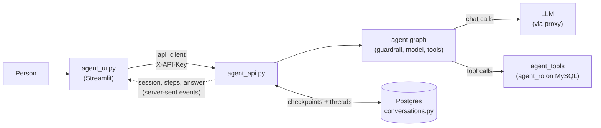
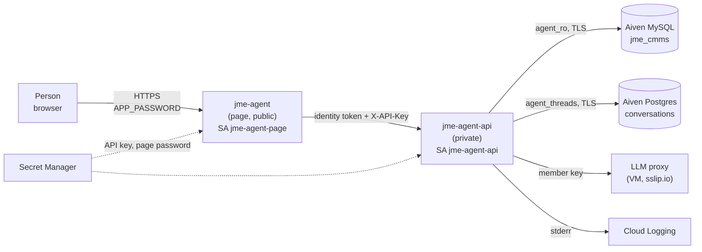

# Agent UI: the demo chat page

`frontend/agent_ui.py` is a Streamlit chat page for the agent, built for the demo. It shows the
path a question takes, from the person to the agent, the LLM and the tools, and back.

**Since phase 3 (15 Nov 2026) the page is only a front end.** It holds no database login, no
LiteLLM key and no agent code. Everything comes from the [agent API](agent_api.md) through
`frontend/api_client.py` (standard library only), with two settings: `AGENT_API_URL` and
`AGENT_API_KEY` (plus `AGENT_API_AUTH=google` on Cloud Run, where the API is private).
Since 16 Nov 2026 (phase 4) the page and its client are alone in `frontend/`, and the page's
image is built from that folder only, so nothing of the agent's can end up in it (a test
checks both: the folder holds exactly those two modules, and the page imports none of
`scripts/`). Grounding, the guardrail on both sides of the model, saving, retention, the
photos and the spend figure are all the API's, the same for every client. Every answer comes
with the sources the tools cited, and a **What happened** table listing each model call and
each tool call in order; while a question runs, a status line follows the agent's steps as the
API streams them.



Until 15 Nov 2026 the page ran the agent itself (`agent_app.ask()`), read photos from MySQL as
`agent_ro`, asked the proxy for the key's spend, and saved conversations to MySQL through
`sessions.py` (the `agent_sessions` login). All of that moved behind the API; `sessions.py` is
retired, and the page and any other client now share one store of conversations.

You run it on your laptop next to the API (below), and host it as one of two Cloud Run
services, the API being the other (private): see
[Deploying on Cloud Run](#deploying-on-google-cloud-run).

## What the page shows

Each part of the page has one place (layout reworked 10 Nov 2026). The page uses Streamlit's
wide layout.

- **Password box.** This appears only if `APP_PASSWORD` is set. Nothing is called until the
  password is right. The check is constant-time, using `hmac.compare_digest`.
- **Sidebar: conversations only.**
  - A **New conversation** button.
  - **Recent**: the eight saved conversations answered most recently (`GET /sessions`), each
    titled by its first question, with how many questions and how long ago. Click one to open
    it here; the one on the page is greyed out ("open now").
  - **Fold earlier questions**, a toggle: on, only the latest exchange is open; off, the whole
    conversation is shown.
  - Whether this conversation is being saved (from the API's `/health`): a quiet line when it
    is, a warning when it isn't. Without saving, each question is answered on its own, without
    the earlier ones, and the warning says so.
- **Top bar.**
  - The title, "JME maintenance assistant", and a caption saying that answers come only from
    the shop's own data, through fixed tools, with sources shown.
  - **Examples**, a lightbulb icon (`EXAMPLES_ICON`, tooltip "Example questions") opening a
    popover with the six example questions, once a conversation has started.
  - The **usage** popover, a payments icon at the right (`USAGE_ICON`). Hovering it shows the
    model and this conversation's cost (`gpt-4o-mini · $0.0031`). Open it for the model,
    "This conversation: $X over N questions" (added up from the answers, so it is the same
    after a reload), and the key's spend against its budget (`GET /usage`: the API asks the
    proxy with its own key; the page holds none).
  - When the key is near or over its cap, or the spend can't be read, a warning also shows
    across the page, under the top bar.
- **A new conversation** opens on the six example questions as a grid of buttons: CNC-02
  behaviour, CNC-03 oil, blasting-chamber entry, welding SOP, the count of 2025 incidents at
  severity 4 or worse, and an employee's name. The last one is refused by the guardrail on
  purpose (in the API, before the model is called), and its tooltip says so. The grid goes
  once a question is asked.
- **Only the latest exchange is open**, by default. Every earlier question and answer folds
  into one expander at the top, "Earlier in this conversation (N questions)"
  (`split_latest()`, `earlier_label()`, `history_parts()`). Asking a new question folds the
  previous exchange straight away. The sidebar toggle turns this off.
- **While a question is answered**, a status box shows the step the agent is on, from the
  API's stream (`step_line()`): "Question checked by the guardrail", "Model (round 1) asked
  for: compare_sensor_trend", "Tools (round 1) ran: compare_sensor_trend", "Model (round 2)
  wrote the answer", "Answer checked by the guardrail". Steps carry no question or answer
  text.
- **A new question is scrolled into view**, whether typed or picked from the examples
  (`scroll_script()`).
- **Less space above the title**: `TOP_CSS` cuts Streamlit's default top padding to 2.5rem and
  gives the usage popover a minimum width.
- **Each answer**: its text, one line with what it cost, then tabs for what it rests on, only
  for what it has, each with a count:
  - **Sources**: the sources the tools cited.
  - **Caveats**: the tools' notes ([below](#notes-from-the-data)).
  - **Photos**: the scans the tools cited ([below](#photos-under-the-answer)).
  - **What happened**: one row per step, as below. On the **newest** answer this is the
    first tab, so it is the one open; on earlier answers it is last.

| Step | Detail shown |
|---|---|
| `model, round N` | Which tools the model asked for, or `(answered)`, the call's cost when the proxy gave one, plus the seconds taken |
| `tool, round N` | Tool name, the arguments the model sent, `ok` or `refused: <error_code>`, plus the seconds taken |
| `model, round N` (failed) | The model call's error |
| `app` | A tool asked a clarifying question that was passed to the user, the app stopped after too many tool calls, a short year was asked back, "completed" was read as CLOSED, or a cut-off conversation was mended |
| `guardrail` | The question was refused in code before the model was called, the staff name list wasn't loaded (fail closed), or the answer was replaced before it was shown |

The rows are built by the API (`scripts/answer_view.py`, `trace_rows()`) and sent with the answer.

## The conversation survives a restart

The API saves the conversation after every answer (LangGraph's checkpointer in Postgres,
[`conversations.md`](conversations.md)) and gives it an id. The id is the stream's first
event (`session`), sent before the model is asked, and the page puts it in its link
(`?session=...`) at once. When the page starts (a refresh, a redeploy, another device) it loads
the conversation for the link's id from `GET /sessions/{id}` and draws it again, **photos
included** (each saved answer keeps the hashes of the scans it cites). A follow-up keeps its
context because the API runs it on the same LangGraph thread; the page sends only the question
and the id.

The sidebar's **Recent** list shows the eight newest saved conversations. A title is the first
question as the API kept it, so a question the guardrail refused shows only as its placeholder.
Everyone behind the page password sees the same list: the page has no user accounts.

The conversation's spend in the usage popover is its own total, added up by the API from its
answers and sent with every answer and with `GET /sessions/{id}`, not a counter in page
memory, so a reopened conversation shows what it cost. The page adds nothing up itself, except
when the API isn't saving conversations: then each answer carries only its own cost, and the
page keeps the running total (`spend_after()`).

**Delete this conversation**, the bin left of the question box, deletes it through
`DELETE /sessions/{id}` (its checkpoints and its row) after a confirm, and starts a new one.

**A click while a question is answered** makes Streamlit stop the page's script and run it
again. The API answers in its own thread, so the question still finishes and is saved. On the
next run the page reloads the conversation (`settle_cut_off()`): if the answer is there it is
drawn and nothing is said; if not (the API is still working on it) the question is taken off
the page with a note that it may appear when the conversation is reopened. The note doesn't
repeat the question: the page no longer runs the guardrail that decides what of a question may
be redrawn. Until 15 Nov 2026 a cut-off question was simply lost, because the page itself was
running it.

If the API isn't saving conversations (no `CONV_DB_URL` there, or Postgres down), the sidebar
says so. If the API can't be reached at all, the page says so and stops.

## Notes from the data

Every tool result carries `notes`: caveats the answer must keep (a value read off a scan by
a person, an OCR value not reliably read, a description that doesn't fit its machine, a
severity converted between scales). The system prompt tells the model to carry each one, but
on 7 Nov 2026 the live page answered incident 911 without its note that the form's severity
was read by a person. So the page also shows the tools' notes itself, once each, under every
answer (the API's `notes` field, `show_notes`), in the answer's **Caveats** tab. It is not the
tab that opens by default, because the answer usually says them already in plainer words; the
tools' wording is written for the model and names the trap-list item, which is what an auditor
wants. One click away whether or not the model said them.

## Photos under the answer

When a tool cites a scan (a nameplate photo or an incident form), the page shows the photo in
the answer's **Photos** tab, so "check the photo" in an answer is something the user can do
there and then. The model never handles images or links: the API lists the scans an answer
cites (`images`: SHA-256, what it is, file name; built by the API's `answer_view.image_refs()`), and the page
fetches each one from `GET /photos/{sha256}` (`photo_items()`), once per answer and cached for
an hour.

- **From the database, through the API.** The photos are in `img_files_public` (made by
  `ingest_images.py`); the API reads them as `agent_ro`. The page has no database login.
- **Hash-checked.** `agent_tools.fetch_image` recomputes the SHA-256 of the bytes and returns
  nothing if it doesn't match the one recorded at ingest (the API answers 404).
- **Incident forms only redacted.** The database holds no unredacted form: the "Person
  involved" value and the signature box are covered, and the caption says so (the API's
  `X-Photo-Variant: redacted`).
- **Only a real hash reaches the API.** `image_refs()` keeps a source only if its `sha256` is
  64 lower-case hex characters, and the API refuses anything else with a 422 before any query.
- **No public link, not even an internal one.** The photo is drawn with its bytes inside the
  page (a `data:` URL, `img_html`), not with `st.image`, whose second request for `/media/...`
  can miss on Cloud Run (seen on the live page, 7 Nov 2026).
- A scan whose photo isn't stored gets "photo not available here"; one the API can't fetch
  right now gets "photo can't be fetched right now".
- **Photos come back with a reopened conversation** (since 15 Nov 2026; before, a reloaded
  answer had no Photos tab).

## Run it locally

The page needs the API running. Two terminals, from the repo root.

**1. The API** ([agent_api.md](agent_api.md)): it has the database, LLM and conversations
settings, plus `AGENT_API_KEY`:

```bash
# personal repo (uv)
uv run uvicorn agent_api:create_app --factory --app-dir scripts --port 8000
# team repo (pip)
pip install -r requirements-api.txt
uvicorn agent_api:create_app --factory --app-dir scripts --port 8000
```

**2. The page**, with `AGENT_API_URL=http://localhost:8000` and the same `AGENT_API_KEY` in its
environment (the same `.env` is fine: the page reads only those two, plus `APP_PASSWORD`):

```bash
# team repo
pip install -r frontend/requirements.txt  # streamlit (1.36 or later) and python-dotenv, nothing else
streamlit run frontend/agent_ui.py
# personal repo
uv run streamlit run frontend/agent_ui.py
```

Streamlit opens the page at <http://localhost:8501>.

The client and the API's health are read once per Streamlit process (`st.cache_resource`;
health is re-read every minute). After changing `.env`, stop Streamlit (Ctrl+C) and start it
again; refreshing the browser is not enough. If the API isn't running, the page says "The
agent API can't be reached right now" and stops.

## Configuration

The page reads four settings, from the environment or `.env`:

| Variable | Used for |
|---|---|
| `AGENT_API_URL` | The API's address: `http://localhost:8000` locally, the API service's `https://...run.app` URL when hosted. Required: there is no default, so a page that isn't configured says so instead of calling somewhere unexpected |
| `AGENT_API_KEY` | The key the API was started with, sent as `X-API-Key`. Required, and never shown in an error |
| `AGENT_API_AUTH` | `google` on Cloud Run: also send a Google identity token for `AGENT_API_URL`, from the metadata server, because the API is private. Unset locally. Any other value is refused, so a typo can't quietly drop the token |
| `APP_PASSWORD` | Optional page password. If it is unset, there is no password box |

Everything else (`CMMS_DB_*`, `CONV_DB_URL`, `OPENAI_API_KEY`, `OPENAI_BASE_URL`,
`AGENT_LOG_FILE`) is the API's. `CMMS_DB_SESSION_*` is no longer read by anything: it was the
retired `sessions.py`'s login.

## Logs

The page logs nothing of the agent's: every question's JSON events (`chat_call`,
`tool_call`, `input_refused`, ...) are written by the API, to stderr and `AGENT_LOG_FILE`, and
come back to the page only as the What happened rows.

## How the code is laid out

| Piece | What it does |
|---|---|
| `TITLE`, `CAPTION`, `EXAMPLES`, `REFUSED_EXAMPLE` | The top bar's text, and the example questions (the new conversation's grid and the Examples popover) |
| `example_help()` | The tooltip on an example button: only the one the guardrail refuses gets one |
| `step_line()` | The status line for one streamed step |
| `answer_message()`, `error_text()` | An answer from the API as the page draws it; what to say for a stream's `error` event, and whether the question may still finish (a 504 or a lost stream) |
| `password_ok()` | Constant-time password check |
| `render_answer()`, `evidence_tabs()`, `last_answer()` | One answer: text, cost line, then its tabs. What happened first on the newest answer |
| `show_notes()` | The tools' caveats, in the Caveats tab |
| `photo_items()`, `attach_photos()`, `show_photos()`, `img_html()` | The photos an answer cites, fetched from the API by hash once per answer, with captions; drawn as `` tags with the bytes inside (caption HTML-escaped) |
| `USAGE_ICON`, `usage_help()`, `spend_after()`, `spend_line()`, `NO_SPEND` | The usage popover's icon and its tooltip, escaped for Markdown; the conversation's spend as the API sent it (added up by the page only when nothing is saved) |
| `split_latest()`, `history_parts()`, `earlier_label()`, `draw_messages()`, `FOLD_KEY` | The latest exchange drawn open, everything before it folded into one expander, unless the sidebar toggle turns folding off |
| `TOP_CSS`, `TOP_MARKER`, `TOP_BAR`, `scroll_script()` | The top bar's layout; the invisible component that scrolls a new question into view |
| `restored()`, `settle_cut_off()`, `interrupted_line()` | A conversation from `GET /sessions/{id}` as the page draws it; a cut-off question shown answered if the API finished it, else taken off with a note |
| `delete_conversation()`, `show_delete()`, `DELETE_*`, `INPUT_*`, `fit_bin_script()` | Delete this conversation through the API; the bin left of the question box |
| `save_line()`, `RECENT`, `recent_label()`, `ago()`, `md_plain()` | The sidebar's saved / not saved line (from `/health`), and its list of saved conversations |
| `main()` | The Streamlit page: password gate, the cached API client and health, the spend (cached 30 s) and photos (cached 1 h), the conversation loaded from `?session=`, the cut-off check, the sidebar, the top bar, the examples grid, the chat, then one question per run, streamed |

State in `st.session_state` while the page is open: `shown` (what is drawn, each answer with
its cost, its image references and, once drawn, its photos) and `sid` (the conversation's id,
from the API, also in the link). The model's conversation is no longer on the page at all: it
is the API's LangGraph thread.

---

# Deploying on Google Cloud Run

Since phase 4 (16 Nov 2026) the hosted app is **two Cloud Run services**, next to the
[LiteLLM proxy](https://github.com/ensanguine2279/sctp-aie-m5-jurong-marine-llm-proxy). The
data stays on Aiven:

- **`jme-agent-api`**: the agent API (`scripts/`, the repo root's `Dockerfile`). **Private**: Cloud
  Run lets a request in only with a Google identity token from an account allowed to invoke
  it, and that account is the page's alone. It holds every secret: `agent_ro`'s password, the
  proxy key, the conversations' Postgres URL and the API key.
- **`jme-agent`**: the page (`frontend/`, its own `Dockerfile`). Public, behind `APP_PASSWORD`. It
  holds only the API's address, the API key and the page password, and runs as its own service
  account, which is what the API lets in.



Two keys protect the API: **who may call it at all** (Cloud Run's check of the identity token:
only `jme-agent-page` has `roles/run.invoker`) and **the API's own key** (`X-API-Key`,
compared in constant time, the same as locally). The page gets its token from the metadata
server that Cloud Run gives every container (`api_client.GoogleIdToken`, switched on by
`AGENT_API_AUTH=google`), for the API's URL, and keeps it until five minutes before it expires.

Until 16 Nov 2026 the hosted page was one service that ran the agent itself, connected to MySQL
as `agent_ro` and `agent_sessions`, and held the proxy key. Its troubleshooting rows for those
are kept at the end, under [Before phase 4](#before-phase-4-one-service).

## Files

| File | Service | What it is |
|---|---|---|
| `Dockerfile` (repo root) | API | Python 3.12 slim. Installs `requirements-api.txt`, copies `scripts/` (with `guard_names.py`) and starts uvicorn on `$PORT` |
| `requirements-api.txt` | API | The agent, the databases, FastAPI. **Pin the versions** from your working environment before the demo |
| `.dockerignore`, `.gcloudignore` (repo root) | API | Keep `.env*`, `data/`, `.git`, `frontend/`, `docs/`, `tests/` and `logs/` out of the image and out of the **upload**: `--source .` first uploads the folder to a Cloud Build bucket, and `data/` holds the client's files |
| `frontend/Dockerfile` | page | Installs `frontend/requirements.txt`, copies `agent_ui.py` and `api_client.py`, starts Streamlit on `$PORT` |
| `frontend/requirements.txt` | page | `streamlit` and `python-dotenv`, nothing else |
| `frontend/.dockerignore`, `frontend/.gcloudignore` | page | Keep a `.env` out of the page's image and upload |

The root `.gcloudignore` (project copy: `claude/gcloudignore`):

```
.env
.env.*
.git
.venv/
__pycache__/
*.pyc
data/
logs/
evals/results/
frontend/
docs/
tests/
```

Neither image holds a secret or any data: settings come from `--set-env-vars` and
`--set-secrets`, data from Aiven. `scripts/guard_names.py` (the staff names as hashes) must be
committed: without it the API refuses to start (fail closed).

## 0. Get the files into Cloud Shell

The simplest is git: commit everything, then in Cloud Shell `git clone <repo-url> && cd <repo>`
(or `git pull` in the existing clone). Check:

```bash
ls -la Dockerfile .dockerignore .gcloudignore requirements-api.txt scripts/agent_api.py \
       scripts/guard_names.py frontend/Dockerfile frontend/agent_ui.py frontend/api_client.py
```

All must exist. **Cloud Shell opens in your home folder after a reconnect**: `cd` into the
clone before every deploy. (Deploying from your own computer works the same if `gcloud` is
installed and logged in there.)

## 1. One-off setup

```bash
PROJECT=your-project-id
REGION=asia-southeast1                  # same region as the proxy
gcloud config set project $PROJECT
gcloud services enable run.googleapis.com cloudbuild.googleapis.com \
    artifactregistry.googleapis.com secretmanager.googleapis.com

# One service account per service: each gets only its own secrets, and the API lets in only
# the page's.
gcloud iam service-accounts create jme-agent-api  --display-name "JME agent API"
gcloud iam service-accounts create jme-agent-page --display-name "JME agent page"
API_SA=jme-agent-api@$PROJECT.iam.gserviceaccount.com
PAGE_SA=jme-agent-page@$PROJECT.iam.gserviceaccount.com

# Two new secrets (printf: no trailing newline). agent-db-password, openai-api-key and
# app-password exist from the first deploy.
printf '%s' 'THE_CONV_DB_URL_FROM_YOUR_AIVEN_SETTINGS' | gcloud secrets create conv-db-url --data-file=-
python3 -c "import secrets; print(secrets.token_urlsafe(32), end='')" \
    | gcloud secrets create agent-api-key --data-file=-

for s in agent-db-password openai-api-key conv-db-url agent-api-key; do
  gcloud secrets add-iam-policy-binding $s --member=serviceAccount:$API_SA \
      --role=roles/secretmanager.secretAccessor
done
for s in agent-api-key app-password; do
  gcloud secrets add-iam-policy-binding $s --member=serviceAccount:$PAGE_SA \
      --role=roles/secretmanager.secretAccessor
done
```

- **`conv-db-url`** is the `CONV_DB_URL` you used with `conversations.py setup` and `check`
  against Aiven Postgres (the `agent_threads` user, ending in `?sslmode=require`). Never the
  admin URL (`CONV_DB_ADMIN_URL`): that one is for setup only and is never deployed.
- **`agent-api-key`** is new and random; both services read the same secret, so they always
  agree. Your local `.env` keeps its own `AGENT_API_KEY`.
- **`agent-db-password`** must still match the `CMMS_DB_AGENT_PASSWORD` that `agent_user.py`
  set on Aiven (compare `gcloud secrets versions access latest --secret=agent-db-password |
  sha256sum` with the SHA-256 of your setting).
- **Aiven allow-lists**: Cloud Run has no fixed outgoing address, so both the MySQL and the
  Postgres service must allow it (all addresses, or a static egress IP).

## 2. Deploy the API (from the repo root)

```bash
gcloud run deploy jme-agent-api --source . --region $REGION \
  --no-allow-unauthenticated --service-account $API_SA \
  --min-instances 0 --max-instances 1 --memory 1Gi --timeout 600 --concurrency 20 \
  --set-env-vars "CMMS_DB_HOST=YOUR-SERVICE.aivencloud.com,CMMS_DB_PORT=12345,CMMS_DB_NAME=jme_cmms,CMMS_DB_AGENT_USERNAME=agent_ro,OPENAI_BASE_URL=https://35-240-177-226.sslip.io,AGENT_LOG_FILE=off" \
  --set-secrets "CMMS_DB_AGENT_PASSWORD=agent-db-password:latest,OPENAI_API_KEY=openai-api-key:latest,CONV_DB_URL=conv-db-url:latest,AGENT_API_KEY=agent-api-key:latest"

API_URL=$(gcloud run services describe jme-agent-api --region $REGION --format='value(status.url)')
echo $API_URL
```

**Replace `YOUR-SERVICE.aivencloud.com` and `12345`** with your Aiven `CMMS_DB_HOST` and
`CMMS_DB_PORT`. Keep the filled-in commands in a script in Cloud Shell (they hold no passwords).

- `--no-allow-unauthenticated`: nobody reaches it without a token from an invoker.
- `--max-instances 1`: one question at a time per conversation is enforced by a lock inside
  the process; two instances would each have their own.
- `--timeout 600`: a streamed answer may take a while; the API itself gives up on a silent
  question after 300 s.
- `--concurrency 20`: a streamed question holds a request open; 20 is plenty for the demo.

Check it as yourself (a project owner may invoke any service):

```bash
curl -s -H "Authorization: Bearer $(gcloud auth print-identity-token)" $API_URL/health
curl -s -o /dev/null -w '%{http_code}\n' $API_URL/health    # without a token: 403
```

`/health` must show `"guard_ready": true`, `"sessions": "on"` and `"store": "postgres"`.

## 3. Let the page call it, then deploy the page

```bash
gcloud run services add-iam-policy-binding jme-agent-api --region $REGION \
  --member=serviceAccount:$PAGE_SA --role=roles/run.invoker

gcloud run deploy jme-agent --source frontend --region $REGION \
  --allow-unauthenticated --session-affinity --service-account $PAGE_SA \
  --min-instances 0 --max-instances 1 --memory 512Mi --timeout 3600 \
  --set-env-vars "AGENT_API_URL=$API_URL,AGENT_API_AUTH=google" \
  --set-secrets "AGENT_API_KEY=agent-api-key:latest,APP_PASSWORD=app-password:latest"
```

`jme-agent` is the existing page service: this replaces it in place, with the same URL.
`--set-env-vars` and `--set-secrets` **replace** its whole lists, so the old `CMMS_DB_*`,
`OPENAI_*` and the two database passwords are removed from it. `--service-account` moves it
off the default Compute Engine account.

- `AGENT_API_URL` is exactly `$API_URL` (the identity token is issued for that address).
- `--allow-unauthenticated`: the page is public, so **`APP_PASSWORD` is what protects it**.
- `--max-instances 1 --session-affinity`: one container and one websocket per browser, which
  Streamlit needs. `--timeout 3600`: the websocket is cut at the timeout and Streamlit then
  reconnects; an hour avoids that during the demo.

## 4. Check it

1. Open the page's URL, enter the password, ask the CNC-02 question: the status box steps
   through the agent, the What happened tab is first.
2. The sidebar says conversations are saved. Reload the link: the conversation comes back.
3. A nameplate question: the Photos tab. Open it again from Recent: the photo is still there.
4. **The restart proof** (checklist section 5): copy the link, start new revisions of both
   services, open the link, ask "and what about CNC-03?":

   ```bash
   gcloud run services update jme-agent-api --region $REGION --update-env-vars RESTART=$(date +%s)
   gcloud run services update jme-agent     --region $REGION --update-env-vars RESTART=$(date +%s)
   ```

   The follow-up is answered in context and the usage popover shows the conversation's total.
5. Logs: **Cloud Run → jme-agent-api → Logs** has one JSON line per event (model calls, tool
   calls with their arguments, `api_ask`). The page's own log has only Streamlit's lines.
6. The API stays closed: `curl -s -o /dev/null -w '%{http_code}\n' $API_URL/health` is `403`.

## 5. Clean up what phase 4 retired

Once the page answers through the API:

```bash
gcloud secrets delete agent-session-db-password
# the default Compute Engine account no longer needs the old secrets:
SA_OLD=$(gcloud projects describe $PROJECT --format='value(projectNumber)')-compute@developer.gserviceaccount.com
for s in agent-db-password openai-api-key app-password; do
  gcloud secrets remove-iam-policy-binding $s --member=serviceAccount:$SA_OLD \
      --role=roles/secretmanager.secretAccessor
done
```

On Aiven MySQL, as `avnadmin`: drop the `agent_sessions` table and the `agent_sessions` user
(`DROP TABLE jme_cmms.agent_sessions; DROP USER 'agent_sessions'@'%';`, and the same table in
`defaultdb`), and the old tables and views left in `defaultdb`. Locally, the same for your
MySQL container if you like.

## 6. Before the demo

- **Warm both services.** With `--min-instances 0` the first request after idling is slow, and
  the API's start (LangGraph, the database pools) is the slower one. For demo day:
  `gcloud run services update jme-agent-api --region $REGION --min-instances 1` and the same
  for `jme-agent`; set both back to 0 afterwards (an idle instance still costs money).
- **Run the kill-shot questions once on the hosted page.** The What happened table should match
  your laptop's.
- **To update** the API: the section 2 command again from the repo root; the page: the section 3
  deploy command. Each builds only its own image.
- **From your laptop against the hosted API** (for a test run of the local page or `curl`):
  `gcloud run services proxy jme-agent-api --region $REGION --port 8000` serves the private API
  on `http://localhost:8000` with your identity; set `AGENT_API_URL=http://localhost:8000`, the
  hosted key in `AGENT_API_KEY`, and leave `AGENT_API_AUTH` unset.

## Troubleshooting

The page shows the API's error message, never a stack trace; the API logs the error type.

| Symptom | Where | Likely cause |
|---|---|---|
| Page: "The agent API can't be reached right now: The API answered HTTP 403." | page | Cloud Run refused the call before it reached the API: `AGENT_API_AUTH=google` isn't set on the page, the page doesn't run as `jme-agent-page`, or that account lacks `roles/run.invoker` on `jme-agent-api` (section 3) |
| Page: "... (no_identity_token) ... unset it locally" | local | `AGENT_API_AUTH=google` in your local `.env`: there is no metadata server off Google Cloud. Remove it (use `gcloud run services proxy` to reach the hosted API) |
| Page: "AGENT_API_AUTH=google needs AGENT_API_URL to be the API's https Cloud Run URL" | page | `AGENT_API_URL` isn't `$API_URL`. Use the URL `gcloud run services describe` prints |
| Page: "Send the API key in the X-API-Key header. (unauthorised, HTTP 401)" | page | The page's `AGENT_API_KEY` differs from the API's: both must use the `agent-api-key` secret |
| Page: "Missing setting(s): AGENT_API_URL, AGENT_API_KEY" | page | The page was deployed without the section 3 settings |
| API revision fails to start; log: "the staff name list isn't loaded" | API | `scripts/guard_names.py` isn't in the image: not committed, git-ignored, or excluded by `.gcloudignore`. Build it (`guardrail.py build-names`) and commit it |
| API log: "Set AGENT_API_KEY (16 characters or more)" | API | The `agent-api-key` secret isn't attached, or `API_SA` can't read it |
| API log: "Couldn't connect to the database as the agent user: ..." | API | Wrong `CMMS_DB_HOST`/`CMMS_DB_PORT`/`CMMS_DB_NAME`, Aiven's MySQL allow-list, Aiven powered off, or `agent-db-password` out of step (1045: compare SHA-256s, add a version, new revision) |
| `/health` says `"sessions": "off (...)"`, the sidebar says conversations aren't saved | API | `conv-db-url` not attached or not readable by `API_SA`, the URL wrong, or Aiven Postgres' allow-list blocks Cloud Run. The reason in brackets names which |
| Deploy: `Permission denied on secret: ... for Revision service account ...` | both | That service's account can't read a secret it names (section 1's loops), or the name differs (hyphens, not underscores) |
| `curl $API_URL/health` with a token still 403 | you | Your account isn't an invoker (only owners are by default): grant yourself `roles/run.invoker` on `jme-agent-api`, or use `gcloud run services proxy` |
| The answer stops mid-way with "The answer stopped arriving" | page | The stream was cut: a new API revision while answering, or `--timeout` too short. The API still finishes and saves it: reopen the conversation from Recent |
| Page loads, then keeps reconnecting | page | `--session-affinity` missing or more than one instance |
| Build fails in `universal_builder` ("provide a main.py or app.py") | both | No `Dockerfile` where you deployed from: run the API deploy from the repo root and the page's with `--source frontend`; check section 0's `ls` |
| Deploy fails while building | both | `gcloud builds list --limit=1`, then `gcloud builds log <ID> --region $REGION \| tail -40`; or build locally (`docker build -t api .`, `docker build -t page frontend`) |
| "photo not available here" in the Photos tab | API | The scan isn't stored (loaded with `--no-photos`, a form that couldn't be redacted), or `agent_ro` lacks `img_files_public` (re-run `agent_user.py`) |
| No What happened tab under an answer | — | A reloaded answer: the trace isn't saved with the conversation |

### Before phase 4: one service

Problems met on the single-service page (9 to 15 Nov 2026), kept for the record:
the placeholder host deployed (2003, 9 Nov); `agent_ro` 1045 after the rename (the secret out
of step, 15 Nov); a trailing newline in a secret ("Wrong password.", fixed with `printf '%s'`);
a secret made with underscores that the grant didn't cover; `st.image`'s second request for
`/media/...` missing after a redeploy (broken photos, 7 Nov: the page now draws photos as
data URLs); the spend shown as "$0.0000 over 0 questions" on a reopened conversation (a page
older than 10 Nov). 