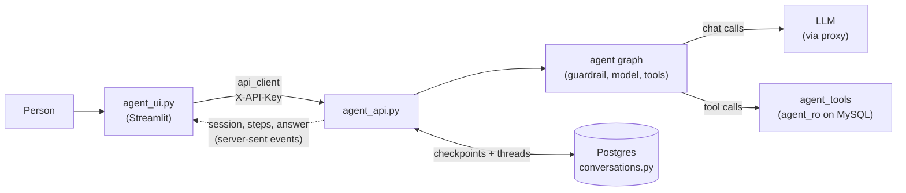
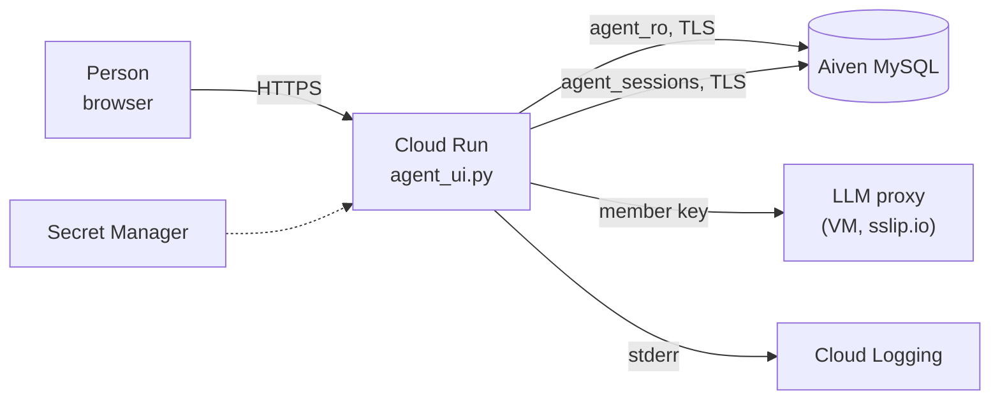

# Agent UI: the demo chat page

`scripts/agent_ui.py` is a Streamlit chat page for the agent, built for the demo. It shows the
path a question takes, from the person to the agent, the LLM and the tools, and back.

**Since phase 3 (15 Nov 2026) the page is only a front end.** It holds no database login, no
LiteLLM key and no agent code. Everything comes from the [agent API](agent_api.md) through
`scripts/api_client.py` (standard library only), with two settings: `AGENT_API_URL` and
`AGENT_API_KEY`. Grounding, the guardrail on both sides of the model, saving, retention, the
photos and the spend figure are all the API's, the same for every client. Every answer comes
with the sources the tools cited, and a **What happened** table listing each model call and
each tool call in order; while a question runs, a status line follows the agent's steps as the
API streams them.



Until 15 Nov 2026 the page ran the agent itself (`agent_app.ask()`), read photos from MySQL as
`agent_ro`, asked the proxy for the key's spend, and saved conversations to MySQL through
`sessions.py` (the `agent_sessions` login). All of that moved behind the API; `sessions.py` is
retired, and the page and any other client now share one store of conversations.

You run it on your laptop next to the API (below). The hosted page on Cloud Run is still the
build from before phase 3 until the API is hosted too (phase 4): see
[Deploying on Cloud Run](#deploying-on-google-cloud-run).

## What the page shows

Each part of the page has one place (layout reworked 10 Nov 2026). The page uses Streamlit's
wide layout.

- **Password box.** This appears only if `APP_PASSWORD` is set. Nothing is called until the
  password is right. The check is constant-time, using `hmac.compare_digest`.
- **Sidebar: conversations only.**
  - A **New conversation** button.
  - **Recent**: the eight saved conversations answered most recently (`GET /sessions`), each
    titled by its first question, with how many questions and how long ago. Click one to open
    it here; the one on the page is greyed out ("open now").
  - **Fold earlier questions**, a toggle: on, only the latest exchange is open; off, the whole
    conversation is shown.
  - Whether this conversation is being saved (from the API's `/health`): a quiet line when it
    is, a warning when it isn't. Without saving, each question is answered on its own, without
    the earlier ones, and the warning says so.
- **Top bar.**
  - The title, "JME maintenance assistant", and a caption saying that answers come only from
    the shop's own data, through fixed tools, with sources shown.
  - **Examples**, a lightbulb icon (`EXAMPLES_ICON`, tooltip "Example questions") opening a
    popover with the six example questions, once a conversation has started.
  - The **usage** popover, a payments icon at the right (`USAGE_ICON`). Hovering it shows the
    model and this conversation's cost (`gpt-4o-mini · $0.0031`). Open it for the model,
    "This conversation: $X over N questions" (added up from the answers, so it is the same
    after a reload), and the key's spend against its budget (`GET /usage`: the API asks the
    proxy with its own key; the page holds none).
  - When the key is near or over its cap, or the spend can't be read, a warning also shows
    across the page, under the top bar.
- **A new conversation** opens on the six example questions as a grid of buttons: CNC-02
  behaviour, CNC-03 oil, blasting-chamber entry, welding SOP, the count of 2025 incidents at
  severity 4 or worse, and an employee's name. The last one is refused by the guardrail on
  purpose (in the API, before the model is called), and its tooltip says so. The grid goes
  once a question is asked.
- **Only the latest exchange is open**, by default. Every earlier question and answer folds
  into one expander at the top, "Earlier in this conversation (N questions)"
  (`split_latest()`, `earlier_label()`, `history_parts()`). Asking a new question folds the
  previous exchange straight away. The sidebar toggle turns this off.
- **While a question is answered**, a status box shows the step the agent is on, from the
  API's stream (`step_line()`): "Question checked by the guardrail", "Model (round 1) asked
  for: compare_sensor_trend", "Tools (round 1) ran: compare_sensor_trend", "Model (round 2)
  wrote the answer", "Answer checked by the guardrail". Steps carry no question or answer
  text.
- **A new question is scrolled into view**, whether typed or picked from the examples
  (`scroll_script()`).
- **Less space above the title**: `TOP_CSS` cuts Streamlit's default top padding to 2.5rem and
  gives the usage popover a minimum width.
- **Each answer**: its text, one line with what it cost, then tabs for what it rests on, only
  for what it has, each with a count:
  - **Sources**: the sources the tools cited.
  - **Caveats**: the tools' notes ([below](#notes-from-the-data)).
  - **Photos**: the scans the tools cited ([below](#photos-under-the-answer)).
  - **What happened**: one row per step, as below. On the **newest** answer this is the
    first tab, so it is the one open; on earlier answers it is last.

| Step | Detail shown |
|---|---|
| `model, round N` | Which tools the model asked for, or `(answered)`, the call's cost when the proxy gave one, plus the seconds taken |
| `tool, round N` | Tool name, the arguments the model sent, `ok` or `refused: <error_code>`, plus the seconds taken |
| `model, round N` (failed) | The model call's error |
| `app` | A tool asked a clarifying question that was passed to the user, the app stopped after too many tool calls, a short year was asked back, "completed" was read as CLOSED, or a cut-off conversation was mended |
| `guardrail` | The question was refused in code before the model was called, the staff name list wasn't loaded (fail closed), or the answer was replaced before it was shown |

The rows are built by the API (`answer_view.trace_rows()`) and sent with the answer.

## The conversation survives a restart

The API saves the conversation after every answer (LangGraph's checkpointer in Postgres,
[`conversations.md`](conversations.md)) and gives it an id. The id is the stream's first
event (`session`), sent before the model is asked, and the page puts it in its link
(`?session=...`) at once. When the page starts (a refresh, a redeploy, another device) it loads
the conversation for the link's id from `GET /sessions/{id}` and draws it again, **photos
included** (each saved answer keeps the hashes of the scans it cites). A follow-up keeps its
context because the API runs it on the same LangGraph thread; the page sends only the question
and the id.

The sidebar's **Recent** list shows the eight newest saved conversations. A title is the first
question as the API kept it, so a question the guardrail refused shows only as its placeholder.
Everyone behind the page password sees the same list: the page has no user accounts.

The conversation's spend in the usage popover is its own total, added up from its answers
(`answer_view.conversation_spend`), not a counter in page memory, so a reopened conversation
shows what it cost.

**Delete this conversation**, the bin left of the question box, deletes it through
`DELETE /sessions/{id}` (its checkpoints and its row) after a confirm, and starts a new one.

**A click while a question is answered** makes Streamlit stop the page's script and run it
again. The API answers in its own thread, so the question still finishes and is saved. On the
next run the page reloads the conversation (`settle_cut_off()`): if the answer is there it is
drawn and nothing is said; if not (the API is still working on it) the question is taken off
the page with a note that it may appear when the conversation is reopened. The note doesn't
repeat the question: the page no longer runs the guardrail that decides what of a question may
be redrawn. Until 15 Nov 2026 a cut-off question was simply lost, because the page itself was
running it.

If the API isn't saving conversations (no `CONV_DB_URL` there, or Postgres down), the sidebar
says so. If the API can't be reached at all, the page says so and stops.

## Notes from the data

Every tool result carries `notes`: caveats the answer must keep (a value read off a scan by
a person, an OCR value not reliably read, a description that doesn't fit its machine, a
severity converted between scales). The system prompt tells the model to carry each one, but
on 7 Nov 2026 the live page answered incident 911 without its note that the form's severity
was read by a person. So the page also shows the tools' notes itself, once each, under every
answer (the API's `notes` field, `show_notes`), in the answer's **Caveats** tab. It is not the
tab that opens by default, because the answer usually says them already in plainer words; the
tools' wording is written for the model and names the trap-list item, which is what an auditor
wants. One click away whether or not the model said them.

## Photos under the answer

When a tool cites a scan (a nameplate photo or an incident form), the page shows the photo in
the answer's **Photos** tab, so "check the photo" in an answer is something the user can do
there and then. The model never handles images or links: the API lists the scans an answer
cites (`images`: SHA-256, what it is, file name; `answer_view.image_refs()`), and the page
fetches each one from `GET /photos/{sha256}` (`photo_items()`), once per answer and cached for
an hour.

- **From the database, through the API.** The photos are in `img_files_public` (made by
  `ingest_images.py`); the API reads them as `agent_ro`. The page has no database login.
- **Hash-checked.** `agent_tools.fetch_image` recomputes the SHA-256 of the bytes and returns
  nothing if it doesn't match the one recorded at ingest (the API answers 404).
- **Incident forms only redacted.** The database holds no unredacted form: the "Person
  involved" value and the signature box are covered, and the caption says so (the API's
  `X-Photo-Variant: redacted`).
- **Only a real hash reaches the API.** `image_refs()` keeps a source only if its `sha256` is
  64 lower-case hex characters, and the API refuses anything else with a 422 before any query.
- **No public link, not even an internal one.** The photo is drawn with its bytes inside the
  page (a `data:` URL, `img_html`), not with `st.image`, whose second request for `/media/...`
  can miss on Cloud Run (seen on the live page, 7 Nov 2026).
- A scan whose photo isn't stored gets "photo not available here"; one the API can't fetch
  right now gets "photo can't be fetched right now".
- **Photos come back with a reopened conversation** (since 15 Nov 2026; before, a reloaded
  answer had no Photos tab).

## Run it locally

The page needs the API running. Two terminals, from the repo root.

**1. The API** ([agent_api.md](agent_api.md)): it has the database, LLM and conversations
settings, plus `AGENT_API_KEY`:

```bash
# personal repo (uv)
uv run uvicorn agent_api:create_app --factory --app-dir scripts --port 8000
# team repo (pip)
pip install -r requirements-api.txt
uvicorn agent_api:create_app --factory --app-dir scripts --port 8000
```

**2. The page**, with `AGENT_API_URL=http://localhost:8000` and the same `AGENT_API_KEY` in its
environment (the same `.env` is fine: the page reads only those two, plus `APP_PASSWORD`):

```bash
# team repo
pip install -r requirements-app.txt  # streamlit (1.36 or later) and python-dotenv, nothing else
streamlit run scripts/agent_ui.py
# personal repo
uv run streamlit run scripts/agent_ui.py
```

Streamlit opens the page at <http://localhost:8501>.

The client and the API's health are read once per Streamlit process (`st.cache_resource`;
health is re-read every minute). After changing `.env`, stop Streamlit (Ctrl+C) and start it
again; refreshing the browser is not enough. If the API isn't running, the page says "The
agent API can't be reached right now" and stops.

## Configuration

The page reads three settings, from the environment or `.env`:

| Variable | Used for |
|---|---|
| `AGENT_API_URL` | The API's address: `http://localhost:8000` locally, the API service's URL when hosted (phase 4). Required: there is no default, so a page that isn't configured says so instead of calling somewhere unexpected |
| `AGENT_API_KEY` | The key the API was started with, sent as `X-API-Key`. Required, and never shown in an error |
| `APP_PASSWORD` | Optional page password. If it is unset, there is no password box |

Everything else (`CMMS_DB_*`, `CONV_DB_URL`, `OPENAI_API_KEY`, `OPENAI_BASE_URL`,
`AGENT_LOG_FILE`) is the API's. `CMMS_DB_SESSION_*` is no longer read by anything: it was the
retired `sessions.py`'s login.

## Logs

The page logs nothing of the agent's: every question's JSON events (`chat_call`,
`tool_call`, `input_refused`, ...) are written by the API, to stderr and `AGENT_LOG_FILE`, and
come back to the page only as the What happened rows.

## How the code is laid out

| Piece | What it does |
|---|---|
| `TITLE`, `CAPTION`, `EXAMPLES`, `REFUSED_EXAMPLE` | The top bar's text, and the example questions (the new conversation's grid and the Examples popover) |
| `example_help()` | The tooltip on an example button: only the one the guardrail refuses gets one |
| `step_line()` | The status line for one streamed step |
| `answer_message()`, `error_text()` | An answer from the API as the page draws it; what to say for a stream's `error` event, and whether the question may still finish (a 504 or a lost stream) |
| `password_ok()` | Constant-time password check |
| `render_answer()`, `evidence_tabs()`, `last_answer()` | One answer: text, cost line, then its tabs. What happened first on the newest answer |
| `show_notes()` | The tools' caveats, in the Caveats tab |
| `photo_items()`, `attach_photos()`, `show_photos()`, `img_html()` | The photos an answer cites, fetched from the API by hash once per answer, with captions; drawn as `` tags with the bytes inside (caption HTML-escaped) |
| `USAGE_ICON`, `usage_help()` | The usage popover's icon and its tooltip, escaped for Markdown. The totals come from `answer_view.conversation_spend()` / `conversation_line()` |
| `split_latest()`, `history_parts()`, `earlier_label()`, `draw_messages()`, `FOLD_KEY` | The latest exchange drawn open, everything before it folded into one expander, unless the sidebar toggle turns folding off |
| `TOP_CSS`, `TOP_MARKER`, `TOP_BAR`, `scroll_script()` | The top bar's layout; the invisible component that scrolls a new question into view |
| `restored()`, `settle_cut_off()`, `interrupted_line()` | A conversation from `GET /sessions/{id}` as the page draws it; a cut-off question shown answered if the API finished it, else taken off with a note |
| `delete_conversation()`, `show_delete()`, `DELETE_*`, `INPUT_*`, `fit_bin_script()` | Delete this conversation through the API; the bin left of the question box |
| `save_line()`, `RECENT`, `recent_label()`, `ago()`, `md_plain()` | The sidebar's saved / not saved line (from `/health`), and its list of saved conversations |
| `main()` | The Streamlit page: password gate, the cached API client and health, the spend (cached 30 s) and photos (cached 1 h), the conversation loaded from `?session=`, the cut-off check, the sidebar, the top bar, the examples grid, the chat, then one question per run, streamed |

State in `st.session_state` while the page is open: `shown` (what is drawn, each answer with
its cost, its image references and, once drawn, its photos) and `sid` (the conversation's id,
from the API, also in the link). The model's conversation is no longer on the page at all: it
is the API's LangGraph thread.

---

# Deploying on Google Cloud Run

> **Phase 3 (15 Nov 2026): don't redeploy the page from the current code yet.** This section
> describes the page as deployed on 15 Nov 2026, before phase 3: it runs the agent itself and
> connects to MySQL as `agent_ro` and `agent_sessions`. The current `agent_ui.py` only calls
> the agent API, and the API isn't hosted yet; deployed alone it would stop with "Missing
> setting(s): AGENT_API_URL, AGENT_API_KEY". Phase 4 hosts the API as a second Cloud Run
> service and replaces this section: the page then needs only `AGENT_API_URL`,
> `AGENT_API_KEY` and `APP_PASSWORD`, and its image only `agent_ui.py`, `api_client.py`,
> `answer_view.py` and `streamlit`. Until then, keep the running service as it is.

This runs `scripts/agent_ui.py` as a container on Cloud Run, next to the
[LiteLLM proxy](https://github.com/ensanguine2279/sctp-aie-m5-jurong-marine-llm-proxy). The database stays on Aiven. The page connects to
it as the read-only `agent_ro` user, keeps conversations as the `agent_sessions` user, and
reaches the LLM through the proxy.



**Deployed end to end on 9 Nov 2026**, with conversations saved to `agent_sessions` from the
hosted page. The problems hit on the way are in [Troubleshooting](#troubleshooting). For the
redeploy after the settings rename and the move to `jme_cmms` (15 Nov 2026), see
[Redeploying after the rename](#redeploying-after-the-rename-15-nov-2026).

## Files

| File | What it is |
|---|---|
| `Dockerfile` | Python 3.12 slim. Installs `requirements-app.txt`, copies `scripts/` and starts Streamlit on `$PORT` |
| `requirements-app.txt` | Only what the page needs. **Pin the versions** from your working environment before the demo |
| `.dockerignore` | Keeps `.env`, `data/`, `docs/`, `tests/` and `logs/` out of the image |
| `.gcloudignore` | Keeps `.env` and `.git` out of the **upload** (below) |

The image holds no secrets and no data. Settings come from the environment and data comes from
Aiven.

`.dockerignore` keeps `.env` out of the image, but `gcloud run deploy --source .` first uploads
the whole folder to a Cloud Build bucket. Keep no `.env` (or `.env.aiven`) in the deploy folder,
or add a `.gcloudignore` containing:

```
.env
.env.*
.git
__pycache__/
```

The hosted page never reads a `.env`: every setting comes from `--set-env-vars` and
`--set-secrets`.

## 0. Get the files into Cloud Shell

`gcloud run deploy --source .` builds whatever is in the current folder, so the files must be in
Cloud Shell first. You need exactly these four items:

```
Dockerfile
.dockerignore            # a hidden file: make sure it is included
requirements-app.txt
scripts/
```

Nothing else is needed. The `Dockerfile` copies the whole of `scripts/`, and `.dockerignore`
keeps everything else out.

**Option A: the zip, like the proxy kit.** On your computer, from the repo root:

```bash
zip -r jme-agent.zip Dockerfile .dockerignore requirements-app.txt scripts -x "scripts/__pycache__/*"
```

On Windows without `zip`, select those four items in Explorer, then choose **Send to** and
**Compressed folder**. Check that `.dockerignore` made it into the zip, because hidden files are
easy to miss.

Then, in Cloud Shell, open the ⋮ menu, choose **Upload** and pick `jme-agent.zip`. Unzip it and
check the files:

```bash
mkdir -p jme-agent && unzip -o jme-agent.zip -d jme-agent && cd jme-agent
ls -la Dockerfile .dockerignore requirements-app.txt scripts/agent_ui.py   # all four must exist
```

**Option B: git.** This works if the team repo on GitHub holds the `Dockerfile` and
`requirements-app.txt` at the repo root (commit them first):

```bash
git clone <repo-url> && cd <repo>
```

**Option C: deploy from your own computer.** If `gcloud` is installed and logged in there, run
section 2 from the repo root on your computer and skip the upload.

Whichever option you use, stay in that folder for section 2. The deploy command ends with
`--source .`, which means the current folder. **Cloud Shell opens in your home folder after a
reconnect**, so `cd ~/jme-agent` (or your clone) again before every deploy, and run the `ls -la`
check.

## 1. One-off setup (Cloud Shell)

```bash
PROJECT=your-project-id
REGION=asia-southeast1                  # same region as the proxy
gcloud config set project $PROJECT
gcloud services enable run.googleapis.com cloudbuild.googleapis.com \
    artifactregistry.googleapis.com secretmanager.googleapis.com

# secrets (printf, so no trailing newline is stored)
printf '%s' 'THE_AGENT_RO_PASSWORD'      | gcloud secrets create agent-db-password         --data-file=-
printf '%s' 'THE_SESSION_USER_PASSWORD'  | gcloud secrets create agent-session-db-password --data-file=-
printf '%s' 'YOUR_PROXY_MEMBER_KEY'      | gcloud secrets create openai-api-key            --data-file=-
printf '%s' 'A_PAGE_PASSWORD'            | gcloud secrets create app-password              --data-file=-

# let the service read them (default Compute Engine service account)
SA=$(gcloud projects describe $PROJECT --format='value(projectNumber)')-compute@developer.gserviceaccount.com
for s in agent-db-password agent-session-db-password openai-api-key app-password; do
  gcloud secrets add-iam-policy-binding $s --member=serviceAccount:$SA \
      --role=roles/secretmanager.secretAccessor
done
```

The secret names use **hyphens**, exactly as above, and the deploy command refers to them by
these names. Check with `gcloud secrets list --format='value(name)'`; a secret made with
underscores (`agent_session_db_password`) is a different secret, and the grant above doesn't
cover it. The secrets' names didn't change with the settings rename: only the environment
variable each one is attached to did (section 2).

Use the **agent_ro** password, never the owner's. `CMMS_DB_USERNAME` and `CMMS_DB_PASSWORD`
are not set on Cloud Run, and `connect()` refuses the owner account anyway. The agent_ro
password is the `CMMS_DB_AGENT_PASSWORD` that `agent_user.py` (or `pipeline.py --agent setup`)
used against Aiven; the session password is the `CMMS_DB_SESSION_PASSWORD` that
`sessions.py setup` used. Run both (and their checks) from your computer before the first
deploy, with `--env-file` pointing at your Aiven settings. To confirm a secret holds the same
password without printing either, compare
`gcloud secrets versions access latest --secret=agent-session-db-password | sha256sum` with the
SHA-256 of the value in your settings file.

## 2. Deploy (from the folder with the `Dockerfile`, section 0)

```bash
gcloud run deploy jme-agent --source . --region $REGION \
  --allow-unauthenticated --session-affinity \
  --min-instances 0 --max-instances 1 --memory 1Gi --timeout 600 \
  --set-env-vars "CMMS_DB_HOST=YOUR-SERVICE.aivencloud.com,CMMS_DB_PORT=12345,CMMS_DB_NAME=jme_cmms,CMMS_DB_AGENT_USERNAME=agent_ro,CMMS_DB_SESSION_USERNAME=agent_sessions,OPENAI_BASE_URL=https://35-240-177-226.sslip.io,AGENT_LOG_FILE=off" \
  --set-secrets "CMMS_DB_AGENT_PASSWORD=agent-db-password:latest,CMMS_DB_SESSION_PASSWORD=agent-session-db-password:latest,OPENAI_API_KEY=openai-api-key:latest,APP_PASSWORD=app-password:latest"
```

**Replace `YOUR-SERVICE.aivencloud.com` and `12345`** with the `CMMS_DB_HOST` and
`CMMS_DB_PORT` from your Aiven settings. The deploy succeeds with the placeholders, but the
page then can't reach MySQL. Keep the filled-in command in a script in Cloud Shell (it holds no
passwords) so every redeploy uses the same values. To fix only the settings on a running
service, without a rebuild:

```bash
gcloud run services update jme-agent --region $REGION \
  --update-env-vars "CMMS_DB_HOST=...,CMMS_DB_PORT=...,CMMS_DB_NAME=..."
```

`--set-env-vars` and `--set-secrets` **replace** the service's whole list, so a deploy with the
command above also removes any old variables (`DB_HOST`, `AGENT_DB_PASSWORD`, ...) left from an
earlier deploy. `--update-env-vars` only adds or changes the ones named.

`--allow-unauthenticated` makes the URL public, so **`APP_PASSWORD` is what protects the page**.
The page shows a password box first, and nothing connects until the password is right. If the
`app-password` secret is missing, the page is open to anyone with the URL.

To make the page private to Google accounts instead:

1. Deploy with `--no-allow-unauthenticated`.
2. Grant `roles/run.invoker` to each person who should see it.
3. Each person opens it with `gcloud run services proxy jme-agent --region $REGION`. This means
   every viewer needs `gcloud` installed.

`--max-instances 1 --session-affinity` keeps a single container and one websocket per
browser, which Streamlit needs. Conversations themselves no longer depend on it: they are
saved in MySQL after every answer.

`AGENT_LOG_FILE=off` stops the page writing the log file. The container's disk is temporary, so
the file would be lost anyway, and the same lines already go to Cloud Logging through stderr.

## Redeploying after the rename (15 Nov 2026)

The page deployed on 9 and 11 Nov reads the old setting names and the `defaultdb` database.
The current code reads only `CMMS_DB_*`, and the hosted data is now in `jme_cmms`, loaded by
the `ingest` owner. A redeploy with the old settings would not start ("Set
CMMS_DB_AGENT_PASSWORD"). In order:

1. **On your computer, against Aiven** (your Aiven settings file, e.g. `.env.aiven`):
   `pipeline.py --recreate --foreign-keys --agent setup` (creates `agent_ro` on `jme_cmms`),
   `agent_user.py --check`, `sessions.py setup` and `sessions.py check`, then
   `run_evals.py` (52/52). Done on 15 Nov 2026.
2. **Make the two secrets match the passwords those scripts used** (each adds a new version;
   `latest` is what the deploy reads):

   ```bash
   printf '%s' 'THE_CMMS_DB_AGENT_PASSWORD'   | gcloud secrets versions add agent-db-password --data-file=-
   printf '%s' 'THE_CMMS_DB_SESSION_PASSWORD' | gcloud secrets versions add agent-session-db-password --data-file=-
   ```

   Check without printing them: compare `gcloud secrets versions access latest
   --secret=agent-db-password | sha256sum` with the SHA-256 of `CMMS_DB_AGENT_PASSWORD` in your
   Aiven settings.
3. **Put the current files in the deploy folder** (section 0): `scripts/` from the repo (the
   whole folder: `db_config.py`, `agent_tools.py`, `sessions.py`, `agent_app.py`,
   `agent_graph.py`, `agent_ui.py` all changed), `requirements-app.txt` (it has `langgraph`),
   `Dockerfile`, `.dockerignore`.
4. **Deploy with the section 2 command**, with `CMMS_DB_NAME=jme_cmms` and your real host and
   port. It replaces every old variable.
5. **Check the page**: the sidebar says conversations are saved; ask one of the kill-shot
   questions and the CNC-02 question; open the What happened tab. In Cloud Run's logs, no
   `Missing setting(s)` or `Access denied` lines.
6. **Then clean up on Aiven**, as `avnadmin`, once the page answers from `jme_cmms`: the old
   tables and views in `defaultdb` are no longer used. Conversations saved in `defaultdb`'s
   `agent_sessions` stay behind there: the page's Recent list starts empty on `jme_cmms`.

## 3. Before the demo

- **Open the URL a few minutes early.** With `--min-instances 0`, the first load after the
  service has been idle is slow. For demo day, run
  `gcloud run services update jme-agent --region $REGION --min-instances 1`. Set it back to 0
  afterwards, because an idle instance still costs money.
- **Run the kill-shot questions once on the hosted page.** The What happened table should match
  what you see on your laptop.
- **Prove the restart.** Ask a question, copy the link, run
  `gcloud run services update jme-agent --region $REGION --update-env-vars RESTART=$(date +%s)`
  (a new revision: a new container with empty memory), open the link and ask a follow-up. The
  usage popover should show the conversation's total, not $0.
- **Check the logs** under **Cloud Run → jme-agent → Logs**. Each line is one JSON event: model
  calls, tool calls with their arguments, and `scale_guess_blocked`.
- **To update the service**, change the code and run the same `gcloud run deploy` command again.
- **Failed revisions** can be listed with
  `gcloud run revisions list --service jme-agent --region $REGION` and removed with
  `gcloud run revisions delete <name> --region $REGION`. The revision serving traffic can't be
  deleted. A failed build never creates a revision.

## Troubleshooting

The page shows only the error type (for example `OperationalError`), never the server's text.
For the MySQL error code, search Cloud Run → jme-agent → Logs for the error type.

| Symptom | Where | Likely cause |
|---|---|---|
| `ModuleNotFoundError: streamlit` | Local | Run `pip install -r requirements-app.txt` in the active venv |
| `TypeError` mentioning `vertical_alignment`, or `AttributeError: ... has no attribute 'popover'` | Local | Streamlit is older than 1.36. Run `pip install -U -r requirements-app.txt` |
| No password box | Both | `APP_PASSWORD` is not set (or, on Cloud Run, the secret isn't attached) |
| "Wrong password." when the password is right | Cloud Run | The secret was stored with a trailing newline. Recreate it with `printf '%s'` |
| Page shows "Couldn't connect as the agent user: Set CMMS_DB_AGENT_PASSWORD ..." | Both | The settings still have the old names (`AGENT_DB_PASSWORD`, `DB_HOST`, ...), which aren't read since 14 Nov 2026. Locally rename them in `.env`; on Cloud Run deploy with the section 2 command |
| Page shows "Couldn't connect as the agent user" | Both | One of these: wrong `CMMS_DB_HOST`/`CMMS_DB_PORT`; Aiven's allow-list blocks Cloud Run (Cloud Run has no fixed IP, so allow all addresses or add a static egress IP); or Aiven is powered off |
| Log: `(2003, "Can't connect to MySQL server on 'YOUR-SERVICE.aivencloud.com' ([Errno -2] Name or service not known)")` | Cloud Run | The deploy went out with the placeholder host. Set the real `CMMS_DB_HOST`/`CMMS_DB_PORT` with `gcloud run services update ... --update-env-vars` (section 2). Happened 9 Nov 2026 |
| Log: `(1045, "Access denied for user 'agent_ro'...")` or `'agent_sessions'` | Cloud Run | The secret differs from the password `agent_user.py` / `sessions.py setup` used (both recreate their user with the password in the settings file). Compare SHA-256s (section 1), add a corrected version, then start a new revision |
| Log: `(1044, "Access denied for user 'agent_ro'@'%' to database ...")` | Cloud Run | `CMMS_DB_NAME` isn't the database `agent_ro` was granted on (`jme_cmms` since 15 Nov 2026) |
| The connection error mentions secure transport / SSL | Both | Aiven requires TLS, and `db_config.py` has no SSL option yet. Add a `CMMS_DB_SSL_CA` setting (a small change, with a test) |
| `cryptography` error at login | Both | `cryptography` is missing from `requirements-app.txt` |
| `ModuleNotFoundError: langgraph` | Both | An old `requirements-app.txt`: the agent is a LangGraph graph since 12 Nov 2026. Use the current one |
| "Set OPENAI_API_KEY" | Both | The key isn't set. On Cloud Run, either the secret isn't attached or the service account can't read it |
| Sidebar: "Conversations aren't being saved (CMMS_DB_SESSION_PASSWORD isn't set)" | Both | Set it in `.env` and restart Streamlit (a browser refresh isn't enough), or attach the `agent-session-db-password` secret on Cloud Run as `CMMS_DB_SESSION_PASSWORD` |
| Sidebar: "This conversation isn't being saved right now" | Both | The session user can't reach or use its table: `setup` not run, a wrong password, a wrong `CMMS_DB_HOST`, or the table missing. Run `python scripts/sessions.py check`, and on Cloud Run read the MySQL error code in the logs |
| Spend says "This session: $0.0000 over 0 questions" on a reopened conversation | Both | The page is older than 10 Nov 2026: its spend was a counter in page memory. Deploy the current `agent_ui.py`; it shows "This conversation: ..." added up from the answers |
| The link opens an empty conversation | Both | The conversation is older than `AGENT_SESSION_DAYS`, was never saved (no answer yet), the link was cut short, or it was saved in `defaultdb` before the move to `jme_cmms` |
| Deploy: `Permission denied on secret: .../secrets/<name>/versions/latest for Revision service account ...` | Cloud Run | The service account can't read that secret, or the deploy names a secret that differs from the one granted (underscores vs hyphens). Check `gcloud secrets list`, then run the grant loop in section 1 for the names in `--set-secrets` |
| No What happened tab under an answer | Both | A reloaded answer: the trace isn't saved with the conversation. On a new answer, `agent_app.ask()` didn't log JSON events to the logger it was given |
| A **broken** image icon under an answer | Cloud Run | An older page that used `st.image`: the browser's second request for `/media/...` missed. Deploy the current `agent_ui.py`, then hard-refresh |
| "photo not available here" in the Photos tab | Both | The images were loaded with `--no-photos` or before photos were stored, the form couldn't be redacted (`form_image_not_stored`), or `agent_ro` lacks `img_files_public` (re-run `agent_user.py`) |
| Page loads, then keeps reconnecting | Cloud Run | `--session-affinity` is missing, or more than one instance is running |
| Build fails in a step named `universal_builder` (exit status 51), log ends with "provide a main.py or app.py" | Cloud Run | Cloud Run found no `Dockerfile` in the folder you deployed from and tried to guess the language. Usually the deploy ran from the home folder (Cloud Shell opens there after a reconnect), or the `Dockerfile` sits in a subfolder or has another name (`Dockerfile.txt`). `cd ~/jme-agent` and run the `ls -la` check in section 0 |
| Deploy fails while building | Cloud Run | To see the error, run `docker build -t jme-agent .` locally. Or run `gcloud builds list --limit=1`, then `gcloud builds log <ID> --region $REGION \| tail -40` |