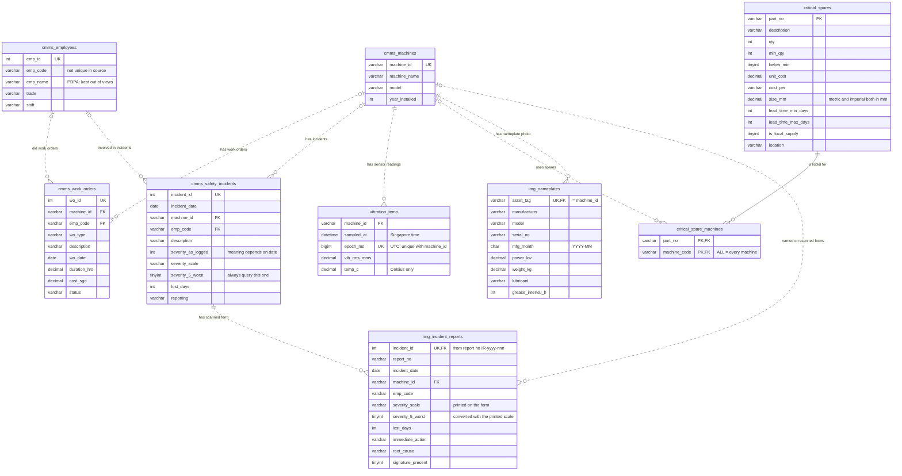

# ER diagram: cleaned schema

Generated by `scripts/relationships.py` on 2026-11-03. Solid lines are FOREIGN KEYs in MySQL; dotted lines are soft relationships, joined in the views and checked for orphans on every run, but not enforced.

Lineage is left out: every cleaned table links to its `*_raw` table by `raw_id`, each raw row to `ingest_runs` by `run_id`, and the `*_audit` views join the three.
