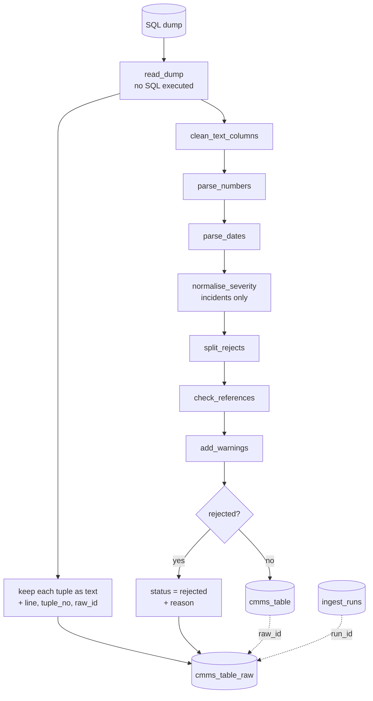
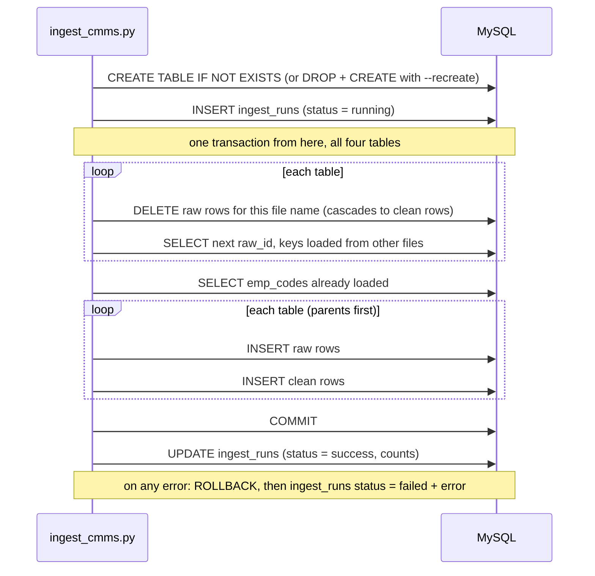
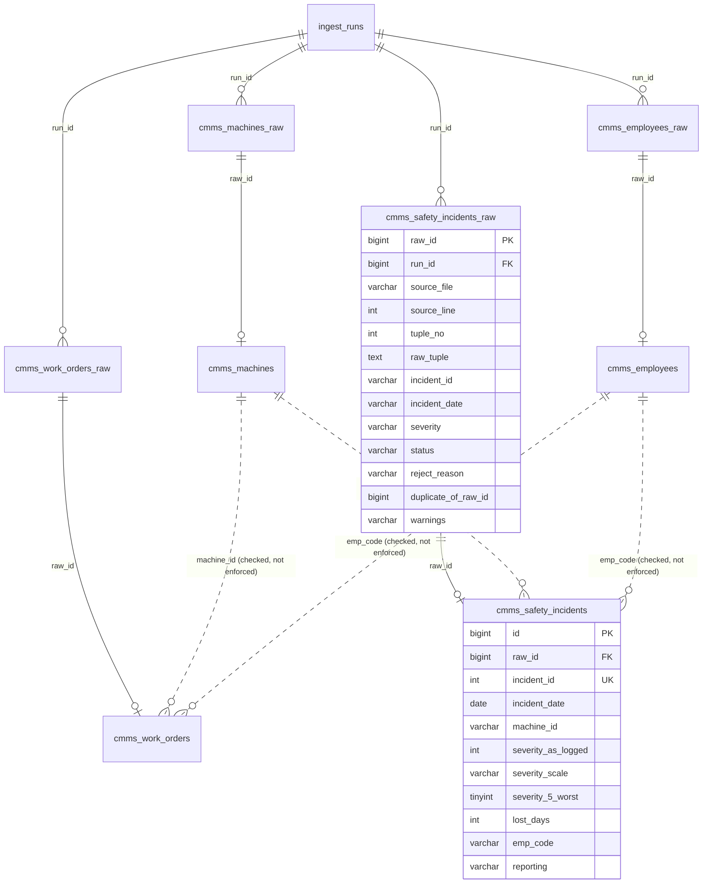

# `ingest_cmms.py`: CMMS SQL dump ingestion

Loads the client's CMMS dump (`jurongmarine_cmms.sql`) into MySQL, cleans the
problems the client warned about (above all the **severity scale flip**), and keeps a
full audit trail: every cleaned row can be traced back to the exact line of the dump it
came from, and every load is recorded. The dump is **parsed, never executed**, so nothing
in it can drop or overwrite our tables.

- **Script:** `scripts/ingest_cmms.py`
- **Shared modules:** `scripts/db_config.py` (settings, DB connection), `scripts/lineage.py` (run log)
- **Tests:** `tests/test_cmms.py` (`pytest`, no database needed)
- **Data audit:** problems found in the client's dump, with record IDs, in [`TRAP_LIST.md`](TRAP_LIST.md#cmms-dump-jurongmarine_cmmssql)

---

## Contents

1. [Quick start](#quick-start)
2. [Input file](#input-file)
3. [Command-line options](#command-line-options)
4. [Configuration (`.env`)](#configuration-env)
5. [How it works](#how-it-works)
6. [Cleaning rules](#cleaning-rules)
7. [Rejects and warnings](#rejects-and-warnings)
8. [Database tables](#database-tables)
9. [Load behaviour](#load-behaviour)
10. [Audit queries](#audit-queries)
11. [Run summary](#run-summary)
12. [Assumptions and limitations](#assumptions-and-limitations)
13. [Troubleshooting](#troubleshooting)

---

## Quick start

```bash
pip install pandas numpy sqlalchemy pymysql python-dotenv pytest

# 1. Check what the script makes of the dump. No database needed.
python scripts/ingest_cmms.py data/sql/jurongmarine_cmms.sql --dry-run

# 2. First real load (creates the tables)
python scripts/ingest_cmms.py data/sql/jurongmarine_cmms.sql --recreate

# 3. Later loads of the same or a newer dump
python scripts/ingest_cmms.py data/sql/jurongmarine_cmms.sql
```

Requires the MySQL container to be running (`docker compose up -d`) and a
filled-in `.env` (see [Configuration](#configuration-env)).

---

## Input file

A MySQL dump (mysqldump or a DBeaver export; backtick or double-quoted names both work).
Only `INSERT` statements are read as data; `CREATE TABLE` is read for column order only;
everything else (`DROP`, `LOCK`, `SET`, comments) is counted and ignored.

| Table | Columns | Key | In the client's dump |
|---|---|---|---|
| `machines` | `machine_id`, `machine_name`, `model`, `year_installed` | `machine_id` | 12 rows |
| `employees` | `emp_id`, `emp_code`, `emp_name`, `trade`, `shift` | `emp_id` | 32 rows, `EMP001`–`EMP032` |
| `work_orders` | `wo_id`, `machine_id`, `wo_type`, `description`, `wo_date`, `duration_hrs`, `cost_sgd`, `emp_code`, `status` | `wo_id` | 1,603 rows (10001–11603) in 4 INSERTs, 2024-01-01 to 2026-06-30 |
| `safety_incidents` | `incident_id`, `incident_date`, `machine_id`, `description`, `severity`, `lost_days`, `emp_code`, `reporting` | `incident_id` | 85 rows (900–984), 2024-01-24 to 2026-06-18 |

Values are matched to columns by the INSERT's column list if it has one, otherwise by
the dump's `CREATE TABLE` order. Any other table in the dump is listed in the summary
and **not** loaded (add a `TableSpec` to load it).

The client's dump is clean in form: every date is `YYYY-MM-DD`, every number is plain,
and every key is present and unique. Its problems are in the meaning of the data (the
severity flip, descriptions that don't fit the machine, coded `lost_days`), which is why
most of them are client questions rather than reject rules. See
[`TRAP_LIST.md`](TRAP_LIST.md#cmms-dump-jurongmarine_cmmssql).

---

## Command-line options

```
python scripts/ingest_cmms.py [DUMP] [options]
```

| Option | Default | What it does |
|---|---|---|
| `DUMP` | `$CMMS_DUMP`, else `data/sql/jurongmarine_cmms.sql` | Dump to load |
| `--dry-run` | off | Read and clean only; print sample rows, rejects and the summary. Nothing is written to the database. Employee names are masked in what it prints ([see below](#personal-data-on-screen)). |
| `--recreate` | off | Drop and recreate the `cmms_*` tables and audit views before loading. Use on the first load and after any schema change. `ingest_runs` is never dropped. |
| `--env-file PATH` | nearest `.env` | Which settings file to use |
| `--prefix` | `cmms_` | Table name prefix, so we never touch the tables the dump itself describes |
| `--severity-cutover DATE` | `2025-07-01` | First date on the new 5 = worst scale |
| `--severity-ambiguous-until DATE` | `2025-07-31` | Incidents from the cutover to this date are **not** converted; `none` once the cutover is confirmed |
| `--rejects PATH` | off | Also write rejected rows, with reasons, to a CSV file |

---

## Configuration (`.env`)

The same `.env` as `ingest_logs.py` and `ingest_spares.py`, read through
`db_config.load_db_config`: `DB_HOST`, `DB_PORT`, `DB_NAME`, `DB_USERNAME`,
`DB_PASSWORD`. Shell values win over `.env`; the password is never printed. See
[`ingest_logs.md`](ingest_logs.md#configuration-env) for the details.

---

## How it works



Each step is a small `DataFrame -> DataFrame` function, so it can be tested on its own.
The tables run in order **machines → employees → work_orders → safety_incidents**, so
children can be checked against the parents just cleaned.

**Sequence of a real load:**



---

## Cleaning rules

### Text: `clean_text_columns`

| Columns | Rule | Example |
|---|---|---|
| `machine_id`, `emp_code` | Trimmed, upper-cased (same rule as the sensor logs, so joins line up) | `cnc-02 ` → `CNC-02` |
| `trade`, `shift`, `wo_type`, `status` | Trimmed, lower-cased | `NIGHT` → `night` |
| `machine_name`, `model`, `emp_name`, `description`, `reporting` | Trimmed, whitespace collapsed | |

Category synonyms (`done` / `completed`) are **not** merged; the summary prints the
distinct values so you can decide on a mapping.

### Numbers: `parse_numbers`

| Columns | Rule |
|---|---|
| `year_installed`, `lost_days`, `severity`, keys | Whole numbers; `1,200` → 1200; `12.5` or text → NULL + warning |
| `duration_hrs` (1 dp), `cost_sgd` (2 dp) | `S$`, `$`, `SGD` and thousands commas stripped: `S$1,050` → 1050.00 |

A value that was written but couldn't be read is flagged (`bad_<column>`), never
silently loaded as NULL. Negative values are kept and flagged (`negative_<column>`).

### Dates: `parse_dates`

| Raw value | Read as | Warning |
|---|---|---|
| `2026-01-05`, `2026-01-05 00:00:00`, `2026/01/05` | as written | |
| `05/02/2026`, `05-02-2026` | **5 Feb** (day first, Singapore convention) | `date_assumed_day_first` |
| `5 Feb 2026` | as written | |
| blank | NULL | `missing_date` |
| `0000-00-00`, anything else | NULL | `bad_date` |

All dates in the client's dump are `YYYY-MM-DD`, so the day-first rule isn't used on it.

### Severity: `normalise_severity`

The scale flipped from **1 = worst** to **5 = worst** in July 2025 and old records were
never converted. The auditor will test this.

| Column | Meaning |
|---|---|
| `severity_as_logged` | The number as recorded, never changed |
| `severity_scale` | `1_worst` (before cutover), `5_worst` (from cutover), `ambiguous` (cutover to `--severity-ambiguous-until`), `unknown` (no date, or not 1-5) |
| `severity_5_worst` | Every incident on the **new** scale: old `s` → `6 − s`. NULL when the scale isn't known |

**Always query `severity_5_worst`, never `severity_as_logged`.** July 2025 is left
unconverted until the client confirms the exact switch-over day; then re-run with e.g.
`--severity-cutover 2025-07-14 --severity-ambiguous-until none`. The distinct values of
`reporting` (in the summary) may show which form, and so which scale, each record used.

The data supports the rule. Before the cutover, 36 of 48 incidents are logged 4 or 5;
after it, 24 of 37 are logged 1 or 2. Converted with `6 − s`, the old period has the
same shape as the new one. Only two incidents fall in July 2025: **906** (logged 3, the
same on both scales) and **907** (logged 2, so 2 or 4 depending on the cutover day).
Details in [`TRAP_LIST.md`](TRAP_LIST.md) (C1, C2).

### Duplicates: `split_rejects`

A row is a duplicate if another row has the same **key**. The first one seen is kept;
later ones are rejected with `duplicate_of_raw_id` pointing at the kept row. If the
values differ from the kept row the reason is `duplicate_key_conflict`, so it gets
reviewed. Keys already loaded from **other** files count too.

This only catches a repeated **key**. A work order entered twice under two different
`wo_id`s isn't caught; see [Assumptions and limitations](#assumptions-and-limitations).

### References: `check_references`

`machine_id` and `emp_code` in `work_orders` and `safety_incidents` are checked against
the cleaned `machines` and `employees` (this file plus anything already loaded).
Orphans are **flagged, not dropped**, so no incident disappears from the audit trail.
The orphan list is also what to fix before running `add_foreign_keys.sql`.

---

## Rejects and warnings

**Rejected rows** go to `cmms_<table>_raw` with `status = 'rejected'` and are not in the
clean table. If several reasons apply, the first in this list wins:

| `reject_reason` | Meaning |
|---|---|
| `malformed_tuple` / `unterminated_tuple` | The tuple couldn't be parsed |
| `column_count_mismatch` | More or fewer values than columns |
| `missing_key` | Key blank |
| `bad_key` | Integer key isn't a whole number |
| `duplicate_key` | Same key as an earlier identical row; see `duplicate_of_raw_id` |
| `duplicate_key_conflict` | Same key, **different values**: review it |

**Warnings** mark rows that were loaded but have gaps. They're stored as a
comma-separated list in `cmms_<table>_raw.warnings`:

| Warning | Table | Meaning |
|---|---|---|
| `unknown_machine` / `unknown_employee` | work orders, incidents | Code not found in machines / employees |
| `missing_machine_id` / `missing_emp_code` | work orders, incidents, employees | Reference blank |
| `duplicate_emp_code` | employees | Two employees share a code, so joins on it are ambiguous |
| `implausible_year_installed` | machines | Before 1950 or in the future |
| `bad_<col>` / `negative_<col>` | any | Number unreadable / negative |
| `missing_date` / `bad_date` / `date_assumed_day_first` | work orders, incidents | See Dates |
| `severity_scale_ambiguous` / `severity_scale_unknown` / `severity_out_of_range` / `missing_severity` | incidents | See Severity |

---

## Database tables



(The other three tables follow the same raw/clean pattern; only incidents is expanded.)

| Object | Contents | Keys |
|---|---|---|
| `ingest_runs` | One row per load, shared with the other ingest scripts | `run_id` |
| `cmms_<table>_raw` | Every tuple **exactly as written** (text): `raw_tuple`, each value, `source_line` (where the tuple starts), `tuple_no` (position in its INSERT), `status`, `reject_reason`, `duplicate_of_raw_id`, `warnings`. `work_orders.status` from the dump is stored as `status_src`, because `status` is the load status | `raw_id`; index on `(source_file, source_line)` and `(status, reject_reason)` |
| `cmms_<table>` | Cleaned rows only | `id`; `raw_id` unique, FK → raw (`ON DELETE CASCADE`); natural key unique; indexes on `machine_id` + date and `emp_code` |
| `cmms_<table>_audit` (view) | Clean row + raw values (`<column>_raw`) + `source_file`, `source_line`, `tuple_no`, `raw_tuple`, `warnings`, `run_id`, `file_sha256`, `loaded_at` | n/a |

`cmms_employees.emp_name` is personal data (PDPA). It's kept for joins; the app should
answer with `emp_code` and keep names out of LLM prompts and answers.

### Personal data on screen

Nothing the script prints shows an employee name in full: only its last 4 characters,
behind a fixed `****` so the length isn't shown either (`Seah Jia Hui` → `**** Hui`). A name
of 4 characters or fewer is masked completely. This covers the dry run's sample rows and
its rejected rows; in a rejected row's `raw_tuple`, the name is masked inside the text, and
if the row couldn't be parsed, so the name's position is unknown, the whole tuple is shown as
`<hidden: unreadable row with personal data>`. Because the masking happens before printing,
the terminal, a screen share and a saved pipeline log (`pipeline.py --save-log`) all get the
masked form.

The data itself is not masked: `cmms_employees` and `cmms_employees_raw` keep the full name.
The `--rejects` CSV also keeps the full `raw_tuple`, because that file is for fixing the
rows; keep it out of git and delete it when done. Which columns are masked is set in
`PERSONAL_COLUMNS` in the script.

---

## Load behaviour

- **All or nothing:** the four tables change in one transaction. If anything fails, the previous data is untouched.
- **Failures are recorded:** the `ingest_runs` row is written in its own transaction first, so a failed load still appears with `status = 'failed'` and the error.
- **Re-loading a file:** loading a dump whose **name** is already in the tables replaces that dump's rows. Rows from other files are kept.
- **Several files:** keys already loaded from another file are rejected as duplicates of the existing rows.
- **IDs:** `raw_id` values continue from each table's current maximum.
- **Schema changes:** table definitions are only created if missing. After changing the DDL, or the first time, run with `--recreate`.

---

## Audit queries

```sql
-- Incidents for the auditor, on one scale, with their source
SELECT incident_id, incident_date, machine_id, severity_as_logged, severity_scale,
       severity_5_worst, source_file, source_line, raw_tuple
FROM cmms_safety_incidents_audit ORDER BY incident_date;

-- Incidents the severity rule could not place (resolve before the audit)
SELECT incident_id, incident_date, severity_as_logged, severity_scale
FROM cmms_safety_incidents WHERE severity_5_worst IS NULL;

-- Rejected rows by reason (for the data quality report)
SELECT 'work_orders' AS tbl, reject_reason, COUNT(*) FROM cmms_work_orders_raw
WHERE status = 'rejected' GROUP BY reject_reason;

-- Orphans to fix before adding foreign keys
SELECT source_line, wo_id, machine_id, emp_code, warnings FROM cmms_work_orders_raw
WHERE warnings LIKE '%unknown_%';

-- Duplicates next to the row that was kept
SELECT d.source_line, d.raw_tuple, d.reject_reason, k.source_line AS kept_line, k.raw_tuple AS kept
FROM cmms_work_orders_raw d JOIN cmms_work_orders_raw k ON k.raw_id = d.duplicate_of_raw_id;

-- Possible double entries the key check can't see: same machine, day and type
SELECT machine_id, wo_date, wo_type, COUNT(*) AS n, GROUP_CONCAT(wo_id) AS wo_ids
FROM cmms_work_orders GROUP BY machine_id, wo_date, wo_type HAVING n > 1 ORDER BY wo_date;

-- Load history
SELECT run_id, source_file, status, rows_read, rows_loaded, rows_rejected, started_at, error
FROM ingest_runs WHERE script = 'ingest_cmms.py' ORDER BY run_id DESC;
```

---

## Run summary

Every run (dry or real) ends with counts you can copy into the data quality report.

**On the client's dump** (`--dry-run`, 3 Nov 2026):

```
Rows read: 1732   loaded: 1732   rejected: 0
Statements in dump: create=1, create_table=4, drop=4, insert=7, set=3, use=1 (total 20)

machines: read 12, loaded 12, rejected 0

employees: read 32, loaded 32, rejected 0
  trade: crane op=2, electrician=4, fitter=10, machinist=5, qa inspector=11 (total 32)
  shift: day=20, night=12 (total 32)

work_orders: read 1603, loaded 1603, rejected 0
  wo_type: breakdown=279, corrective=647, preventive=677 (total 1603)
  status: awaiting parts=12, closed=1569, open=22 (total 1603)

safety_incidents: read 85, loaded 85, rejected 0
  Loaded with gaps: severity_scale_ambiguous=2 (total 2)
  severity_scale: 1_worst=48, 5_worst=35, ambiguous=2 (total 85)
  reporting: found during audit=35, reported next day=25, reported same day=25 (total 85)

Severity: before 2025-07-01 the scale was 1 = worst (converted); from then 5 = worst.
          Incidents 2025-07-01 to 2025-07-31 left unconverted (switch-over date unconfirmed).
```

No orphan machines or employees, no duplicates, no unreadable values. The only
warnings are the two July 2025 incidents (906, 907) waiting on the cutover date. If a
dry run of the same dump shows anything different, the file or the code has changed.

Example from a deliberately messy test dump, showing the other lines that can appear:

```
Rows read: 17   loaded: 15   rejected: 2
Statements in dump: create_table=1, drop=1, insert=5, lock=1, unlock=1 (total 9)
Tables with no spec (NOT loaded): spares=1 (total 1)

employees: read 4, loaded 4, rejected 0
  Loaded with gaps: duplicate_emp_code=2, missing_emp_code=1 (total 3)
  trade: fitter=1, machinist=2, welder=1 (total 4)

work_orders: read 5, loaded 3, rejected 2
  Rejected rows: column_count_mismatch=1, duplicate_key_conflict=1 (total 2)
  Loaded with gaps: bad_date=1, date_assumed_day_first=1, negative_duration_hrs=1, unknown_employee=1, unknown_machine=1 (total 5)

safety_incidents: read 5, loaded 5, rejected 0
  Loaded with gaps: missing_date=1, severity_out_of_range=1, severity_scale_ambiguous=1, severity_scale_unknown=1, unknown_employee=1 (total 5)
  severity_scale: 1_worst=1, 5_worst=1, ambiguous=1, unknown=2 (total 5)

Severity: before 2025-07-01 the scale was 1 = worst (converted); from then 5 = worst.
          Incidents 2025-07-01 to 2025-07-31 left unconverted (switch-over date unconfirmed).
```

Each breakdown line ends with its total. On category lines (`trade`, `severity_scale`, ...)
it equals the table's loaded rows. On `Loaded with gaps` it counts **warnings**, not rows:
one row can carry several.

The last line states the severity rule the run used, so the summary records it alongside
the counts. Once the client confirms the switch-over day and you run with
`--severity-cutover <date> --severity-ambiguous-until none`, the second line is dropped
and the first shows the confirmed date.

---

## Assumptions and limitations

- **Severity cutover** is assumed to be 1 July 2025, with all of July left unconverted. Confirm the exact day with the client; on the client's dump this decides only incident 907.
- **Severity is converted by date alone.** Several old-scale incidents have lost days that don't fit their severity (e.g. 982 logged 4, minor on the old scale, with 14 lost days). If some old records already used the new scale, a per-record rule is needed. Client question Q2 in the [README](../README.md#needs-the-clients-input).
- **`lost_days` is loaded as a count,** but in the client's dump it only ever takes 0, 1, 2, 5 or 14, which looks like a coded band. Don't sum it until the client confirms what it means.
- **Slash dates are day-first** (Singapore convention). Each one is warned; the client's dump has none.
- **Duplicates are found by key only.** Two work orders with different `wo_id`s but the same machine, date, type and technician (10727 and 10728) both load. Use the double-entries audit query above to list candidates.
- **Descriptions are loaded as written,** even where they don't fit the machine (e.g. `crane limit switch fault` on CNC-02). Cite them; don't reason from them.
- **Category synonyms aren't merged.** Only case and spacing are normalised. The client's dump has none to merge.
- **Foreign keys aren't enforced** between the clean tables, so orphans can be kept and flagged. Fix them, then add constraints (`add_foreign_keys.sql`).
- **Only four tables have specs.** Other tables in the dump are reported and skipped.
- **Re-loading is keyed on the file name,** not its content. A renamed copy of the same dump is treated as a new file, and its rows become duplicates.
- **Line numbers** are where each tuple *starts*; `tuple_no` gives its position in a multi-row INSERT.
- **Not yet run against a live MySQL.** Parsing and cleaning are tested, and the dry run on the client's dump matches the summary above; do a first load on a scratch database next.

---

## Troubleshooting

Settings and connection errors are the same as for the logs script: see
[`ingest_logs.md`](ingest_logs.md#troubleshooting).

| Symptom | Likely cause | Fix |
|---|---|---|
| `Dump not found` | Wrong path | Check the path, or set `CMMS_DUMP` |
| `<table>: read 0` / `NO ROWS FOUND IN DUMP` | The dump has no INSERTs for that table, or names it differently | Check `Statements in dump` and `Tables with no spec` in the summary |
| Every row `column_count_mismatch` | The dump's table has more/fewer columns than the spec and no INSERT column list | Compare the dump's `CREATE TABLE` with [Input file](#input-file); update the `TableSpec` |
| `Unknown column ...` / `Unknown table ...` | Tables were created by an older version | Run once with `--recreate` |
| Many `severity_scale_unknown` | `incident_date` missing or unparseable | Check the `missing_date` / `bad_date` counts |