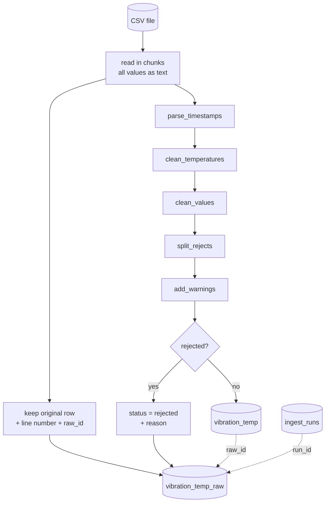
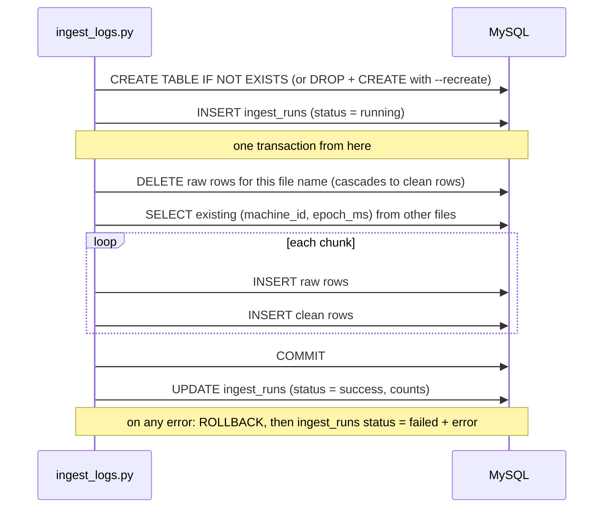
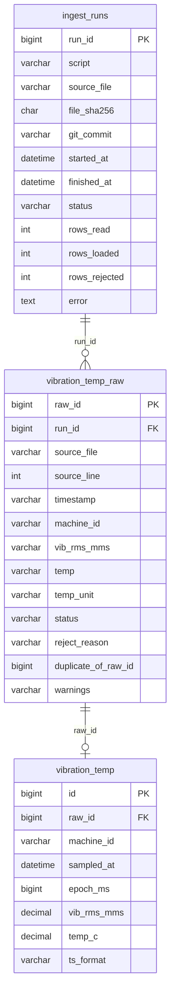
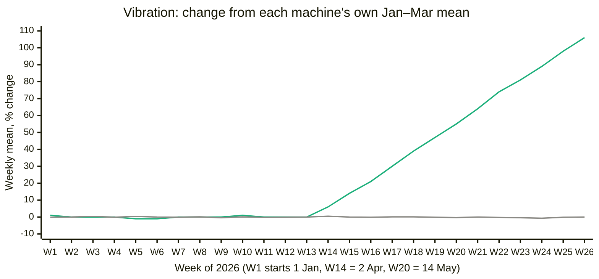
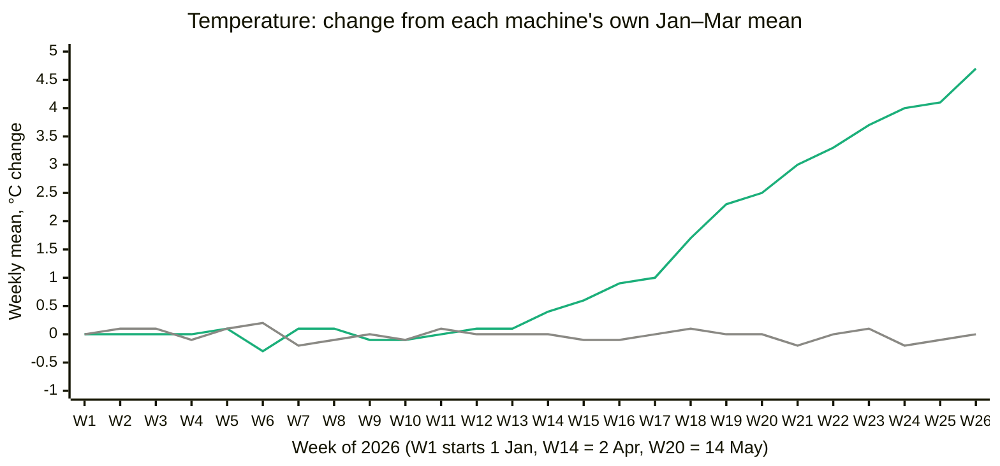

# `ingest_logs.py`: sensor log ingestion

Loads the vibration/temperature sensor log (`vibration_temp_*.csv`) into MySQL,
cleans the mixed formats the client warned about, and keeps a full audit trail:
every cleaned reading can be traced back to the exact line of the file it came
from, and every load is recorded.

- **Script:** `scripts/ingest_logs.py`
- **Shared modules:** `scripts/db_config.py` (settings, DB connection), `scripts/lineage.py` (run log)
- **Tests:** `tests/test_logs.py` (`pytest`, no database needed)
- **Data audit:** `scripts/audit_sensor_csv.py` profiles a sensor file without loading it; findings in [`trap_list.md`](trap_list.md#sensor-log-vibration_temp_2026h1csv)
- **Charts:** `scripts/plot_sensor_csv.py` charts each machine's daily or weekly means; what they show is in [What the 2026H1 log shows](#what-the-2026h1-log-shows)

---

## Contents

1. [Quick start](#quick-start)
2. [Input file](#input-file)
3. [Command-line options](#command-line-options)
4. [Configuration (`.env`)](#configuration-env)
5. [How it works](#how-it-works)
6. [Cleaning rules](#cleaning-rules)
7. [Rejects and warnings](#rejects-and-warnings)
8. [Database tables](#database-tables)
9. [Load behaviour](#load-behaviour)
10. [Audit queries](#audit-queries)
11. [Run summary](#run-summary)
12. [What the 2026H1 log shows](#what-the-2026h1-log-shows)
13. [Assumptions and limitations](#assumptions-and-limitations)
14. [Troubleshooting](#troubleshooting)

---

## Quick start

```bash
# 1. Check what the script makes of the file. No database needed.
python scripts/ingest_logs.py data/logs/vibration_temp_2026H1.csv --dry-run

# 2. First real load (creates the tables)
python scripts/ingest_logs.py data/logs/vibration_temp_2026H1.csv --recreate

# 3. Later loads of the same or a newer file
python scripts/ingest_logs.py data/logs/vibration_temp_2026H1.csv
```

Requires the MySQL container to be running (`docker compose up -d`) and a
filled-in `.env` (see [Configuration](#configuration-env)).

---

## Input file

A CSV with a header row and these five columns (others are ignored):

| Column | Formats the script handles | In `vibration_temp_2026H1.csv` |
|---|---|---|
| `timestamp` | ISO 8601 with offset (`2026-01-01T00:00:00+08:00`, `...Z`), ISO without offset (`2026-01-01 00:12:00`), epoch milliseconds (`1767196800000`) | ISO with `+08:00` (79,596 rows) and epoch ms (26,788), mixed row by row; none without an offset, none with `Z` |
| `machine_id` | Any case, surrounding spaces (`cnc-02 ` → `CNC-02`) | `CMP-01`, `CNC-01`, `CNC-02`, `CNC-03`, `PMP-T01`, all already clean and all in the CMMS |
| `vib_rms_mms` | Number, vibration RMS in mm/s | 0.2–5.81, none blank |
| `temp` | Number; the unit is in the next column | 28.1–79.8 when logged in C, 88.5–165.6 when logged in F |
| `temp_unit` | `C`, `F`, `°C`, `degF`, `Celsius`, `Fahrenheit`, any case | Only `C` (90,578) and `F` (15,806), mixed reading by reading |

The 2026H1 file has 106,384 readings: 5 machines, one reading every 12 minutes, from
2026-01-01 00:00 to 2026-06-30 23:48 Singapore time, in time order, with Windows (CRLF)
line endings. The other formats in the middle column aren't in this file; the rules
stay in case a later file has them.

The script exits with an error if any of the five columns is missing.

---

## Command-line options

```
python scripts/ingest_logs.py [CSV] [options]
```

| Option | Default | What it does |
|---|---|---|
| `CSV` | `$CSV_FILE`, else `data/logs/vibration_temp_2026H1.csv` | File to load |
| `--dry-run` | off | Read and clean only; print sample rows, rejects and the summary. Nothing is written to the database. |
| `--recreate` | off | Drop and recreate `vibration_temp`, `vibration_temp_raw` and the audit view before loading. Use on the first load and after any schema change. `ingest_runs` is never dropped. |
| `--env-file PATH` | nearest `.env` | Which settings file to use |
| `--table NAME` | `vibration_temp` | Base table name; the raw table and view are `NAME_raw` and `NAME_audit` |
| `--chunk-size N` | `10000` | Rows read and inserted per batch (affects memory, not results) |
| `--source-tz TZ` | `Asia/Singapore` | Timezone assumed for ISO timestamps that have no offset |
| `--rejects PATH` | off | Also write rejected rows, with reasons, to a CSV file |

The default input path is relative to the repo root, so run the script from there.

---

## Configuration (`.env`)

Shared with `ingest_spares.py` and `docker-compose.yml`. Copy `.env.example`
to `.env` and fill it in. `.env` is git-ignored and must never be committed.

| Key | Example | Used for |
|---|---|---|
| `DB_HOST` | `localhost` | MySQL host |
| `DB_PORT` | `3307` | MySQL port (the container publishes 3307 to avoid clashing with a MySQL on Windows) |
| `DB_NAME` | `jurong_marine` | Database |
| `DB_USERNAME` | `ingest` | MySQL user (not `root`) |
| `DB_PASSWORD` | | That user's password |
| `MYSQL_ROOT_PASSWORD` | | Container admin password only; the script doesn't use it |

**Precedence:** a value already set in your shell (`export DB_PORT=...`) wins
over `.env`, even if it is empty. If the script connects to the wrong port or
says `using password: NO`, check `env | grep DB_`.

**Which `.env`:** without `--env-file`, the script searches from the `scripts/`
folder upward and uses the first `.env` it finds.

The password is never printed. Connection messages show
`user@host:port/database (password hidden)`.

---

## How it works



Each step is a small `DataFrame -> DataFrame` function, so it can be tested on
its own. The steps run on a copy, and the original text of every row goes to
the raw table unchanged.

**Sequence of a real load:**



---

## Cleaning rules

### Timestamps: `parse_timestamps`

Every timestamp is converted to UTC first, then stored two ways:

- `epoch_ms`: UTC epoch milliseconds. Unambiguous; use it for joins and ordering.
- `sampled_at`: Singapore local time (UTC+8), as a MySQL `DATETIME`. Readable; use it for display and charts.

| Raw value | Detected as (`ts_format`) | How it becomes UTC | `sampled_at` |
|---|---|---|---|
| `1767196800000` | `epoch_ms` (11–14 digits) | epoch is UTC by definition | 2026-01-01 00:00:00 |
| `2026-01-01T00:00:00+08:00` | `iso_offset` | uses the offset | 2026-01-01 00:00:00 |
| `2026-01-01T00:12:00Z` | `iso_offset` | `Z` = UTC | 2026-01-01 08:12:00 |
| `2026-01-01 00:12:00` | `iso_naive` | **assumed** `--source-tz` | 2026-01-01 00:12:00 |
| blank, `not a date` | `unknown` | n/a | row rejected (`bad_timestamp`) |

> Fixed bug: the original script kept the `+08:00` offset on ISO rows but
> converted epoch rows to UTC, so the same moment was stored 8 hours apart.
> `test_iso_with_offset_and_epoch_give_same_time` guards against this. In the
> 2026H1 file a quarter of all readings are epoch ms, so this bug would have
> shifted 26,788 readings.

### Temperature: `clean_temperatures`

Every reading is converted to **Celsius** in `temp_c`, rounded to 2 decimals.

| Unit as logged | Treated as | Conversion |
|---|---|---|
| `C`, `c`, `°C`, `degC`, `Celsius`, `Centigrade` | Celsius | as is |
| `F`, `°F`, `degF`, `Fahrenheit` | Fahrenheit | (°F − 32) × 5/9 |
| anything else (e.g. `K`) or blank | unknown | `temp_c = NULL`, warning `unknown_temp_unit` |

The original reading and unit stay in `vibration_temp_raw.temp` / `.temp_unit`.
A non-numeric reading gives `temp_c = NULL` and the warning `missing_temp`.

The unit labels in the 2026H1 file can be trusted: after conversion, readings logged
in F average 51.9 °C and readings logged in C average 52.3 °C, and no reading looks
mislabelled (no F value below 80, no C value above 80).

### Machine ID and vibration: `clean_values`

- `machine_id`: trimmed and upper-cased (`cnc-02 ` → `CNC-02`). Blank → rejected.
- `vib_rms_mms`: converted to a number, rounded to 2 decimals. Non-numeric or blank → `NULL`, warning `missing_vibration`.

### Duplicates: `split_rejects`

A reading is a duplicate if another row has the same `machine_id` and
`epoch_ms`, i.e. the same machine at the same instant, whatever format the
timestamp was written in. The **first one seen is kept**; later ones are
rejected with `duplicate_of_raw_id` pointing at the kept row. This is checked
across chunks, and against readings already loaded from **other** files.

---

## Rejects and warnings

**Rejected rows** go to `vibration_temp_raw` with `status = 'rejected'` and are
not in the clean table. If several reasons apply, the first in this list wins:

| `reject_reason` | Meaning |
|---|---|
| `bad_timestamp` | Blank or unparseable timestamp |
| `missing_machine_id` | Blank machine ID |
| `duplicate_reading` | Same machine and instant as an earlier row; see `duplicate_of_raw_id` |

**Warnings** mark rows that were loaded but have gaps. They're stored as a
comma-separated list in `vibration_temp_raw.warnings`:

| Warning | Meaning |
|---|---|
| `unknown_temp_unit` | Reading present but unit not recognised; `temp_c` is NULL |
| `missing_temp` | No usable temperature reading |
| `missing_vibration` | No usable vibration reading |

The 2026H1 file produces no rejects and no warnings.

---

## Database tables



| Object | Contents | Keys |
|---|---|---|
| `ingest_runs` | One row per load, shared with other ingest scripts: file name, SHA-256 of the file, git commit of the code, start/finish time, counts, `running` / `success` / `failed` and the error message | `run_id` |
| `vibration_temp_raw` | Every row of the file **exactly as written** (text), with `source_line` (header = line 1), `status`, `reject_reason`, `duplicate_of_raw_id`, `warnings` | `raw_id`; index on `(source_file, source_line)` and `(status, reject_reason)` |
| `vibration_temp` | Cleaned readings only | `id`; `raw_id` unique, FK → raw (`ON DELETE CASCADE`); unique `(machine_id, epoch_ms)`; index `(machine_id, sampled_at)` |
| `vibration_temp_audit` (view) | Clean row + its raw row + its run: `source_file`, `source_line`, `timestamp_raw`, `temp_raw`, `temp_unit_raw`, `warnings`, `file_sha256`, `loaded_at` | n/a |

---

## Load behaviour

- **All or nothing:** the data changes for a file happen in one transaction. If anything fails, the previous data for that file is untouched.
- **Failures are recorded:** the `ingest_runs` row is written in its own transaction first, so a failed load still appears with `status = 'failed'` and the error.
- **Re-loading a file:** loading a file whose **name** is already in the table replaces that file's rows. Rows from other files are kept.
- **Several files:** load each one; readings that overlap with an already-loaded file are rejected as duplicates of the existing rows.
- **IDs:** `raw_id` values continue from the current maximum, so they stay unique across files.
- **Schema changes:** table definitions are only created if missing. After changing the DDL, or the first time, run with `--recreate`.

---

## Audit queries

```sql
-- Where did this reading come from?
SELECT source_file, source_line, timestamp_raw, temp_raw, temp_unit_raw, temp_c, file_sha256
FROM vibration_temp_audit
WHERE machine_id = 'CNC-02' AND sampled_at = '2026-03-14 02:00:00';

-- Rejected rows by reason (for the data quality report)
SELECT reject_reason, COUNT(*) FROM vibration_temp_raw
WHERE status = 'rejected' GROUP BY reject_reason;

-- Duplicates next to the row that was kept
SELECT d.source_line, d.`timestamp`, d.temp, d.temp_unit,
       k.source_line AS kept_line, k.`timestamp` AS kept_ts, k.temp AS kept_temp, k.temp_unit AS kept_unit
FROM vibration_temp_raw d
JOIN vibration_temp_raw k ON k.raw_id = d.duplicate_of_raw_id;

-- Timestamp and unit formats found in the file
SELECT ts_format, COUNT(*) FROM vibration_temp GROUP BY ts_format;
SELECT temp_unit, COUNT(*) FROM vibration_temp_raw GROUP BY temp_unit;

-- Missing readings per machine (expected: 21,720 slots of 12 minutes in 2026H1)
SELECT machine_id, COUNT(*) AS readings, 21720 - COUNT(*) AS missing
FROM vibration_temp GROUP BY machine_id;

-- Monthly means per machine (the table in "What the 2026H1 log shows")
SELECT machine_id, DATE_FORMAT(sampled_at, '%Y-%m') AS month,
       ROUND(AVG(vib_rms_mms), 2) AS vib_mean, ROUND(AVG(temp_c), 1) AS temp_mean
FROM vibration_temp GROUP BY 1, 2 ORDER BY 1, 2;

-- Load history
SELECT run_id, source_file, status, rows_read, rows_loaded, rows_rejected, started_at, error
FROM ingest_runs WHERE script = 'ingest_logs.py' ORDER BY run_id DESC;
```

---

## Run summary

Every run (dry or real) ends with counts you can copy into the data quality
report. For the client's `vibration_temp_2026H1.csv` (SHA-256 `05c18527…6bd023`):

```
Rows read: 106384   loaded: 106384   rejected: 0
Timestamp formats: epoch_ms=26788, iso_offset=79596 (total 106384)
Temperature units: C=90578, F=15806 (total 106384)
```

If a dry run of that file shows anything different, the file or the code has changed.

When a file has rejects or gaps, more lines appear. Example from a deliberately messy test file:

```
Rows read: 9   loaded: 5   rejected: 4
Timestamp formats: epoch_ms=4, iso_naive=1, iso_offset=2, unknown=2 (total 9)
Temperature units: <blank>=1, C=4, F=1, K=1, degF=1, °C=1 (total 9)
Rejected rows: bad_timestamp=2, duplicate_reading=1, missing_machine_id=1 (total 4)
Loaded with gaps: missing_temp=1, missing_vibration=1, unknown_temp_unit=1 (total 3)
```

Each breakdown line ends with its total. `Timestamp formats` and `Temperature units`
add up to `Rows read`, and `Rejected rows` to `rejected`, which is a quick check that no
row was missed. `Loaded with gaps` counts **warnings**, not rows: one row can carry several.

---

## What the 2026H1 log shows

Findings from `vibration_temp_2026H1.csv` (SHA-256 `05c18527…6bd023`), not a property of
the script. A later file needs its own look.

**CNC-02 is the only machine whose readings change.** Its weekly mean vibration doubles
between the start of April and the end of June, and its temperature rises by about 5 °C.
The other four machines (CMP-01, CNC-01, CNC-03, PMP-T01) stay flat all half-year.

Each machine is compared with **its own** January–March average, so machines that run at
different levels share one scale and "flat" means "no change". The grey line is the
average of the other four machines; none of them moves more than 1.4% in vibration or
0.7 °C in any week.





Green = CNC-02, grey = average of the other four machines. W26 covers 25–30 Jun (6 days).

| Monthly mean | Jan | Feb | Mar | Apr | May | Jun |
|---|---|---|---|---|---|---|
| CNC-02 vibration (mm/s) | 2.31 | 2.30 | 2.31 | 2.71 | 3.56 | 4.41 |
| CNC-02 temperature (°C) | 51.9 | 51.9 | 52.0 | 52.6 | 54.4 | 56.0 |
| Other four, vibration (mm/s) | CMP-01 3.40, PMP-T01 2.90, CNC-01 2.10, CNC-03 1.80 in every month (±0.02) | | | | | |
| Other four, temperature (°C) | 51.8–52.3 in every month | | | | | |

What it means, and how it connects to the other sources:

- **Vibration warned first.** CNC-02's daily mean vibration left its normal range on
  **5 April** (the first of three days in a row more than 3 standard deviations above its
  Jan–mid-Mar average of 2.30 mm/s), six weeks before the `spindle vibration high`
  breakdown on **15 May** (CMMS WO 11529, in W20). Temperature followed about
  **30 April**, by the same test.
- **The breakdown repair didn't stop it.** Vibration kept rising at the same rate after
  15 May. The CMMS has an open `bearing noise - gearbox` work order on **19 June**
  (WO 11591), and the spares sheet has CNC-02's bearing **BRG-6310** below minimum stock
  (2 < 4, lead time 2–3 weeks).
- **It isn't a shift effect.** Day and night shift readings are the same (trap list), so
  it's the machine, not who's running it.
- **It isn't a data artefact.** Every machine logs about 98% of its expected readings
  every day (lowest day 92.5%), with no outage; the gaps are single missed readings (L4).

**Caveats.**
- The work orders line up with the trend in time; they don't prove the cause. What was
  done on 15 May isn't recorded in enough detail to say.
- CNC-02's daily mean temperature reaches **58.1 °C on 30 June**, the last day in the
  file, up from about 56 °C on the two days before. It's one day at the end of the data:
  worth asking the client about, not a finding on its own.
- Single readings are too noisy to quote (sd about 6 °C, L6). Quote weekly or monthly
  means, as here.

**Reproduce:**

```bash
python scripts/plot_sensor_csv.py data/logs/vibration_temp_2026H1.csv --freq W --table reports/sensor_monthly.csv
```

This writes `reports/sensor_weekly.png` (all five machines, mean vibration, temperature
and coverage) and the monthly means above. The charts in this section use the same
weekly means, indexed to each machine's January–March average.

---

## Assumptions and limitations

- **Timestamps without an offset** are assumed to be Singapore time (`--source-tz`). The 2026H1 file has none (`iso_naive` = 0), so the assumption isn't used on the client's data; state it in the data quality report only for later files.
- **`sampled_at` holds no timezone:** it's Singapore time by convention, documented in the column comment. `epoch_ms` is the unambiguous value.
- **Duplicates keep the first row seen.** If two duplicate rows have *different* readings, the second is still rejected; review them with the duplicates query. The 2026H1 file has none.
- **No plausibility checks:** values are loaded as logged. The 2026H1 file stays within 28.1–79.8 °C and 0.2–5.81 mm/s, with only 9 readings more than 4 standard deviations from their machine's mean, so there's nothing to reject. If a rule is added, those ranges are a starting point for its bounds.
- **Time gaps are not detected at ingest.** In the 2026H1 file, 2,216 of the expected 108,600 readings are missing (about 2% per machine), each gap one or two 12-minute slots. Charts and window queries should group by time, not assume one row every 12 minutes.
- **Only 5 machines have sensors** (CMP-01, CNC-01, CNC-02, CNC-03, PMP-T01). The other seven CMMS machines have no readings at all.
- **Line numbers** assume one CSV record per line (no line breaks inside quoted fields). The 2026H1 file has CRLF line endings; pandas handles them.
- **Re-loading is keyed on the file name,** not its content. A renamed copy of the same file is treated as a new file, and its rows become duplicates.

---

## Troubleshooting

| Error | Likely cause | Fix |
|---|---|---|
| `CSV not found: data/logs/vibration_temp_2026H1.csv` | Script run from outside the repo root, or the file isn't in `data/logs/` | `cd` to the repo root, or pass the path |
| `Missing setting(s) ...` | No `.env` found, or keys missing | Copy `.env.example` to `.env`, or pass `--env-file` |
| `Can't connect ... Connection refused` | Nothing listening on `DB_HOST:DB_PORT` | `docker compose ps` shows the published port; it must match `DB_PORT`. Check `env \| grep DB_PORT` for a shell override. |
| `Access denied ... (using password: NO)` | Empty `DB_PASSWORD` reached the script | `unset DB_PASSWORD` in the shell, or pass `--env-file .env` |
| `Access denied ... (using password: YES)` | Password differs from the one the container was created with | Reset with `ALTER USER` as root, or `docker compose down -v && docker compose up -d` (deletes data) |
| `Unknown column ...` / `Unknown table ...` | Tables were created by an older version | Run once with `--recreate` |
| `CSV is missing column(s)` | Header doesn't match | Check the header row against [Input file](#input-file) |