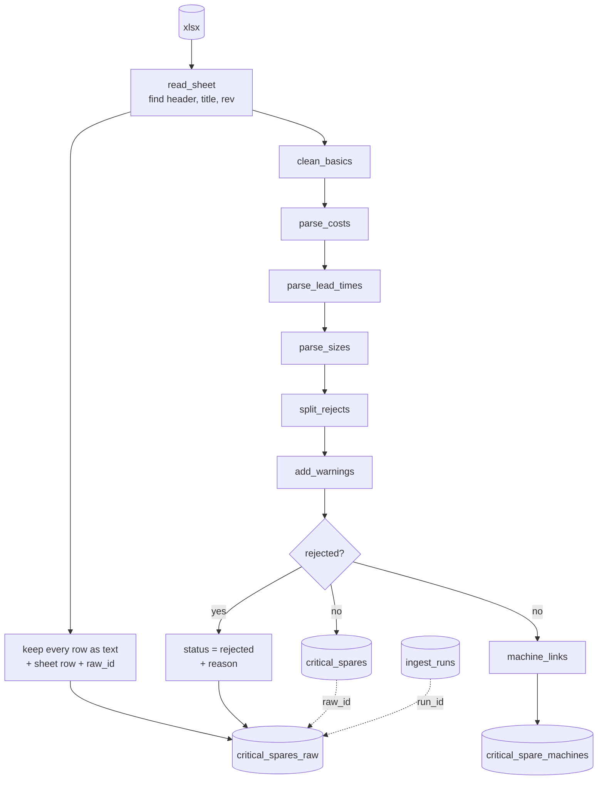

# `ingest_spares.py`: critical spares ingestion

Loads the storeman's Critical Spares spreadsheet (`critical_spares.xlsx`) into
MySQL. It parses the free-text cells (costs, lead times, sizes in mixed metric
and imperial, machine lists) and keeps a full audit trail: every cleaned part
can be traced back to the exact sheet row and revision it came from, and every
load is recorded.

- **Script:** `scripts/ingest_spares.py`
- **Shared modules:** `scripts/db_config.py` (settings, DB connection), `scripts/lineage.py` (run log)
- **Tests:** `tests/test_spares.py` (`pytest`, no database needed)
- **Companion:** [`ingest_logs.md`](ingest_logs.md) for the sensor log script, which uses the same structure

---

## Contents

1. [Quick start](#quick-start)
2. [Input file](#input-file)
3. [Command-line options](#command-line-options)
4. [Configuration (`.env`)](#configuration-env)
5. [How it works](#how-it-works)
6. [Cleaning rules](#cleaning-rules)
7. [Rejects and warnings](#rejects-and-warnings)
8. [Database tables](#database-tables)
9. [Load behaviour](#load-behaviour)
10. [Audit queries](#audit-queries)
11. [Run summary](#run-summary)
12. [Assumptions and limitations](#assumptions-and-limitations)
13. [Troubleshooting](#troubleshooting)

---

## Quick start

```bash
# 1. Check what the script makes of the sheet. No database needed.
python scripts/ingest_spares.py data/tabular/critical_spares.xlsx --dry-run

# 2. First real load (creates the tables)
python scripts/ingest_spares.py data/tabular/critical_spares.xlsx --recreate

# 3. Loading a new revision of the sheet
python scripts/ingest_spares.py data/tabular/critical_spares.xlsx
```

Requires the MySQL container to be running (`docker compose up -d`) and a
filled-in `.env` (see [Configuration](#configuration-env)).

---

## Input file

An Excel workbook. The script reads the **active (first-shown) worksheet** and
finds the header row by looking for a cell that says `Part No`. Anything above
the header is treated as the title; the first non-empty title cell is stored,
and a revision is taken from it (`... rev 11` → `11`).

Example layout (the client's file):

| Row | A | B | C | D | E | F | G | H |
|---|---|---|---|---|---|---|---|---|
| 1 | JURONG MARINE & ENGINEERING — CRITICAL SPARES LIST (storeman: Halim) rev 11 | | | | | | | |
| 2 | | | | | | | | |
| 3 | Part No | Description | For Machine | Qty | Min Qty | Unit Cost | Lead Time | Location |
| 4 | BRG-6205-2RS | Bearing 6205 2RS | CNC-01 | 8 | 4 | $12.50 | 3 days | S1-A2 |
| 10 | WIRE-ER70S | Welding wire ER70S-6 0.045in | WELD-01/02 | 12 | 6 | $38/spool | local | S2-A1 |

Required headers (case-insensitive, any order; other columns are ignored):
`Part No`, `Description`, `For Machine`, `Qty`, `Min Qty`, `Unit Cost`,
`Lead Time`, `Location`. The script exits with an error if any are missing.

Fully blank rows are skipped and are not stored.

---

## Command-line options

```
python scripts/ingest_spares.py XLSX [options]
```

| Option | Default | What it does |
|---|---|---|
| `XLSX` | required | Workbook to load |
| `--dry-run` | off | Read and clean only; print the parsed parts, rejects and the summary. Nothing is written to the database. |
| `--recreate` | off | Drop and recreate `critical_spares_raw`, `critical_spares`, `critical_spare_machines` and the audit view before loading. Use on the first load and after any schema change. `ingest_runs` is never dropped. |
| `--env-file PATH` | nearest `.env` | Which settings file to use |

---

## Configuration (`.env`)

Shared with `ingest_logs.py` and `docker-compose.yml`. Copy `.env.example`
to `.env` and fill it in. `.env` is git-ignored and must never be committed.

| Key | Example | Used for |
|---|---|---|
| `DB_HOST` | `localhost` | MySQL host |
| `DB_PORT` | `3307` | MySQL port |
| `DB_NAME` | `jurong_marine` | Database |
| `DB_USERNAME` | `ingest` | MySQL user (not `root`) |
| `DB_PASSWORD` | | That user's password |

A value already set in your shell (`export DB_PORT=...`) wins over `.env`, even
if it is empty; check `env | grep DB_` if the connection goes to the wrong place.
Without `--env-file`, the script uses the first `.env` it finds searching
upward from the `scripts/` folder. The password is never printed.

---

## How it works



Each step is a small `DataFrame -> DataFrame` function, so it can be tested on
its own. The cleaning runs on a copy; the raw table gets each cell's text
exactly as in the sheet, only trimmed of surrounding spaces.

A real load:

1. Create the tables if missing (or drop and recreate with `--recreate`).
2. Write an `ingest_runs` row with `status = 'running'`, in its own transaction.
3. In **one transaction**: delete all spares rows (cascading to parts and machine links), then insert the raw rows, the clean parts and the machine links.
4. Update the run to `success` with counts. On any error, roll back and mark the run `failed` with the error message.

---

## Cleaning rules

### Text and quantities: `clean_basics`

| Field | Rule | Example |
|---|---|---|
| `part_no` | Trimmed, upper-cased | `brg-1 ` → `BRG-1` |
| `description`, `location` | Trimmed; blank → NULL | |
| `qty`, `min_qty` | Read as whole numbers. Blank or non-numeric → **0 with a warning** (`qty_missing_or_invalid` / `min_qty_missing_or_invalid`), so it isn't mistaken for real zero stock | `two` → `0` + warning |
| `below_min` | Computed by MySQL: `qty < min_qty` | `2 < 4` → `1` |

### Unit cost: `parse_cost`

| Cell | `unit_cost` | `cost_per` |
|---|---|---|
| `$12.50` | 12.50 | NULL (per piece) |
| `$48` | 48.00 | NULL |
| `$38/spool` | 38.00 | `spool` |
| `ask Halim` | NULL + warning `unit_cost_unparsed` | NULL |

The sheet doesn't state a currency, so none is stored. The column comment says so.

### Lead time: `parse_lead_time`

| Cell | `lead_time_min_days` | `lead_time_max_days` | `is_local_supply` | `lead_time_note` |
|---|---|---|---|---|
| `3 days` | 3 | 3 | 0 | |
| `1 wk` | 7 | 7 | 0 | |
| `2-3 weeks (Germany)` | 14 | 21 | 0 | `Germany` |
| `6-8 weeks!!` | 42 | 56 | 0 | |
| `local` | NULL | NULL | **1** | |
| `when available` | NULL + warning `lead_time_unparsed` | NULL | 0 | |

Units understood: `d`, `day(s)` = 1 day; `w`, `wk(s)`, `week(s)` = 7 days;
`mth(s)`, `month(s)` = 30 days. Ranges can be written `2-3` or `2 to 3`.
Text in brackets becomes the note; trailing `!` is ignored.

### Size: `parse_size`

The brief warns that the sheet mixes metric and imperial. The script looks for
an explicit size **with a unit** in the description and converts it to mm:

| Description | `size_raw` | `size_value` | `size_unit` | `size_mm` |
|---|---|---|---|---|
| V-Belt 5V x 85 in | `85 in` | 85 | in | 2159.00 |
| Mech seal kit 1-3/8 inch | `1-3/8 inch` | 1.375 | in | 34.92 |
| Welding wire ER70S-6 0.045in | `0.045in` | 0.045 | in | 1.14 |
| Chuck jaw set 10in | `10in` | 10 | in | 254.00 |
| Insert tip DNMG 2.4mm nose | `2.4mm` | 2.4 | mm | 2.40 |
| Bearing 6205 2RS | | | | NULL |

Recognised forms: mixed fractions (`1-3/8 inch`), fractions (`3/8"`),
decimals and whole numbers, followed by `in`, `inch`, `inches`, `"` or `mm`.
Only one size is captured per part; inch forms are checked before mm.

**Bearing designations (e.g. `6205` = 25 mm bore) are deliberately not
decoded.** Only sizes written with a unit are converted.

### Machines: `split_machines`

| `For Machine` cell | `critical_spare_machines` rows |
|---|---|
| `CNC-01` | `CNC-01` |
| `CNC-01/02/03` | `CNC-01`, `CNC-02`, `CNC-03` (the prefix carries over) |
| `WELD-01/02` | `WELD-01`, `WELD-02` |
| `ALL` | `ALL` (used on every machine) |

---

## Rejects and warnings

**Rejected rows** stay in `critical_spares_raw` with `status = 'rejected'` and
are not in `critical_spares`. If several reasons apply, the first in this list wins:

| `reject_reason` | Meaning |
|---|---|
| `missing_part_no` | Part No cell is blank |
| `duplicate_part_no` | Same part number (after trimming and upper-casing) as an earlier row; the **first row is kept**, and `duplicate_of_raw_id` points at it |
| `missing_description` | Description cell is blank |

**Warnings** mark rows that were loaded but where something couldn't be read.
They're stored as a comma-separated list in `critical_spares_raw.warnings`:

| Warning | Meaning |
|---|---|
| `qty_missing_or_invalid` | Qty blank or not a number; stored as 0 |
| `min_qty_missing_or_invalid` | Min Qty blank or not a number; stored as 0 |
| `unit_cost_unparsed` | Unit Cost has text but no readable amount |
| `lead_time_unparsed` | Lead Time has text that isn't a duration or `local` |

---

## Database tables

```mermaid
erDiagram
    ingest_runs ||--o{ critical_spares_raw : "run_id"
    critical_spares_raw ||--o| critical_spares : "raw_id"
    critical_spares ||--o{ critical_spare_machines : "part_no"

    ingest_runs {
        bigint run_id PK
        varchar script
        varchar source_file
        char file_sha256
        varchar git_commit
        datetime started_at
        varchar status
        int rows_read
        int rows_loaded
        int rows_rejected
    }
    critical_spares_raw {
        bigint raw_id PK
        bigint run_id FK
        varchar source_file
        int source_row
        varchar source_rev
        varchar part_no
        varchar description
        varchar for_machine
        varchar qty
        varchar min_qty
        varchar unit_cost
        varchar lead_time
        varchar location
        varchar status
        varchar reject_reason
        bigint duplicate_of_raw_id
        varchar warnings
    }
    critical_spares {
        varchar part_no PK
        bigint raw_id FK
        varchar description
        int qty
        int min_qty
        tinyint below_min
        decimal unit_cost
        varchar cost_per
        decimal size_value
        varchar size_unit
        decimal size_mm
        varchar size_raw
        int lead_time_min_days
        int lead_time_max_days
        tinyint is_local_supply
        varchar lead_time_note
        varchar location
    }
    critical_spare_machines {
        varchar part_no PK, FK
        varchar machine_code PK
    }
```



| Object | Contents | Keys |
|---|---|---|
| `ingest_runs` | One row per load, shared with `ingest_logs.py`: file name, SHA-256, git commit, times, counts, `running` / `success` / `failed` and error | `run_id` |
| `critical_spares_raw` | Every non-blank sheet row **exactly as written** (text), with `source_row`, `source_rev`, `source_title`, `status`, `reject_reason`, `duplicate_of_raw_id`, `warnings` | `raw_id` = `run_id × 100000 + source_row` |
| `critical_spares` | Cleaned parts only | `part_no`; `raw_id` unique, FK → raw (`ON DELETE CASCADE`) |
| `critical_spare_machines` | Which machines each part is for | (`part_no`, `machine_code`); FK → parts (`ON DELETE CASCADE`) |
| `critical_spares_audit` (view) | Clean part + its raw row + its run: `source_file`, `source_row`, `source_rev`, `for_machine_raw`, `qty_raw`, `min_qty_raw`, `unit_cost_raw`, `lead_time_raw`, `warnings`, `file_sha256`, `loaded_at` | n/a |

**Reading a `raw_id`:** `300008` is run 3, sheet row 8. IDs never repeat
across loads, so a citation stays unambiguous.

---

## Load behaviour

- **Full refresh:** the sheet is a complete list of critical spares, so every load **replaces all spares data** with the new sheet. A part dropped from a new revision disappears from the tables; to see it, look at an earlier run in `ingest_runs` and the file it names.
- **All or nothing:** delete and inserts happen in one transaction. If anything fails, the previous data is untouched.
- **Failures are recorded:** the `ingest_runs` row is written first in its own transaction, so a failed load still appears with `status = 'failed'` and the error.
- **Schema changes:** tables are only created if missing. After changing the DDL, or the first time, run with `--recreate`.

---

## Audit queries

```sql
-- Where did this part's figures come from?
SELECT part_no, qty, qty_raw, unit_cost, unit_cost_raw,
       lead_time_min_days, lead_time_max_days, lead_time_raw,
       source_file, source_row, source_rev, file_sha256, loaded_at
FROM critical_spares_audit WHERE part_no = 'SEAL-KIT-KSB';

-- Parts below minimum stock, with their lead time (the storeman's question)
SELECT part_no, description, qty, min_qty, lead_time_raw, location
FROM critical_spares_audit WHERE below_min = 1 ORDER BY lead_time_max_days DESC;

-- Spares for a machine
SELECT s.part_no, s.description, s.qty, s.min_qty, s.location
FROM critical_spares s
JOIN critical_spare_machines m ON m.part_no = s.part_no
WHERE m.machine_code IN ('CNC-02', 'ALL');

-- Rows rejected or loaded with warnings (for the data quality report)
SELECT source_row, part_no, status, reject_reason, warnings
FROM critical_spares_raw WHERE status = 'rejected' OR warnings IS NOT NULL;

-- Metric vs imperial sizes found
SELECT size_unit, COUNT(*) FROM critical_spares GROUP BY size_unit;

-- Load history
SELECT run_id, source_file, file_sha256, status, rows_read, rows_loaded, rows_rejected, started_at
FROM ingest_runs WHERE script = 'ingest_spares.py' ORDER BY run_id DESC;
```

---

## Run summary

Every run ends with counts you can copy into the data quality report. From the
client's rev 11 sheet:

```
Rev 11: rows_read=10, parts_loaded=10, rejected=0, machine_links=13, below_min_qty=3,
        size_in_inches=4, size_in_mm=1, no_explicit_size=5
```

When rows are rejected or loaded with warnings, two more lines appear, each ending
with its total:

```
Rejected rows: duplicate_part_no=1, missing_part_no=1 (total 2)
Loaded with warnings: lead_time_unparsed=1, min_qty_missing_or_invalid=1 (total 2)
```

The `Rejected rows` total equals `rejected` on the `Rev` line. The `Loaded with
warnings` total counts **warnings**, not rows: one row can carry several. The `Rev`
line has no total, because its figures are separate counts rather than one breakdown.

---

## Assumptions and limitations

- **Currency:** costs are stored as numbers without a currency; the sheet only shows `$`.
- **Months are 30 days** when converting lead times.
- **`local` supply** has no lead time in days; filter on `is_local_supply = 1`.
- **Sizes:** only sizes written with a unit are converted; bearing designations aren't decoded, and only one size is captured per description (inch forms take priority over mm).
- **Duplicates keep the first row.** A later row with the same part number is rejected even if its quantity is different; review with the rejected-rows query.
- **Only the active worksheet is read.** If the workbook gains more sheets, make sure the spares list is the one shown when it's saved.
- **Formula cells** are read as their last calculated value. A file saved by a tool that doesn't store calculated values (some scripts, not Excel) would show those cells as blank.
- **Up to 99,999 sheet rows**, because of the `raw_id` scheme.
- **No plausibility checks:** a negative quantity or a $0 cost is loaded as written.

---

## Troubleshooting

| Error | Likely cause | Fix |
|---|---|---|
| `No header row with 'Part No' found` | Header text changed, or the wrong sheet is active | Check the header cell, and which sheet is active when the file is saved |
| `Sheet is missing column(s)` | A required header is missing or renamed | Compare with [Input file](#input-file) |
| `Missing setting(s) ...` | No `.env` found, or keys missing | Copy `.env.example` to `.env`, or pass `--env-file` |
| `Can't connect ... Connection refused` | Nothing listening on `DB_HOST:DB_PORT` | `docker compose ps` shows the published port; it must match `DB_PORT`. Check `env \| grep DB_PORT` |
| `Access denied ... (using password: NO)` | Empty `DB_PASSWORD` reached the script | `unset DB_PASSWORD`, or pass `--env-file .env` |
| `Unknown column ...` / `Unknown table ...` | Tables were created by an older version | Run once with `--recreate` |