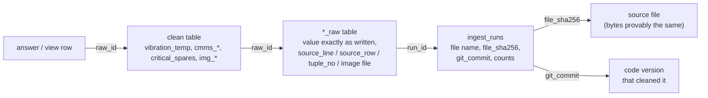

# Data ingestion

How the client's data gets into the database: one script per source type, the pipeline
that runs them, the tables they fill, how the sources are linked, and how every value
traces back to its file. For the project overview, the agent and the open client
questions, see the [README](../README.md).

One style for every data source: settings from one shared `.env`, small cleaning
steps chained with `.pipe()`, each load in a single transaction, `--dry-run` to
check parsing without a database, lineage back to the source file, and a summary
you can paste into the data quality report. Everything is loaded into one MySQL
database ([why MySQL](../README.md#why-mysql)).

| Script | Source | Details |
|---|---|---|
| `ingest/ingest_logs.py` | Sensor log CSV (`vibration_temp_*.csv`) | [`ingest_logs.md`](ingest_logs.md) |
| `ingest/ingest_spares.py` | Critical spares sheet (`critical_spares.xlsx`) | [`ingest_spares.md`](ingest_spares.md) |
| `ingest/ingest_cmms.py` | CMMS SQL dump (`jurongmarine_cmms.sql`) | [`ingest_cmms.md`](ingest_cmms.md) |
| `ingest/ingest_images.py` | Scanned nameplates and incident report forms (`data/images/`): read by Tesseract, the class vision model, or both; photos stored for the app (forms redacted) | [`ingest_images.md`](ingest_images.md) |
| `ingest/ingest_sops.py` | SOP documents (`data/sops/`): steps with line numbers, machine links, keyword search | [`ingest_sops.md`](ingest_sops.md) |
| `ingest/relationships.py` | The loaded tables: links the sources (CMMS, sensors, spares, scans, SOPs) | [`relationships.md`](relationships.md), [ER diagram](er_diagram.md) |
| `ingest/agent_user.py` | Creates the app's read-only database user (PDPA), after the loads | [`agent_user.md`](agent_user.md), [README](../README.md#database-access-for-the-app-pdpa) |
| `ingest/pipeline.py` | Runs all of the above in order (the SOPs after the CMMS), writes a Markdown report | [`pipeline.md`](pipeline.md) |
| `ingest/audit_sensor_csv.py` | Profiles a sensor CSV without loading it: formats, units, ids, gaps, duplicates, outliers, with line numbers. Run it alone, or first in the pipeline with `pipeline.py --audit` | [`trap_list.md`](trap_list.md#sensor-log-vibration_temp_2026h1csv) |

The shared modules are `common/db_config.py` (settings, database connection) and
`ingest/lineage.py` (the run log, [`lineage.md`](lineage.md)). Every data-quality problem
found so far, with evidence, is in [`trap_list.md`](trap_list.md).

## Quick start

Set up the environment and `.env` first ([README quick start](../README.md#quick-start)).
Then, from the repo root:

```bash
docker compose up -d                      # MySQL 8.4 on localhost:3307
docker compose ps                         # wait for "healthy"

python ingest/ingest_logs.py   data/logs/vibration_temp_2026H1.csv --dry-run
python ingest/ingest_logs.py   data/logs/vibration_temp_2026H1.csv --recreate   # first load
python ingest/ingest_spares.py data/tabular/critical_spares.xlsx --dry-run
python ingest/ingest_spares.py data/tabular/critical_spares.xlsx --recreate     # first load
python ingest/ingest_cmms.py   data/sql/jurongmarine_cmms.sql --dry-run
python ingest/ingest_cmms.py   data/sql/jurongmarine_cmms.sql --recreate        # first load
python ingest/ingest_images.py data/images --dry-run                            # needs Tesseract, see below
python ingest/ingest_images.py data/images --dry-run --photos-preview .cache/ingest_images/preview   # look at the redacted forms
python ingest/ingest_images.py data/images --recreate                           # first load (engine: see below)
python ingest/ingest_sops.py   data/sops --dry-run
python ingest/ingest_sops.py   data/sops --recreate                             # first load (after the CMMS)

python ingest/relationships.py --mermaid docs/er_diagram.md   # link the sources (after the loads)
python ingest/agent_user.py                                   # the app's read-only user, then a check
```

**The images need Tesseract** (free, offline OCR), installed once: Windows from
[UB Mannheim](https://github.com/UB-Mannheim/tesseract/wiki) (default folder), WSL/Ubuntu
`sudo apt install tesseract-ocr`, macOS `brew install tesseract`. The Python side is
`pytesseract` and `opencv-python-headless`; the vision model needs `openai`, and `.env` is
read with `python-dotenv` (all four belong in `requirements.txt`)
([setup](ingest_images.md#setup-tesseract)).

**Which engine reads the scans** (`--engine`, else `IMAGE_ENGINE` in `.env`, else `tesseract`):

| Engine | What it does | When |
|---|---|---|
| `tesseract` | Three preprocessings of each scan, fields voted; on the new forms the severity also read from its blue ink alone ([voting](ingest_images.md#four-pass-voting), [colour separation](ingest_images.md#colour-separation-severity-from-the-blue-value-ink)) | No network; the default |
| `llm` | The class LLM endpoint's vision model (`OPENAI_BASE_URL` / `OPENAI_API_KEY`), nothing else | For comparison only |
| `both` | Both read every scan; per field, a [decision tree](ingest_images.md#decision-tree-2-per-field-which-value-is-kept) keeps one value and flags `engines_disagree_*` where they differ | **What we load** (`IMAGE_ENGINE=both` in `.env`): it fixed every misread checked by eye on the plates (I15, I18) |

Values neither engine can read can be read off the scan by a person and recorded in the
script ([Values read by a person](ingest_images.md#values-read-by-a-person); flagged
`checked_by_eye_*`). The load also stores the photos the chat page shows: nameplates as
they are, incident forms **only redacted** (person and signature covered; a form whose labels
can't be found isn't stored). Look at the redacted forms with `--photos-preview` before the
first load ([Photos for the app](ingest_images.md#photos-for-the-app)).

Or run the loads and `relationships.py` in one go, with a report of the results in
`reports/` ([`pipeline.md`](pipeline.md)):

```bash
python ingest/pipeline.py --dry-run     # check everything first
python ingest/pipeline.py --recreate    # first load; later loads without --recreate
python ingest/pipeline.py --image-engine both   # engine for the scans (default: IMAGE_ENGINE in .env)
```

Use `--recreate` on the first load and after any schema change; afterwards run
without it. Run `relationships.py` again after every load: it re-checks the links
and refreshes the views and the ER diagram.

With uv (personal repo): `uv sync`, then put `uv run` in front of each command,
e.g. `uv run python ingest/ingest_cmms.py data/sql/jurongmarine_cmms.sql --dry-run`.

## Database (Docker)

`docker-compose.yml` runs MySQL in a container, configured from the same `.env`
as the scripts: on first start it creates `CMMS_DB_NAME` and the user
`CMMS_DB_USERNAME`/`CMMS_DB_PASSWORD`. Data lives in the `mysql-data` volume, so it
survives `docker compose down`; `docker compose down -v` wipes it.

Changing `CMMS_DB_NAME`, `CMMS_DB_USERNAME` or a password in `.env` after the first start
has no effect on the existing database. (These were `DB_NAME`, `DB_USERNAME`, ... until
14 Nov 2026; `docker-compose.yml` reads the new names too. Our database is `jme_cmms`, owned by
`ingest`, locally and on Aiven.) Either change it in MySQL, or wipe and
recreate with `docker compose down -v && docker compose up -d`.

```bash
# MySQL shell inside the container
docker compose exec mysql sh -c 'mysql -u"$MYSQL_USER" -p"$MYSQL_PASSWORD" "$MYSQL_DATABASE"'
```

GUI clients (MySQL Workbench, DBeaver) connect to `localhost:3307` from Windows.

### The client's CMMS dump

Load it with **`ingest_cmms.py`** (see the [quick start](#quick-start) and
[`ingest_cmms.md`](ingest_cmms.md)). The script parses the dump
without executing it, cleans it, and writes `cmms_*` tables with lineage, like the
other sources. This is the path to use for the app and the audit.

Running the dump directly in MySQL is only for browsing the client's tables as they
are. It runs as root and executes whatever the dump contains, including any
`DROP TABLE` or `CREATE DATABASE`, so look at the dump first:

```bash
grep -nE '^(DROP|CREATE) (TABLE|DATABASE)|^USE ' data/sql/jurongmarine_cmms.sql   # what it will do
docker compose exec -T mysql sh -c 'mysql -uroot -p"$MYSQL_ROOT_PASSWORD"' < data/sql/jurongmarine_cmms.sql
```

If the dump creates its own database (e.g. `jurongmarine_cmms`), grant the ingest
user access to it:

```bash
docker compose exec mysql sh -c 'mysql -uroot -p"$MYSQL_ROOT_PASSWORD" -e "GRANT ALL ON jurongmarine_cmms.* TO \"$MYSQL_USER\"@\"%\""'
```

The `cmms_` prefix keeps `ingest_cmms.py`'s tables apart from the dump's own
`machines`, `work_orders`, ... tables, so both can live in the same database.

## Tables

The [ER diagram](er_diagram.md) shows the cleaned tables and how they link;
`relationships.py --mermaid docs/er_diagram.md` regenerates it.

| Table | What it holds | Made by |
|---|---|---|
| `ingest_runs` | One row per run: script, file name, file SHA-256, git commit, time, row counts, `success`/`failed` + error. `relationships.py` runs appear as source `(database)`; image loads as the folder, with one hash over all its images | every script |
| `vibration_temp_raw` | Every CSV row exactly as in the file (text), with `source_line`, `status` (`loaded`/`rejected`), `reject_reason`, `duplicate_of_raw_id`, `warnings` | [`ingest_logs`](ingest_logs.md) |
| `vibration_temp` | Cleaned readings only; `raw_id` links each to its raw row | [`ingest_logs`](ingest_logs.md) |
| `vibration_temp_audit` (view) | Clean + raw + run joined: use this for citations | [`ingest_logs`](ingest_logs.md) |
| `critical_spares_raw` | Every sheet row exactly as written (text), with `source_row`, `source_rev`, `status`, `reject_reason`, `duplicate_of_raw_id`, `warnings` | [`ingest_spares`](ingest_spares.md) |
| `critical_spares` | Cleaned parts only; `raw_id` links each to its raw row | [`ingest_spares`](ingest_spares.md) |
| `critical_spare_machines` | Part to machine links (`CNC-01/02/03` split into three rows) | [`ingest_spares`](ingest_spares.md) |
| `critical_spares_audit` (view) | Clean + raw + run joined: use this for citations | [`ingest_spares`](ingest_spares.md) |
| `cmms_<table>_raw` | For `machines`, `employees`, `work_orders`, `safety_incidents`: every INSERT tuple exactly as in the dump (text), with `source_line`, `tuple_no`, `raw_tuple`, `status`, `reject_reason`, `duplicate_of_raw_id`, `warnings`. The dump's `work_orders.status` is stored as `status_src` | [`ingest_cmms`](ingest_cmms.md) |
| `cmms_<table>` | Cleaned rows only; `raw_id` links each to its raw row. Incidents carry `severity_as_logged`, `severity_scale` and `severity_5_worst` | [`ingest_cmms`](ingest_cmms.md) |
| `cmms_<table>_audit` (view) | Clean + raw + run joined: use this for citations | [`ingest_cmms`](ingest_cmms.md) |
| `img_documents_raw` | One row per image: file name, its SHA-256, document type, OCR engine(s), each field as read (JSON), where the readings or the two engines disagreed and which value was kept, the OCR text, `status`, `reject_reason`, `warnings` | [`ingest_images`](ingest_images.md) |
| `img_nameplates` | One per machine (`asset_tag` = `machine_id`): serial, power, weight, **lubricant**, **grease interval**, ... | [`ingest_images`](ingest_images.md) |
| `img_incident_reports` | One per incident (`IR-2024-900` -> `incident_id` 900): immediate action, root cause, signature, severity on the **scale printed on the form** | [`ingest_images`](ingest_images.md) |
| `img_files` | The photos for the app, in the database (the hosted page has no data folder): nameplates as they are, incident forms only redacted; `bytes_sha256` to check them | [`ingest_images`](ingest_images.md#photos-for-the-app) |
| `img_files_public` (view) | The photos the app may show: nameplates' originals and forms' redacted copies, of loaded scans only | [`ingest_images`](ingest_images.md#photos-for-the-app) |
| `img_nameplates_audit`, `img_incident_reports_audit` (views) | Clean + image file + its SHA-256 + run: use these for citations | [`ingest_images`](ingest_images.md) |
| `sop_documents_raw` | One row per file in the SOP folder: file name, SHA-256, text as read, `status`, `reject_reason`, `warnings` | [`ingest_sops`](ingest_sops.md) |
| `sops`, `sop_steps`, `sop_machines` | One row per SOP revision (`is_current`; `search_text` is what the app searches), per step with its line number, per machine it names | [`ingest_sops`](ingest_sops.md) |
| `sop_ft_stopwords` | The words the SOP `FULLTEXT` indexes ignore (MySQL's defaults + the script's own) | [`ingest_sops`](ingest_sops.md#stop-words-how-they-help-retrieval) |
| `sops_audit`, `sop_steps_audit` (views) | Clean + file + its SHA-256 + run: use these for citations | [`ingest_sops`](ingest_sops.md) |
| `table_relationships` | One row per link between sources (see below): child and parent column, `fk`/`soft`, rows checked, matched, orphans and which keys, `run_id` of the run that checked it | [`relationships`](relationships.md) |
| `machine_overview` (view) | One row per machine: work orders, breakdowns, open WOs, incidents, lost days, spares, spares below min, sensor readings and their date range | [`relationships`](relationships.md#views) |
| `machine_spares` (view) | Spares per machine, with `ALL` expanded to every machine | [`relationships`](relationships.md#views) |
| `work_order_detail` (view) | Work orders + machine + employee trade/shift (no names) | [`relationships`](relationships.md#views) |
| `incident_detail` (view) | Incidents + machine + employee trade/shift; severity as `severity_5_worst` only | [`relationships`](relationships.md#views) |
| `work_order_sensor_window` (view) | Each work order with the sensor readings in the 7 days up to it (`--window-days`) | [`relationships`](relationships.md#views) |
| `machine_nameplate` (view) | Every machine with its nameplate's values; `has_nameplate = 0` if there is no photo | [`relationships`](relationships.md#views) |
| `machine_sops` (view) | Every machine with the current SOPs that name it; `has_sop = 0` if none does | [`relationships`](relationships.md#views) |
| `incident_report_vs_cmms` (view) | Scanned form vs CMMS, one row per field: `form_value`, `logged_value`, `agrees` | [`relationships`](relationships.md#views) |

Re-loading a sensor file or a CMMS dump replaces that file's rows (other files are
kept). The spares sheet is a complete list, so each spares load replaces all spares
rows with the new sheet; the images folder likewise replaces every row from that folder.
`ingest_runs` keeps the history of what was loaded when.
Spares `raw_id` = `run_id * 100000 + sheet row`, so `300008` is run 3, row 8.

## Linking the sources

The ingest scripts load each source on its own. `relationships.py` ties them together
through their shared keys and is safe to run after every load:

| Link (child -> parent) | Kind |
|---|---|
| `cmms_work_orders.machine_id` -> `cmms_machines.machine_id` | FK with `--foreign-keys`, if no orphans |
| `cmms_safety_incidents.machine_id` -> `cmms_machines.machine_id` | FK with `--foreign-keys`, if no orphans |
| `vibration_temp.machine_id` -> `cmms_machines.machine_id` | FK with `--foreign-keys`, if no orphans |
| `critical_spare_machines.machine_code` -> `cmms_machines.machine_id` | soft: `ALL` means every machine |
| `critical_spare_machines.part_no` -> `critical_spares.part_no` | FK, made by `ingest_spares.py` |
| `cmms_work_orders.emp_code` -> `cmms_employees.emp_code` | soft: `emp_code` is not unique by design |
| `cmms_safety_incidents.emp_code` -> `cmms_employees.emp_code` | soft: `emp_code` is not unique by design |
| `img_nameplates.asset_tag` -> `cmms_machines.machine_id` | FK with `--foreign-keys`, if no orphans |
| `img_incident_reports.incident_id` -> `cmms_safety_incidents.incident_id` | FK with `--foreign-keys`, if no orphans |
| `img_incident_reports.machine_id` -> `cmms_machines.machine_id` | FK with `--foreign-keys`, if no orphans |
| `sop_machines.machine_id` -> `cmms_machines.machine_id` | FK with `--foreign-keys`, if no orphans |
| `sop_machines.doc_no` -> `sops.doc_no` | FK on `(doc_no, revision)`, made by `ingest_sops.py` |

Each run checks every link (rows, matched, NULL, **orphans**: child keys with no
parent), prints the result, writes it to `table_relationships`, creates the views
above, and records itself in `ingest_runs`. Orphans are flagged in the views
(`machine_known`, `employee_known`), never dropped.

On the client's data we expect no orphans on the sensor link: the five machine ids in
`vibration_temp_2026H1.csv` (CMP-01, CNC-01, CNC-02, CNC-03, PMP-T01) are spelled exactly
as in the CMMS. The other seven CMMS machines have no sensor readings, so
`machine_overview` shows them with zero readings; that's missing coverage, not an
orphan. If a later sensor file gives orphans, lookalike ids (`CNC2` for `CNC-02`) would
need a `machine_aliases` table. On the image links, an orphan asset tag or incident id
means OCR misread it or the scan isn't in the CMMS; check `img_documents_raw.ocr_notes`.
All 30 incident forms link with 0 orphans (one misread machine id, `CRN-002`, was fixed
by a stricter machine-id check: trap list I10). The 7 machines the SOPs name (by id, CMMS
name or alias) all match the CMMS.

```bash
python ingest/relationships.py --dry-run --mermaid docs/er_diagram.md   # no database needed
python ingest/relationships.py                                          # check + catalog + views
python ingest/relationships.py --foreign-keys                           # also enforce where clean
python ingest/relationships.py --drop-foreign-keys                      # before reloading a source
```

Foreign keys are opt-in: a reload deletes rows they would protect, so while they
exist a reload fails. Order of work: `--drop-foreign-keys`, reload, `--foreign-keys`
(see [Foreign keys](relationships.md#foreign-keys)). Every run is logged too
(see [Run log](relationships.md#run-log)).
The ER diagram of the cleaned schema is in [`er_diagram.md`](er_diagram.md); solid
lines are foreign keys, dotted lines are soft links. Details in
[`relationships.md`](relationships.md).

## Lineage: traceability and reproducibility

Every cleaned value can be followed back to the exact line of the exact file it came
from, and to the exact code that cleaned it. That is what lets the app cite its sources
and what an auditor will test. The run log and raw tables behind it are described in
[`lineage.md`](lineage.md).



| Link | Where it is | What it proves |
|---|---|---|
| clean row -> raw row | `raw_id` on every clean table, joined in the `*_audit` views | which input row produced this value |
| raw row -> place in the file | `source_line` (CSV, header is line 1), `source_line` + `tuple_no` (SQL dump), `source_row` + `source_rev` (spreadsheet), `source_file` + `image_sha256` (scans) | where to look in the original |
| raw row -> load | `run_id` on every raw row | which load brought it in, and when |
| load -> file | `ingest_runs.file_sha256` (for the images: one hash over the folder, `lineage.folder_sha256`) | the file you hold is byte-for-byte the one that was loaded |
| load -> code | `ingest_runs.git_commit` | which version of the cleaning rules ran |
| rejected rows | `*_raw` with `status = 'rejected'`, `reject_reason`, `duplicate_of_raw_id` | nothing was dropped silently |
| links between sources | `table_relationships.run_id`; `relationships.py` runs in `ingest_runs` with a fingerprint of the check | how well the sources linked up at that moment |

The views made by `relationships.py` keep `raw_id`, so a row from `work_order_detail` or
`incident_detail` traces through `cmms_work_orders_audit` / `cmms_safety_incidents_audit`,
and a row from `machine_nameplate` or `incident_report_vs_cmms` through the `img_*_audit`
views to the image file.

### Demonstrating traceability

Take a value the app gave as an answer and walk it back to the source. Run the SQL in
the MySQL shell (or DBeaver), the shell commands from the repo root.

**A sensor reading:**

```sql
-- 1. The value, as stored and as written in the file
SELECT temp_c, temp_raw, temp_unit_raw, timestamp_raw, source_file, source_line, run_id, file_sha256
FROM vibration_temp_audit
WHERE machine_id = 'CNC-02' AND sampled_at = '2026-03-14 02:00:00';

-- 2. The load that brought it in
SELECT run_id, script, source_file, file_sha256, git_commit, started_at, status
FROM ingest_runs WHERE run_id = <run_id>;
```

```bash
sed -n '<source_line>p' data/logs/vibration_temp_2026H1.csv   # 3. the line exactly as in the file
sha256sum data/logs/vibration_temp_2026H1.csv                 # 4. must equal file_sha256
git show --stat <git_commit>                                  # 5. the code that cleaned it
```

On Windows: `Get-FileHash -Algorithm SHA256 data\logs\vibration_temp_2026H1.csv`.

That reading is line 42343 of the 2026H1 file. Point out what changed on the way. The
file's first CNC-03 reading (line 4) was logged as `141.4` with unit `F` and is stored
as `temp_c = 60.78`; the rule is `clean_temperatures` in `ingest_logs.py` at that commit.

**A safety incident** (the severity flip the auditor will test):

```sql
SELECT incident_id, incident_date, severity_as_logged, severity_scale, severity_5_worst,
       source_file, source_line, raw_tuple, file_sha256
FROM cmms_safety_incidents_audit WHERE incident_id = 902;
```

```bash
sed -n '<source_line>p' data/sql/jurongmarine_cmms.sql   # the INSERT line holding raw_tuple
```

Incident 902 (16 Apr 2024) was logged as `5` on the old scale (1 = worst), so it appears
as `severity_5_worst = 1`: same incident, translated, with the original kept beside it.

**A scanned form** (and the printed scale behind the conversion):

```sql
SELECT incident_id, severity_as_logged, severity_scale, severity_5_worst, source_file, image_sha256
FROM img_incident_reports_audit WHERE incident_id = 900;
SELECT field, form_value, logged_value, agrees FROM incident_report_vs_cmms WHERE incident_id = 900;
```

```bash
sha256sum data/images/IR-2024-900.jpg   # must equal image_sha256; then open the image
```

The form says `Severity (1 = MOST SEVERE): 4`, so it is `severity_5_worst = 2`, the same
value the CMMS date rule gives.

**A spare part:** `critical_spares_audit` gives `source_row` and `source_rev`; open
`critical_spares.xlsx` at that row and check the title says the same revision.

**Nothing lost:** every row read is either loaded or rejected with a reason.

```sql
-- Counts add up for every load
SELECT run_id, script, source_file, rows_read, rows_loaded, rows_rejected,
       rows_read = rows_loaded + rows_rejected AS adds_up
FROM ingest_runs WHERE script LIKE 'ingest_%' AND status = 'success' ORDER BY run_id DESC;

-- The rows behind a run's counts (latest run of each file; older runs' rows were replaced)
SELECT status, reject_reason, COUNT(*) FROM vibration_temp_raw
WHERE run_id = <run_id> GROUP BY status, reject_reason;
```

### Demonstrating reproducibility

Same file + same code = same result. `ingest_runs` records both halves, so a load can be
repeated and compared.

1. **Before a load that matters, commit.** `git_commit` records only `HEAD`; changes
   that aren't committed are not recorded. Check `git status` is clean, then load.
2. **Re-run the load at the recorded commit, without touching the database:**

   ```bash
   git switch --detach <git_commit>                     # the code as it was
   sha256sum data/logs/vibration_temp_2026H1.csv        # same file as file_sha256?
   python ingest/ingest_logs.py data/logs/vibration_temp_2026H1.csv --dry-run
   git switch -                                         # back to where you were
   ```

   `Rows read / loaded / rejected` and the reject reasons must match that run's row in
   `ingest_runs` and the `GROUP BY` above. For the client's 2026H1 file that's
   106,384 read, 106,384 loaded, 0 rejected ([Run summary](ingest_logs.md#run-summary)).
3. **Linking reproduces too.** Run `relationships.py` twice with no load in between: both
   runs get the same `file_sha256` (the fingerprint of the check results).

   ```sql
   SELECT run_id, started_at, file_sha256, rows_read, rows_loaded, rows_rejected
   FROM ingest_runs WHERE script = 'relationships.py' ORDER BY run_id DESC LIMIT 2;
   ```

**Compare content, not ids.** `run_id` and `raw_id` are assigned by the database, so they
differ between runs and between databases (spares `raw_id` even contains the `run_id`).
Compare by `source_file` + `source_line` / `source_row` and by the counts.

**Dry run vs real load:** a real load also rejects rows that duplicate rows already
loaded from *other* files, which a dry run can't see. The counts match exactly for the
first file of a source; for later files, the difference is the `duplicate_*` rejects.

**OCR is the exception:** another Tesseract version can read a bad photo differently, and
the vision model's answers vary from run to run even at `temperature = 0` (trap list I24).
Each image's reading is cached by its SHA-256 and the engine tag
(`.cache/ingest_images/<hash>_tesseract-v3.json`, `<hash>_llm-v3-gpt-4o-mini.json`), and
`img_documents_raw` keeps what was read, so a re-run on the same machine with the cache gives
the same result; across machines, compare `fields_raw` and `ocr_notes`. Changing the image
preparation or the model's prompt means a new tag, so old cached reads are ignored.
`ingest_runs` and the run summary record the engine (`both:tesseract-v3+llm-v3:gpt-4o-mini`).

## Run summary

Every run, dry or real, ends with counts you can paste into the data quality report.
Each breakdown line ends with its total, for example:

```
Timestamp formats: epoch_ms=4, iso_naive=1, iso_offset=2, unknown=2 (total 9)
Rejected rows: bad_timestamp=2, duplicate_reading=1, missing_machine_id=1 (total 4)
```

Category totals (timestamp formats, temperature units, `trade`, `severity_scale`, document
types, ...) add up to the rows read or loaded, which is a quick check that no row was missed.
`Rejected rows` totals equal the rejected count. Warning totals (`Loaded with gaps`,
`Loaded with warnings`) count **warnings**, not rows: one row can carry several.
Each script's doc shows a full example: [`ingest_logs.md`](ingest_logs.md),
[`ingest_spares.md`](ingest_spares.md), [`ingest_cmms.md`](ingest_cmms.md),
[`ingest_images.md`](ingest_images.md#run-summary).
`relationships.py` prints a per-link check instead
(see [`relationships.md`](relationships.md#relationships)).

## Audit queries

```sql
-- Where did this reading come from?
SELECT source_file, source_line, timestamp_raw, temp_raw, temp_unit_raw, temp_c, file_sha256
FROM vibration_temp_audit WHERE machine_id = 'CNC-02' AND sampled_at = '2026-03-14 02:00:00';

-- What was rejected, and why?
SELECT reject_reason, COUNT(*) FROM vibration_temp_raw WHERE status = 'rejected' GROUP BY 1;

-- Duplicates side by side with the row that was kept
SELECT d.source_line, d.`timestamp`, d.temp, d.temp_unit,
       k.source_line AS kept_line, k.`timestamp` AS kept_ts, k.temp AS kept_temp, k.temp_unit AS kept_unit
FROM vibration_temp_raw d JOIN vibration_temp_raw k ON k.raw_id = d.duplicate_of_raw_id;

-- Where did this spare's lead time come from?
SELECT part_no, lead_time_raw, lead_time_min_days, lead_time_max_days, source_file, source_row, source_rev
FROM critical_spares_audit WHERE part_no = 'SEAL-KIT-KSB';

-- Spares rows that were rejected or loaded with warnings
SELECT source_row, part_no, status, reject_reason, warnings FROM critical_spares_raw
WHERE status = 'rejected' OR warnings IS NOT NULL;

-- Incidents on one severity scale, with their source line in the dump
SELECT incident_id, incident_date, severity_as_logged, severity_scale, severity_5_worst,
       source_line, raw_tuple
FROM cmms_safety_incidents_audit ORDER BY incident_date;

-- Incidents the severity rule could not place (resolve before the audit)
SELECT incident_id, incident_date, severity_as_logged, severity_scale
FROM cmms_safety_incidents WHERE severity_5_worst IS NULL;

-- Work orders pointing at unknown machines or employees (fix before adding foreign keys)
SELECT source_line, wo_id, machine_id, emp_code, warnings FROM cmms_work_orders_raw
WHERE warnings LIKE '%unknown_%';

-- What oil and grease interval does each machine's nameplate give?
SELECT machine_id, has_nameplate, lubricant, grease_interval_h FROM machine_nameplate;

-- Where scanned forms and the CMMS disagree
SELECT incident_id, field, form_value, logged_value FROM incident_report_vs_cmms WHERE agrees = 0;

-- Which SOPs apply to a machine (has_sop = 0: no SOP in the data covers it)
SELECT machine_id, has_sop, doc_no, rev_label, linked_by FROM machine_sops WHERE machine_id = 'CNC-02';

-- The SOP for a question (terms from ingest_sops.search_terms), then quote it whole
SELECT doc_no, revision, MATCH (search_text) AGAINST ('blasting chamber entry') AS score
FROM sops WHERE is_current = 1 AND MATCH (search_text) AGAINST ('blasting chamber entry');
SELECT step_no, line_no, marker, step_text, refers_to FROM sop_steps_audit
WHERE doc_no = 'SOP-CONFINED-03' AND is_current = 1 ORDER BY step_no;

-- How well do the sources link up? (paste into the data quality report)
SELECT name, child_table, child_column, enforced, child_rows, matched_rows, orphan_rows, orphan_values
FROM table_relationships;

-- One machine across all sources
SELECT * FROM machine_overview WHERE machine_id = 'CNC-02';

-- Sensor readings before each CNC-02 work order (is the night shift right?)
SELECT wo_id, wo_date, wo_type, description, readings, vib_avg, vib_max, temp_c_max
FROM work_order_sensor_window WHERE machine_id = 'CNC-02' AND readings > 0 ORDER BY wo_date;

-- Load history
SELECT run_id, script, source_file, status, rows_read, rows_loaded, rows_rejected, started_at
FROM ingest_runs ORDER BY run_id DESC;
```

## Rules for the data

How the loads treat the data. Rules for how the app must answer from it (severity, scans,
SOPs, employee names) are in the [README](../README.md#rules-worth-knowing).

**Timezone rule:** `epoch_ms` is UTC; `sampled_at` is Singapore time (UTC+8).
ISO timestamps without an offset are assumed to be Singapore time (`--source-tz`).
See [`ingest_logs.md`](ingest_logs.md).

**Temperatures:** stored in Celsius only (`temp_c`); the reading and unit as
logged stay in `vibration_temp_raw`. Unknown units give `temp_c = NULL`.
See [`ingest_logs.md`](ingest_logs.md).

**Spares sizes and lead times:** sizes in inches and mm both end up in `size_mm`;
lead times like `2-3 weeks (Germany)` become day ranges. See
[`ingest_spares.md`](ingest_spares.md).

**Severity:** `ingest_cmms.py` converts every incident to `severity_5_worst` by date;
July 2025 is left unconverted until the client confirms the switch-over day
([`ingest_cmms.md`](ingest_cmms.md), client question 1 in the
[README](../README.md#needs-the-clients-input)). Scanned forms are converted with the scale
printed on them ([`ingest_images.md`](ingest_images.md#severity-the-scale-printed-on-the-form)).

**Foreign keys before reloading:** if you ran `relationships.py --foreign-keys`, run
`relationships.py --drop-foreign-keys` before reloading any source or using
`--recreate`, then add them back afterwards. See
[`relationships.md`](relationships.md#foreign-keys).

**Adding a new ingest script:** import `load_db_config`, `add_common_args` from
`db_config` and `start_run`, `finish_run` from `lineage`; write each cleaning rule
as a `df -> df` function and add a test for it ([Testing with pytest](../README.md#testing-with-pytest)).
Follow the checklist in [`lineage.md`](lineage.md#adding-lineage-to-a-new-ingest-script).
If its tables share a key with another source, add the link to `RELATIONSHIPS` in
`relationships.py` (see [`relationships.md`](relationships.md#relationships)) and a step
to `pipeline.py`.