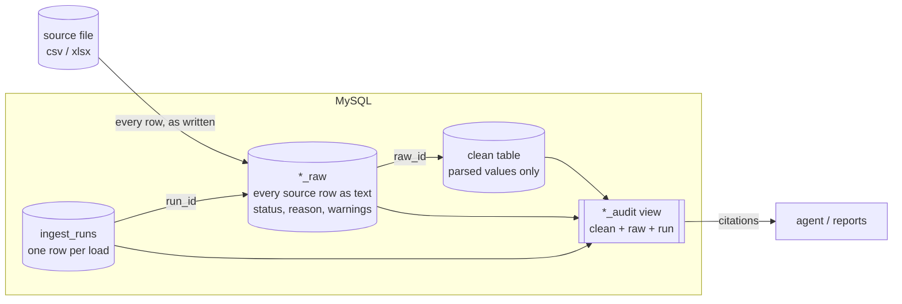
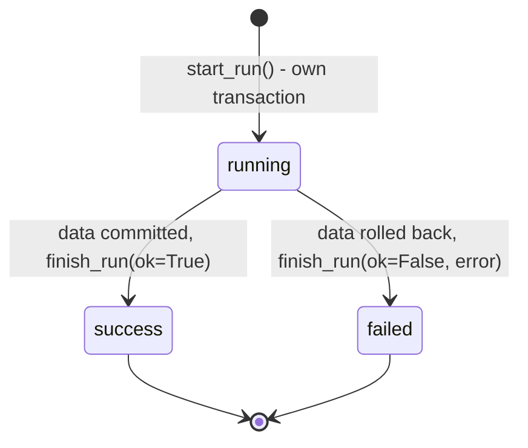

# Data lineage: tracing every value back to its source

The client brief says answers must cite their source so the auditor can verify
them. The ingest pipeline is built so that any value in the database can be
traced back to **the exact file, the exact line or row, the exact version of
that file, and the version of the code that loaded it**. Rejected and
duplicate rows are kept too, so the data quality report can show what was
wrong and what was done about it.

- **Module:** `ingest/lineage.py` (the run log, shared by all ingest scripts)
- **Used by:** [`ingest_logs.py`](ingest_logs.md), [`ingest_spares.py`](ingest_spares.md)
- **Tests:** `tests/test_shared.py`, plus the lineage tests in `tests/test_logs.py` and `tests/test_spares.py`

---

## Contents

1. [The three layers](#the-three-layers)
2. [The run log: `ingest_runs`](#the-run-log-ingest_runs)
3. [Raw tables](#raw-tables)
4. [Clean tables and audit views](#clean-tables-and-audit-views)
5. [How the scripts differ](#how-the-scripts-differ)
6. [Tracing a value: worked example](#tracing-a-value-worked-example)
7. [Proving which file was loaded](#proving-which-file-was-loaded)
8. [Citing sources in the agent](#citing-sources-in-the-agent)
9. [Adding lineage to a new ingest script](#adding-lineage-to-a-new-ingest-script)
10. [`lineage.py` reference](#lineagepy-reference)
11. [Limitations](#limitations)

---

## The three layers



| Layer | Question it answers | Tables |
|---|---|---|
| **Run** | Which file, which version of it, loaded by which code, when, and did it succeed? | `ingest_runs` |
| **Raw** | What exactly did the source say, on which line or row? Was it used, and if not, why? | `vibration_temp_raw`, `critical_spares_raw` |
| **Clean** | What is the value, in consistent units and formats? | `vibration_temp`, `critical_spares`, `critical_spare_machines` |
| **Audit view** | All of the above, joined, for one value | `vibration_temp_audit`, `critical_spares_audit` |

The agent and reports should query the **clean tables** for answers and the
**audit views** for citations. The raw tables are for the data quality report
and for investigating disputes.

---

## The run log: `ingest_runs`

One row per load, written by every ingest script through `lineage.py`.

| Column | Meaning |
|---|---|
| `run_id` | Unique ID of the load; every raw row carries it |
| `script` | `ingest_logs.py`, `ingest_spares.py`, … |
| `source_file` | File name that was loaded (name only, not the full path) |
| `file_sha256` | SHA-256 fingerprint of the file's contents at load time |
| `git_commit` | Short commit hash of the code that ran the load (NULL outside a git repo or before the first commit) |
| `started_at`, `finished_at` | When the load ran (local time of the machine running the script) |
| `status` | `running` → `success` or `failed` |
| `rows_read`, `rows_loaded`, `rows_rejected` | Counts for the load |
| `error` | Error type and message for failed loads (first 5,000 characters) |

**Lifecycle of a run:**



The run row is written in **its own transaction before the data load**, so a
failed load still leaves a record of the attempt and its error, while the data
itself is rolled back. The tables are never left half-loaded.

---

## Raw tables

Every raw table follows the same pattern:

| Column | Meaning |
|---|---|
| `raw_id` | Unique ID of the source row; clean rows point at it |
| `run_id` | The load that wrote it → `ingest_runs` |
| `source_file` | File name |
| `source_line` / `source_row` | Line number in the CSV (header = line 1) or row number in the spreadsheet |
| *source columns* | Every input column **as text, exactly as written** (spreadsheet cells are trimmed of surrounding spaces) |
| `status` | `loaded` (a clean row exists) or `rejected` (no clean row) |
| `reject_reason` | Why it was rejected, e.g. `bad_timestamp`, `duplicate_part_no` |
| `duplicate_of_raw_id` | For duplicates: the `raw_id` of the row that was kept |
| `warnings` | Comma-separated notes for rows that loaded with gaps, e.g. `missing_temp`, `lead_time_unparsed` |

Rules that hold for both pipelines:

- **Every source row is stored**, loaded or not (fully blank spreadsheet rows excepted). `rows_read` = number of raw rows.
- **A clean row exists if and only if its raw row has `status = 'loaded'`.** The clean table's `raw_id` is unique and a foreign key to the raw table.
- **Raw values are never modified.** All parsing happens on a copy; the parsed result goes to the clean table.
- **Duplicates keep the first row seen** and point the later ones at it, so both versions can be compared.

---

## Clean tables and audit views

Clean tables hold only parsed, typed values: Celsius temperatures, Singapore
times, numeric costs, lead times in days, sizes in mm. The text they came from
is not repeated there; it's one join away, in the audit view.

| View | Adds to each clean row |
|---|---|
| `vibration_temp_audit` | `source_file`, `source_line`, `timestamp_raw`, `temp_raw`, `temp_unit_raw`, `warnings`, `run_id`, `file_sha256`, `loaded_at` |
| `critical_spares_audit` | `source_file`, `source_row`, `source_rev`, `for_machine_raw`, `qty_raw`, `min_qty_raw`, `unit_cost_raw`, `lead_time_raw`, `warnings`, `run_id`, `file_sha256`, `loaded_at` |

---

## How the scripts differ

| | Sensor logs | Critical spares |
|---|---|---|
| Source | CSV, ~106k rows, read in chunks | One worksheet, ~10 rows |
| Position recorded as | `source_line` (header = line 1) | `source_row` (spreadsheet row number) |
| `raw_id` | Running number, continuing from the current maximum | `run_id × 100000 + source_row` (e.g. `300008` = run 3, row 8) |
| Re-loading | Replaces the rows **of that file name**; other files are kept | Replaces **all** spares rows (the sheet is the complete list) |
| Duplicate key | Same `machine_id` and instant (`epoch_ms`), across files | Same `part_no` within the sheet |
| Extra | — | `source_rev` and `source_title` from the sheet's title row |

In both cases, deleting a raw row cascades to its clean row (and, for spares,
its machine links). The delete and the inserts happen in one transaction.

---

## Tracing a value: worked example

*"Why does the app say CNC-03 was at 60.78 °C at midnight on 1 January?"*

(Values from `vibration_temp_sample.csv`; run numbers are illustrative.)

**1. Find the reading and its source:**

```sql
SELECT machine_id, sampled_at, temp_c,
       source_file, source_line, timestamp_raw, temp_raw, temp_unit_raw,
       run_id, file_sha256
FROM vibration_temp_audit
WHERE machine_id = 'CNC-03' AND sampled_at = '2026-01-01 00:00:00';
```

| machine_id | sampled_at | temp_c | source_file | source_line | timestamp_raw | temp_raw | temp_unit_raw |
|---|---|---|---|---|---|---|---|
| CNC-03 | 2026-01-01 00:00:00 | 60.78 | vibration_temp_sample.csv | 4 | 1767196800000 | 141.4 | F |

So the file logged **141.4 °F** as an **epoch-millisecond** timestamp on line 4.
That converts to 60.78 °C at 2026-01-01 00:00 Singapore time.

**2. Check the load it came from:**

```sql
SELECT run_id, script, source_file, file_sha256, git_commit, started_at, status
FROM ingest_runs WHERE run_id = 12;
```

**3. Open the file and look at line 4.** It should match `timestamp_raw`,
`temp_raw` and `temp_unit_raw` character for character. The cleaning rules that
turned it into 60.78 °C are documented in [`ingest_logs.md`](ingest_logs.md)
and tested in `tests/test_logs.py`.

**What was *not* loaded:**

```sql
-- Everything rejected from a file, with reasons
SELECT source_line, `timestamp`, machine_id, temp, temp_unit, reject_reason, duplicate_of_raw_id
FROM vibration_temp_raw
WHERE source_file = 'vibration_temp_2026H1.csv' AND status = 'rejected'
ORDER BY source_line;
```

---

## Proving which file was loaded

`ingest_runs.file_sha256` is a fingerprint of the file's contents. Change one
character in the file and the fingerprint changes completely. To prove the
database was loaded from the file you have in hand, compare it with the hash
of your copy:

```bash
sha256sum data/logs/vibration_temp_2026H1.csv           # Linux / WSL
```
```powershell
Get-FileHash data\logs\vibration_temp_2026H1.csv -Algorithm SHA256   # PowerShell (upper-case hex)
```
```sql
SELECT run_id, started_at, file_sha256 FROM ingest_runs
WHERE source_file = 'vibration_temp_2026H1.csv' AND status = 'success'
ORDER BY run_id DESC LIMIT 1;
```

If they match, the data came from exactly that file. If not, the file was
changed after loading, or a different copy was loaded.

---

## Citing sources in the agent

A suggested citation format, built from the audit views:

| Source | Citation | Built from |
|---|---|---|
| Sensor reading | `vibration_temp_2026H1.csv, line 48213 (run 12)` | `source_file`, `source_line`, `run_id` |
| Spare part | `critical_spares.xlsx rev 11, row 7 (run 13)` | `source_file`, `source_rev`, `source_row`, `run_id` |
| Aggregate (e.g. average temperature) | `vibration_temp_2026H1.csv, 1,204 readings, lines 2–106001 (run 12)` | `COUNT(*)`, `MIN/MAX(source_line)` over the rows used |

Have the agent's tools return these columns with every result, so the model
only has to repeat them, not invent them.

When sources disagree (e.g. two readings for the same instant), the raw table
shows both: the rejected row's `duplicate_of_raw_id` points at the one used.
The agent can then say which value it used and why.

---

## Adding lineage to a new ingest script

For example, the incident reports. Copy the pattern from `ingest_logs.py`:

```python
from db_config import add_common_args, load_db_config, to_records
from lineage import RUNS_DDL, finish_run, start_run

def main():
    ...
    engine = load_db_config(args.env_file).engine()
    create_tables(engine, args.recreate)      # run RUNS_DDL first: raw tables reference ingest_runs

    run_id = start_run(engine, "ingest_incidents.py", args.path)
    try:
        raw, clean = prepare(args.path, run_id)   # raw: every row as text + status/reason
        load(engine, raw, clean)                  # ONE transaction: delete old, insert raw, insert clean
    except BaseException as e:
        finish_run(engine, run_id, ok=False, error=f"{type(e).__name__}: {e}")
        raise
    finish_run(engine, run_id, ok=True, rows_read=len(raw),
               rows_loaded=len(clean), rows_rejected=int((raw.status == "rejected").sum()))
```

Checklist:

- [ ] A `*_raw` table with `raw_id`, `run_id` (FK → `ingest_runs`, `ON DELETE SET NULL`), `source_file`, a position column (line, row, page or image name), every source field as text, `status`, `reject_reason`, `duplicate_of_raw_id`, `warnings`
- [ ] A clean table with `raw_id` **unique** and FK → raw (`ON DELETE CASCADE`)
- [ ] A `*_audit` view joining clean + raw + `ingest_runs`
- [ ] Decide the re-load rule (replace per file, or replace all) and the duplicate key
- [ ] Raw rows inserted before clean rows, in the same transaction
- [ ] Tests that every source row reaches raw and every clean row links to a loaded raw row

For the incident reports specifically, keep the **severity as written** in the
raw table and add the date-based rule to the clean table (`severity_raw`,
`severity_scale` = `old_1_worst` / `new_5_worst`, `severity_normalised`). The
brief says the auditor will test the July 2025 scale flip, and this lets you
show the original, the rule applied and the result side by side.

For scanned images, the "position" is the image file name (and page or region),
and the raw text is the OCR output, so keep the OCR model and its confidence in
the raw table too.

---

## `lineage.py` reference

| Function / constant | What it does |
|---|---|
| `RUNS_DDL` | `CREATE TABLE IF NOT EXISTS ingest_runs …`. Run it before creating raw tables, which reference it. |
| `start_run(engine, script, source_path) -> int` | Creates `ingest_runs` if needed and inserts a `running` row with the file name, SHA-256 and git commit, in its own transaction. Returns the new `run_id`. |
| `finish_run(engine, run_id, *, ok, rows_read=None, rows_loaded=None, rows_rejected=None, error=None)` | Sets `finished_at`, `status` (`success` if `ok`, else `failed`), counts and error (truncated to 5,000 characters). |
| `file_sha256(path) -> str` | SHA-256 of the file, read in 1 MB blocks (fine for large files). |
| `git_commit() -> str \| None` | `git rev-parse --short HEAD` in the `scripts/` folder, or `None` if that fails. |

---

## Limitations

- **Only the latest load's raw rows are kept.** Re-loading replaces them; `ingest_runs` keeps the history of every load, but not the rows of older loads. To keep a version, keep the file; its fingerprint is in `ingest_runs`.
- **`git_commit` doesn't show uncommitted changes.** A load run with edited but uncommitted scripts records the last commit. It's NULL outside a git repo, before the first commit, or when the scripts are run from a copy outside the repo.
- **Times in `ingest_runs` are the local time of the machine running the script.** WSL is often set to UTC rather than Singapore time; check with `date`, and set it with `sudo timedatectl set-timezone Asia/Singapore` if needed.
- **A run that is killed** (power loss, `kill -9`) stays `running` forever. Its data transaction was rolled back, so no data is affected; treat old `running` rows as failed.
- **Sensor re-loads are keyed on the file name.** A renamed copy of a file is loaded as a new file, and its rows become duplicates of the original's.
- **Line numbers** assume one CSV record per line (no line breaks inside quoted fields).