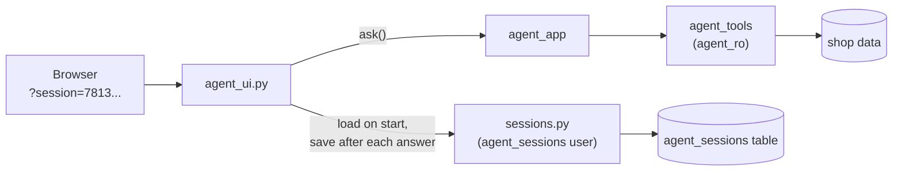

# Sessions: the conversation survives a restart

Harness checklist section 5. Before this, the page kept the conversation in Streamlit's memory
(`st.session_state`). A redeploy, Cloud Run replacing or scaling the container to zero, or a
browser refresh lost it, so a follow-up like "and what about CNC-03?" had nothing to refer back to.

Now `scripts/sessions.py` saves each conversation to a MySQL table, `agent_sessions`, after every
answer. The page puts the conversation's id in its link (`?session=...`). Opening that link
again, after a restart or on another device, loads the conversation back. The next question then
goes to the model with the whole earlier conversation, exactly as if nothing had happened.



## Who can touch it (PDPA)

This is the same idea as `agent_user.py`: each part of the app gets only the rights it needs.

| MySQL user | Can | Can't |
|---|---|---|
| `agent_sessions` (new) | `SELECT`, `INSERT`, `UPDATE`, `DELETE` on `agent_sessions`, and nothing else | read any shop data, read employee names, write any other table, create or change tables |
| `agent_ro` (unchanged) | read the linking views, as before | read `agent_sessions`. The model's tools (`query_sql` included) can't see anyone's conversation |

The app never connects as the owner (`DB_USERNAME`), and `agent_ro` stays read-only. Saving
conversations doesn't give the model's side any write access.

## What is stored

One row per conversation:

| Column | What |
|---|---|
| `session_id` | 32 random hex characters (`secrets.token_hex(16)`), the id in the link |
| `messages` | The model's conversation as JSON, **without the system prompt**. The system prompt always comes fresh from code, so a prompt change applies to old conversations too, and a tampered row can't add one: a stored `system` message makes the row unreadable, and the page starts afresh |
| `display` | A light copy of what the page drew: each question and answer, its sources, caveats and cost. No photos (large, and in the database already) and no "What happened" table |
| `turns`, `created_at`, `updated_at` | Question count and UTC timestamps |

The guardrail has already cleaned what gets here. A refused question is only a placeholder in
`messages` (`[question withheld by the guardrail: pdpa]`), and an answer it blocked has already
been replaced. So neither a name typed into a question nor a leaked answer is ever stored (tested).

**Retention.** Conversations not touched for `AGENT_SESSION_DAYS` days (default 7) are deleted
when the page starts, and by `python scripts/sessions.py purge`. A value below 1 counts as 1,
so a typo can't delete everything at once.

**The link is the key.** Anyone with a conversation's link can open it. The id is 128 random bits
and can't be guessed, but treat the link like the conversation itself. On the hosted page,
`APP_PASSWORD` still comes first.

## Set it up

Add to `.env` (and the same settings on Cloud Run, below):

```bash
AGENT_SESSION_DB_USERNAME=agent_sessions   # the default
AGENT_SESSION_DB_PASSWORD=...              # a new password, not agent_ro's or the owner's
AGENT_SESSION_DAYS=7                       # optional
```

Then, as with `agent_user.py` (it uses `DB_ADMIN_USERNAME`/`DB_ADMIN_PASSWORD`, falling back to
`MYSQL_ROOT_PASSWORD`):

```bash
python scripts/sessions.py setup --dry-run   # the table, the user and the grant; password hidden; no database
python scripts/sessions.py setup             # create them as the admin, then run the check
python scripts/sessions.py check             # only the check (exit 1 if anything is wrong)
python scripts/sessions.py purge             # delete conversations older than the retention
```

With uv (personal repo): `uv run python scripts/sessions.py setup`. No new packages are needed:
it uses SQLAlchemy and PyMySQL, which the app already has.

`setup` runs `CREATE TABLE IF NOT EXISTS`, so it never touches saved conversations. It drops and
recreates the user, so the grants are always exactly these:

```sql
CREATE USER 'agent_sessions'@'%' IDENTIFIED BY ****;
GRANT SELECT, INSERT, UPDATE, DELETE ON `defaultdb`.`agent_sessions` TO 'agent_sessions'@'%';
```

The password is bound as a parameter, never written into the SQL, and never printed.

## The check

The check connects **as the session user**. It must be able to use its own table, and every
probe of anything else must be refused:

```
Allowed (must work):
  ok      save a conversation
  ok      read it back
  ok      update it
  ok      delete it
Blocked (must fail):
  ok      the shop data: denied
  ok      employee names: denied
  ok      writing shop data: denied
  ok      changing the schema: denied

Passed: the session user can keep conversations and do nothing else.
```

The allowed probes use a fixed all-zero id and delete their row again. A probe that unexpectedly
works is a FAIL. If the `CREATE TABLE` probe worked, the check drops its table again. A missing
shop table counts as blocked; any other error is a FAIL. Run it live on demo day next to
`agent_user.py --check`.

## On the page

- **Start.** The page reads `?session=` from its link. If the store has that conversation, the
  page loads it: the answers are drawn again, and the model gets the messages. Otherwise the page
  starts a new conversation with a new id and puts it in the link.
- **After each answer.** The conversation is saved. The sidebar says "Saved after every answer.
  Keep this page's link to come back to it."
- **New conversation.** A new id goes in the link. The old conversation stays saved under its
  own link until the retention deletes it.
- **Honest degradation (#4).** If the store isn't configured, the sidebar warns "Conversations
  aren't being saved (AGENT_SESSION_DB_PASSWORD isn't set). This one lasts until the page
  closes." If MySQL is down or refuses, it warns "This conversation isn't being saved right
  now". Either way the page carries on in memory. `SessionStore.load`, `save` and `purge` never
  raise, and their messages name the error type only, never the server's text.
- **A link the store can't read** (store down, or a corrupt row) gets a new id rather than reusing
  the old one. A later save then can't overwrite the saved conversation with a shorter one.

**Limits.**
- Restored answers show their text, sources, caveats and cost, but not their photos or "What
  happened" table.
- The sidebar's "this session" spend counts from the page load.
- Two tabs on the same link both save to one row, and the last answer saved wins.

## How it is built

`SessionStore` runs its SQL through a small `run(sql, params)` function, the same pattern
`agent_tools.py` uses. In the app it is `mysql_run(engine)` (SQLAlchemy `text()` in a
transaction). In the tests it is `sqlite_run(conn)` on Python's built-in `sqlite3`, so the same
SQL and `:name` parameters run on both, and the tests need no MySQL.

A save is an `UPDATE`, then an `INSERT` if no row matched. Timestamps come from Python, in UTC.

| Piece | What it does |
|---|---|
| `new_session_id()`, `valid_id()` | The id, and the check every id passes before it reaches SQL |
| `SessionStore.load/save/purge` | Never raise; `Loaded(ok, found, messages, display, error)` |
| `store_from_env()` | `(store, None)`, or `(None, why)` when settings are missing. Never falls back to `agent_ro` or the owner |
| `setup_statements()`, `check()` | The table, user and grant; the probes, classified by MySQL error code |
| `agent_ui.display_copy()`, `restored()`, `save_line()` | What the page saves, how it comes back, what the sidebar says |

## Cloud Run

Add the secret and the settings (section 1 and 2 of
[Deploying on Cloud Run](agent_ui.md#deploying-on-google-cloud-run)):

```bash
printf '%s' 'THE_SESSION_PASSWORD' | gcloud secrets create agent-session-db-password --data-file=-
gcloud secrets add-iam-policy-binding agent-session-db-password --member=serviceAccount:$SA \
    --role=roles/secretmanager.secretAccessor
```

Then, in the deploy command, add `AGENT_SESSION_DB_USERNAME=agent_sessions` to
`--set-env-vars` and `AGENT_SESSION_DB_PASSWORD=agent-session-db-password:latest` to
`--set-secrets`. Run `setup` once from your computer, against Aiven, before the deploy.

**To prove it on the hosted page:**
1. Ask a question and copy the link.
2. Run `gcloud run services update jme-agent --region $REGION --update-env-vars RESTART=$(date +%s)`. This starts a new revision, so a new container with empty memory.
3. Open the link and ask a follow-up ("and what about CNC-03?"). It is answered in context.

## Tests

`tests/test_sessions.py` (39 tests, sqlite3, no MySQL) and 3 in `tests/test_agent_ui.py`:

- **Ids.** Random, 32 hex characters; anything else, an injection attempt included, never reaches
  the database.
- **Saving and loading.**
  - A conversation round-trips without its system prompt.
  - Saving again updates the row, keeps `created_at` and counts turns.
  - Values that aren't JSON are stored as text.
  - An unknown id is simply "not found".
  - A corrupt or tampered row (bad JSON, not a list, a stored `system` message) starts afresh.
  - A down database never raises.
- **Purge.** It deletes only rows older than the retention.
- **Settings.** Defaults apply; a bad or zero retention is handled; Windows line endings are
  stripped; the store never falls back to the admin or read-only password.
- **Setup and check.**
  - Setup grants exactly four privileges on one table, with the password bound; odd names are refused.
  - The check passes only when the session user's own table works and everything else is refused. It fails if the user can read shop data or names, or if its own table is refused.
  - A probe table that shouldn't exist is dropped.
  - A missing shop table counts as blocked; an odd error counts as a failure.
  - The dry run shows the SQL without the password.
- **The restart, end to end.**
  1. A question is asked through `ask()` and saved.
  2. The conversation is dropped and a new store object loads it.
  3. A follow-up is asked: the model receives the system prompt once, the earlier question and answer, then the follow-up.
  4. A question the guardrail refused is stored only as its placeholder.
- **The page.** The saved display has no photos or trace; a loaded conversation gets a fresh system prompt and only drawable rows; the sidebar says honestly whether the conversation is kept.