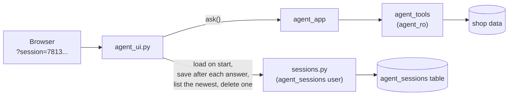

# Sessions: the conversation survives a restart

Harness checklist section 5. Before this, the page kept the conversation in Streamlit's memory
(`st.session_state`). A redeploy, Cloud Run replacing or scaling the container to zero, or a
browser refresh lost it, so a follow-up like "and what about CNC-03?" had nothing to refer back to.

Now `scripts/sessions.py` saves each conversation to a MySQL table, `agent_sessions`, after every
answer. The page puts the conversation's id in its link (`?session=...`). Opening that link
again, after a restart or on another device, loads the conversation back. The next question then
goes to the model with the whole earlier conversation, exactly as if nothing had happened. The
sidebar also lists the eight newest saved conversations, so one can be reopened without its link
([below](#recent-conversations-in-the-sidebar)), and **Delete this conversation** removes the
one on the page ([below](#deleting-a-conversation)).



## Who can touch it (PDPA)

This is the same idea as `agent_user.py`: each part of the app gets only the rights it needs.

| MySQL user | Can | Can't |
|---|---|---|
| `agent_sessions` (new) | `SELECT`, `INSERT`, `UPDATE`, `DELETE` on `agent_sessions`, and nothing else | read any shop data, read employee names, write any other table, create or change tables |
| `agent_ro` (unchanged) | read the linking views, as before | read `agent_sessions`. The model's tools (`query_sql` included) can't see anyone's conversation |

The app never connects as the owner (`DB_USERNAME`), and `agent_ro` stays read-only. Saving
conversations doesn't give the model's side any write access.

## What is stored

One row per conversation:

| Column | What |
|---|---|
| `session_id` | 32 random hex characters (`secrets.token_hex(16)`), the id in the link |
| `messages` | The model's conversation as JSON, **without the system prompt**. The system prompt always comes fresh from code, so a prompt change applies to old conversations too, and a tampered row can't add one: a stored `system` message makes the row unreadable, and the page starts afresh |
| `display` | A light copy of what the page drew: each question and answer, its sources, caveats and cost (the cost line, and since 10 Nov 2026 the cost as a number, `cost_usd` and `cost_complete`, for the conversation's total). No photos (large, and in the database already) and no "What happened" table |
| `turns`, `created_at`, `updated_at` | Question count and UTC timestamps |

**A refused question is stored only as a placeholder.** In `messages`, `ask()` keeps a refused
question only as `[question withheld by the guardrail: pdpa]` (or `injection`, `out_of_scope`),
and an answer the guardrail blocked has already been replaced. The page's `display` copy now
does the same: `agent_ui.kept_question()` runs each question through the guardrail again before
it is saved, and again when a conversation is drawn back. So neither a name typed into a
question nor a leaked answer is stored (tested in both places).

> **Corrected 9 Nov 2026.** Until then the `display` copy kept a refused question **as typed**:
> only `messages` held the placeholder, and the test saved an empty display. A staff name typed
> into a question was stored in `agent_sessions.display` and shown again when the conversation
> was reloaded. Found while adding the sidebar list. Rows saved before the fix are cleaned when
> they are drawn (`restored()` runs the same check), and they are deleted by the 7-day retention.
> To remove them at once, empty the table as the admin (`DELETE FROM agent_sessions;`): every
> saved conversation goes, and the table, user and grant stay. `purge` can't do it, because a
> retention below 1 day counts as 1.

**Only whole turns are stored (11 Nov 2026).** A click on the page while a question is being
answered makes Streamlit stop the script and run it again. Before the fix this could leave the
model's tool call in `messages` without its result, the page then saved it, and the chat API
refused every later question in that conversation ("An assistant message with 'tool_calls'
must be followed by tool messages..."). Now `ask()` works on a copy and puts it back only when
the turn is finished, so a cut-off question leaves nothing behind, and a conversation saved
broken before the fix is mended the next time it is asked
([`agent_app.md`](agent_app.md)). The page drops the unanswered question from its display and
says so once.

**Retention.** Conversations not touched for `AGENT_SESSION_DAYS` days (default 7) are deleted
when the page starts, and by `python scripts/sessions.py purge`. A value below 1 counts as 1,
so a typo can't delete everything at once. One conversation can also be deleted at once from
the page ([below](#deleting-a-conversation)).

**Who can see a conversation.** Anyone with a conversation's link can open it. The id is 128
random bits and can't be guessed, but treat the link like the conversation itself. Anyone who
gets past the page password also sees the **titles of the eight newest conversations** in the
sidebar and can open them (and delete them): the page has one shared password and no user
accounts, so everyone behind it sees the same list. A title is the conversation's first
question as `messages` keeps it, so a refused question shows only as its placeholder. On the
hosted page, `APP_PASSWORD` still comes first.

## Set it up

Add to `.env` (and the same settings on Cloud Run, below):

```bash
AGENT_SESSION_DB_USERNAME=agent_sessions   # the default
AGENT_SESSION_DB_PASSWORD=...              # a new password, not agent_ro's or the owner's
AGENT_SESSION_DAYS=7                       # optional
```

Then, as with `agent_user.py` (it uses `DB_ADMIN_USERNAME`/`DB_ADMIN_PASSWORD`, falling back to
`MYSQL_ROOT_PASSWORD`):

```bash
python scripts/sessions.py setup --dry-run   # the table, the user and the grant; password hidden; no database
python scripts/sessions.py setup             # create them as the admin, then run the check
python scripts/sessions.py check             # only the check (exit 1 if anything is wrong)
python scripts/sessions.py purge             # delete conversations older than the retention
```

With uv (personal repo): `uv run python scripts/sessions.py setup`. No new packages are needed:
it uses SQLAlchemy and PyMySQL, which the app already has.

`setup` runs `CREATE TABLE IF NOT EXISTS`, so it never touches saved conversations. It drops and
recreates the user, so the grants are always exactly these:

```sql
CREATE USER 'agent_sessions'@'%' IDENTIFIED BY ****;
GRANT SELECT, INSERT, UPDATE, DELETE ON `defaultdb`.`agent_sessions` TO 'agent_sessions'@'%';
```

The password is bound as a parameter, never written into the SQL, and never printed. The
sidebar list and the Delete button need no new grant: they are a `SELECT` and a `DELETE` on the
same table, which the user already had for saving and for the retention.

## The check

The check connects **as the session user**. It must be able to use its own table, and every
probe of anything else must be refused:

```
Allowed (must work):
  ok      save a conversation
  ok      read it back
  ok      update it
  ok      delete it
Blocked (must fail):
  ok      the shop data: denied
  ok      employee names: denied
  ok      writing shop data: denied
  ok      changing the schema: denied

Passed: the session user can keep conversations and do nothing else.
```

The allowed probes use a fixed all-zero id and delete their row again. A probe that unexpectedly
works is a FAIL. If the `CREATE TABLE` probe worked, the check drops its table again. A missing
shop table counts as blocked; any other error is a FAIL. Run it live on demo day next to
`agent_user.py --check`. Passed against Aiven on 9 Nov 2026. "delete it" is the same statement
the Delete button runs.

## On the page

- **Start.** The page reads `?session=` from its link. If the store has that conversation, the
  page loads it: the answers are drawn again, and the model gets the messages. Otherwise the page
  starts a new conversation with a new id and puts it in the link.
- **After each answer.** The conversation is saved. The sidebar says "Saved after every answer.
  Keep this page's link to come back to it."
- **New conversation.** A new id goes in the link. The old conversation stays saved under its
  own link until the retention deletes it.
- **Delete this conversation.** Removes the conversation on the page from the store, after a
  confirm ([below](#deleting-a-conversation)).
- **A question cut off by a click.** The question is taken off the page and a note says it
  wasn't answered and can be asked again. Nothing of it is saved.
- **Spend.** "This conversation: $0.0023 over 2 questions", in the usage popover (the icon at
  the right of the top bar), is added up from the answers on the page
  (`agent_ui.conversation_spend`), so a conversation reopened from its link or from the list
  shows what it has cost, and a new one shows $0
  ([below](#the-conversations-spend-after-a-reload)).
- **Honest degradation (#4).** If the store isn't configured, the sidebar warns "Conversations
  aren't being saved (AGENT_SESSION_DB_PASSWORD isn't set). This one lasts until the page
  closes." If MySQL is down or refuses, it warns "This conversation isn't being saved right
  now". Either way the page carries on in memory. `SessionStore.load`, `save`, `recent`,
  `delete` and `purge` never raise, and their messages name the error type only, never the
  server's text.
- **A link the store can't read** (store down, or a corrupt row) gets a new id rather than reusing
  the old one. A later save then can't overwrite the saved conversation with a shorter one.

### Recent conversations in the sidebar

Under **New conversation**, the sidebar's **Recent** list shows the eight conversations
answered most recently (`RECENT` in `agent_ui.py`), newest first. Until 10 Nov 2026 it showed
three, between the saved line and the spend; the sidebar now holds only conversations
([`agent_ui.md`](agent_ui.md#what-the-page-shows)):

```
Recent
  What oil does CNC-03 take? (2 questions, open now)        <- the one on the page, greyed out
  Is CNC-02 running differently now? (1 question, 3 h ago)
  [question withheld by the guardrail: pdpa] (1 question, 1 d ago)
```

- **Title.** The first question, as `messages` keeps it (`sessions.title_of`): a refused
  question shows only as its placeholder, never as typed. Cut to 60 characters. Markdown
  characters are escaped, so a title shows exactly as stored (Streamlit reads `$...$` as maths).
- **Clicking one** opens it on the page, as opening its link would: the answers are drawn again,
  the model gets its messages, the link changes to its id, and the usage popover shows that
  conversation's total. If it can't be loaded, the sidebar says why and the page stays as it was.
- **Which rows.** `SessionStore.recent(n)` reads only rows inside the retention, newest
  `updated_at` first, at most 10. A row that `load()` would refuse (unreadable, a stored `system`
  message, a bad id) isn't listed.
- **When it updates.** The list is read once per page run, before the question. A conversation
  saved by this answer shows from the next click on.
- **Store down:** "Couldn't list saved conversations right now." No store configured: the
  list isn't shown (the sidebar's saved line already says conversations aren't saved).

### Deleting a conversation

Added 11 Nov 2026. Once the conversation on the page has an answer and the store is set up, a
**bin icon** sits to the left of the question box at the bottom of the page (its tooltip:
"Delete this conversation"). It opens a small panel: "Deletes this conversation from the saved
conversations now, for good, and starts a new one. Its link will open a new conversation." and
a **Delete** button. (It was at the bottom of the sidebar for the first hour; moved by request.)

- **How it sits there.** Streamlit pins the question box to the bottom only at the top level of
  the page, so the bin and the box go together in Streamlit's own pinned bottom container
  (`st.bottom`; first written with `st._bottom`, which Streamlit warns will be removed after
  2026-07-01), in two columns, the bin's shrunk to the icon by CSS (`INPUT_CSS`, marker
  `INPUT_MARKER`). On a Streamlit without `st.bottom`, the page puts the
  bin back in the sidebar and the box works as before.
- **The bin's height.** It is made exactly as tall as the question box by a small script in an
  invisible component (`fit_bin_script`, like the scroll to a new question): it measures the
  box and sets the bin's height to match, again whenever the box changes size (a long
  question). CSS alone didn't manage it: Streamlit sizes the popover's wrappers itself.
  Checked in Chromium on a mock of the bar (58 px, then 92 px after the box grew); on the real
  page it relies on the box's `stChatInput` test id. The user confirmed the height on the
  page (11 Nov 2026, 20:15).
- **No down arrow.** Streamlit draws an arrow on every popover button; the same script hides
  it on the bin (the `expand_more` / `expand_less` icon, or an older SVG chevron), and hides it
  again if Streamlit redraws it when the panel opens. The bin icon itself is kept. Without the
  arrow the button was thin, so the script also makes it square (width = height), the icon
  centred, with priority over Streamlit's own rules, and gives every wrapper up to the bin's
  column room for it: on the page the first try left it thin (a narrow column clipped it).
  Checked in Chromium on a mock with a narrow, clipping column: 24 × 56 px before, 56 × 56 after.
- **A shorter bar** (asked for 11 Nov 2026, 21:12). The question box's text padding and line
  height are trimmed (`INPUT_PAD`, `INPUT_LINE` in `agent_ui.py`; tune them there), and the bin
  follows the box. On a mock with Streamlit-like padding: 52 px tall before, 33 px after.
- **A bigger bin icon** (22:42). The script draws it at `DELETE_ICON_SCALE` (0.6) of the
  button's height, so it stays in proportion with the bar: 24 px on a 40 px button.

- **Delete** runs `SessionStore.delete(sid)`: one `DELETE ... WHERE session_id = :sid`, the id
  checked first, as for every other statement. The page then starts a new conversation with a
  new id, and the deleted one is gone from **Recent**. Its old link opens a new conversation.
- **Nothing to undo.** The row is deleted, not hidden. Saved conversations hold no shop data
  (that stays in the database the tools read), so only the conversation itself is lost.
- **A conversation that was never saved, or already deleted or purged**, counts as deleted:
  either way it is gone.
- **If the store is down**, the sidebar says "Not deleted: couldn't delete the conversation
  (OperationalError)." and the page stays as it was. Like the rest of the store, `delete` never
  raises and names only the error type.
- **To delete another conversation**, open it from **Recent** first, then delete it.

### The conversation's spend after a reload

> **Fixed 10 Nov 2026.** The sidebar's spend was a counter in the page's memory ("This session:
> ..."), started at $0 on every page load and reset when a conversation was opened from the
> list. So a conversation reopened after a restart, or picked from **Recent conversations**,
> showed "$0.0000 over 0 questions" above answers that each showed their cost.

The page now shows **"This conversation: $X over N questions"** (in the usage popover since
the layout of 10 Nov 2026; its tooltip shows the same total), added up from the conversation
itself every time it is drawn (`agent_ui.conversation_spend`): N is the questions on the page,
$X the sum of each answer's cost. There is no counter to keep in step, so a reload, a restart,
opening a link or picking from the list all show the same figure, and **New conversation**
shows $0.

- **Each answer's cost** is the proxy's `x-litellm-response-cost` for its model calls, kept with
  the answer as a number (`cost_usd`, `cost_complete`) and saved with the display copy.
- **Conversations saved before the fix** have only the cost line under each answer ("2 model
  calls, 9,936 tokens, $0.0012"), so their cost is read back from that line, to its 4 decimal
  places. A refusal ("No model calls: answered in code.") costs $0.
- **"at least $X"** when any answer's cost isn't known (a call came back without the cost
  header, or an old answer has no cost line): the total is then a lower bound, as under the
  answer itself.
- A stored `cost_usd` that isn't a plain non-negative number (a tampered row) is ignored and the
  cost line used instead.
- The **key's** spend against its budget, under it, is unchanged: it comes from the proxy
  (`spend.py`, about a minute behind) and covers every conversation on the key.

**Limits.**
- Restored answers show their text, sources, caveats and cost, but not their photos or "What
  happened" table (so they have no Photos or What happened tab).
- Two tabs on the same link both save to one row, and the last answer saved wins.
- Everyone behind the page password sees the same list, and can delete from it (above).

## How it is built

`SessionStore` runs its SQL through a small `run(sql, params)` function, the same pattern
`agent_tools.py` uses. In the app it is `mysql_run(engine)` (SQLAlchemy `text()` in a
transaction). In the tests it is `sqlite_run(conn)` on Python's built-in `sqlite3`, so the same
SQL and `:name` parameters run on both, and the tests need no MySQL.

A save is an `UPDATE`, then an `INSERT` if no row matched. Timestamps come from Python, in UTC.

| Piece | What it does |
|---|---|
| `new_session_id()`, `valid_id()` | The id, and the check every id passes before it reaches SQL |
| `SessionStore.load/save/purge` | Never raise; `Loaded(ok, found, messages, display, error)` |
| `SessionStore.delete(sid)` | One conversation deleted on request; `(ok, error)`, never raises; a bad id never reaches SQL |
| `SessionStore.recent(n)`, `Recent`, `title_of()`, `messages_ok()` | The newest conversations for the sidebar, titled from `messages`; the same row check `load()` uses |
| `store_from_env()` | `(store, None)`, or `(None, why)` when settings are missing. Never falls back to `agent_ro` or the owner |
| `setup_statements()`, `check()` | The table, user and grant; the probes, classified by MySQL error code |
| `agent_ui.display_copy()`, `restored()`, `kept_question()`, `save_line()` | What the page saves (refused questions as placeholders), how it comes back (cleaned again), what the sidebar says |
| `agent_ui.recent_label()`, `ago()`, `md_plain()` | One line of the sidebar list: title, question count, how long ago or "open now", escaped |
| `agent_ui.delete_conversation()`, `show_delete()`, `DELETE_ICON`, `DELETE_LABEL`, `DELETE_WARNING`, `INPUT_CSS` | The bin left of the question box: shown once there's a saved answer; `None` when gone, else why not |
| `agent_ui.drop_unanswered()`, `interrupted_line()` | A question cut off by a click taken off the page, and the note that says so |
| `agent_ui.conversation_spend()`, `conversation_line()` | The conversation's spend in the usage popover, added up from its answers (old rows from their cost line) |

## Cloud Run

Add the secret and the settings (section 1 and 2 of
[Deploying on Cloud Run](agent_ui.md#deploying-on-google-cloud-run)):

```bash
printf '%s' 'THE_SESSION_PASSWORD' | gcloud secrets create agent-session-db-password --data-file=-
gcloud secrets add-iam-policy-binding agent-session-db-password --member=serviceAccount:$SA \
    --role=roles/secretmanager.secretAccessor
```

Then, in the deploy command, add `AGENT_SESSION_DB_USERNAME=agent_sessions` to
`--set-env-vars` and `AGENT_SESSION_DB_PASSWORD=agent-session-db-password:latest` to
`--set-secrets`. Run `setup` once from your computer, against Aiven, before the deploy. Live on
the hosted page since 9 Nov 2026.

**To prove it on the hosted page:**
1. Ask a question and copy the link.
2. Run `gcloud run services update jme-agent --region $REGION --update-env-vars RESTART=$(date +%s)`. This starts a new revision, so a new container with empty memory.
3. Open the link and ask a follow-up ("and what about CNC-03?"). It is answered in context.
   Or open the page without a link and pick the conversation from **Recent** in the sidebar.
   The usage popover shows the conversation's total, not $0.

## Tests

`tests/test_sessions.py` (47 tests, sqlite3, no MySQL) and 13 in `tests/test_agent_ui.py`:

- **Ids.** Random, 32 hex characters; anything else, an injection attempt included, never reaches
  the database.
- **Saving and loading.**
  - A conversation round-trips without its system prompt.
  - Saving again updates the row, keeps `created_at` and counts turns.
  - Values that aren't JSON are stored as text.
  - An unknown id is simply "not found".
  - A corrupt or tampered row (bad JSON, not a list, a stored `system` message) starts afresh.
  - A down database never raises.
- **Purge.** It deletes only rows older than the retention.
- **Deleting one (11 Nov 2026).** Only that row goes, its link then finds nothing and it leaves
  the sidebar list; one never saved (or already gone) is fine; a bad id, an injection attempt
  included, never reaches the database; a down database never raises and names only the error
  type. On the page: Delete removes it from the store, and a failed delete says why.
- **Settings.** Defaults apply; a bad or zero retention is handled; Windows line endings are
  stripped; the store never falls back to the admin or read-only password.
- **Setup and check.**
  - Setup grants exactly four privileges on one table, with the password bound; odd names are refused.
  - The check passes only when the session user's own table works and everything else is refused. It fails if the user can read shop data or names, or if its own table is refused.
  - A probe table that shouldn't exist is dropped.
  - A missing shop table counts as blocked; an odd error counts as a failure.
  - The dry run shows the SQL without the password.
- **The restart, end to end.**
  1. A question is asked through `ask()` and saved.
  2. The conversation is dropped and a new store object loads it.
  3. A follow-up is asked: the model receives the system prompt once, the earlier question and answer, then the follow-up.
  4. A question the guardrail refused is stored only as its placeholder.
- **The sidebar list.** Newest first with their first question; a refused question (asked through
  the real `ask()`) listed only as its placeholder; expired, unreadable and tampered rows and bad
  ids left out; a down database giving `None`, never an exception; at most ten asked for, none
  when none are wanted; a long title shortened.
- **The page.** The saved display has no photos or trace; a loaded conversation gets a fresh
  system prompt and only drawable rows; the sidebar says honestly whether the conversation is
  kept; **a refused question saved and redrawn only as its placeholder** (PDPA and injection,
  the page's own copy untouched, a row saved before the fix cleaned when drawn); how long ago,
  from a datetime or sqlite's text; each list line, the open one marked, Markdown and `$`
  escaped; **a question cut off by a click** (11 Nov 2026) taken off the page and named, a
  refused one only as its placeholder.
- **The conversation's spend (10 Nov 2026).** A reopened conversation shows what it cost, not $0,
  through the save and load; an answer with an unknown cost makes the total "at least"; rows
  saved before the fix read from their cost line, a refusal costing $0; a new conversation $0;
  a tampered `cost_usd` never trusted.

`main()` itself, the bin and its panel included, needs Streamlit and was run only with a
stand-in Streamlit (the cut-off note, Delete, the fresh page after it); try it on the real page.